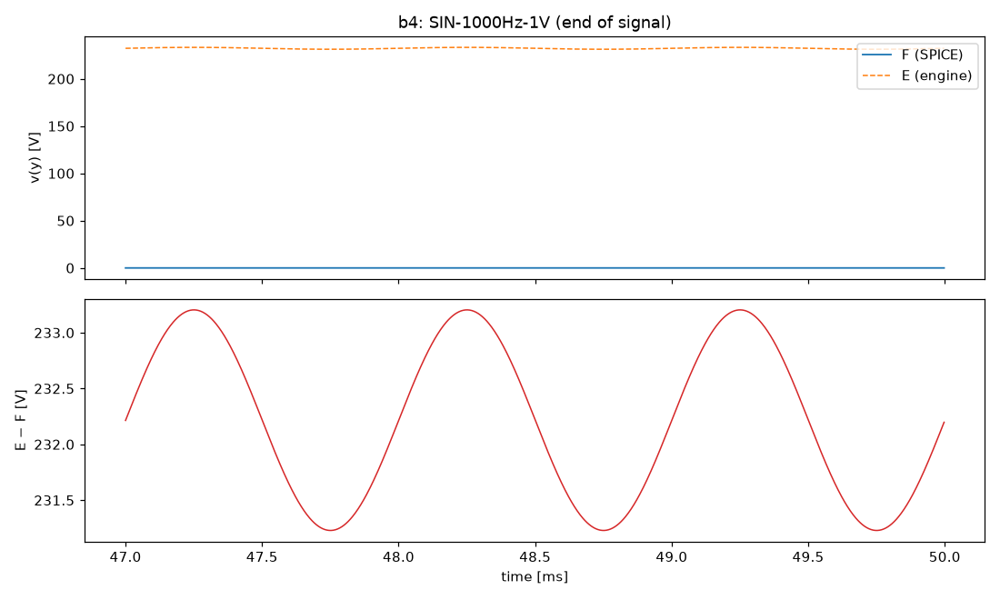
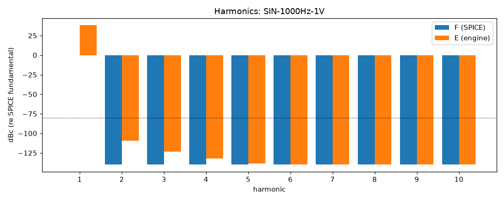

# M0 report: b4 / PIPE

- Block: B4 ToneStackMaster
- Preset: PIPE — Pipeline smoke test: one 50 ms nominal 1 kHz sine
- Knobs: preampVolume=0.6, treble=0.5, middle=0.5, bass=0.5, master=0.3, presence=0.5
- Date: 2026-10-12
- Engine commit: `f311402 (dirty)`
- Testbench: `harness/testbenches/b4.cir` sha256 `da3acedcd275787b`; netlist sha256 `5b0b8095ad124450`; tubes.lib sha256 `9ec33154be8127d7`
- ngspice 47, fs = 384000 Hz

## Summary

PASS 0 · FAIL 0 · INFO 4 (INFO = measured, not scored in M0)

| Check | Item | Measured | Tolerance | Status |
|---|---|---|---|---|
| nonlinear_esr_db | SIN-1000Hz-1V | 38.14 dB | ≤ -40 | INFO |
| harmonics_2_5_db | SIN-1000Hz-1V | — | ≤ 0.5 | INFO |
| thd_pp | SIN-1000Hz-1V | 4.504e-07 pp | — | INFO |
| newton_failures | SIN-1000Hz-1V | 0 | ≤ 0 | INFO |

## Signals

| Signal | Peak F [V] | ESR [dB] | Best lag | ESR at lag [dB] | THD F / E [%] | Power F / E [W] | ns/sample | Newton fail / max it |
|---|---|---|---|---|---|---|---|---|
| SIN-1000Hz-1V | 0.01377 | 38.14 | 2 | 38.14 | 4.59e-06 / 4.14e-06 | — | 0.0 | 0 / 0 |

## DC operating point

| Node | SPICE [V] | Engine [V] | Rel. error |
|---|---|---|---|
| k2b | 232.2165 | — | — |
| mw | 0.0000 | — | — |
| nbb | 0.0000 | — | — |
| nd | 232.2165 | — | — |
| ne | 0.0000 | — | — |
| tt | 0.0000 | — | — |
| tw | 0.0000 | — | — |
| y | 0.0000 | — | — |

Engine values are the probe values after the first sample (zero input) following `reset()`. Nodes the engine does not probe yet show —.

## Figures

### Waveform overlay and error (most demanding signal)

### Harmonics

