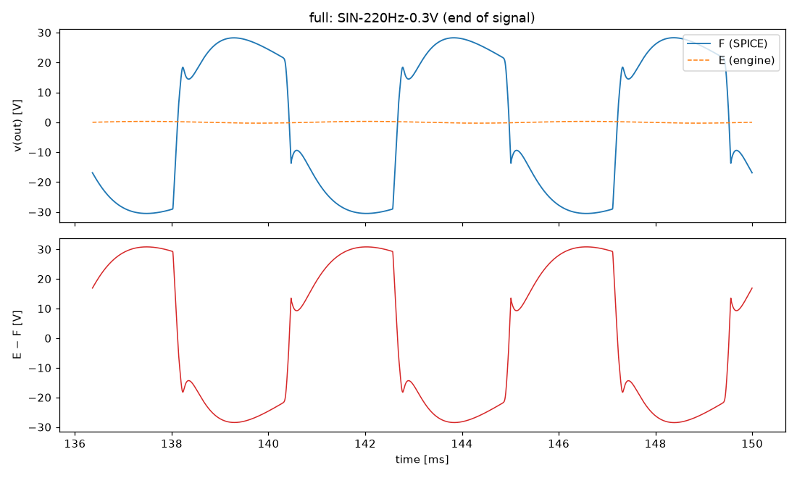
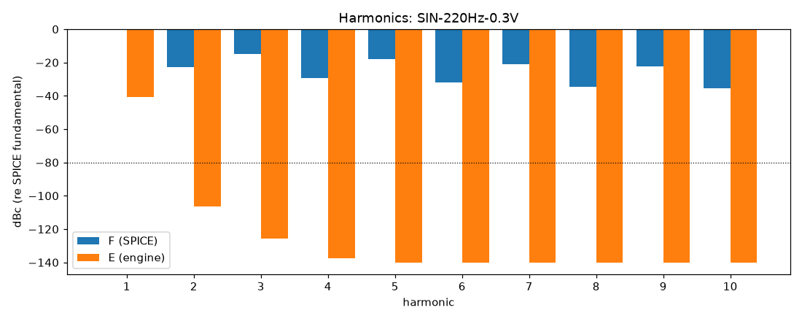

# M0 report: full / DRIVE

- Block: Full amplifier (reference F)
- Preset: DRIVE — 300 mV peak 220 Hz, DI clips
- Knobs: preampVolume=1, treble=0.5, middle=0.5, bass=0.5, master=0.3, presence=0.5
- Date: 2026-10-12
- Engine commit: `f311402 (dirty)`
- Testbench: `harness/testbenches/full.cir` sha256 `9c21536867160578`; netlist sha256 `5b0b8095ad124450`; tubes.lib sha256 `9ec33154be8127d7`
- ngspice 47, fs = 384000 Hz, reference: F (full netlist)

## Summary

PASS 0 · FAIL 0 · INFO 5 (INFO = measured, not scored in M0)

| Check | Item | Measured | Tolerance | Status |
|---|---|---|---|---|
| total_esr_db | SIN-220Hz-0.3V | 0.06204 dB | ≤ -20 | INFO |
| harmonics_2_5_db | SIN-220Hz-0.3V | 127.5 dB | ≤ 0.5 | INFO |
| total_thd_pp | SIN-220Hz-0.3V | 25.98 pp | ≤ 0.5 | INFO |
| total_power_rel | SIN-220Hz-0.3V | 0.9999 | ≤ 0.05 | INFO |
| newton_failures | SIN-220Hz-0.3V | 0 | ≤ 0 | INFO |

## Signals

| Signal | Peak F [V] | ESR [dB] | Best lag | ESR at lag [dB] | THD F / E [%] | Power F / E [W] | ns/sample | Newton fail / max it |
|---|---|---|---|---|---|---|---|---|
| SIN-220Hz-0.3V | 38.51 | 0.06 | -2 | 0.06 | 26 / 0.0531 | 36.68 / 0.002828 | 0.9 | 0 / 0 |

## DC operating point

| Node | SPICE [V] | Engine [V] | Rel. error |
|---|---|---|---|
| ct | 488.4450 | — | — |
| nscr | 486.8281 | — | — |
| bpx | 403.3067 | — | — |
| bpa | 390.2867 | — | — |
| nbias | -46.3636 | — | — |
| p1a | 297.1034 | — | — |
| k1a | 2.5159 | — | — |
| p1b | 353.2707 | — | — |
| k1b | 3.7016 | — | — |
| p2a | 231.6574 | — | — |
| k2a | 1.4075 | — | — |
| k2b | 232.2162 | — | — |
| p3a | 271.5119 | — | — |
| p3b | 262.8834 | — | — |
| k3 | 45.0489 | — | — |
| nf | 43.6335 | — | — |
| ng | 13.5186 | — | — |

Engine values are the probe values after the first sample (zero input) following `reset()`. Nodes the engine does not probe yet show —.

## Figures

### Waveform overlay and error (most demanding signal)

### Harmonics

