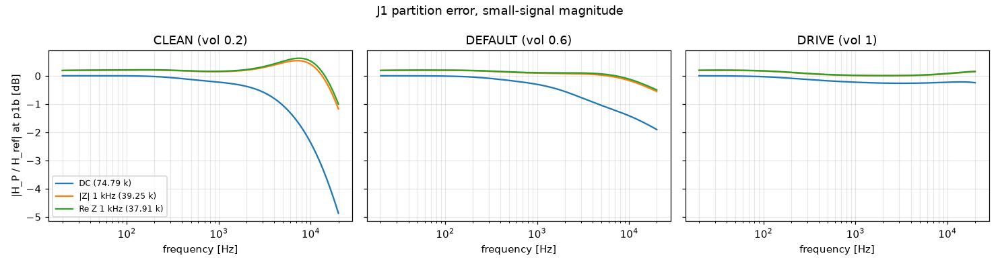

# M0 partition-error study: J1

- Date: 2026-10-12, ngspice 47, reltol 1e-06
- P chain: b1 (output p1a open) -> b2 (J-Thevenin source driven by the recorded open-circuit p1a, through R_th). Reference: b12 (b1 and b2 joined, no junction). Same constant supply in both.
- Compared node: p1b; also the junction node p1a (loaded) as information. All time-domain metrics on node voltage minus its DC operating point.
- Candidates: DC = 74791.6 Ω, |Z| 1 kHz = 39253.2 Ω, Re Z 1 kHz = 37906 Ω
- Tolerance context (not scored here): partition error at y (M3) ≤ −26 dB sines, ≤ −20 dB DI (VERIFICATION §7).

## Summary (worst case over the signal set)

| Preset | Candidate | Worst ESR | Worst ESR (SIN only) | Worst h1 diff | Worst harm. 2–5 diff | Small-signal max dB error 20 Hz–10 kHz | 10–20 kHz |
|---|---|---|---|---|---|---|---|
| CLEAN | DC | -6.8 dB | -8.7 dB | 1.053 dB | 12.4 dB | 2.305 dB | 4.868 dB |
| CLEAN | |Z| 1 kHz | -11.0 dB | -11.2 dB | 1.174 dB | 21.5 dB | 0.542 dB | 1.170 dB |
| CLEAN | Re Z 1 kHz | -11.2 dB | -11.2 dB | 1.220 dB | 20.8 dB | 0.626 dB | 1.000 dB |
| DEFAULT | DC | -14.8 dB | -14.8 dB | 1.048 dB | 6.12 dB | 1.398 dB | 1.901 dB |
| DEFAULT | |Z| 1 kHz | -17.6 dB | -17.6 dB | 0.197 dB | 5.03 dB | 0.199 dB | 0.551 dB |
| DEFAULT | Re Z 1 kHz | -17.6 dB | -17.6 dB | 0.205 dB | 5.02 dB | 0.206 dB | 0.496 dB |
| DRIVE | DC | -22.6 dB | -22.6 dB | 0.260 dB | 2.43 dB | 0.261 dB | 0.242 dB |
| DRIVE | |Z| 1 kHz | -19.3 dB | -19.3 dB | 0.249 dB | 5.28 dB | 0.198 dB | 0.146 dB |
| DRIVE | Re Z 1 kHz | -19.1 dB | -19.1 dB | 0.259 dB | 5.08 dB | 0.205 dB | 0.160 dB |

## Per signal (ESR at p1b / at p1a, dB)

| Preset | Signal | DC | |Z| 1 kHz | Re Z 1 kHz |
|---|---|---|---|---|
| CLEAN | SIN-100Hz-0.01V | -38.4 / -38.6 | -32.4 / -32.4 | -32.1 / -32.1 |
| CLEAN | SIN-1000Hz-0.01V | -21.9 / -21.9 | -32.9 / -32.9 | -33.0 / -33.0 |
| CLEAN | SIN-5000Hz-0.01V | -10.5 / -10.5 | -19.5 / -19.5 | -19.8 / -19.8 |
| CLEAN | SIN-100Hz-0.1V | -38.4 / -38.6 | -32.4 / -32.4 | -32.1 / -32.1 |
| CLEAN | SIN-1000Hz-0.1V | -21.9 / -21.9 | -32.9 / -32.9 | -32.9 / -33.0 |
| CLEAN | SIN-5000Hz-0.1V | -10.5 / -10.5 | -19.5 / -19.5 | -19.8 / -19.8 |
| CLEAN | SIN-100Hz-0.5V | -38.4 / -38.6 | -32.4 / -32.4 | -32.1 / -32.1 |
| CLEAN | SIN-1000Hz-0.5V | -21.8 / -21.9 | -32.1 / -32.6 | -32.1 / -32.6 |
| CLEAN | SIN-5000Hz-0.5V | -10.5 / -10.5 | -18.8 / -19.3 | -19.1 / -19.6 |
| CLEAN | SIN-100Hz-2V | -38.4 / -38.7 | -32.2 / -32.2 | -31.9 / -31.9 |
| CLEAN | SIN-1000Hz-2V | -20.4 / -21.8 | -26.1 / -28.6 | -26.1 / -28.5 |
| CLEAN | SIN-5000Hz-2V | -8.7 / -10.8 | -11.2 / -15.9 | -11.2 / -15.9 |
| CLEAN | SWP-lo-0.01V | -6.8 / -14.2 | -11.0 / -20.3 | -11.2 / -20.5 |
| CLEAN | TT-0.05V | -29.6 / -29.9 | -32.4 / -32.4 | -32.1 / -32.1 |
| CLEAN | BURST-0.5V | -21.8 / -21.9 | -32.1 / -32.6 | -32.1 / -32.6 |
| CLEAN | STEP-0.1V | -8.5 / -25.9 | -12.1 / -30.5 | -12.3 / -30.4 |
| DEFAULT | SIN-100Hz-0.01V | -38.9 / -38.9 | -32.7 / -32.7 | -32.4 / -32.4 |
| DEFAULT | SIN-1000Hz-0.01V | -23.5 / -23.6 | -34.6 / -34.6 | -34.6 / -34.6 |
| DEFAULT | SIN-5000Hz-0.01V | -16.0 / -16.0 | -25.5 / -25.5 | -25.9 / -25.9 |
| DEFAULT | SIN-100Hz-0.1V | -38.9 / -38.9 | -32.7 / -32.7 | -32.4 / -32.4 |
| DEFAULT | SIN-1000Hz-0.1V | -23.6 / -23.6 | -34.5 / -34.6 | -34.6 / -34.6 |
| DEFAULT | SIN-5000Hz-0.1V | -16.1 / -16.0 | -25.5 / -25.5 | -25.8 / -25.8 |
| DEFAULT | SIN-100Hz-0.5V | -38.9 / -39.0 | -32.8 / -32.7 | -32.4 / -32.4 |
| DEFAULT | SIN-1000Hz-0.5V | -23.7 / -23.6 | -33.6 / -34.2 | -33.7 / -34.2 |
| DEFAULT | SIN-5000Hz-0.5V | -15.8 / -16.1 | -24.2 / -25.2 | -24.5 / -25.5 |
| DEFAULT | SIN-100Hz-2V | -39.2 / -39.1 | -33.7 / -32.5 | -33.4 / -32.2 |
| DEFAULT | SIN-1000Hz-2V | -22.3 / -23.8 | -28.6 / -29.6 | -28.7 / -29.4 |
| DEFAULT | SIN-5000Hz-2V | -14.8 / -16.3 | -17.6 / -20.3 | -17.6 / -20.2 |
| DEFAULT | SWP-lo-0.01V | -15.2 / -18.8 | -22.3 / -26.3 | -22.6 / -26.6 |
| DEFAULT | TT-0.05V | -30.6 / -30.8 | -33.4 / -33.3 | -33.1 / -33.0 |
| DEFAULT | BURST-0.5V | -23.7 / -23.6 | -33.6 / -34.2 | -33.7 / -34.2 |
| DEFAULT | STEP-0.1V | -19.4 / -29.1 | -26.7 / -32.3 | -26.9 / -32.1 |
| DRIVE | SIN-100Hz-0.01V | -39.6 / -39.6 | -33.3 / -33.3 | -33.0 / -33.0 |
| DRIVE | SIN-1000Hz-0.01V | -30.4 / -30.4 | -41.6 / -41.6 | -41.7 / -41.7 |
| DRIVE | SIN-5000Hz-0.01V | -26.7 / -26.7 | -37.0 / -37.0 | -37.5 / -37.4 |
| DRIVE | SIN-100Hz-0.1V | -39.6 / -39.6 | -33.4 / -33.3 | -33.1 / -33.0 |
| DRIVE | SIN-1000Hz-0.1V | -30.8 / -30.4 | -41.6 / -41.6 | -41.7 / -41.7 |
| DRIVE | SIN-5000Hz-0.1V | -26.9 / -26.7 | -37.0 / -37.1 | -37.4 / -37.5 |
| DRIVE | SIN-100Hz-0.5V | -39.5 / -39.6 | -33.9 / -33.3 | -33.6 / -33.0 |
| DRIVE | SIN-1000Hz-0.5V | -30.5 / -30.5 | -40.9 / -41.3 | -40.8 / -41.3 |
| DRIVE | SIN-5000Hz-0.5V | -26.2 / -27.1 | -35.5 / -36.9 | -35.8 / -37.2 |
| DRIVE | SIN-100Hz-2V | -39.0 / -39.2 | -40.3 / -32.2 | -40.3 / -31.9 |
| DRIVE | SIN-1000Hz-2V | -30.0 / -30.0 | -28.9 / -32.5 | -28.8 / -32.1 |
| DRIVE | SIN-5000Hz-2V | -22.6 / -27.2 | -19.3 / -27.5 | -19.1 / -27.2 |
| DRIVE | SWP-lo-0.01V | -25.8 / -26.6 | -33.3 / -33.8 | -33.6 / -34.0 |
| DRIVE | TT-0.05V | -33.9 / -33.8 | -36.2 / -36.1 | -35.9 / -35.8 |
| DRIVE | BURST-0.5V | -30.5 / -30.5 | -40.9 / -41.3 | -40.8 / -41.3 |
| DRIVE | STEP-0.1V | -33.9 / -35.0 | -33.9 / -33.8 | -33.7 / -33.5 |
