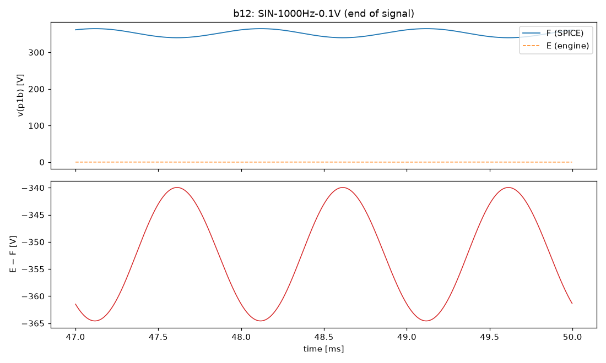
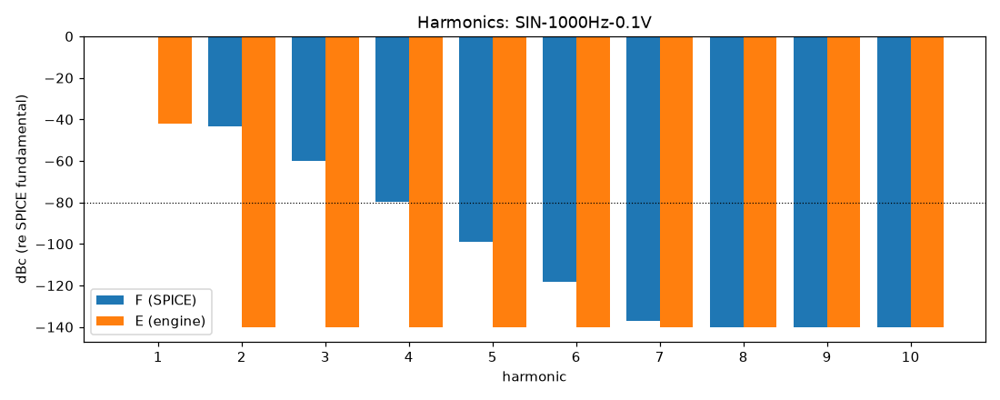

# M0 report: b12 / PIPE

- Block: B12 StageV1aV1b (V1a + V1b, joint root)
- Preset: PIPE — Pipeline smoke test: one 50 ms nominal 1 kHz sine
- Knobs: preampVolume=0.6, treble=0.5, middle=0.5, bass=0.5, master=0.3, presence=0.5
- Date: 2026-10-13
- Engine commit: `3a47496 (dirty)`
- Testbench: `harness/testbenches/b12.cir` sha256 `eea22b746d2e9e0a`; netlist sha256 `7bea8385e4adb04e`; tubes.lib sha256 `9ec33154be8127d7`
- ngspice 47, fs = 384000 Hz

## Summary

PASS 0 · FAIL 0 · INFO 5 (INFO = measured, not scored in M0)

| Check | Item | Measured | Tolerance | Status |
|---|---|---|---|---|
| dc_rel_error | v(in) | 0 | ≤ 0.005 | INFO |
| nonlinear_esr_db | SIN-1000Hz-0.1V | -0.04674 dB | ≤ -40 | INFO |
| harmonics_2_5_db | SIN-1000Hz-0.1V | 146.5 dB | ≤ 0.5 | INFO |
| thd_pp | SIN-1000Hz-0.1V | 0.699 pp | — | INFO |
| newton_failures | SIN-1000Hz-0.1V | 0 | ≤ 0 | INFO |

## Signals

| Signal | Peak F [V] | ESR [dB] | Best lag | ESR at lag [dB] | THD F / E [%] | Power F / E [W] | ns/sample | Newton fail / max it |
|---|---|---|---|---|---|---|---|---|
| SIN-1000Hz-0.1V | 12.82 | -0.05 | 2 | -0.05 | 0.699 / 4.14e-06 | — | 0.0 | 0 / 0 |

## DC operating point

| Node | SPICE [V] | Engine [V] | Rel. error |
|---|---|---|---|
| bpa | 389.3496 | — | — |
| g1a | 0.0001 | — | — |
| in | 0.0000 | 0 | 0 |
| k1a | 2.5096 | — | — |
| k1b | 3.6917 | — | — |
| na | 0.0002 | — | — |
| p1a | 296.4025 | — | — |
| p1b | 352.4328 | — | — |
| vtop | 0.0002 | — | — |
| w1 | 0.0002 | — | — |

Engine values are the probe values after the first sample (zero input) following `reset()`. Nodes the engine does not probe yet show —.

## Figures

### Waveform overlay and error (most demanding signal)

### Harmonics

