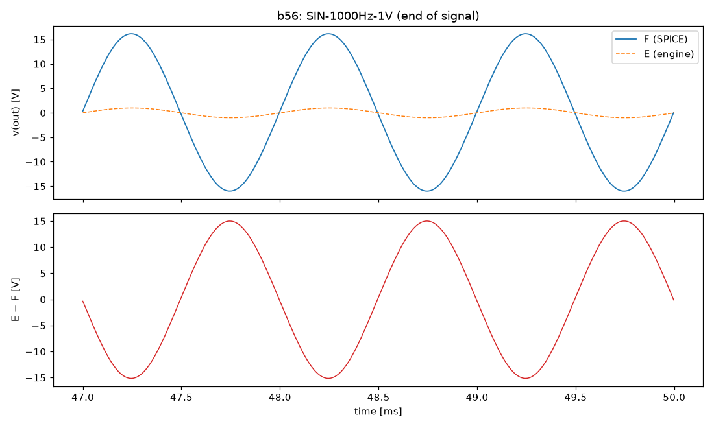
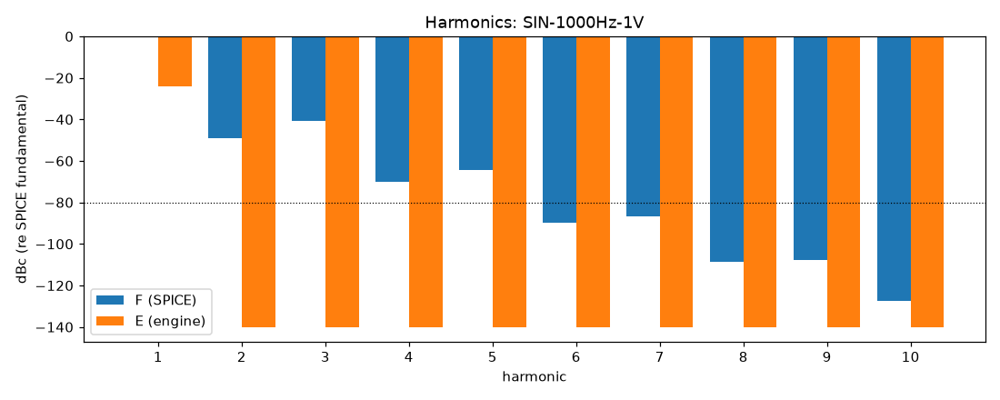

# M0 report: b56 / PIPE

- Block: B56+B7 phase inverter, power stage, supply (instantaneous NFB)
- Preset: PIPE — Pipeline smoke test: one 50 ms nominal 1 kHz sine
- Knobs: preampVolume=0.6, treble=0.5, middle=0.5, bass=0.5, master=0.3, presence=0.5
- Date: 2026-10-13
- Engine commit: `3a47496 (dirty)`
- Testbench: `harness/testbenches/b56.cir` sha256 `33f55c7ac8ebb82b`; netlist sha256 `7bea8385e4adb04e`; tubes.lib sha256 `9ec33154be8127d7`
- ngspice 47, fs = 384000 Hz

## Summary

PASS 0 · FAIL 0 · INFO 6 (INFO = measured, not scored in M0)

| Check | Item | Measured | Tolerance | Status |
|---|---|---|---|---|
| dc_rel_error | v(out) | 0.0423 | ≤ 0.005 | INFO |
| nonlinear_esr_db | SIN-1000Hz-1V | -0.5572 dB | ≤ -40 | INFO |
| harmonics_2_5_db | SIN-1000Hz-1V | 145.2 dB | ≤ 0.5 | INFO |
| thd_pp | SIN-1000Hz-1V | 0.9903 pp | — | INFO |
| total_power_rel | SIN-1000Hz-1V | 0.9961 | ≤ 0.05 | INFO |
| newton_failures | SIN-1000Hz-1V | 0 | ≤ 0 | INFO |

## Signals

| Signal | Peak F [V] | ESR [dB] | Best lag | ESR at lag [dB] | THD F / E [%] | Power F / E [W] | ns/sample | Newton fail / max it |
|---|---|---|---|---|---|---|---|---|
| SIN-1000Hz-1V | 16.88 | -0.56 | 2 | -0.56 | 0.99 / 4.14e-06 | 8.033 / 0.03125 | 0.0 | 0 / 0 |

## DC operating point

| Node | SPICE [V] | Engine [V] | Rel. error |
|---|---|---|---|
| bpa | 389.3496 | — | — |
| bpx | 402.3360 | — | — |
| c20 | -60.0000 | — | — |
| ct | 488.7084 | — | — |
| g3a | 43.5226 | — | — |
| g3b | 43.5226 | — | — |
| g4 | -46.3631 | — | — |
| g5 | -46.3631 | — | — |
| g6 | -46.3631 | — | — |
| g7 | -46.3631 | — | — |
| k3 | 44.9334 | — | — |
| nbias | -46.3636 | — | — |
| nch | 488.7084 | — | — |
| nf | 43.5216 | — | — |
| ng | 13.4840 | — | — |
| ngn | -46.3631 | — | — |
| nor | -46.3631 | — | — |
| npr | 0.0000 | — | — |
| nrv | -3.6364 | — | — |
| nscr | 485.6493 | — | — |
| out | 0.0000 | 0 | 0.0423 |
| p3a | 270.8809 | — | — |
| p3b | 262.2706 | — | — |
| pa | 487.6615 | — | — |
| pa1 | 488.7084 | — | — |
| pb | 487.5797 | — | — |
| pb1 | 488.7084 | — | — |
| raw | 505.0000 | — | — |
| s4 | 481.0819 | — | — |
| s5 | 481.0819 | — | — |
| s6 | 481.0817 | — | — |
| s7 | 481.0817 | — | — |
| sl | 0.0000 | — | — |
| y | 0.0000 | — | — |

Engine values are the probe values after the first sample (zero input) following `reset()`. Nodes the engine does not probe yet show —.

## Figures

### Waveform overlay and error (most demanding signal)

### Harmonics

