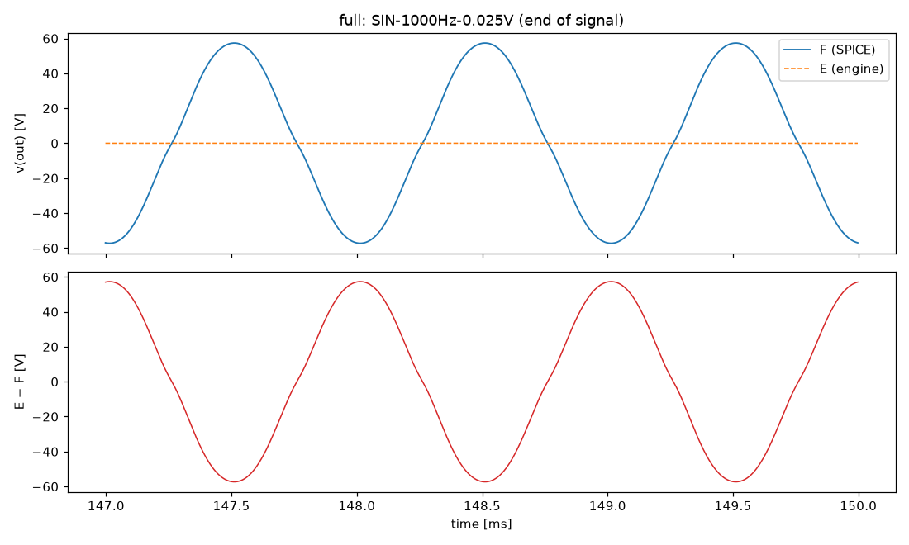
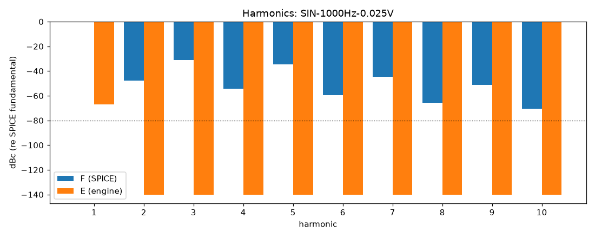

# M0 report: full / CLEAN

- Block: Full amplifier (reference F)
- Preset: CLEAN — 25 mV peak 1 kHz (about 100 W in SPICE)
- Knobs: preampVolume=0.2, treble=0.5, middle=0.5, bass=0.5, master=1, presence=0.5
- Date: 2026-10-13
- Engine commit: `3a47496 (dirty)`
- Testbench: `harness/testbenches/full.cir` sha256 `063103a6d8212d33`; netlist sha256 `7bea8385e4adb04e`; tubes.lib sha256 `9ec33154be8127d7`
- ngspice 47, fs = 384000 Hz, reference: F (full netlist)

## Summary

PASS 0 · FAIL 0 · INFO 5 (INFO = measured, not scored in M0)

| Check | Item | Measured | Tolerance | Status |
|---|---|---|---|---|
| total_esr_db | SIN-1000Hz-0.025V | 0.0002735 dB | ≤ -20 | INFO |
| harmonics_2_5_db | SIN-1000Hz-0.025V | 209.1 dB | ≤ 0.5 | INFO |
| total_thd_pp | SIN-1000Hz-0.025V | 3.473 pp | ≤ 0.5 | INFO |
| total_power_rel | SIN-1000Hz-0.025V | 1 | ≤ 0.05 | INFO |
| newton_failures | SIN-1000Hz-0.025V | 0 | ≤ 0 | INFO |

## Signals

| Signal | Peak F [V] | ESR [dB] | Best lag | ESR at lag [dB] | THD F / E [%] | Power F / E [W] | ns/sample | Newton fail / max it |
|---|---|---|---|---|---|---|---|---|
| SIN-1000Hz-0.025V | 72.44 | 0.00 | -2 | 0.00 | 3.47 / 4.14e-06 | 100.2 / 1.953e-05 | 0.9 | 0 / 0 |

## DC operating point

| Node | SPICE [V] | Engine [V] | Rel. error |
|---|---|---|---|
| ct | 488.7084 | — | — |
| nscr | 485.6493 | — | — |
| bpx | 402.3361 | — | — |
| bpa | 389.3498 | — | — |
| nbias | -46.3636 | — | — |
| p1a | 296.4026 | — | — |
| k1a | 2.5096 | — | — |
| p1b | 352.4341 | — | — |
| k1b | 3.6916 | — | — |
| p2a | 231.1295 | — | — |
| k2a | 1.4039 | — | — |
| k2b | 231.6859 | — | — |
| p3a | 270.8810 | — | — |
| p3b | 262.2706 | — | — |
| k3 | 44.9334 | — | — |
| nf | 43.5216 | — | — |
| ng | 13.4840 | — | — |

Engine values are the probe values after the first sample (zero input) following `reset()`. Nodes the engine does not probe yet show —.

## Figures

### Waveform overlay and error (most demanding signal)

### Harmonics

