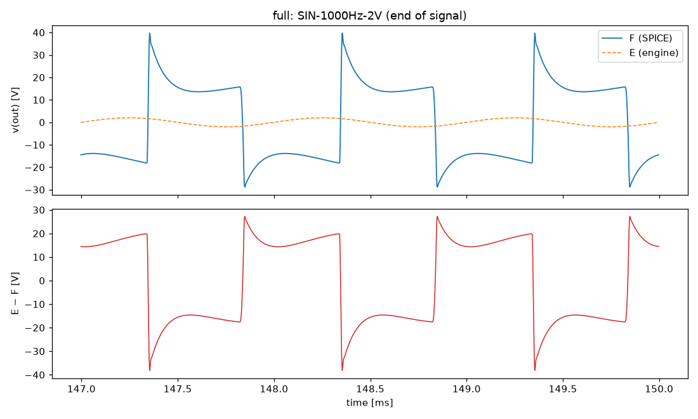
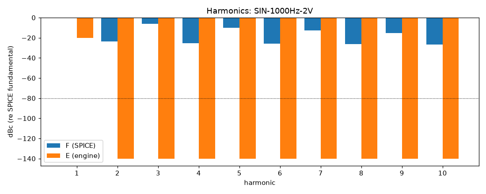
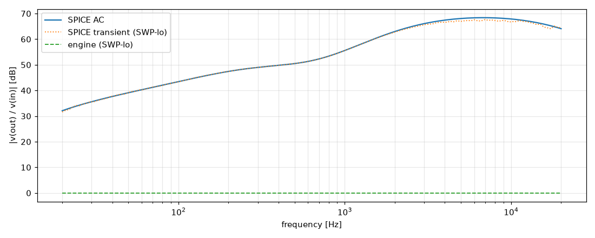

# M0 report: full / DEFAULT

- Block: Full amplifier (reference F)
- Preset: DEFAULT — Default knobs; standard signal set at the block levels
- Knobs: preampVolume=0.6, treble=0.5, middle=0.5, bass=0.5, master=0.3, presence=0.5
- Date: 2026-10-13
- Engine commit: `3a47496 (dirty)`
- Testbench: `harness/testbenches/full.cir` sha256 `063103a6d8212d33`; netlist sha256 `7bea8385e4adb04e`; tubes.lib sha256 `9ec33154be8127d7`
- ngspice 47, fs = 384000 Hz, reference: F (full netlist)

## Summary

PASS 0 · FAIL 0 · INFO 73 (INFO = measured, not scored in M0)

| Check | Item | Measured | Tolerance | Status |
|---|---|---|---|---|
| total_esr_db | SIN-100Hz-0.01V | 0.01043 dB | ≤ -20 | INFO |
| harmonics_2_5_db | SIN-100Hz-0.01V | 77.95 dB | ≤ 0.5 | INFO |
| total_thd_pp | SIN-100Hz-0.01V | 0.1101 pp | ≤ 0.5 | INFO |
| total_power_rel | SIN-100Hz-0.01V | 1 | ≤ 0.05 | INFO |
| newton_failures | SIN-100Hz-0.01V | 0 | ≤ 0 | INFO |
| total_esr_db | SIN-1000Hz-0.01V | 0.004461 dB | ≤ -20 | INFO |
| harmonics_2_5_db | SIN-1000Hz-0.01V | 160.6 dB | ≤ 0.5 | INFO |
| total_thd_pp | SIN-1000Hz-0.01V | 0.7262 pp | ≤ 0.5 | INFO |
| total_power_rel | SIN-1000Hz-0.01V | 1 | ≤ 0.05 | INFO |
| newton_failures | SIN-1000Hz-0.01V | 0 | ≤ 0 | INFO |
| total_esr_db | SIN-5000Hz-0.01V | 0.003778 dB | ≤ -20 | INFO |
| harmonics_2_5_db | SIN-5000Hz-0.01V | 238 dB | ≤ 0.5 | INFO |
| total_thd_pp | SIN-5000Hz-0.01V | 6.47 pp | ≤ 0.5 | INFO |
| total_power_rel | SIN-5000Hz-0.01V | 1 | ≤ 0.05 | INFO |
| newton_failures | SIN-5000Hz-0.01V | 0 | ≤ 0 | INFO |
| total_esr_db | SIN-100Hz-0.1V | 0.01055 dB | ≤ -20 | INFO |
| harmonics_2_5_db | SIN-100Hz-0.1V | 121.5 dB | ≤ 0.5 | INFO |
| total_thd_pp | SIN-100Hz-0.1V | 1.769 pp | ≤ 0.5 | INFO |
| total_power_rel | SIN-100Hz-0.1V | 1 | ≤ 0.05 | INFO |
| newton_failures | SIN-100Hz-0.1V | 0 | ≤ 0 | INFO |
| total_esr_db | SIN-1000Hz-0.1V | 0.009549 dB | ≤ -20 | INFO |
| harmonics_2_5_db | SIN-1000Hz-0.1V | 206.5 dB | ≤ 0.5 | INFO |
| total_thd_pp | SIN-1000Hz-0.1V | 43.43 pp | ≤ 0.5 | INFO |
| total_power_rel | SIN-1000Hz-0.1V | 1 | ≤ 0.05 | INFO |
| newton_failures | SIN-1000Hz-0.1V | 0 | ≤ 0 | INFO |
| total_esr_db | SIN-5000Hz-0.1V | 0.02495 dB | ≤ -20 | INFO |
| harmonics_2_5_db | SIN-5000Hz-0.1V | 234.3 dB | ≤ 0.5 | INFO |
| total_thd_pp | SIN-5000Hz-0.1V | 47.02 pp | ≤ 0.5 | INFO |
| total_power_rel | SIN-5000Hz-0.1V | 1 | ≤ 0.05 | INFO |
| newton_failures | SIN-5000Hz-0.1V | 0 | ≤ 0 | INFO |
| total_esr_db | SIN-100Hz-0.5V | 0.02591 dB | ≤ -20 | INFO |
| harmonics_2_5_db | SIN-100Hz-0.5V | 140.6 dB | ≤ 0.5 | INFO |
| total_thd_pp | SIN-100Hz-0.5V | 17.4 pp | ≤ 0.5 | INFO |
| total_power_rel | SIN-100Hz-0.5V | 0.9998 | ≤ 0.05 | INFO |
| newton_failures | SIN-100Hz-0.5V | 0 | ≤ 0 | INFO |
| total_esr_db | SIN-1000Hz-0.5V | 0.0411 dB | ≤ -20 | INFO |
| harmonics_2_5_db | SIN-1000Hz-0.5V | 197.3 dB | ≤ 0.5 | INFO |
| total_thd_pp | SIN-1000Hz-0.5V | 65.6 pp | ≤ 0.5 | INFO |
| total_power_rel | SIN-1000Hz-0.5V | 0.9995 | ≤ 0.05 | INFO |
| newton_failures | SIN-1000Hz-0.5V | 0 | ≤ 0 | INFO |
| total_esr_db | SIN-5000Hz-0.5V | 0.1155 dB | ≤ -20 | INFO |
| harmonics_2_5_db | SIN-5000Hz-0.5V | 226 dB | ≤ 0.5 | INFO |
| total_thd_pp | SIN-5000Hz-0.5V | 42.81 pp | ≤ 0.5 | INFO |
| total_power_rel | SIN-5000Hz-0.5V | 0.9998 | ≤ 0.05 | INFO |
| newton_failures | SIN-5000Hz-0.5V | 0 | ≤ 0 | INFO |
| total_esr_db | SIN-100Hz-2V | 0.1285 dB | ≤ -20 | INFO |
| harmonics_2_5_db | SIN-100Hz-2V | 138.1 dB | ≤ 0.5 | INFO |
| total_thd_pp | SIN-100Hz-2V | 30.83 pp | ≤ 0.5 | INFO |
| total_power_rel | SIN-100Hz-2V | 0.9975 | ≤ 0.05 | INFO |
| newton_failures | SIN-100Hz-2V | 0 | ≤ 0 | INFO |
| total_esr_db | SIN-1000Hz-2V | 0.2463 dB | ≤ -20 | INFO |
| harmonics_2_5_db | SIN-1000Hz-2V | 186.7 dB | ≤ 0.5 | INFO |
| total_thd_pp | SIN-1000Hz-2V | 65.8 pp | ≤ 0.5 | INFO |
| total_power_rel | SIN-1000Hz-2V | 0.9935 | ≤ 0.05 | INFO |
| newton_failures | SIN-1000Hz-2V | 0 | ≤ 0 | INFO |
| total_esr_db | SIN-5000Hz-2V | 0.4491 dB | ≤ -20 | INFO |
| harmonics_2_5_db | SIN-5000Hz-2V | 214.3 dB | ≤ 0.5 | INFO |
| total_thd_pp | SIN-5000Hz-2V | 42.67 pp | ≤ 0.5 | INFO |
| total_power_rel | SIN-5000Hz-2V | 0.9963 | ≤ 0.05 | INFO |
| newton_failures | SIN-5000Hz-2V | 0 | ≤ 0 | INFO |
| total_esr_db | SWP-lo-0.01V | 0.003213 dB | ≤ -20 | INFO |
| linear_mag_db_20_10k | SWP-lo-0.01V | 68.38 dB | ≤ 0.1 | INFO |
| linear_mag_db_10k_20k | SWP-lo-0.01V | 67.83 dB | ≤ 0.3 | INFO |
| method_mag_db_spice_tran_vs_ac | SWP-lo-0.01V | 1.267 dB | — | INFO |
| newton_failures | SWP-lo-0.01V | 0 | ≤ 0 | INFO |
| total_esr_db | SWP-hi-0.1V | 0.01709 dB | ≤ -20 | INFO |
| newton_failures | SWP-hi-0.1V | 0 | ≤ 0 | INFO |
| total_esr_db | TT-0.05V | 0.01925 dB | ≤ -20 | INFO |
| newton_failures | TT-0.05V | 0 | ≤ 0 | INFO |
| total_esr_db | BURST-0.5V | 0.03593 dB | ≤ -20 | INFO |
| newton_failures | BURST-0.5V | 0 | ≤ 0 | INFO |
| total_esr_db | STEP-0.1V | 0.0285 dB | ≤ -20 | INFO |
| newton_failures | STEP-0.1V | 0 | ≤ 0 | INFO |

## Signals

| Signal | Peak F [V] | ESR [dB] | Best lag | ESR at lag [dB] | THD F / E [%] | Power F / E [W] | ns/sample | Newton fail / max it |
|---|---|---|---|---|---|---|---|---|
| SIN-100Hz-0.01V | 1.527 | 0.01 | -2 | 0.01 | 0.112 / 0.00211 | 0.06905 / 3.125e-06 | 0.9 | 0 / 0 |
| SIN-1000Hz-0.01V | 6.605 | 0.00 | -2 | 0.00 | 0.726 / 4.14e-06 | 1.127 / 3.125e-06 | 0.8 | 0 / 0 |
| SIN-5000Hz-0.01V | 23.18 | 0.00 | -2 | 0.00 | 6.47 / 1.52e-07 | 16.04 / 3.125e-06 | 0.9 | 0 / 0 |
| SIN-100Hz-0.1V | 15.44 | 0.01 | -2 | 0.01 | 1.77 / 0.00211 | 6.832 / 0.0003125 | 0.9 | 0 / 0 |
| SIN-1000Hz-0.1V | 29.69 | 0.01 | -2 | 0.01 | 43.4 / 4.14e-06 | 14.22 / 0.0003125 | 0.8 | 0 / 0 |
| SIN-5000Hz-0.1V | 44.76 | 0.02 | -2 | 0.02 | 47 / 1.52e-07 | 26.74 / 0.0003125 | 0.9 | 0 / 0 |
| SIN-100Hz-0.5V | 44.78 | 0.03 | -2 | 0.03 | 17.4 / 0.00211 | 46.26 / 0.007812 | 0.9 | 0 / 0 |
| SIN-1000Hz-0.5V | 44.07 | 0.04 | -2 | 0.04 | 65.6 / 4.14e-06 | 17.13 / 0.007812 | 0.9 | 0 / 0 |
| SIN-5000Hz-0.5V | 46.83 | 0.12 | -2 | 0.11 | 42.8 / 1.52e-07 | 32.6 / 0.007812 | 0.9 | 0 / 0 |
| SIN-100Hz-2V | 49.41 | 0.13 | -2 | 0.13 | 30.8 / 0.00211 | 50.75 / 0.125 | 0.9 | 0 / 0 |
| SIN-1000Hz-2V | 50.24 | 0.25 | -2 | 0.23 | 65.8 / 4.14e-06 | 19.13 / 0.125 | 0.9 | 0 / 0 |
| SIN-5000Hz-2V | 46.56 | 0.45 | -2 | 0.42 | 42.7 / 1.52e-07 | 33.79 / 0.125 | 0.9 | 0 / 0 |
| SWP-lo-0.01V | 23.02 | 0.00 | 2 | 0.00 | — | — | 1.3 | 0 / 0 |
| SWP-hi-0.1V | 31.1 | 0.02 | 2 | 0.02 | — | — | 1.2 | 0 / 0 |
| TT-0.05V | 25.21 | 0.02 | -2 | 0.02 | — | — | 0.9 | 0 / 0 |
| BURST-0.5V | 43.73 | 0.04 | -2 | 0.03 | — | — | 0.9 | 0 / 0 |
| STEP-0.1V | 46.92 | 0.03 | -2 | 0.03 | — | — | 0.9 | 0 / 0 |

## DC operating point

| Node | SPICE [V] | Engine [V] | Rel. error |
|---|---|---|---|
| ct | 488.7084 | — | — |
| nscr | 485.6493 | — | — |
| bpx | 402.3360 | — | — |
| bpa | 389.3496 | — | — |
| nbias | -46.3636 | — | — |
| p1a | 296.4025 | — | — |
| k1a | 2.5096 | — | — |
| p1b | 352.4328 | — | — |
| k1b | 3.6917 | — | — |
| p2a | 231.1295 | — | — |
| k2a | 1.4039 | — | — |
| k2b | 231.6858 | — | — |
| p3a | 270.8809 | — | — |
| p3b | 262.2706 | — | — |
| k3 | 44.9334 | — | — |
| nf | 43.5216 | — | — |
| ng | 13.4840 | — | — |

Engine values are the probe values after the first sample (zero input) following `reset()`. Nodes the engine does not probe yet show —.

## Figures

### Waveform overlay and error (most demanding signal)

### Harmonics

### Magnitude response

