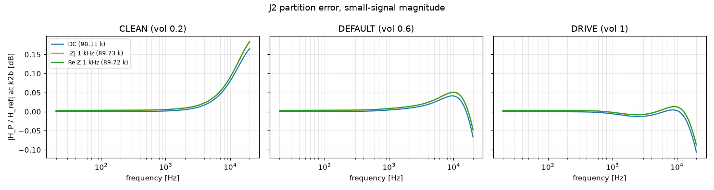

# M0 partition-error study: J2

- Date: 2026-10-13, ngspice 47, reltol 1e-06
- P chain: b12 (output p1b open) -> b3 (J-Thevenin source driven by the recorded open-circuit p1b, through R_th). Reference: b123 (b12 and b3 joined, no junction). Same constant supply in both.
- Compared node: k2b; also the junction node p1b (loaded) as information. All time-domain metrics on node voltage minus its DC operating point.
- Candidates: DC = 90107.6 Ω, |Z| 1 kHz = 89732.8 Ω, Re Z 1 kHz = 89720.4 Ω
- Tolerance context (not scored here): partition error at y (M3) ≤ −26 dB sines, ≤ −20 dB DI (VERIFICATION §7).

## Summary (worst case over the signal set)

| Preset | Candidate | Worst ESR | Worst ESR (SIN only) | Worst h1 diff | Worst harm. 2–5 diff | Small-signal max dB error 20 Hz–10 kHz | 10–20 kHz |
|---|---|---|---|---|---|---|---|
| CLEAN | DC | -30.6 dB | -30.6 dB | 0.021 dB | 1.44 dB | 0.077 dB | 0.165 dB |
| CLEAN | |Z| 1 kHz | -30.6 dB | -30.6 dB | 0.027 dB | 1.48 dB | 0.086 dB | 0.183 dB |
| CLEAN | Re Z 1 kHz | -30.6 dB | -30.6 dB | 0.027 dB | 1.48 dB | 0.087 dB | 0.184 dB |
| DEFAULT | DC | -27.0 dB | -27.0 dB | 0.081 dB | 1.58 dB | 0.041 dB | 0.066 dB |
| DEFAULT | |Z| 1 kHz | -27.1 dB | -27.1 dB | 0.081 dB | 1.61 dB | 0.051 dB | 0.051 dB |
| DEFAULT | Re Z 1 kHz | -27.1 dB | -27.1 dB | 0.081 dB | 1.61 dB | 0.051 dB | 0.051 dB |
| DRIVE | DC | -26.2 dB | -26.2 dB | 0.146 dB | 3.21 dB | 0.013 dB | 0.107 dB |
| DRIVE | |Z| 1 kHz | -26.2 dB | -26.2 dB | 0.146 dB | 3.28 dB | 0.013 dB | 0.088 dB |
| DRIVE | Re Z 1 kHz | -26.2 dB | -26.2 dB | 0.146 dB | 3.28 dB | 0.013 dB | 0.088 dB |

## Per signal (ESR at k2b / at p1b, dB)

| Preset | Signal | DC | |Z| 1 kHz | Re Z 1 kHz |
|---|---|---|---|---|
| CLEAN | SIN-100Hz-0.01V | -84.2 / -86.9 | -68.7 / -68.7 | -68.4 / -68.5 |
| CLEAN | SIN-1000Hz-0.01V | -67.9 / -68.0 | -64.3 / -64.3 | -64.1 / -64.1 |
| CLEAN | SIN-5000Hz-0.01V | -48.3 / -48.3 | -48.4 / -48.4 | -48.4 / -48.4 |
| CLEAN | SIN-100Hz-0.1V | -84.2 / -86.9 | -68.7 / -68.7 | -68.4 / -68.5 |
| CLEAN | SIN-1000Hz-0.1V | -67.9 / -67.9 | -64.3 / -64.3 | -64.1 / -64.1 |
| CLEAN | SIN-5000Hz-0.1V | -47.9 / -48.0 | -48.8 / -48.2 | -48.8 / -48.2 |
| CLEAN | SIN-100Hz-0.5V | -84.2 / -86.9 | -68.7 / -68.7 | -68.4 / -68.4 |
| CLEAN | SIN-1000Hz-0.5V | -68.2 / -65.6 | -65.6 / -62.3 | -65.4 / -62.1 |
| CLEAN | SIN-5000Hz-0.5V | -39.1 / -45.8 | -39.5 / -45.2 | -39.5 / -45.1 |
| CLEAN | SIN-100Hz-2V | -83.4 / -85.8 | -71.3 / -68.4 | -71.0 / -68.2 |
| CLEAN | SIN-1000Hz-2V | -49.1 / -51.7 | -47.9 / -50.1 | -47.8 / -50.1 |
| CLEAN | SIN-5000Hz-2V | -30.6 / -35.6 | -30.6 / -35.3 | -30.6 / -35.3 |
| CLEAN | SWP-lo-0.01V | -36.1 / -36.2 | -36.3 / -36.5 | -36.3 / -36.5 |
| CLEAN | TT-0.05V | -78.8 / -79.7 | -68.1 / -68.2 | -67.8 / -67.9 |
| CLEAN | BURST-0.5V | -68.1 / -65.7 | -65.4 / -62.3 | -65.2 / -62.1 |
| CLEAN | STEP-0.1V | -34.1 / -35.2 | -34.4 / -35.4 | -34.4 / -35.4 |
| DEFAULT | SIN-100Hz-0.01V | -74.8 / -75.3 | -68.0 / -68.1 | -67.8 / -67.8 |
| DEFAULT | SIN-1000Hz-0.01V | -54.0 / -54.0 | -54.3 / -54.3 | -54.3 / -54.3 |
| DEFAULT | SIN-5000Hz-0.01V | -37.8 / -37.8 | -38.2 / -38.2 | -38.2 / -38.3 |
| DEFAULT | SIN-100Hz-0.1V | -74.8 / -75.3 | -68.0 / -68.0 | -67.8 / -67.8 |
| DEFAULT | SIN-1000Hz-0.1V | -52.7 / -51.6 | -53.5 / -51.9 | -53.5 / -51.9 |
| DEFAULT | SIN-5000Hz-0.1V | -30.0 / -37.2 | -30.3 / -37.7 | -30.3 / -37.7 |
| DEFAULT | SIN-100Hz-0.5V | -72.5 / -72.7 | -72.0 / -65.5 | -71.9 / -65.3 |
| DEFAULT | SIN-1000Hz-0.5V | -39.6 / -42.0 | -39.5 / -41.6 | -39.5 / -41.6 |
| DEFAULT | SIN-5000Hz-0.5V | -27.0 / -35.4 | -27.1 / -35.3 | -27.1 / -35.3 |
| DEFAULT | SIN-100Hz-2V | -45.9 / -44.0 | -45.7 / -43.6 | -45.7 / -43.6 |
| DEFAULT | SIN-1000Hz-2V | -31.6 / -34.5 | -31.7 / -34.6 | -31.7 / -34.6 |
| DEFAULT | SIN-5000Hz-2V | -30.4 / -21.0 | -30.5 / -21.1 | -30.5 / -21.1 |
| DEFAULT | SWP-lo-0.01V | -31.8 / -32.3 | -32.2 / -32.6 | -32.2 / -32.6 |
| DEFAULT | TT-0.05V | -65.9 / -66.0 | -65.2 / -64.4 | -65.1 / -64.3 |
| DEFAULT | BURST-0.5V | -39.2 / -42.0 | -39.1 / -41.7 | -39.1 / -41.7 |
| DEFAULT | STEP-0.1V | -38.8 / -41.1 | -38.9 / -41.4 | -38.9 / -41.4 |
| DRIVE | SIN-100Hz-0.01V | -68.2 / -68.2 | -66.4 / -66.4 | -66.2 / -66.2 |
| DRIVE | SIN-1000Hz-0.01V | -48.9 / -48.9 | -49.6 / -49.6 | -49.6 / -49.6 |
| DRIVE | SIN-5000Hz-0.01V | -37.5 / -37.8 | -38.1 / -38.3 | -38.1 / -38.4 |
| DRIVE | SIN-100Hz-0.1V | -66.4 / -66.6 | -67.2 / -63.8 | -67.2 / -63.7 |
| DRIVE | SIN-1000Hz-0.1V | -42.8 / -46.4 | -43.3 / -46.8 | -43.3 / -46.8 |
| DRIVE | SIN-5000Hz-0.1V | -30.7 / -38.1 | -31.0 / -38.5 | -31.0 / -38.5 |
| DRIVE | SIN-100Hz-0.5V | -43.6 / -43.5 | -43.4 / -43.1 | -43.4 / -43.1 |
| DRIVE | SIN-1000Hz-0.5V | -34.9 / -42.3 | -35.1 / -42.1 | -35.1 / -42.1 |
| DRIVE | SIN-5000Hz-0.5V | -27.4 / -35.7 | -27.4 / -35.6 | -27.4 / -35.5 |
| DRIVE | SIN-100Hz-2V | -46.0 / -27.8 | -46.3 / -27.9 | -46.4 / -27.9 |
| DRIVE | SIN-1000Hz-2V | -30.7 / -23.6 | -30.8 / -23.6 | -30.8 / -23.6 |
| DRIVE | SIN-5000Hz-2V | -26.2 / -19.4 | -26.2 / -19.4 | -26.2 / -19.4 |
| DRIVE | SWP-lo-0.01V | -34.8 / -36.1 | -35.2 / -36.5 | -35.2 / -36.5 |
| DRIVE | TT-0.05V | -56.8 / -57.3 | -57.4 / -57.1 | -57.4 / -57.1 |
| DRIVE | BURST-0.5V | -35.8 / -42.2 | -35.9 / -42.0 | -35.9 / -42.0 |
| DRIVE | STEP-0.1V | -48.8 / -49.5 | -49.0 / -49.5 | -49.0 / -49.5 |
