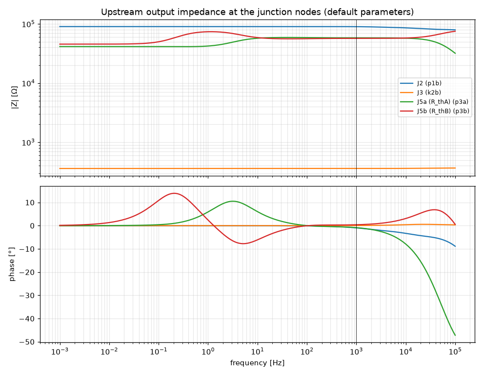

# M0 junction Thevenin resistances

- Date: 2026-10-15, ngspice 47, default parameters unless stated
- Method (SPEC §7 M0.5): 1 A AC current into the open-circuited output node of the upstream block testbench, block input AC-grounded, linearised at the DC operating point. DC = 1 mHz point of the sweep (capacitors effectively open), cross-checked by a ±1 µA finite difference of two DC operating points.
- Upstream junctions inside a testbench (Rth_j2 in b3) use the junctions.py value, or the DC value measured here while it is unset.
- junctions.py (used by the testbenches): j2 = 89.73 kΩ, j3 = 360.1 Ω, j5a = 58.07 kΩ, j5b = 56.94 kΩ (|Z(1 kHz)|, D-018)

| Junction | Node | Testbench | R_th DC | DC (op finite diff.) | Z @ 1 kHz | Re Z @ 1 kHz |
|---|---|---|---|---|---|---|
| J2 | p1b | b12 | 90.1 kΩ | 90.1 kΩ | 89.73 kΩ ∠-1.0° | 89.72 kΩ |
| J3 | k2b | b3 | 359.5 Ω | 359.5 Ω | 359.5 Ω ∠+0.1° | 359.5 Ω |
| J5a (R_thA) | p3a | b5open | 41.38 kΩ | 41.38 kΩ | 58.05 kΩ ∠-0.9° | 58.05 kΩ |
| J5b (R_thB) | p3b | b5open | 45.49 kΩ | 45.49 kΩ | 56.91 kΩ ∠+0.4° | 56.91 kΩ |

## Spread over presets

| Junction | Knob sets | R_th DC min–max | \|Z\| @ 1 kHz min–max |
|---|---|---|---|
| J2 | 34 | 90.1 kΩ – 90.1 kΩ | 88.39 kΩ – 90.1 kΩ |
| J3 | 34 | 359.5 Ω – 359.5 Ω | 359.5 Ω – 359.5 Ω |
| J5a (R_thA) | 34 | 41.38 kΩ – 41.38 kΩ | 53.55 kΩ – 58.56 kΩ |
| J5b (R_thB) | 34 | 45.49 kΩ – 45.49 kΩ | 56.35 kΩ – 62.37 kΩ |

## LTP coupling (J5)

Transimpedance to the other PI plate (v(other) per A injected); the J-Thevenin model has no such term.

| Injected at | Observed | DC | @ 1 kHz | Ratio to self @ 1 kHz |
|---|---|---|---|---|
| p3a | p3b | 14.46 kΩ | 25.48 kΩ ∠+1.8° | 0.44 |
| p3b | p3a | 14.52 kΩ | 32.12 kΩ ∠-0.8° | 0.56 |

## Sensitivity to the upstream R_th

Max relative change when every upstream R_th is switched from its DC value to |Z(1 kHz)|: j2 0.0e+00, j3 8.7e-08, j5a 0.0e+00, j5b 0.0e+00

## |Z(f)|

## |Z| at selected frequencies

| Junction | 0.001 Hz | 10 Hz | 100 Hz | 1000 Hz | 10000 Hz |
|---|---|---|---|---|---|
| J2 | 90.1 kΩ ∠-0.0° | 90.1 kΩ ∠-0.0° | 90.1 kΩ ∠-0.1° | 89.73 kΩ ∠-1.0° | 85.63 kΩ ∠-3.3° |
| J3 | 359.5 Ω ∠+0.0° | 359.5 Ω ∠+0.0° | 359.5 Ω ∠+0.0° | 359.5 Ω ∠+0.1° | 360.7 Ω ∠+0.4° |
| J5a (R_thA) | 41.38 kΩ ∠+0.0° | 57.2 kΩ ∠+6.0° | 58.67 kΩ ∠+0.0° | 58.05 kΩ ∠-0.9° | 57.35 kΩ ∠-7.9° |
| J5b (R_thB) | 45.49 kΩ ∠+0.1° | 58.69 kΩ ∠-6.1° | 56.23 kΩ ∠-0.0° | 56.91 kΩ ∠+0.4° | 57.67 kΩ ∠+3.1° |
