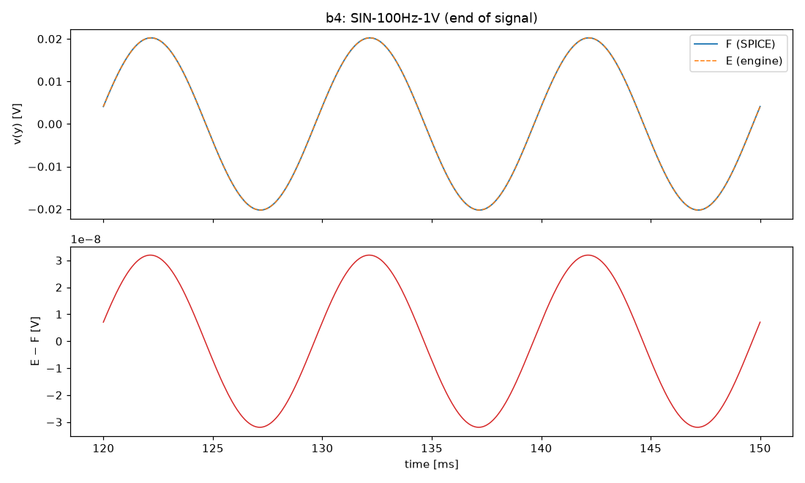
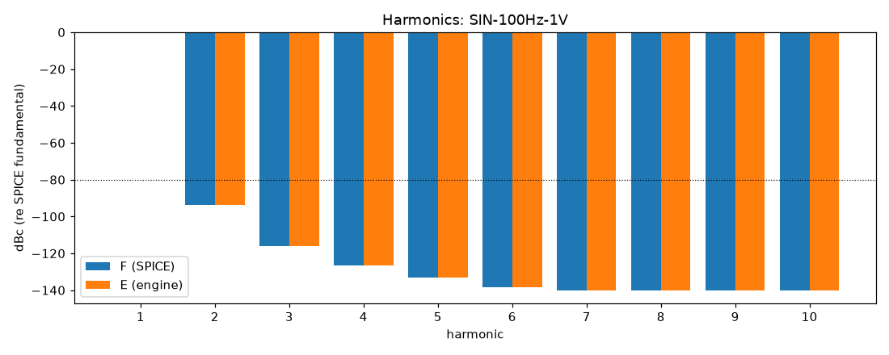
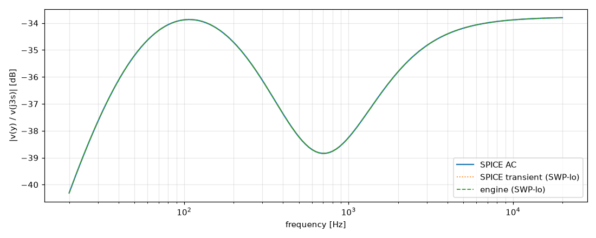

# M1 report: b4 / DEFAULT

- Block: B4 ToneStackMaster
- Preset: DEFAULT — Default knobs; standard signal set at the block levels
- Knobs: preampVolume=0.6, treble=0.5, middle=0.5, bass=0.5, master=0.3, presence=0.5
- Date: 2026-10-13
- Engine commit: `26f8d81 (dirty)`
- Testbench: `harness/testbenches/b4.cir` sha256 `22d71b4a54e0d598`; netlist sha256 `7bea8385e4adb04e`; tubes.lib sha256 `9ec33154be8127d7`
- ngspice 47, fs = 384000 Hz

## Summary

PASS 17 · FAIL 0 · INFO 14 (INFO = measured, not scored in M1)

| Check | Item | Measured | Tolerance | Status |
|---|---|---|---|---|
| dc_rel_error | v(k2b) | 0 | ≤ 0.005 | PASS |
| dc_rel_error | v(mw) | 2.787e-12 | ≤ 0.005 | PASS |
| dc_rel_error | v(nbb) | 3.239e-12 | ≤ 0.005 | PASS |
| dc_rel_error | v(nd) | 1.227e-16 | ≤ 0.005 | PASS |
| dc_rel_error | v(ne) | 2.842e-11 | ≤ 0.005 | PASS |
| dc_rel_error | v(tt) | 0 | ≤ 0.005 | PASS |
| dc_rel_error | v(tw) | 7.417e-12 | ≤ 0.005 | PASS |
| dc_rel_error | v(y) | 5.846e-13 | ≤ 0.005 | PASS |
| linear_esr_db | SIN-100Hz-1V | -116.1 dB | ≤ -60 | PASS |
| harmonics_2_5_db | SIN-100Hz-1V | — | ≤ 0.5 | INFO |
| thd_pp | SIN-100Hz-1V | 3.51e-10 pp | — | INFO |
| newton_failures | SIN-100Hz-1V | 0 | ≤ 0 | INFO |
| linear_esr_db | SIN-1000Hz-1V | -90.3 dB | ≤ -60 | PASS |
| harmonics_2_5_db | SIN-1000Hz-1V | — | ≤ 0.5 | INFO |
| thd_pp | SIN-1000Hz-1V | 2.119e-11 pp | — | INFO |
| newton_failures | SIN-1000Hz-1V | 0 | ≤ 0 | INFO |
| linear_esr_db | SIN-5000Hz-1V | -85.02 dB | ≤ -60 | PASS |
| harmonics_2_5_db | SIN-5000Hz-1V | — | ≤ 0.5 | INFO |
| thd_pp | SIN-5000Hz-1V | 3.177e-11 pp | — | INFO |
| newton_failures | SIN-5000Hz-1V | 0 | ≤ 0 | INFO |
| linear_esr_db | SWP-lo-1V | -88.29 dB | ≤ -60 | PASS |
| linear_mag_db_20_10k | SWP-lo-1V | 0.0004757 dB | ≤ 0.1 | PASS |
| linear_mag_db_10k_20k | SWP-lo-1V | 0.0004857 dB | ≤ 0.3 | PASS |
| method_mag_db_spice_tran_vs_ac | SWP-lo-1V | 0.0002181 dB | — | INFO |
| newton_failures | SWP-lo-1V | 0 | ≤ 0 | INFO |
| linear_esr_db | TT-0.5V | -107.3 dB | ≤ -60 | PASS |
| newton_failures | TT-0.5V | 0 | ≤ 0 | INFO |
| linear_esr_db | BURST-1V | -90.3 dB | ≤ -60 | PASS |
| newton_failures | BURST-1V | 0 | ≤ 0 | INFO |
| linear_esr_db | STEP-1V | -102.8 dB | ≤ -60 | PASS |
| newton_failures | STEP-1V | 0 | ≤ 0 | INFO |

## Signals

| Signal | Peak F [V] | ESR [dB] | Best lag | ESR at lag [dB] | THD F / E [%] | Power F / E [W] | ns/sample | Newton fail / max it |
|---|---|---|---|---|---|---|---|---|
| SIN-100Hz-1V | 0.02157 | -116.07 | 0 | -116.07 | 0.00212 / 0.00212 | — | 32.0 | 0 / 0 |
| SIN-1000Hz-1V | 0.01377 | -90.30 | 0 | -90.30 | 4.19e-06 / 4.19e-06 | — | 31.9 | 0 / 0 |
| SIN-5000Hz-1V | 0.01985 | -85.02 | 0 | -85.02 | 1.52e-07 / 1.52e-07 | — | 32.0 | 0 / 0 |
| SWP-lo-1V | 0.02042 | -88.29 | 0 | -88.29 | — | — | 31.7 | 0 / 0 |
| TT-0.5V | 0.016 | -107.29 | 0 | -107.29 | — | — | 30.8 | 0 / 0 |
| BURST-1V | 0.01372 | -90.30 | 0 | -90.30 | — | — | 31.8 | 0 / 0 |
| STEP-1V | 0.0253 | -102.83 | 0 | -102.83 | — | — | 31.8 | 0 / 0 |

## DC operating point

| Node | SPICE [V] | Engine [V] | Rel. error |
|---|---|---|---|
| k2b | 231.6858 | 231.7 | 0 |
| mw | 0.0000 | 2.787e-15 | 2.787e-12 |
| nbb | 0.0000 | 3.239e-15 | 3.239e-12 |
| nd | 231.6858 | 231.7 | 1.227e-16 |
| ne | 0.0000 | 2.842e-14 | 2.842e-11 |
| tt | 0.0000 | 0 | 0 |
| tw | 0.0000 | -7.417e-15 | 7.417e-12 |
| y | 0.0000 | -5.846e-16 | 5.846e-13 |

Engine values are the probe values after the first sample (zero input) following `reset()`. Nodes the engine does not probe yet show —.

## Figures

### Waveform overlay and error (most demanding signal)

### Harmonics

### Magnitude response

