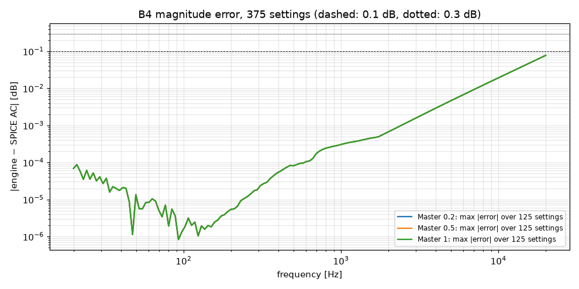

# M1 report: B4 ToneStackMaster checks

- Date: 2026-10-13, engine commit `26f8d81 (dirty)`, ngspice 47, fs = 384000 Hz, SPICE reltol 1e-06
- Testbench `harness/testbenches/b4.cir` sha256 `22d71b4a54e0d598`; netlist sha256 `7bea8385e4adb04e`
- Engine input: the J3 source voltage (DC operating point + signal, D-022); output v_oc(y).

## Summary

| Check | Measured (worst) | Tolerance | Status | Worst setting |
|---|---|---|---|---|
| linear_mag_db_20_10k (375 settings) | 0.0182 dB | ≤ 0.1 dB | PASS | T0 M0 B1 V0.2 |
| linear_mag_db_10k_20k (375 settings) | 0.0778 dB | ≤ 0.3 dB | PASS | T0 M0 B0.75 V0.2 |
| linear_esr_db (log sweep, 9 settings) | -78.5 dB | ≤ −60 dB | PASS | T1 M0 B0 V0.5 |
| R_th4 engine vs testbench formula (11 settings) | 2.2e-16 relative | — | INFO | |

Master scales v_oc(y) by a frequency-independent ratio (unloaded wiper, VR2 total fixed), so the dB error is the same at every Master setting.

## Magnitude error per Master

| Master | max \|error\| 20 Hz–10 kHz | 10–20 kHz | settings |
|---|---|---|---|
| 0.2 | 0.0182 dB | 0.0778 dB | 125 |
| 0.5 | 0.0182 dB | 0.0778 dB | 125 |
| 1 | 0.0182 dB | 0.0778 dB | 125 |

## Time-domain ESR (log sweep 20 Hz–20 kHz, 1 V, 2 s + 50 ms tail)

| Setting | ESR | Best lag |
|---|---|---|
| T0.5 M0.5 B0.5 V0.3 | -88.3 dB | 0 |
| T0 M0 B0 V0.5 | -85.2 dB | 0 |
| T0 M0 B1 V0.5 | -97.5 dB | 0 |
| T0 M1 B0 V0.5 | -102.2 dB | 0 |
| T0 M1 B1 V0.5 | -112.0 dB | 0 |
| T1 M0 B0 V0.5 | -78.5 dB | 0 |
| T1 M0 B1 V0.5 | -79.9 dB | 0 |
| T1 M1 B0 V0.5 | -83.8 dB | 0 |
| T1 M1 B1 V0.5 | -84.5 dB | 0 |

## R_th4

| Setting | Testbench (ngspice) | Engine | Rel. difference |
|---|---|---|---|
| T0.5 M0.5 B0.5 V0.3 | 33265.6 Ω | 33265.6 Ω | 0.0e+00 |
| T0 M0 B0 V0.5 | 90217.3 Ω | 90217.3 Ω | 0.0e+00 |
| T0 M0 B1 V0.5 | 95055.4 Ω | 95055.4 Ω | 0.0e+00 |
| T0 M1 B0 V0.5 | 90217.3 Ω | 90217.3 Ω | 0.0e+00 |
| T0 M1 B1 V0.5 | 95055.4 Ω | 95055.4 Ω | 0.0e+00 |
| T1 M0 B0 V0.5 | 91949.8 Ω | 91949.8 Ω | 0.0e+00 |
| T1 M0 B1 V0.5 | 95540.6 Ω | 95540.6 Ω | 0.0e+00 |
| T1 M1 B0 V0.5 | 91949.8 Ω | 91949.8 Ω | 0.0e+00 |
| T1 M1 B1 V0.5 | 95540.6 Ω | 95540.6 Ω | 0.0e+00 |
| T0.5 M0.5 B0.5 V1 | 188313 Ω | 188313 Ω | 2.2e-16 |
| T0.5 M0.5 B0.5 V0 | 100.992 Ω | 100.992 Ω | 2.2e-16 |
