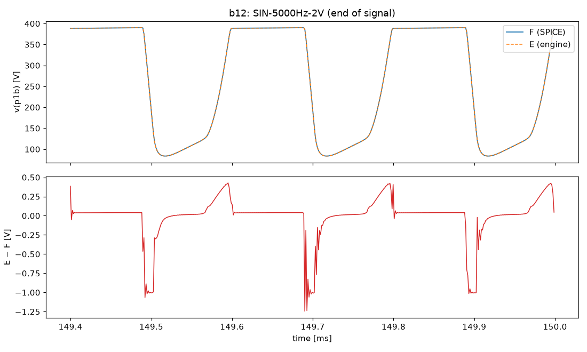
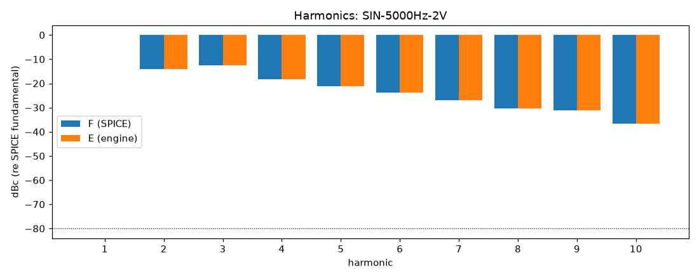
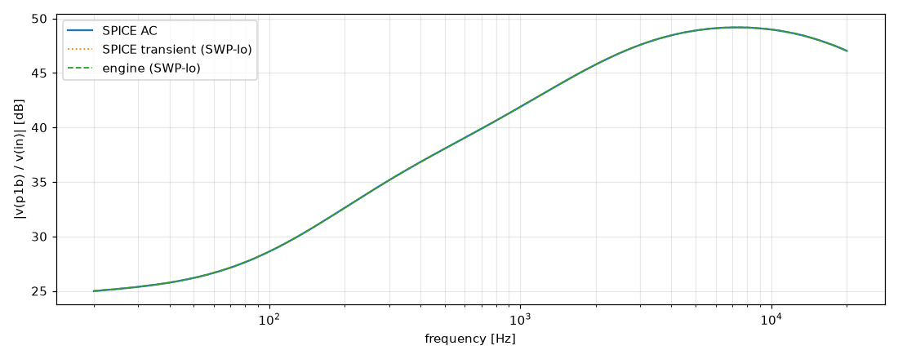

# M2 report: b12 / DEFAULT

- Block: B12 StageV1aV1b (V1a + V1b, joint root)
- Preset: DEFAULT — Default knobs; standard signal set at the block levels
- Knobs: preampVolume=0.6, treble=0.5, middle=0.5, bass=0.5, master=0.3, presence=0.5
- Date: 2026-10-13
- Engine commit: `9c92e73 (dirty)`
- Testbench: `harness/testbenches/b12.cir` sha256 `eea22b746d2e9e0a`; netlist sha256 `7bea8385e4adb04e`; tubes.lib sha256 `9ec33154be8127d7`
- ngspice 47, fs = 768000 Hz, SPICE reltol 1e-08

## Summary

PASS 89 · FAIL 0 · INFO 16 (INFO = measured, not scored in M2)

| Check | Item | Measured | Tolerance | Status |
|---|---|---|---|---|
| dc_rel_error | v(bpa) | 0 | ≤ 0.005 | PASS |
| dc_rel_error | v(g1a) | 0.0001705 | ≤ 0.005 | PASS |
| dc_rel_error | v(in) | 0 | ≤ 0.005 | PASS |
| dc_rel_error | v(k1a) | 4.583e-05 | ≤ 0.005 | PASS |
| dc_rel_error | v(k1b) | 0.0001071 | ≤ 0.005 | PASS |
| dc_rel_error | v(na) | 0.0005983 | ≤ 0.005 | PASS |
| dc_rel_error | v(p1a) | 1.437e-05 | ≤ 0.005 | PASS |
| dc_rel_error | v(p1b) | 1.122e-05 | ≤ 0.005 | PASS |
| dc_rel_error | v(vtop) | 0.0005983 | ≤ 0.005 | PASS |
| dc_rel_error | v(w1) | 0.0005983 | ≤ 0.005 | PASS |
| nonlinear_esr_db | SIN-100Hz-0.01V | -76.08 dB | ≤ -40 | PASS |
| harmonics_2_5_db | SIN-100Hz-0.01V | — | ≤ 0.5 | INFO |
| thd_pp | SIN-100Hz-0.01V | 1.109e-05 pp | — | INFO |
| newton_failures | SIN-100Hz-0.01V | 0 | ≤ 0 | PASS |
| newton_median_iterations | SIN-100Hz-0.01V | 1 | ≤ 3 | PASS |
| newton_max_iterations | SIN-100Hz-0.01V | 2 | ≤ 12 | PASS |
| nonlinear_esr_db | SIN-1000Hz-0.01V | -68.17 dB | ≤ -40 | PASS |
| harmonics_2_5_db | SIN-1000Hz-0.01V | 0.0132 dB | ≤ 0.5 | PASS |
| thd_pp | SIN-1000Hz-0.01V | 0.000118 pp | — | INFO |
| newton_failures | SIN-1000Hz-0.01V | 0 | ≤ 0 | PASS |
| newton_median_iterations | SIN-1000Hz-0.01V | 1 | ≤ 3 | PASS |
| newton_max_iterations | SIN-1000Hz-0.01V | 2 | ≤ 12 | PASS |
| nonlinear_esr_db | SIN-5000Hz-0.01V | -57.01 dB | ≤ -40 | PASS |
| harmonics_2_5_db | SIN-5000Hz-0.01V | 0.01324 dB | ≤ 0.5 | PASS |
| thd_pp | SIN-5000Hz-0.01V | 0.0003935 pp | — | INFO |
| newton_failures | SIN-5000Hz-0.01V | 0 | ≤ 0 | PASS |
| newton_median_iterations | SIN-5000Hz-0.01V | 2 | ≤ 3 | PASS |
| newton_max_iterations | SIN-5000Hz-0.01V | 2 | ≤ 12 | PASS |
| nonlinear_esr_db | SIN-100Hz-0.1V | -76.06 dB | ≤ -40 | PASS |
| harmonics_2_5_db | SIN-100Hz-0.1V | 0.0121 dB | ≤ 0.5 | PASS |
| thd_pp | SIN-100Hz-0.1V | 0.0001097 pp | — | INFO |
| newton_failures | SIN-100Hz-0.1V | 0 | ≤ 0 | PASS |
| newton_median_iterations | SIN-100Hz-0.1V | 1 | ≤ 3 | PASS |
| newton_max_iterations | SIN-100Hz-0.1V | 2 | ≤ 12 | PASS |
| nonlinear_esr_db | SIN-1000Hz-0.1V | -68.08 dB | ≤ -40 | PASS |
| harmonics_2_5_db | SIN-1000Hz-0.1V | 0.02236 dB | ≤ 0.5 | PASS |
| thd_pp | SIN-1000Hz-0.1V | 0.0013 pp | — | INFO |
| newton_failures | SIN-1000Hz-0.1V | 0 | ≤ 0 | PASS |
| newton_median_iterations | SIN-1000Hz-0.1V | 2 | ≤ 3 | PASS |
| newton_max_iterations | SIN-1000Hz-0.1V | 2 | ≤ 12 | PASS |
| nonlinear_esr_db | SIN-5000Hz-0.1V | -56.9 dB | ≤ -40 | PASS |
| harmonics_2_5_db | SIN-5000Hz-0.1V | 0.01175 dB | ≤ 0.5 | PASS |
| thd_pp | SIN-5000Hz-0.1V | 0.004758 pp | — | INFO |
| newton_failures | SIN-5000Hz-0.1V | 0 | ≤ 0 | PASS |
| newton_median_iterations | SIN-5000Hz-0.1V | 2 | ≤ 3 | PASS |
| newton_max_iterations | SIN-5000Hz-0.1V | 3 | ≤ 12 | PASS |
| nonlinear_esr_db | SIN-100Hz-0.5V | -75.62 dB | ≤ -40 | PASS |
| harmonics_2_5_db | SIN-100Hz-0.5V | 0.02412 dB | ≤ 0.5 | PASS |
| thd_pp | SIN-100Hz-0.5V | 0.0004084 pp | — | INFO |
| newton_failures | SIN-100Hz-0.5V | 0 | ≤ 0 | PASS |
| newton_median_iterations | SIN-100Hz-0.5V | 1 | ≤ 3 | PASS |
| newton_max_iterations | SIN-100Hz-0.5V | 2 | ≤ 12 | PASS |
| nonlinear_esr_db | SIN-1000Hz-0.5V | -64.64 dB | ≤ -40 | PASS |
| harmonics_2_5_db | SIN-1000Hz-0.5V | 0.1825 dB | ≤ 0.5 | PASS |
| thd_pp | SIN-1000Hz-0.5V | 0.01933 pp | — | INFO |
| newton_failures | SIN-1000Hz-0.5V | 0 | ≤ 0 | PASS |
| newton_median_iterations | SIN-1000Hz-0.5V | 2 | ≤ 3 | PASS |
| newton_max_iterations | SIN-1000Hz-0.5V | 3 | ≤ 12 | PASS |
| nonlinear_esr_db | SIN-5000Hz-0.5V | -56.32 dB | ≤ -40 | PASS |
| harmonics_2_5_db | SIN-5000Hz-0.5V | 0.01346 dB | ≤ 0.5 | PASS |
| thd_pp | SIN-5000Hz-0.5V | 0.01183 pp | — | INFO |
| newton_failures | SIN-5000Hz-0.5V | 0 | ≤ 0 | PASS |
| newton_median_iterations | SIN-5000Hz-0.5V | 2 | ≤ 3 | PASS |
| newton_max_iterations | SIN-5000Hz-0.5V | 4 | ≤ 12 | PASS |
| nonlinear_esr_db_overdrive | SIN-100Hz-2V | -66.56 dB | ≤ -30 | PASS |
| harmonics_2_5_db | SIN-100Hz-2V | 0.02825 dB | ≤ 0.5 | PASS |
| thd_pp | SIN-100Hz-2V | 0.01771 pp | — | INFO |
| newton_failures | SIN-100Hz-2V | 0 | ≤ 0 | PASS |
| newton_median_iterations | SIN-100Hz-2V | 1 | ≤ 3 | PASS |
| newton_max_iterations | SIN-100Hz-2V | 2 | ≤ 12 | PASS |
| nonlinear_esr_db_overdrive | SIN-1000Hz-2V | -67.39 dB | ≤ -30 | PASS |
| harmonics_2_5_db | SIN-1000Hz-2V | 0.01401 dB | ≤ 0.5 | PASS |
| thd_pp | SIN-1000Hz-2V | 0.01338 pp | — | INFO |
| newton_failures | SIN-1000Hz-2V | 0 | ≤ 0 | PASS |
| newton_median_iterations | SIN-1000Hz-2V | 2 | ≤ 3 | PASS |
| newton_max_iterations | SIN-1000Hz-2V | 3 | ≤ 12 | PASS |
| nonlinear_esr_db_overdrive | SIN-5000Hz-2V | -54.94 dB | ≤ -30 | PASS |
| harmonics_2_5_db | SIN-5000Hz-2V | 0.01096 dB | ≤ 0.5 | PASS |
| thd_pp | SIN-5000Hz-2V | 0.009518 pp | — | INFO |
| newton_failures | SIN-5000Hz-2V | 0 | ≤ 0 | PASS |
| newton_median_iterations | SIN-5000Hz-2V | 2 | ≤ 3 | PASS |
| newton_max_iterations | SIN-5000Hz-2V | 6 | ≤ 12 | PASS |
| nonlinear_esr_db | SWP-lo-0.01V | -54.09 dB | ≤ -40 | PASS |
| linear_mag_db_20_10k | SWP-lo-0.01V | 0.02056 dB | ≤ 0.1 | INFO |
| linear_mag_db_10k_20k | SWP-lo-0.01V | 0.02949 dB | ≤ 0.3 | INFO |
| method_mag_db_spice_tran_vs_ac | SWP-lo-0.01V | 0.03286 dB | — | INFO |
| newton_failures | SWP-lo-0.01V | 0 | ≤ 0 | PASS |
| newton_median_iterations | SWP-lo-0.01V | 1 | ≤ 3 | PASS |
| newton_max_iterations | SWP-lo-0.01V | 3 | ≤ 12 | PASS |
| nonlinear_esr_db | SWP-hi-0.1V | -54.11 dB | ≤ -40 | PASS |
| newton_failures | SWP-hi-0.1V | 0 | ≤ 0 | PASS |
| newton_median_iterations | SWP-hi-0.1V | 1 | ≤ 3 | PASS |
| newton_max_iterations | SWP-hi-0.1V | 3 | ≤ 12 | PASS |
| nonlinear_esr_db | TT-0.05V | -73.66 dB | ≤ -40 | PASS |
| newton_failures | TT-0.05V | 0 | ≤ 0 | PASS |
| newton_median_iterations | TT-0.05V | 1 | ≤ 3 | PASS |
| newton_max_iterations | TT-0.05V | 2 | ≤ 12 | PASS |
| nonlinear_esr_db | BURST-0.5V | -64.65 dB | ≤ -40 | PASS |
| newton_failures | BURST-0.5V | 0 | ≤ 0 | PASS |
| newton_median_iterations | BURST-0.5V | 1 | ≤ 3 | PASS |
| newton_max_iterations | BURST-0.5V | 3 | ≤ 12 | PASS |
| nonlinear_esr_db | STEP-0.1V | -60.35 dB | ≤ -40 | PASS |
| newton_failures | STEP-0.1V | 0 | ≤ 0 | PASS |
| newton_median_iterations | STEP-0.1V | 1 | ≤ 3 | PASS |
| newton_max_iterations | STEP-0.1V | 3 | ≤ 12 | PASS |

## Signals

| Signal | Peak F [V] | ESR [dB] | Best lag | ESR at lag [dB] | THD F / E [%] | Power F / E [W] | ns/sample | Newton fail / median / max it |
|---|---|---|---|---|---|---|---|---|
| SIN-100Hz-0.01V | 0.276 | -76.08 | 0 | -76.08 | 0.00916 / 0.00918 | — | 277.8 | 0 / 1 / 2 |
| SIN-1000Hz-0.01V | 1.274 | -68.17 | 0 | -68.17 | 0.0677 / 0.0676 | — | 277.6 | 0 / 1 / 2 |
| SIN-5000Hz-0.01V | 2.915 | -57.01 | 0 | -57.01 | 0.17 / 0.17 | — | 433.0 | 0 / 2 / 2 |
| SIN-100Hz-0.1V | 2.761 | -76.06 | 0 | -76.06 | 0.0894 / 0.0895 | — | 278.4 | 0 / 1 / 2 |
| SIN-1000Hz-0.1V | 12.82 | -68.08 | 0 | -68.08 | 0.699 / 0.698 | — | 411.2 | 0 / 2 / 2 |
| SIN-5000Hz-0.1V | 29.77 | -56.90 | 0 | -56.90 | 2.23 / 2.23 | — | 444.3 | 0 / 2 / 3 |
| SIN-100Hz-0.5V | 13.78 | -75.62 | 0 | -75.62 | 0.458 / 0.459 | — | 282.3 | 0 / 1 / 2 |
| SIN-1000Hz-0.5V | 63.85 | -64.64 | 0 | -64.64 | 13 / 13 | — | 441.1 | 0 / 2 / 3 |
| SIN-5000Hz-0.5V | 151.4 | -56.32 | 0 | -56.32 | 28.3 / 28.3 | — | 493.7 | 0 / 2 / 4 |
| SIN-100Hz-2V | 52.05 | -66.56 | 0 | -66.56 | 8.34 / 8.33 | — | 275.7 | 0 / 1 / 2 |
| SIN-1000Hz-2V | 225.8 | -67.39 | 0 | -67.39 | 30.8 / 30.8 | — | 477.7 | 0 / 2 / 3 |
| SIN-5000Hz-2V | 273.8 | -54.94 | 0 | -54.94 | 35.7 / 35.7 | — | 536.4 | 0 / 2 / 6 |
| SWP-lo-0.01V | 2.885 | -54.09 | 0 | -54.09 | — | — | 356.6 | 0 / 1 / 3 |
| SWP-hi-0.1V | 29.54 | -54.11 | 0 | -54.11 | — | — | 366.2 | 0 / 1 / 3 |
| TT-0.05V | 5.297 | -73.66 | 0 | -73.66 | — | — | 278.3 | 0 / 1 / 2 |
| BURST-0.5V | 63.81 | -64.65 | 0 | -64.65 | — | — | 354.0 | 0 / 1 / 3 |
| STEP-0.1V | 24.15 | -60.35 | 0 | -60.35 | — | — | 290.1 | 0 / 1 / 3 |

## DC operating point

| Node | SPICE [V] | Engine [V] | Rel. error |
|---|---|---|---|
| bpa | 389.3496 | 389.3496 | 0 |
| g1a | 0.0001 | 0.0001 | 0.0001705 |
| in | 0.0000 | 0.0000 | 0 |
| k1a | 2.5096 | 2.5095 | 4.583e-05 |
| k1b | 3.6917 | 3.6913 | 0.0001071 |
| na | 0.0002 | 0.0002 | 0.0005983 |
| p1a | 296.4025 | 296.4067 | 1.437e-05 |
| p1b | 352.4328 | 352.4367 | 1.122e-05 |
| vtop | 0.0002 | 0.0002 | 0.0005983 |
| w1 | 0.0002 | 0.0002 | 0.0005983 |

Engine values are the probe values after the first sample (zero input) following `reset()`. Nodes the engine does not probe yet show —.

## Figures

### Waveform overlay and error (most demanding signal)

### Harmonics

### Magnitude response

