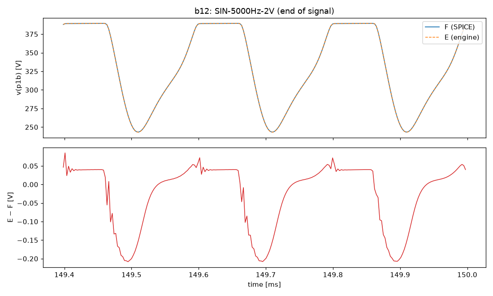
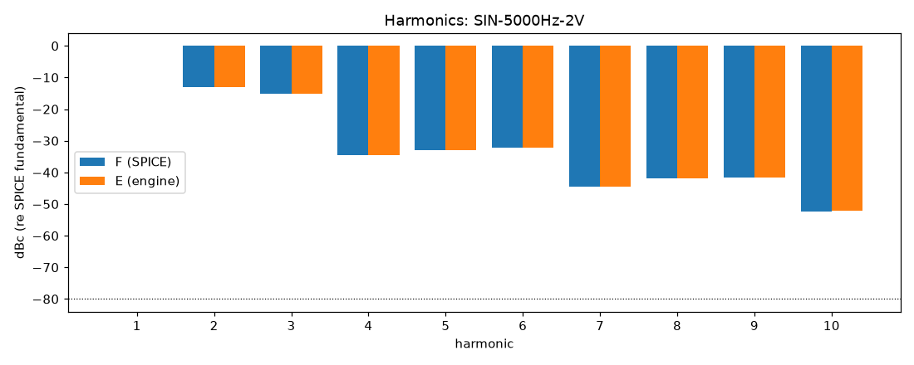
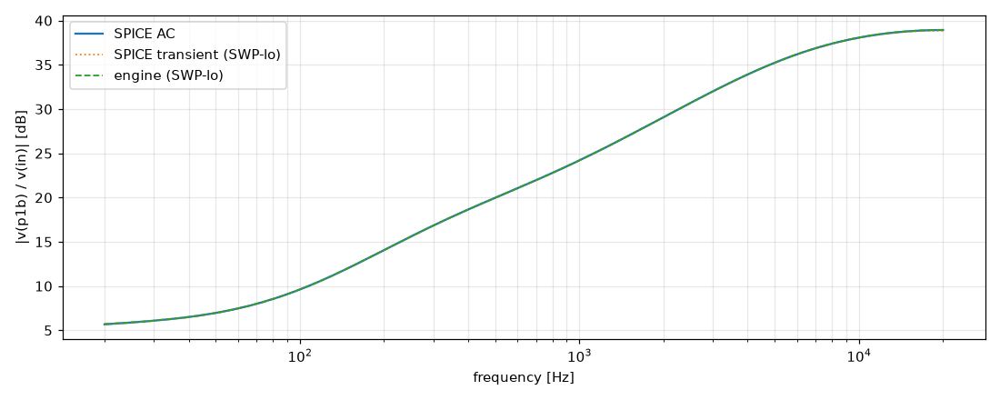

# M2 report: b12 / VOL0.2

- Block: B12 StageV1aV1b (V1a + V1b, joint root)
- Preset: VOL0.2 — Preamp Volume 0.2; standard signal set (M2)
- Knobs: preampVolume=0.2, treble=0.5, middle=0.5, bass=0.5, master=0.3, presence=0.5
- Date: 2026-10-13
- Engine commit: `b4a4896 (dirty)`
- Testbench: `harness/testbenches/b12.cir` sha256 `eea22b746d2e9e0a`; netlist sha256 `7bea8385e4adb04e`; tubes.lib sha256 `9ec33154be8127d7`
- ngspice 47, fs = 384000 Hz, SPICE reltol 1e-08

## Summary

PASS 90 · FAIL 0 · INFO 15 (INFO = measured, not scored in M2)

| Check | Item | Measured | Tolerance | Status |
|---|---|---|---|---|
| dc_rel_error | v(bpa) | 0 | ≤ 0.005 | PASS |
| dc_rel_error | v(g1a) | 0.0001705 | ≤ 0.005 | PASS |
| dc_rel_error | v(in) | 0 | ≤ 0.005 | PASS |
| dc_rel_error | v(k1a) | 4.583e-05 | ≤ 0.005 | PASS |
| dc_rel_error | v(k1b) | 0.000107 | ≤ 0.005 | PASS |
| dc_rel_error | v(na) | 6.498e-05 | ≤ 0.005 | PASS |
| dc_rel_error | v(p1a) | 1.437e-05 | ≤ 0.005 | PASS |
| dc_rel_error | v(p1b) | 1.121e-05 | ≤ 0.005 | PASS |
| dc_rel_error | v(vtop) | 6.498e-05 | ≤ 0.005 | PASS |
| dc_rel_error | v(w1) | 6.498e-05 | ≤ 0.005 | PASS |
| nonlinear_esr_db | SIN-100Hz-0.01V | -76.18 dB | ≤ -40 | PASS |
| harmonics_2_5_db | SIN-100Hz-0.01V | 0.001914 dB | ≤ 0.5 | PASS |
| thd_pp | SIN-100Hz-0.01V | 1.003e-05 pp | — | INFO |
| newton_failures | SIN-100Hz-0.01V | 0 | ≤ 0 | PASS |
| newton_median_iterations | SIN-100Hz-0.01V | 1 | ≤ 3 | PASS |
| newton_max_iterations | SIN-100Hz-0.01V | 2 | ≤ 12 | PASS |
| nonlinear_esr_db | SIN-1000Hz-0.01V | -69.4 dB | ≤ -40 | PASS |
| harmonics_2_5_db | SIN-1000Hz-0.01V | 0.0003448 dB | ≤ 0.5 | PASS |
| thd_pp | SIN-1000Hz-0.01V | 1.795e-05 pp | — | INFO |
| newton_failures | SIN-1000Hz-0.01V | 0 | ≤ 0 | PASS |
| newton_median_iterations | SIN-1000Hz-0.01V | 1 | ≤ 3 | PASS |
| newton_max_iterations | SIN-1000Hz-0.01V | 2 | ≤ 12 | PASS |
| nonlinear_esr_db | SIN-5000Hz-0.01V | -56.11 dB | ≤ -40 | PASS |
| harmonics_2_5_db | SIN-5000Hz-0.01V | 0.02768 dB | ≤ 0.5 | PASS |
| thd_pp | SIN-5000Hz-0.01V | 0.0001506 pp | — | INFO |
| newton_failures | SIN-5000Hz-0.01V | 0 | ≤ 0 | PASS |
| newton_median_iterations | SIN-5000Hz-0.01V | 2 | ≤ 3 | PASS |
| newton_max_iterations | SIN-5000Hz-0.01V | 2 | ≤ 12 | PASS |
| nonlinear_esr_db | SIN-100Hz-0.1V | -76.17 dB | ≤ -40 | PASS |
| harmonics_2_5_db | SIN-100Hz-0.1V | 0.001965 dB | ≤ 0.5 | PASS |
| thd_pp | SIN-100Hz-0.1V | 0.0001005 pp | — | INFO |
| newton_failures | SIN-100Hz-0.1V | 0 | ≤ 0 | PASS |
| newton_median_iterations | SIN-100Hz-0.1V | 1 | ≤ 3 | PASS |
| newton_max_iterations | SIN-100Hz-0.1V | 2 | ≤ 12 | PASS |
| nonlinear_esr_db | SIN-1000Hz-0.1V | -69.38 dB | ≤ -40 | PASS |
| harmonics_2_5_db | SIN-1000Hz-0.1V | 0.06703 dB | ≤ 0.5 | PASS |
| thd_pp | SIN-1000Hz-0.1V | 0.0001651 pp | — | INFO |
| newton_failures | SIN-1000Hz-0.1V | 0 | ≤ 0 | PASS |
| newton_median_iterations | SIN-1000Hz-0.1V | 2 | ≤ 3 | PASS |
| newton_max_iterations | SIN-1000Hz-0.1V | 2 | ≤ 12 | PASS |
| nonlinear_esr_db | SIN-5000Hz-0.1V | -56.11 dB | ≤ -40 | PASS |
| harmonics_2_5_db | SIN-5000Hz-0.1V | 0.08898 dB | ≤ 0.5 | PASS |
| thd_pp | SIN-5000Hz-0.1V | 0.001549 pp | — | INFO |
| newton_failures | SIN-5000Hz-0.1V | 0 | ≤ 0 | PASS |
| newton_median_iterations | SIN-5000Hz-0.1V | 2 | ≤ 3 | PASS |
| newton_max_iterations | SIN-5000Hz-0.1V | 3 | ≤ 12 | PASS |
| nonlinear_esr_db | SIN-100Hz-0.5V | -76.13 dB | ≤ -40 | PASS |
| harmonics_2_5_db | SIN-100Hz-0.5V | 0.00529 dB | ≤ 0.5 | PASS |
| thd_pp | SIN-100Hz-0.5V | 0.0005126 pp | — | INFO |
| newton_failures | SIN-100Hz-0.5V | 0 | ≤ 0 | PASS |
| newton_median_iterations | SIN-100Hz-0.5V | 1 | ≤ 3 | PASS |
| newton_max_iterations | SIN-100Hz-0.5V | 2 | ≤ 12 | PASS |
| nonlinear_esr_db | SIN-1000Hz-0.5V | -69.22 dB | ≤ -40 | PASS |
| harmonics_2_5_db | SIN-1000Hz-0.5V | 0.01306 dB | ≤ 0.5 | PASS |
| thd_pp | SIN-1000Hz-0.5V | 0.0008511 pp | — | INFO |
| newton_failures | SIN-1000Hz-0.5V | 0 | ≤ 0 | PASS |
| newton_median_iterations | SIN-1000Hz-0.5V | 2 | ≤ 3 | PASS |
| newton_max_iterations | SIN-1000Hz-0.5V | 3 | ≤ 12 | PASS |
| nonlinear_esr_db | SIN-5000Hz-0.5V | -56.13 dB | ≤ -40 | PASS |
| harmonics_2_5_db | SIN-5000Hz-0.5V | 0.02667 dB | ≤ 0.5 | PASS |
| thd_pp | SIN-5000Hz-0.5V | 0.007143 pp | — | INFO |
| newton_failures | SIN-5000Hz-0.5V | 0 | ≤ 0 | PASS |
| newton_median_iterations | SIN-5000Hz-0.5V | 2 | ≤ 3 | PASS |
| newton_max_iterations | SIN-5000Hz-0.5V | 3 | ≤ 12 | PASS |
| nonlinear_esr_db_overdrive | SIN-100Hz-2V | -75.36 dB | ≤ -30 | PASS |
| harmonics_2_5_db | SIN-100Hz-2V | 0.009791 dB | ≤ 0.5 | PASS |
| thd_pp | SIN-100Hz-2V | 0.002701 pp | — | INFO |
| newton_failures | SIN-100Hz-2V | 0 | ≤ 0 | PASS |
| newton_median_iterations | SIN-100Hz-2V | 1 | ≤ 3 | PASS |
| newton_max_iterations | SIN-100Hz-2V | 2 | ≤ 12 | PASS |
| nonlinear_esr_db_overdrive | SIN-1000Hz-2V | -66.54 dB | ≤ -30 | PASS |
| harmonics_2_5_db | SIN-1000Hz-2V | 0.01633 dB | ≤ 0.5 | PASS |
| thd_pp | SIN-1000Hz-2V | 0.005387 pp | — | INFO |
| newton_failures | SIN-1000Hz-2V | 0 | ≤ 0 | PASS |
| newton_median_iterations | SIN-1000Hz-2V | 2 | ≤ 3 | PASS |
| newton_max_iterations | SIN-1000Hz-2V | 3 | ≤ 12 | PASS |
| nonlinear_esr_db_overdrive | SIN-5000Hz-2V | -55.91 dB | ≤ -30 | PASS |
| harmonics_2_5_db | SIN-5000Hz-2V | 0.02588 dB | ≤ 0.5 | PASS |
| thd_pp | SIN-5000Hz-2V | 0.02337 pp | — | INFO |
| newton_failures | SIN-5000Hz-2V | 0 | ≤ 0 | PASS |
| newton_median_iterations | SIN-5000Hz-2V | 3 | ≤ 3 | PASS |
| newton_max_iterations | SIN-5000Hz-2V | 5 | ≤ 12 | PASS |
| nonlinear_esr_db | SWP-lo-0.01V | -45.7 dB | ≤ -40 | PASS |
| linear_mag_db_20_10k | SWP-lo-0.01V | 0.02646 dB | ≤ 0.1 | INFO |
| linear_mag_db_10k_20k | SWP-lo-0.01V | 0.01831 dB | ≤ 0.3 | INFO |
| method_mag_db_spice_tran_vs_ac | SWP-lo-0.01V | 0.09076 dB | — | INFO |
| newton_failures | SWP-lo-0.01V | 0 | ≤ 0 | PASS |
| newton_median_iterations | SWP-lo-0.01V | 1 | ≤ 3 | PASS |
| newton_max_iterations | SWP-lo-0.01V | 3 | ≤ 12 | PASS |
| nonlinear_esr_db | SWP-hi-0.1V | -45.72 dB | ≤ -40 | PASS |
| newton_failures | SWP-hi-0.1V | 0 | ≤ 0 | PASS |
| newton_median_iterations | SWP-hi-0.1V | 1 | ≤ 3 | PASS |
| newton_max_iterations | SWP-hi-0.1V | 3 | ≤ 12 | PASS |
| nonlinear_esr_db | TT-0.05V | -74.2 dB | ≤ -40 | PASS |
| newton_failures | TT-0.05V | 0 | ≤ 0 | PASS |
| newton_median_iterations | TT-0.05V | 1 | ≤ 3 | PASS |
| newton_max_iterations | TT-0.05V | 2 | ≤ 12 | PASS |
| nonlinear_esr_db | BURST-0.5V | -69.22 dB | ≤ -40 | PASS |
| newton_failures | BURST-0.5V | 0 | ≤ 0 | PASS |
| newton_median_iterations | BURST-0.5V | 1 | ≤ 3 | PASS |
| newton_max_iterations | BURST-0.5V | 3 | ≤ 12 | PASS |
| nonlinear_esr_db | STEP-0.1V | -48.28 dB | ≤ -40 | PASS |
| newton_failures | STEP-0.1V | 0 | ≤ 0 | PASS |
| newton_median_iterations | STEP-0.1V | 1 | ≤ 3 | PASS |
| newton_max_iterations | STEP-0.1V | 3 | ≤ 12 | PASS |

## Signals

| Signal | Peak F [V] | ESR [dB] | Best lag | ESR at lag [dB] | THD F / E [%] | Power F / E [W] | ns/sample | Newton fail / median / max it |
|---|---|---|---|---|---|---|---|---|
| SIN-100Hz-0.01V | 0.03093 | -76.18 | 0 | -76.18 | 0.0272 / 0.0272 | — | 269.8 | 0 / 1 / 2 |
| SIN-1000Hz-0.01V | 0.1657 | -69.40 | 0 | -69.40 | 0.0942 / 0.0942 | — | 272.3 | 0 / 1 / 2 |
| SIN-5000Hz-0.01V | 0.5821 | -56.11 | 0 | -56.11 | 0.083 / 0.0832 | — | 425.5 | 0 / 2 / 2 |
| SIN-100Hz-0.1V | 0.3084 | -76.17 | 0 | -76.17 | 0.268 / 0.268 | — | 266.0 | 0 / 1 / 2 |
| SIN-1000Hz-0.1V | 1.647 | -69.38 | 0 | -69.38 | 0.943 / 0.942 | — | 399.4 | 0 / 2 / 2 |
| SIN-5000Hz-0.1V | 5.832 | -56.11 | 0 | -56.11 | 0.831 / 0.832 | — | 424.2 | 0 / 2 / 3 |
| SIN-100Hz-0.5V | 1.528 | -76.13 | 0 | -76.13 | 1.35 / 1.35 | — | 268.0 | 0 / 1 / 2 |
| SIN-1000Hz-0.5V | 8.277 | -69.22 | 0 | -69.22 | 4.78 / 4.77 | — | 421.1 | 0 / 2 / 3 |
| SIN-5000Hz-0.5V | 29.09 | -56.13 | 0 | -56.13 | 4.26 / 4.27 | — | 462.1 | 0 / 2 / 3 |
| SIN-100Hz-2V | 6.251 | -75.36 | 0 | -75.36 | 6.01 / 6.01 | — | 270.3 | 0 / 1 / 2 |
| SIN-1000Hz-2V | 31.55 | -66.54 | 0 | -66.54 | 23 / 23 | — | 419.0 | 0 / 2 / 3 |
| SIN-5000Hz-2V | 112.6 | -55.91 | 0 | -55.91 | 28.5 / 28.6 | — | 552.8 | 0 / 3 / 5 |
| SWP-lo-0.01V | 0.877 | -45.70 | 0 | -45.70 | — | — | 315.4 | 0 / 1 / 3 |
| SWP-hi-0.1V | 8.817 | -45.72 | 0 | -45.72 | — | — | 348.2 | 0 / 1 / 3 |
| TT-0.05V | 0.6454 | -74.20 | 0 | -74.20 | — | — | 270.1 | 0 / 1 / 2 |
| BURST-0.5V | 8.277 | -69.22 | 0 | -69.22 | — | — | 345.5 | 0 / 1 / 3 |
| STEP-0.1V | 5.868 | -48.28 | 0 | -48.28 | — | — | 282.0 | 0 / 1 / 3 |

## DC operating point

| Node | SPICE [V] | Engine [V] | Rel. error |
|---|---|---|---|
| bpa | 389.3496 | 389.3496 | 0 |
| g1a | 0.0001 | 0.0001 | 0.0001705 |
| in | 0.0000 | 0.0000 | 0 |
| k1a | 2.5096 | 2.5095 | 4.583e-05 |
| k1b | 3.6916 | 3.6912 | 0.000107 |
| na | 0.0000 | 0.0000 | 6.498e-05 |
| p1a | 296.4025 | 296.4067 | 1.437e-05 |
| p1b | 352.4339 | 352.4379 | 1.121e-05 |
| vtop | 0.0000 | 0.0000 | 6.498e-05 |
| w1 | 0.0000 | 0.0000 | 6.498e-05 |

Engine values are the probe values after the first sample (zero input) following `reset()`. Nodes the engine does not probe yet show —.

## Figures

### Waveform overlay and error (most demanding signal)

### Harmonics

### Magnitude response

