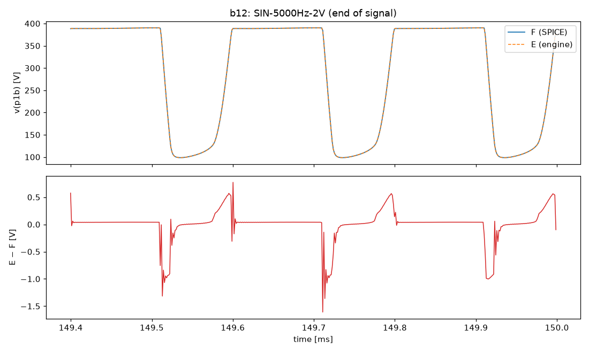
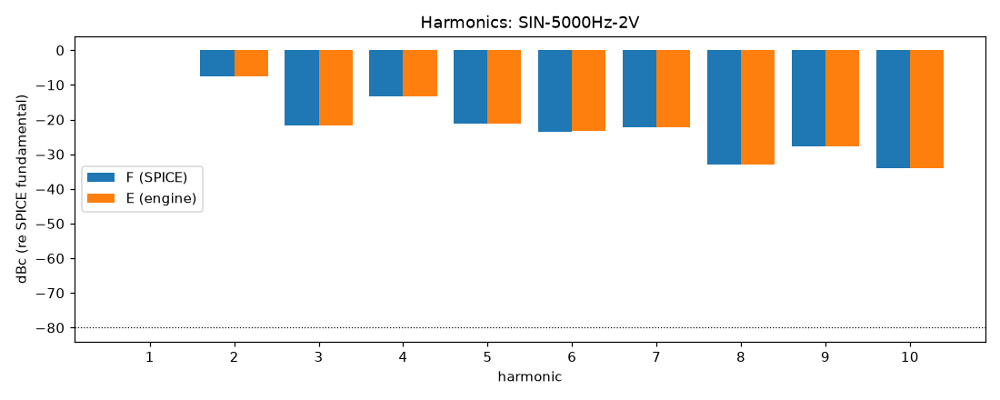
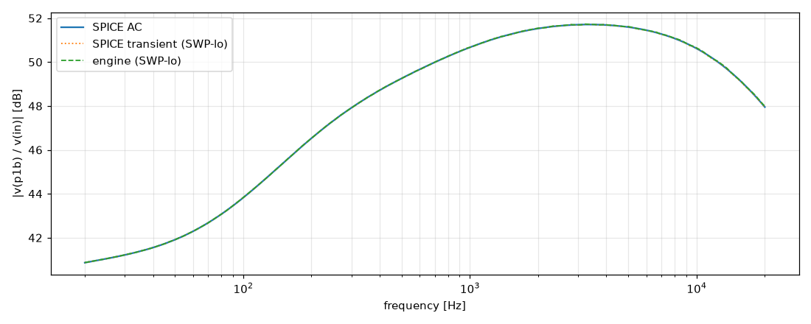

# M2 report: b12 / VOL1.0

- Block: B12 StageV1aV1b (V1a + V1b, joint root)
- Preset: VOL1.0 — Preamp Volume 1.0; standard signal set (M2)
- Knobs: preampVolume=1, treble=0.5, middle=0.5, bass=0.5, master=0.3, presence=0.5
- Date: 2026-10-13
- Engine commit: `9c92e73 (dirty)`
- Testbench: `harness/testbenches/b12.cir` sha256 `eea22b746d2e9e0a`; netlist sha256 `7bea8385e4adb04e`; tubes.lib sha256 `9ec33154be8127d7`
- ngspice 47, fs = 768000 Hz, SPICE reltol 1e-08

## Summary

PASS 90 · FAIL 0 · INFO 15 (INFO = measured, not scored in M2)

| Check | Item | Measured | Tolerance | Status |
|---|---|---|---|---|
| dc_rel_error | v(bpa) | 0 | ≤ 0.005 | PASS |
| dc_rel_error | v(g1a) | 0.0001705 | ≤ 0.005 | PASS |
| dc_rel_error | v(in) | 0 | ≤ 0.005 | PASS |
| dc_rel_error | v(k1a) | 4.583e-05 | ≤ 0.005 | PASS |
| dc_rel_error | v(k1b) | 0.0001077 | ≤ 0.005 | PASS |
| dc_rel_error | v(na) | 0.003677 | ≤ 0.005 | PASS |
| dc_rel_error | v(p1a) | 1.437e-05 | ≤ 0.005 | PASS |
| dc_rel_error | v(p1b) | 1.129e-05 | ≤ 0.005 | PASS |
| dc_rel_error | v(vtop) | 0.003677 | ≤ 0.005 | PASS |
| dc_rel_error | v(w1) | 0.003677 | ≤ 0.005 | PASS |
| nonlinear_esr_db | SIN-100Hz-0.01V | -75.65 dB | ≤ -40 | PASS |
| harmonics_2_5_db | SIN-100Hz-0.01V | 0.01303 dB | ≤ 0.5 | PASS |
| thd_pp | SIN-100Hz-0.01V | 0.000163 pp | — | INFO |
| newton_failures | SIN-100Hz-0.01V | 0 | ≤ 0 | PASS |
| newton_median_iterations | SIN-100Hz-0.01V | 1 | ≤ 3 | PASS |
| newton_max_iterations | SIN-100Hz-0.01V | 2 | ≤ 12 | PASS |
| nonlinear_esr_db | SIN-1000Hz-0.01V | -66.57 dB | ≤ -40 | PASS |
| harmonics_2_5_db | SIN-1000Hz-0.01V | 0.01672 dB | ≤ 0.5 | PASS |
| thd_pp | SIN-1000Hz-0.01V | 0.0004393 pp | — | INFO |
| newton_failures | SIN-1000Hz-0.01V | 0 | ≤ 0 | PASS |
| newton_median_iterations | SIN-1000Hz-0.01V | 1 | ≤ 3 | PASS |
| newton_max_iterations | SIN-1000Hz-0.01V | 2 | ≤ 12 | PASS |
| nonlinear_esr_db | SIN-5000Hz-0.01V | -56.97 dB | ≤ -40 | PASS |
| harmonics_2_5_db | SIN-5000Hz-0.01V | 0.01125 dB | ≤ 0.5 | PASS |
| thd_pp | SIN-5000Hz-0.01V | 0.0005095 pp | — | INFO |
| newton_failures | SIN-5000Hz-0.01V | 0 | ≤ 0 | PASS |
| newton_median_iterations | SIN-5000Hz-0.01V | 2 | ≤ 3 | PASS |
| newton_max_iterations | SIN-5000Hz-0.01V | 2 | ≤ 12 | PASS |
| nonlinear_esr_db | SIN-100Hz-0.1V | -75.14 dB | ≤ -40 | PASS |
| harmonics_2_5_db | SIN-100Hz-0.1V | 0.02421 dB | ≤ 0.5 | PASS |
| thd_pp | SIN-100Hz-0.1V | 0.001868 pp | — | INFO |
| newton_failures | SIN-100Hz-0.1V | 0 | ≤ 0 | PASS |
| newton_median_iterations | SIN-100Hz-0.1V | 1 | ≤ 3 | PASS |
| newton_max_iterations | SIN-100Hz-0.1V | 2 | ≤ 12 | PASS |
| nonlinear_esr_db | SIN-1000Hz-0.1V | -65.65 dB | ≤ -40 | PASS |
| harmonics_2_5_db | SIN-1000Hz-0.1V | 0.02255 dB | ≤ 0.5 | PASS |
| thd_pp | SIN-1000Hz-0.1V | 0.007927 pp | — | INFO |
| newton_failures | SIN-1000Hz-0.1V | 0 | ≤ 0 | PASS |
| newton_median_iterations | SIN-1000Hz-0.1V | 2 | ≤ 3 | PASS |
| newton_max_iterations | SIN-1000Hz-0.1V | 2 | ≤ 12 | PASS |
| nonlinear_esr_db | SIN-5000Hz-0.1V | -56.77 dB | ≤ -40 | PASS |
| harmonics_2_5_db | SIN-5000Hz-0.1V | 0.009374 dB | ≤ 0.5 | PASS |
| thd_pp | SIN-5000Hz-0.1V | 0.006786 pp | — | INFO |
| newton_failures | SIN-5000Hz-0.1V | 0 | ≤ 0 | PASS |
| newton_median_iterations | SIN-5000Hz-0.1V | 2 | ≤ 3 | PASS |
| newton_max_iterations | SIN-5000Hz-0.1V | 3 | ≤ 12 | PASS |
| nonlinear_esr_db | SIN-100Hz-0.5V | -67.42 dB | ≤ -40 | PASS |
| harmonics_2_5_db | SIN-100Hz-0.5V | 0.04628 dB | ≤ 0.5 | PASS |
| thd_pp | SIN-100Hz-0.5V | 0.01732 pp | — | INFO |
| newton_failures | SIN-100Hz-0.5V | 0 | ≤ 0 | PASS |
| newton_median_iterations | SIN-100Hz-0.5V | 1 | ≤ 3 | PASS |
| newton_max_iterations | SIN-100Hz-0.5V | 2 | ≤ 12 | PASS |
| nonlinear_esr_db | SIN-1000Hz-0.5V | -65.19 dB | ≤ -40 | PASS |
| harmonics_2_5_db | SIN-1000Hz-0.5V | 0.009766 dB | ≤ 0.5 | PASS |
| thd_pp | SIN-1000Hz-0.5V | 0.01095 pp | — | INFO |
| newton_failures | SIN-1000Hz-0.5V | 0 | ≤ 0 | PASS |
| newton_median_iterations | SIN-1000Hz-0.5V | 2 | ≤ 3 | PASS |
| newton_max_iterations | SIN-1000Hz-0.5V | 3 | ≤ 12 | PASS |
| nonlinear_esr_db | SIN-5000Hz-0.5V | -56.4 dB | ≤ -40 | PASS |
| harmonics_2_5_db | SIN-5000Hz-0.5V | 0.01213 dB | ≤ 0.5 | PASS |
| thd_pp | SIN-5000Hz-0.5V | 0.01127 pp | — | INFO |
| newton_failures | SIN-5000Hz-0.5V | 0 | ≤ 0 | PASS |
| newton_median_iterations | SIN-5000Hz-0.5V | 2 | ≤ 3 | PASS |
| newton_max_iterations | SIN-5000Hz-0.5V | 4 | ≤ 12 | PASS |
| nonlinear_esr_db_overdrive | SIN-100Hz-2V | -74.08 dB | ≤ -30 | PASS |
| harmonics_2_5_db | SIN-100Hz-2V | 0.01059 dB | ≤ 0.5 | PASS |
| thd_pp | SIN-100Hz-2V | 0.002979 pp | — | INFO |
| newton_failures | SIN-100Hz-2V | 0 | ≤ 0 | PASS |
| newton_median_iterations | SIN-100Hz-2V | 1 | ≤ 3 | PASS |
| newton_max_iterations | SIN-100Hz-2V | 2 | ≤ 12 | PASS |
| nonlinear_esr_db_overdrive | SIN-1000Hz-2V | -64.33 dB | ≤ -30 | PASS |
| harmonics_2_5_db | SIN-1000Hz-2V | 0.001494 dB | ≤ 0.5 | PASS |
| thd_pp | SIN-1000Hz-2V | 0.000513 pp | — | INFO |
| newton_failures | SIN-1000Hz-2V | 0 | ≤ 0 | PASS |
| newton_median_iterations | SIN-1000Hz-2V | 2 | ≤ 3 | PASS |
| newton_max_iterations | SIN-1000Hz-2V | 4 | ≤ 12 | PASS |
| nonlinear_esr_db_overdrive | SIN-5000Hz-2V | -53.8 dB | ≤ -30 | PASS |
| harmonics_2_5_db | SIN-5000Hz-2V | 0.01989 dB | ≤ 0.5 | PASS |
| thd_pp | SIN-5000Hz-2V | 0.01233 pp | — | INFO |
| newton_failures | SIN-5000Hz-2V | 0 | ≤ 0 | PASS |
| newton_median_iterations | SIN-5000Hz-2V | 2 | ≤ 3 | PASS |
| newton_max_iterations | SIN-5000Hz-2V | 7 | ≤ 12 | PASS |
| nonlinear_esr_db | SWP-lo-0.01V | -57.13 dB | ≤ -40 | PASS |
| linear_mag_db_20_10k | SWP-lo-0.01V | 0.03077 dB | ≤ 0.1 | INFO |
| linear_mag_db_10k_20k | SWP-lo-0.01V | 0.03803 dB | ≤ 0.3 | INFO |
| method_mag_db_spice_tran_vs_ac | SWP-lo-0.01V | 0.03662 dB | — | INFO |
| newton_failures | SWP-lo-0.01V | 0 | ≤ 0 | PASS |
| newton_median_iterations | SWP-lo-0.01V | 1 | ≤ 3 | PASS |
| newton_max_iterations | SWP-lo-0.01V | 3 | ≤ 12 | PASS |
| nonlinear_esr_db | SWP-hi-0.1V | -57.05 dB | ≤ -40 | PASS |
| newton_failures | SWP-hi-0.1V | 0 | ≤ 0 | PASS |
| newton_median_iterations | SWP-hi-0.1V | 2 | ≤ 3 | PASS |
| newton_max_iterations | SWP-hi-0.1V | 3 | ≤ 12 | PASS |
| nonlinear_esr_db | TT-0.05V | -71.85 dB | ≤ -40 | PASS |
| newton_failures | TT-0.05V | 0 | ≤ 0 | PASS |
| newton_median_iterations | TT-0.05V | 1 | ≤ 3 | PASS |
| newton_max_iterations | TT-0.05V | 2 | ≤ 12 | PASS |
| nonlinear_esr_db | BURST-0.5V | -65.2 dB | ≤ -40 | PASS |
| newton_failures | BURST-0.5V | 0 | ≤ 0 | PASS |
| newton_median_iterations | BURST-0.5V | 2 | ≤ 3 | PASS |
| newton_max_iterations | BURST-0.5V | 3 | ≤ 12 | PASS |
| nonlinear_esr_db | STEP-0.1V | -67.89 dB | ≤ -40 | PASS |
| newton_failures | STEP-0.1V | 0 | ≤ 0 | PASS |
| newton_median_iterations | STEP-0.1V | 1 | ≤ 3 | PASS |
| newton_max_iterations | STEP-0.1V | 3 | ≤ 12 | PASS |

## Signals

| Signal | Peak F [V] | ESR [dB] | Best lag | ESR at lag [dB] | THD F / E [%] | Power F / E [W] | ns/sample | Newton fail / median / max it |
|---|---|---|---|---|---|---|---|---|
| SIN-100Hz-0.01V | 1.597 | -75.65 | 0 | -75.65 | 0.0987 / 0.0985 | — | 277.3 | 0 / 1 / 2 |
| SIN-1000Hz-0.01V | 3.571 | -66.57 | 0 | -66.57 | 0.197 / 0.197 | — | 283.9 | 0 / 1 / 2 |
| SIN-5000Hz-0.01V | 3.98 | -56.97 | 0 | -56.97 | 0.239 / 0.239 | — | 441.0 | 0 / 2 / 2 |
| SIN-100Hz-0.1V | 16.21 | -75.14 | 0 | -75.14 | 1.07 / 1.07 | — | 277.5 | 0 / 1 / 2 |
| SIN-1000Hz-0.1V | 36.51 | -65.65 | 0 | -65.65 | 3.18 / 3.17 | — | 440.5 | 0 / 2 / 2 |
| SIN-5000Hz-0.1V | 40.8 | -56.77 | 0 | -56.77 | 4.18 / 4.18 | — | 443.9 | 0 / 2 / 3 |
| SIN-100Hz-0.5V | 83.15 | -67.42 | 0 | -67.42 | 19.5 / 19.5 | — | 280.6 | 0 / 1 / 2 |
| SIN-1000Hz-0.5V | 182.8 | -65.19 | 0 | -65.19 | 30.2 / 30.2 | — | 455.4 | 0 / 2 / 3 |
| SIN-5000Hz-0.5V | 205.9 | -56.40 | 0 | -56.40 | 31.7 / 31.7 | — | 510.6 | 0 / 2 / 4 |
| SIN-100Hz-2V | 229.1 | -74.08 | 0 | -74.08 | 35 / 35 | — | 322.6 | 0 / 1 / 2 |
| SIN-1000Hz-2V | 249.7 | -64.33 | 0 | -64.33 | 40.2 / 40.2 | — | 481.4 | 0 / 2 / 4 |
| SIN-5000Hz-2V | 275.6 | -53.80 | 0 | -53.80 | 49.8 / 49.8 | — | 532.4 | 0 / 2 / 7 |
| SWP-lo-0.01V | 3.87 | -57.13 | 0 | -57.13 | — | — | 339.6 | 0 / 1 / 3 |
| SWP-hi-0.1V | 39.81 | -57.05 | 0 | -57.05 | — | — | 377.3 | 0 / 2 / 3 |
| TT-0.05V | 22.36 | -71.85 | 0 | -71.85 | — | — | 277.9 | 0 / 1 / 2 |
| BURST-0.5V | 182.6 | -65.20 | 0 | -65.20 | — | — | 389.4 | 0 / 2 / 3 |
| STEP-0.1V | 38.65 | -67.89 | 0 | -67.89 | — | — | 284.1 | 0 / 1 / 3 |

## DC operating point

| Node | SPICE [V] | Engine [V] | Rel. error |
|---|---|---|---|
| bpa | 389.3496 | 389.3496 | 0 |
| g1a | 0.0001 | 0.0001 | 0.0001705 |
| in | 0.0000 | 0.0000 | 0 |
| k1a | 2.5096 | 2.5095 | 4.583e-05 |
| k1b | 3.6923 | 3.6919 | 0.0001077 |
| na | 0.0010 | 0.0010 | 0.003677 |
| p1a | 296.4025 | 296.4067 | 1.437e-05 |
| p1b | 352.4262 | 352.4302 | 1.129e-05 |
| vtop | 0.0010 | 0.0010 | 0.003677 |
| w1 | 0.0010 | 0.0010 | 0.003677 |

Engine values are the probe values after the first sample (zero input) following `reset()`. Nodes the engine does not probe yet show —.

## Figures

### Waveform overlay and error (most demanding signal)

### Harmonics

### Magnitude response

