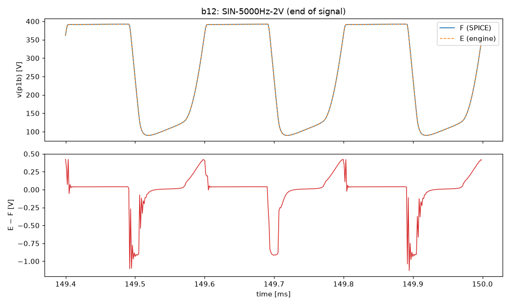
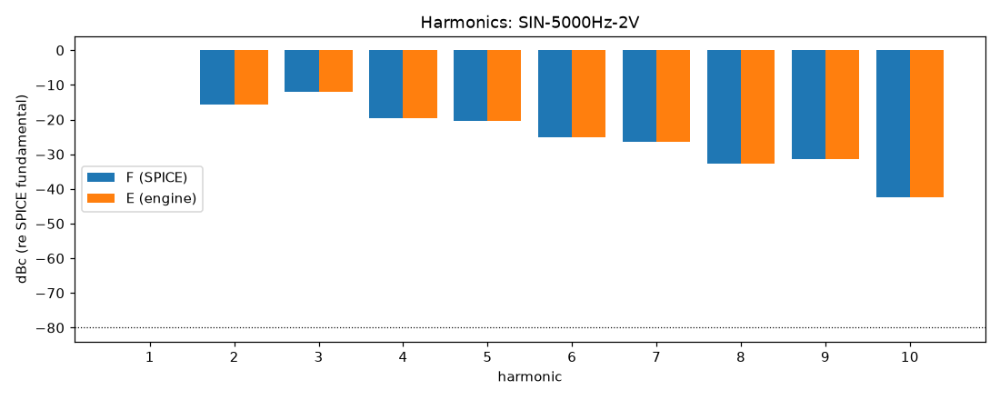
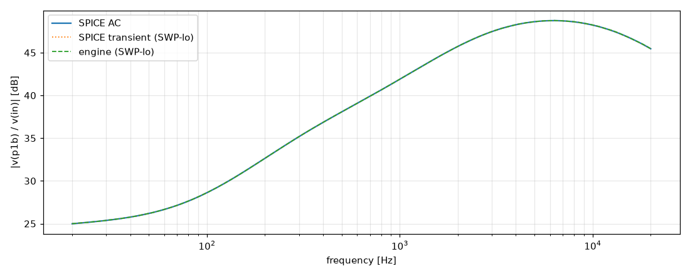
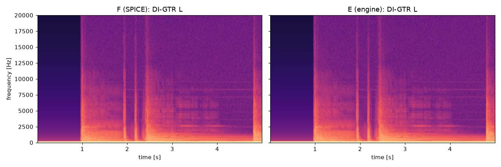

# M2 report: b12 / DEFAULT

- Block: B12 StageV1aV1b (V1a + V1b, joint root)
- Preset: DEFAULT — Default knobs; standard signal set at the block levels
- Knobs: preampVolume=0.6, treble=0.5, middle=0.5, bass=0.5, master=0.3, presence=0.5
- Date: 2026-10-18
- Engine commit: `d37baf0 (dirty)`
- Testbench: `harness/testbenches/b12.cir` sha256 `ddc48819203d327c`; netlist sha256 `ffd9b2812204248f`; tubes.lib sha256 `c9c9c88346c69010`
- ngspice 47, fs = 768000 Hz, SPICE reltol 1e-08

## Summary

PASS 105 · FAIL 0 · INFO 16 (INFO = measured, not scored in M2)

| Check | Item | Measured | Tolerance | Status |
|---|---|---|---|---|
| dc_rel_error | v(bpa) | 1.45e-16 | ≤ 0.005 | PASS |
| dc_rel_error | v(g1a) | 0.0001717 | ≤ 0.005 | PASS |
| dc_rel_error | v(in) | 0 | ≤ 0.005 | PASS |
| dc_rel_error | v(k1a) | 4.576e-05 | ≤ 0.005 | PASS |
| dc_rel_error | v(k1b) | 0.000107 | ≤ 0.005 | PASS |
| dc_rel_error | v(na) | 0.0006024 | ≤ 0.005 | PASS |
| dc_rel_error | v(p1a) | 1.436e-05 | ≤ 0.005 | PASS |
| dc_rel_error | v(p1b) | 1.121e-05 | ≤ 0.005 | PASS |
| dc_rel_error | v(vtop) | 0.0006024 | ≤ 0.005 | PASS |
| dc_rel_error | v(w1) | 0.0006024 | ≤ 0.005 | PASS |
| nonlinear_esr_db | SIN-100Hz-0.01V | -76.08 dB | ≤ -20 | PASS |
| harmonics_2_5_db | SIN-100Hz-0.01V | — | ≤ 0.5 | INFO |
| thd_pp | SIN-100Hz-0.01V | 1.078e-05 pp | — | INFO |
| newton_failures | SIN-100Hz-0.01V | 0 | ≤ 0 | PASS |
| newton_median_iterations | SIN-100Hz-0.01V | 1 | ≤ 3 | PASS |
| newton_max_iterations | SIN-100Hz-0.01V | 1 | ≤ 12 | PASS |
| nonlinear_esr_db | SIN-1000Hz-0.01V | -68.16 dB | ≤ -20 | PASS |
| harmonics_2_5_db | SIN-1000Hz-0.01V | 0.0136 dB | ≤ 0.5 | PASS |
| thd_pp | SIN-1000Hz-0.01V | 0.0001133 pp | — | INFO |
| newton_failures | SIN-1000Hz-0.01V | 0 | ≤ 0 | PASS |
| newton_median_iterations | SIN-1000Hz-0.01V | 1 | ≤ 3 | PASS |
| newton_max_iterations | SIN-1000Hz-0.01V | 2 | ≤ 12 | PASS |
| nonlinear_esr_db | SIN-5000Hz-0.01V | -57.18 dB | ≤ -20 | PASS |
| harmonics_2_5_db | SIN-5000Hz-0.01V | 0.01576 dB | ≤ 0.5 | PASS |
| thd_pp | SIN-5000Hz-0.01V | 0.0003894 pp | — | INFO |
| newton_failures | SIN-5000Hz-0.01V | 0 | ≤ 0 | PASS |
| newton_median_iterations | SIN-5000Hz-0.01V | 2 | ≤ 3 | PASS |
| newton_max_iterations | SIN-5000Hz-0.01V | 2 | ≤ 12 | PASS |
| nonlinear_esr_db | SIN-100Hz-0.1V | -76.07 dB | ≤ -20 | PASS |
| harmonics_2_5_db | SIN-100Hz-0.1V | 0.0117 dB | ≤ 0.5 | PASS |
| thd_pp | SIN-100Hz-0.1V | 0.0001065 pp | — | INFO |
| newton_failures | SIN-100Hz-0.1V | 0 | ≤ 0 | PASS |
| newton_median_iterations | SIN-100Hz-0.1V | 1 | ≤ 3 | PASS |
| newton_max_iterations | SIN-100Hz-0.1V | 2 | ≤ 12 | PASS |
| nonlinear_esr_db | SIN-1000Hz-0.1V | -68.06 dB | ≤ -20 | PASS |
| harmonics_2_5_db | SIN-1000Hz-0.1V | 0.02226 dB | ≤ 0.5 | PASS |
| thd_pp | SIN-1000Hz-0.1V | 0.001254 pp | — | INFO |
| newton_failures | SIN-1000Hz-0.1V | 0 | ≤ 0 | PASS |
| newton_median_iterations | SIN-1000Hz-0.1V | 2 | ≤ 3 | PASS |
| newton_max_iterations | SIN-1000Hz-0.1V | 2 | ≤ 12 | PASS |
| nonlinear_esr_db | SIN-5000Hz-0.1V | -57.08 dB | ≤ -20 | PASS |
| harmonics_2_5_db | SIN-5000Hz-0.1V | 0.01389 dB | ≤ 0.5 | PASS |
| thd_pp | SIN-5000Hz-0.1V | 0.004654 pp | — | INFO |
| newton_failures | SIN-5000Hz-0.1V | 0 | ≤ 0 | PASS |
| newton_median_iterations | SIN-5000Hz-0.1V | 2 | ≤ 3 | PASS |
| newton_max_iterations | SIN-5000Hz-0.1V | 2 | ≤ 12 | PASS |
| nonlinear_esr_db | SIN-100Hz-0.5V | -75.63 dB | ≤ -20 | PASS |
| harmonics_2_5_db | SIN-100Hz-0.5V | 0.02413 dB | ≤ 0.5 | PASS |
| thd_pp | SIN-100Hz-0.5V | 0.0003982 pp | — | INFO |
| newton_failures | SIN-100Hz-0.5V | 0 | ≤ 0 | PASS |
| newton_median_iterations | SIN-100Hz-0.5V | 1 | ≤ 3 | PASS |
| newton_max_iterations | SIN-100Hz-0.5V | 2 | ≤ 12 | PASS |
| nonlinear_esr_db | SIN-1000Hz-0.5V | -64.63 dB | ≤ -20 | PASS |
| harmonics_2_5_db | SIN-1000Hz-0.5V | 0.163 dB | ≤ 0.5 | PASS |
| thd_pp | SIN-1000Hz-0.5V | 0.0193 pp | — | INFO |
| newton_failures | SIN-1000Hz-0.5V | 0 | ≤ 0 | PASS |
| newton_median_iterations | SIN-1000Hz-0.5V | 2 | ≤ 3 | PASS |
| newton_max_iterations | SIN-1000Hz-0.5V | 2 | ≤ 12 | PASS |
| nonlinear_esr_db | SIN-5000Hz-0.5V | -56.46 dB | ≤ -20 | PASS |
| harmonics_2_5_db | SIN-5000Hz-0.5V | 0.01751 dB | ≤ 0.5 | PASS |
| thd_pp | SIN-5000Hz-0.5V | 0.01231 pp | — | INFO |
| newton_failures | SIN-5000Hz-0.5V | 0 | ≤ 0 | PASS |
| newton_median_iterations | SIN-5000Hz-0.5V | 2 | ≤ 3 | PASS |
| newton_max_iterations | SIN-5000Hz-0.5V | 4 | ≤ 12 | PASS |
| nonlinear_esr_db_overdrive | SIN-100Hz-2V | -66.58 dB | ≤ -20 | PASS |
| harmonics_2_5_db | SIN-100Hz-2V | 0.0261 dB | ≤ 0.5 | PASS |
| thd_pp | SIN-100Hz-2V | 0.0177 pp | — | INFO |
| newton_failures | SIN-100Hz-2V | 0 | ≤ 0 | PASS |
| newton_median_iterations | SIN-100Hz-2V | 1 | ≤ 3 | PASS |
| newton_max_iterations | SIN-100Hz-2V | 2 | ≤ 12 | PASS |
| nonlinear_esr_db_overdrive | SIN-1000Hz-2V | -67.36 dB | ≤ -20 | PASS |
| harmonics_2_5_db | SIN-1000Hz-2V | 0.01549 dB | ≤ 0.5 | PASS |
| thd_pp | SIN-1000Hz-2V | 0.01299 pp | — | INFO |
| newton_failures | SIN-1000Hz-2V | 0 | ≤ 0 | PASS |
| newton_median_iterations | SIN-1000Hz-2V | 2 | ≤ 3 | PASS |
| newton_max_iterations | SIN-1000Hz-2V | 3 | ≤ 12 | PASS |
| nonlinear_esr_db_overdrive | SIN-5000Hz-2V | -55.38 dB | ≤ -20 | PASS |
| harmonics_2_5_db | SIN-5000Hz-2V | 0.01022 dB | ≤ 0.5 | PASS |
| thd_pp | SIN-5000Hz-2V | 0.00766 pp | — | INFO |
| newton_failures | SIN-5000Hz-2V | 0 | ≤ 0 | PASS |
| newton_median_iterations | SIN-5000Hz-2V | 2 | ≤ 3 | PASS |
| newton_max_iterations | SIN-5000Hz-2V | 6 | ≤ 12 | PASS |
| nonlinear_esr_db | SWP-lo-0.01V | -55.39 dB | ≤ -20 | PASS |
| linear_mag_db_20_10k | SWP-lo-0.01V | 0.01735 dB | ≤ 0.1 | INFO |
| linear_mag_db_10k_20k | SWP-lo-0.01V | 0.02413 dB | ≤ 0.3 | INFO |
| method_mag_db_spice_tran_vs_ac | SWP-lo-0.01V | 0.03087 dB | — | INFO |
| newton_failures | SWP-lo-0.01V | 0 | ≤ 0 | PASS |
| newton_median_iterations | SWP-lo-0.01V | 1 | ≤ 3 | PASS |
| newton_max_iterations | SWP-lo-0.01V | 3 | ≤ 12 | PASS |
| nonlinear_esr_db | SWP-hi-0.1V | -55.37 dB | ≤ -20 | PASS |
| newton_failures | SWP-hi-0.1V | 0 | ≤ 0 | PASS |
| newton_median_iterations | SWP-hi-0.1V | 1 | ≤ 3 | PASS |
| newton_max_iterations | SWP-hi-0.1V | 3 | ≤ 12 | PASS |
| nonlinear_esr_db | TT-0.05V | -73.66 dB | ≤ -20 | PASS |
| newton_failures | TT-0.05V | 0 | ≤ 0 | PASS |
| newton_median_iterations | TT-0.05V | 1 | ≤ 3 | PASS |
| newton_max_iterations | TT-0.05V | 2 | ≤ 12 | PASS |
| nonlinear_esr_db | BURST-0.5V | -64.63 dB | ≤ -20 | PASS |
| newton_failures | BURST-0.5V | 0 | ≤ 0 | PASS |
| newton_median_iterations | BURST-0.5V | 1 | ≤ 3 | PASS |
| newton_max_iterations | BURST-0.5V | 3 | ≤ 12 | PASS |
| nonlinear_esr_db | STEP-0.1V | -61.4 dB | ≤ -20 | PASS |
| newton_failures | STEP-0.1V | 0 | ≤ 0 | PASS |
| newton_median_iterations | STEP-0.1V | 1 | ≤ 3 | PASS |
| newton_max_iterations | STEP-0.1V | 3 | ≤ 12 | PASS |
| nonlinear_esr_db | DI-GTR L | -69.48 dB | ≤ -20 | PASS |
| newton_failures | DI-GTR L | 0 | ≤ 0 | PASS |
| newton_median_iterations | DI-GTR L | 1 | ≤ 3 | PASS |
| newton_max_iterations | DI-GTR L | 2 | ≤ 12 | PASS |
| nonlinear_esr_db | DI-GTR LL | -69.44 dB | ≤ -20 | PASS |
| newton_failures | DI-GTR LL | 0 | ≤ 0 | PASS |
| newton_median_iterations | DI-GTR LL | 1 | ≤ 3 | PASS |
| newton_max_iterations | DI-GTR LL | 3 | ≤ 12 | PASS |
| nonlinear_esr_db | DI-GTR R | -69.73 dB | ≤ -20 | PASS |
| newton_failures | DI-GTR R | 0 | ≤ 0 | PASS |
| newton_median_iterations | DI-GTR R | 1 | ≤ 3 | PASS |
| newton_max_iterations | DI-GTR R | 3 | ≤ 12 | PASS |
| nonlinear_esr_db | DI-GTR RR | -69.16 dB | ≤ -20 | PASS |
| newton_failures | DI-GTR RR | 0 | ≤ 0 | PASS |
| newton_median_iterations | DI-GTR RR | 1 | ≤ 3 | PASS |
| newton_max_iterations | DI-GTR RR | 3 | ≤ 12 | PASS |

## Signals

| Signal | Peak F [V] | ESR [dB] | Best lag | ESR at lag [dB] | THD F / E [%] | Power F / E [W] | ns/sample | Newton fail / median / max it |
|---|---|---|---|---|---|---|---|---|
| SIN-100Hz-0.01V | 0.2762 | -76.08 | 0 | -76.08 | 0.00925 / 0.00926 | — | 289.6 | 0 / 1 / 1 |
| SIN-1000Hz-0.01V | 1.275 | -68.16 | 0 | -68.16 | 0.0634 / 0.0632 | — | 292.0 | 0 / 1 / 2 |
| SIN-5000Hz-0.01V | 2.832 | -57.18 | 0 | -57.18 | 0.151 / 0.15 | — | 458.8 | 0 / 2 / 2 |
| SIN-100Hz-0.1V | 2.763 | -76.07 | 0 | -76.07 | 0.0902 / 0.0904 | — | 286.9 | 0 / 1 / 2 |
| SIN-1000Hz-0.1V | 12.83 | -68.06 | 0 | -68.06 | 0.655 / 0.653 | — | 404.5 | 0 / 2 / 2 |
| SIN-5000Hz-0.1V | 28.88 | -57.08 | 0 | -57.08 | 1.98 / 1.98 | — | 438.8 | 0 / 2 / 2 |
| SIN-100Hz-0.5V | 13.79 | -75.63 | 0 | -75.63 | 0.462 / 0.463 | — | 290.5 | 0 / 1 / 2 |
| SIN-1000Hz-0.5V | 63.77 | -64.63 | 0 | -64.63 | 12.8 / 12.8 | — | 433.1 | 0 / 2 / 2 |
| SIN-5000Hz-0.5V | 146 | -56.46 | 0 | -56.46 | 27.4 / 27.4 | — | 477.0 | 0 / 2 / 4 |
| SIN-100Hz-2V | 52.13 | -66.58 | 0 | -66.58 | 8.21 / 8.2 | — | 288.3 | 0 / 1 / 2 |
| SIN-1000Hz-2V | 226.3 | -67.36 | 0 | -67.36 | 30.2 / 30.2 | — | 465.7 | 0 / 2 / 3 |
| SIN-5000Hz-2V | 270 | -55.38 | 0 | -55.38 | 34.3 / 34.3 | — | 509.1 | 0 / 2 / 6 |
| SWP-lo-0.01V | 2.746 | -55.39 | 0 | -55.39 | — | — | 334.1 | 0 / 1 / 3 |
| SWP-hi-0.1V | 28.05 | -55.37 | 0 | -55.37 | — | — | 361.8 | 0 / 1 / 3 |
| TT-0.05V | 5.308 | -73.66 | 0 | -73.66 | — | — | 286.1 | 0 / 1 / 2 |
| BURST-0.5V | 63.74 | -64.63 | 0 | -64.63 | — | — | 359.5 | 0 / 1 / 3 |
| STEP-0.1V | 22.79 | -61.40 | 0 | -61.40 | — | — | 299.0 | 0 / 1 / 3 |
| DI-GTR L | 126 | -69.48 | 0 | -69.48 | — | — | 312.4 | 0 / 1 / 2 |
| DI-GTR LL | 122.9 | -69.44 | 0 | -69.44 | — | — | 307.1 | 0 / 1 / 3 |
| DI-GTR R | 114.5 | -69.73 | 0 | -69.73 | — | — | 306.4 | 0 / 1 / 3 |
| DI-GTR RR | 121.1 | -69.16 | 0 | -69.16 | — | — | 308.5 | 0 / 1 / 3 |

## DC operating point

| Node | SPICE [V] | Engine [V] | Rel. error |
|---|---|---|---|
| bpa | 391.9215 | 391.9215 | 1.45e-16 |
| g1a | 0.0001 | 0.0001 | 0.0001717 |
| in | 0.0000 | 0.0000 | 0 |
| k1a | 2.5271 | 2.5270 | 4.576e-05 |
| k1b | 3.7171 | 3.7167 | 0.000107 |
| na | 0.0002 | 0.0002 | 0.0006024 |
| p1a | 298.3260 | 298.3303 | 1.436e-05 |
| p1b | 354.7502 | 354.7542 | 1.121e-05 |
| vtop | 0.0002 | 0.0002 | 0.0006024 |
| w1 | 0.0002 | 0.0002 | 0.0006024 |

Engine values are the probe values after the first sample (zero input) following `reset()`. Nodes the engine does not probe yet show —.

## Figures

### Waveform overlay and error (most demanding signal)

### Harmonics

### Magnitude response

### Spectrogram (DI)

