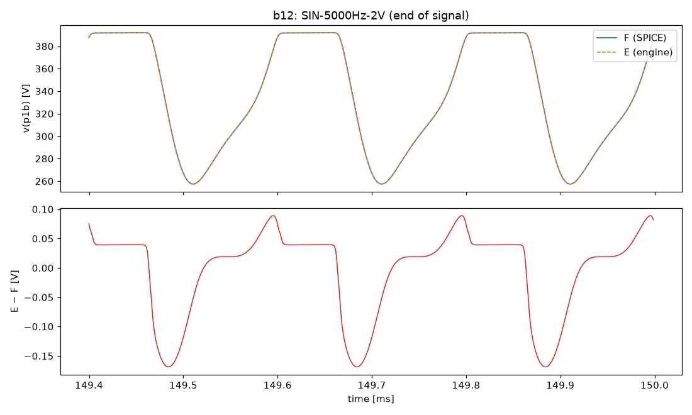
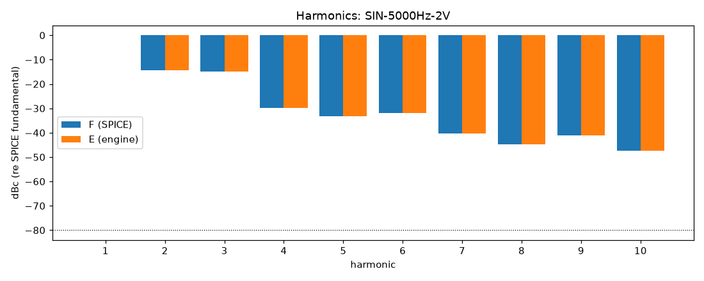
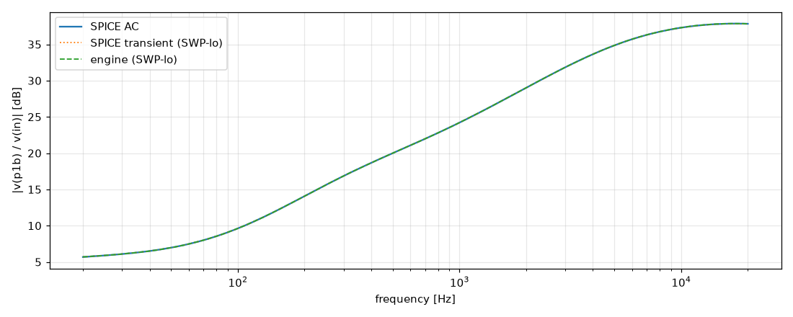
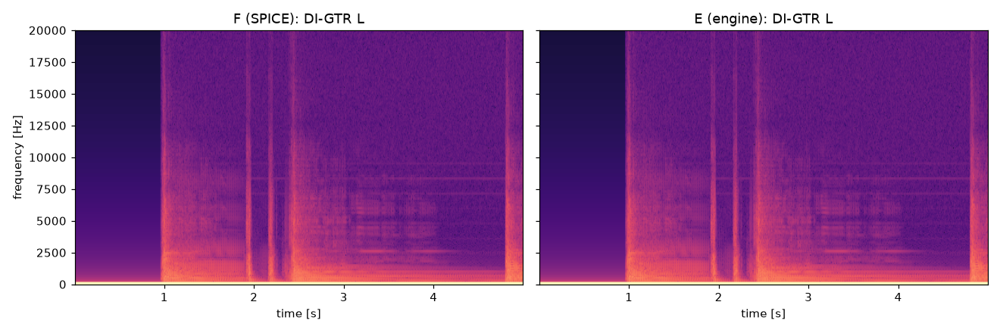

# M2 report: b12 / VOL0.2

- Block: B12 StageV1aV1b (V1a + V1b, joint root)
- Preset: VOL0.2 — Preamp Volume 0.2; standard signal set (M2)
- Knobs: preampVolume=0.2, treble=0.5, middle=0.5, bass=0.5, master=0.3, presence=0.5
- Date: 2026-10-18
- Engine commit: `d37baf0 (dirty)`
- Testbench: `harness/testbenches/b12.cir` sha256 `ddc48819203d327c`; netlist sha256 `ffd9b2812204248f`; tubes.lib sha256 `c9c9c88346c69010`
- ngspice 47, fs = 768000 Hz, SPICE reltol 1e-08

## Summary

PASS 106 · FAIL 0 · INFO 15 (INFO = measured, not scored in M2)

| Check | Item | Measured | Tolerance | Status |
|---|---|---|---|---|
| dc_rel_error | v(bpa) | 1.45e-16 | ≤ 0.005 | PASS |
| dc_rel_error | v(g1a) | 0.0001717 | ≤ 0.005 | PASS |
| dc_rel_error | v(in) | 0 | ≤ 0.005 | PASS |
| dc_rel_error | v(k1a) | 4.576e-05 | ≤ 0.005 | PASS |
| dc_rel_error | v(k1b) | 0.0001069 | ≤ 0.005 | PASS |
| dc_rel_error | v(na) | 6.543e-05 | ≤ 0.005 | PASS |
| dc_rel_error | v(p1a) | 1.436e-05 | ≤ 0.005 | PASS |
| dc_rel_error | v(p1b) | 1.12e-05 | ≤ 0.005 | PASS |
| dc_rel_error | v(vtop) | 6.543e-05 | ≤ 0.005 | PASS |
| dc_rel_error | v(w1) | 6.543e-05 | ≤ 0.005 | PASS |
| nonlinear_esr_db | SIN-100Hz-0.01V | -76.23 dB | ≤ -20 | PASS |
| harmonics_2_5_db | SIN-100Hz-0.01V | 0.001939 dB | ≤ 0.5 | PASS |
| thd_pp | SIN-100Hz-0.01V | 9.992e-06 pp | — | INFO |
| newton_failures | SIN-100Hz-0.01V | 0 | ≤ 0 | PASS |
| newton_median_iterations | SIN-100Hz-0.01V | 1 | ≤ 3 | PASS |
| newton_max_iterations | SIN-100Hz-0.01V | 1 | ≤ 12 | PASS |
| nonlinear_esr_db | SIN-1000Hz-0.01V | -69.84 dB | ≤ -20 | PASS |
| harmonics_2_5_db | SIN-1000Hz-0.01V | 0.0001541 dB | ≤ 0.5 | PASS |
| thd_pp | SIN-1000Hz-0.01V | 2.054e-05 pp | — | INFO |
| newton_failures | SIN-1000Hz-0.01V | 0 | ≤ 0 | PASS |
| newton_median_iterations | SIN-1000Hz-0.01V | 1 | ≤ 3 | PASS |
| newton_max_iterations | SIN-1000Hz-0.01V | 2 | ≤ 12 | PASS |
| nonlinear_esr_db | SIN-5000Hz-0.01V | -58.53 dB | ≤ -20 | PASS |
| harmonics_2_5_db | SIN-5000Hz-0.01V | 0.01449 dB | ≤ 0.5 | PASS |
| thd_pp | SIN-5000Hz-0.01V | 8.281e-05 pp | — | INFO |
| newton_failures | SIN-5000Hz-0.01V | 0 | ≤ 0 | PASS |
| newton_median_iterations | SIN-5000Hz-0.01V | 2 | ≤ 3 | PASS |
| newton_max_iterations | SIN-5000Hz-0.01V | 2 | ≤ 12 | PASS |
| nonlinear_esr_db | SIN-100Hz-0.1V | -76.23 dB | ≤ -20 | PASS |
| harmonics_2_5_db | SIN-100Hz-0.1V | 0.001969 dB | ≤ 0.5 | PASS |
| thd_pp | SIN-100Hz-0.1V | 0.0001001 pp | — | INFO |
| newton_failures | SIN-100Hz-0.1V | 0 | ≤ 0 | PASS |
| newton_median_iterations | SIN-100Hz-0.1V | 1 | ≤ 3 | PASS |
| newton_max_iterations | SIN-100Hz-0.1V | 2 | ≤ 12 | PASS |
| nonlinear_esr_db | SIN-1000Hz-0.1V | -69.83 dB | ≤ -20 | PASS |
| harmonics_2_5_db | SIN-1000Hz-0.1V | 0.005029 dB | ≤ 0.5 | PASS |
| thd_pp | SIN-1000Hz-0.1V | 0.0002044 pp | — | INFO |
| newton_failures | SIN-1000Hz-0.1V | 0 | ≤ 0 | PASS |
| newton_median_iterations | SIN-1000Hz-0.1V | 1 | ≤ 3 | PASS |
| newton_max_iterations | SIN-1000Hz-0.1V | 2 | ≤ 12 | PASS |
| nonlinear_esr_db | SIN-5000Hz-0.1V | -58.53 dB | ≤ -20 | PASS |
| harmonics_2_5_db | SIN-5000Hz-0.1V | 0.08524 dB | ≤ 0.5 | PASS |
| thd_pp | SIN-5000Hz-0.1V | 0.0008574 pp | — | INFO |
| newton_failures | SIN-5000Hz-0.1V | 0 | ≤ 0 | PASS |
| newton_median_iterations | SIN-5000Hz-0.1V | 2 | ≤ 3 | PASS |
| newton_max_iterations | SIN-5000Hz-0.1V | 2 | ≤ 12 | PASS |
| nonlinear_esr_db | SIN-100Hz-0.5V | -76.19 dB | ≤ -20 | PASS |
| harmonics_2_5_db | SIN-100Hz-0.5V | 0.005208 dB | ≤ 0.5 | PASS |
| thd_pp | SIN-100Hz-0.5V | 0.0005098 pp | — | INFO |
| newton_failures | SIN-100Hz-0.5V | 0 | ≤ 0 | PASS |
| newton_median_iterations | SIN-100Hz-0.5V | 1 | ≤ 3 | PASS |
| newton_max_iterations | SIN-100Hz-0.5V | 2 | ≤ 12 | PASS |
| nonlinear_esr_db | SIN-1000Hz-0.5V | -69.67 dB | ≤ -20 | PASS |
| harmonics_2_5_db | SIN-1000Hz-0.5V | 0.0147 dB | ≤ 0.5 | PASS |
| thd_pp | SIN-1000Hz-0.5V | 0.001054 pp | — | INFO |
| newton_failures | SIN-1000Hz-0.5V | 0 | ≤ 0 | PASS |
| newton_median_iterations | SIN-1000Hz-0.5V | 2 | ≤ 3 | PASS |
| newton_max_iterations | SIN-1000Hz-0.5V | 2 | ≤ 12 | PASS |
| nonlinear_esr_db | SIN-5000Hz-0.5V | -58.39 dB | ≤ -20 | PASS |
| harmonics_2_5_db | SIN-5000Hz-0.5V | 0.01418 dB | ≤ 0.5 | PASS |
| thd_pp | SIN-5000Hz-0.5V | 0.003571 pp | — | INFO |
| newton_failures | SIN-5000Hz-0.5V | 0 | ≤ 0 | PASS |
| newton_median_iterations | SIN-5000Hz-0.5V | 2 | ≤ 3 | PASS |
| newton_max_iterations | SIN-5000Hz-0.5V | 3 | ≤ 12 | PASS |
| nonlinear_esr_db_overdrive | SIN-100Hz-2V | -75.41 dB | ≤ -20 | PASS |
| harmonics_2_5_db | SIN-100Hz-2V | 0.008804 dB | ≤ 0.5 | PASS |
| thd_pp | SIN-100Hz-2V | 0.002683 pp | — | INFO |
| newton_failures | SIN-100Hz-2V | 0 | ≤ 0 | PASS |
| newton_median_iterations | SIN-100Hz-2V | 1 | ≤ 3 | PASS |
| newton_max_iterations | SIN-100Hz-2V | 2 | ≤ 12 | PASS |
| nonlinear_esr_db_overdrive | SIN-1000Hz-2V | -66.81 dB | ≤ -20 | PASS |
| harmonics_2_5_db | SIN-1000Hz-2V | 0.01702 dB | ≤ 0.5 | PASS |
| thd_pp | SIN-1000Hz-2V | 0.006508 pp | — | INFO |
| newton_failures | SIN-1000Hz-2V | 0 | ≤ 0 | PASS |
| newton_median_iterations | SIN-1000Hz-2V | 2 | ≤ 3 | PASS |
| newton_max_iterations | SIN-1000Hz-2V | 3 | ≤ 12 | PASS |
| nonlinear_esr_db_overdrive | SIN-5000Hz-2V | -57.12 dB | ≤ -20 | PASS |
| harmonics_2_5_db | SIN-5000Hz-2V | 0.02244 dB | ≤ 0.5 | PASS |
| thd_pp | SIN-5000Hz-2V | 0.001298 pp | — | INFO |
| newton_failures | SIN-5000Hz-2V | 0 | ≤ 0 | PASS |
| newton_median_iterations | SIN-5000Hz-2V | 2 | ≤ 3 | PASS |
| newton_max_iterations | SIN-5000Hz-2V | 4 | ≤ 12 | PASS |
| nonlinear_esr_db | SWP-lo-0.01V | -53.06 dB | ≤ -20 | PASS |
| linear_mag_db_20_10k | SWP-lo-0.01V | 0.02046 dB | ≤ 0.1 | INFO |
| linear_mag_db_10k_20k | SWP-lo-0.01V | 0.0127 dB | ≤ 0.3 | INFO |
| method_mag_db_spice_tran_vs_ac | SWP-lo-0.01V | 0.02721 dB | — | INFO |
| newton_failures | SWP-lo-0.01V | 0 | ≤ 0 | PASS |
| newton_median_iterations | SWP-lo-0.01V | 1 | ≤ 3 | PASS |
| newton_max_iterations | SWP-lo-0.01V | 3 | ≤ 12 | PASS |
| nonlinear_esr_db | SWP-hi-0.1V | -53.06 dB | ≤ -20 | PASS |
| newton_failures | SWP-hi-0.1V | 0 | ≤ 0 | PASS |
| newton_median_iterations | SWP-hi-0.1V | 1 | ≤ 3 | PASS |
| newton_max_iterations | SWP-hi-0.1V | 3 | ≤ 12 | PASS |
| nonlinear_esr_db | TT-0.05V | -74.31 dB | ≤ -20 | PASS |
| newton_failures | TT-0.05V | 0 | ≤ 0 | PASS |
| newton_median_iterations | TT-0.05V | 1 | ≤ 3 | PASS |
| newton_max_iterations | TT-0.05V | 2 | ≤ 12 | PASS |
| nonlinear_esr_db | BURST-0.5V | -69.68 dB | ≤ -20 | PASS |
| newton_failures | BURST-0.5V | 0 | ≤ 0 | PASS |
| newton_median_iterations | BURST-0.5V | 1 | ≤ 3 | PASS |
| newton_max_iterations | BURST-0.5V | 2 | ≤ 12 | PASS |
| nonlinear_esr_db | STEP-0.1V | -56.71 dB | ≤ -20 | PASS |
| newton_failures | STEP-0.1V | 0 | ≤ 0 | PASS |
| newton_median_iterations | STEP-0.1V | 1 | ≤ 3 | PASS |
| newton_max_iterations | STEP-0.1V | 2 | ≤ 12 | PASS |
| nonlinear_esr_db | DI-GTR L | -71.2 dB | ≤ -20 | PASS |
| newton_failures | DI-GTR L | 0 | ≤ 0 | PASS |
| newton_median_iterations | DI-GTR L | 1 | ≤ 3 | PASS |
| newton_max_iterations | DI-GTR L | 2 | ≤ 12 | PASS |
| nonlinear_esr_db | DI-GTR LL | -70.92 dB | ≤ -20 | PASS |
| newton_failures | DI-GTR LL | 0 | ≤ 0 | PASS |
| newton_median_iterations | DI-GTR LL | 1 | ≤ 3 | PASS |
| newton_max_iterations | DI-GTR LL | 2 | ≤ 12 | PASS |
| nonlinear_esr_db | DI-GTR R | -71.3 dB | ≤ -20 | PASS |
| newton_failures | DI-GTR R | 0 | ≤ 0 | PASS |
| newton_median_iterations | DI-GTR R | 1 | ≤ 3 | PASS |
| newton_max_iterations | DI-GTR R | 2 | ≤ 12 | PASS |
| nonlinear_esr_db | DI-GTR RR | -71.15 dB | ≤ -20 | PASS |
| newton_failures | DI-GTR RR | 0 | ≤ 0 | PASS |
| newton_median_iterations | DI-GTR RR | 1 | ≤ 3 | PASS |
| newton_max_iterations | DI-GTR RR | 2 | ≤ 12 | PASS |

## Signals

| Signal | Peak F [V] | ESR [dB] | Best lag | ESR at lag [dB] | THD F / E [%] | Power F / E [W] | ns/sample | Newton fail / median / max it |
|---|---|---|---|---|---|---|---|---|
| SIN-100Hz-0.01V | 0.03095 | -76.23 | 0 | -76.23 | 0.0269 / 0.0269 | — | 285.1 | 0 / 1 / 1 |
| SIN-1000Hz-0.01V | 0.1658 | -69.84 | 0 | -69.84 | 0.0938 / 0.0938 | — | 290.9 | 0 / 1 / 2 |
| SIN-5000Hz-0.01V | 0.5588 | -58.53 | 0 | -58.53 | 0.0802 / 0.0803 | — | 400.1 | 0 / 2 / 2 |
| SIN-100Hz-0.1V | 0.3086 | -76.23 | 0 | -76.23 | 0.267 / 0.267 | — | 288.2 | 0 / 1 / 2 |
| SIN-1000Hz-0.1V | 1.647 | -69.83 | 0 | -69.83 | 0.939 / 0.939 | — | 289.6 | 0 / 1 / 2 |
| SIN-5000Hz-0.1V | 5.585 | -58.53 | 0 | -58.53 | 0.802 / 0.803 | — | 433.9 | 0 / 2 / 2 |
| SIN-100Hz-0.5V | 1.529 | -76.19 | 0 | -76.19 | 1.34 / 1.34 | — | 287.7 | 0 / 1 / 2 |
| SIN-1000Hz-0.5V | 8.292 | -69.67 | 0 | -69.67 | 4.76 / 4.76 | — | 381.1 | 0 / 2 / 2 |
| SIN-5000Hz-0.5V | 27.55 | -58.39 | 0 | -58.39 | 4.03 / 4.03 | — | 437.6 | 0 / 2 / 3 |
| SIN-100Hz-2V | 6.256 | -75.41 | 0 | -75.41 | 5.98 / 5.98 | — | 286.8 | 0 / 1 / 2 |
| SIN-1000Hz-2V | 31.68 | -66.81 | 0 | -66.81 | 22.9 / 22.9 | — | 430.5 | 0 / 2 / 3 |
| SIN-5000Hz-2V | 101.4 | -57.12 | 0 | -57.12 | 26.7 / 26.7 | — | 476.8 | 0 / 2 / 4 |
| SWP-lo-0.01V | 0.7803 | -53.06 | 0 | -53.06 | — | — | 319.2 | 0 / 1 / 3 |
| SWP-hi-0.1V | 7.821 | -53.06 | 0 | -53.06 | — | — | 337.8 | 0 / 1 / 3 |
| TT-0.05V | 0.6466 | -74.31 | 0 | -74.31 | — | — | 288.3 | 0 / 1 / 2 |
| BURST-0.5V | 8.292 | -69.68 | 0 | -69.68 | — | — | 331.2 | 0 / 1 / 2 |
| STEP-0.1V | 5.434 | -56.71 | 0 | -56.71 | — | — | 292.5 | 0 / 1 / 2 |
| DI-GTR L | 15.65 | -71.20 | 0 | -71.20 | — | — | 288.8 | 0 / 1 / 2 |
| DI-GTR LL | 15.26 | -70.92 | 0 | -70.92 | — | — | 281.9 | 0 / 1 / 2 |
| DI-GTR R | 13.84 | -71.30 | 0 | -71.30 | — | — | 287.1 | 0 / 1 / 2 |
| DI-GTR RR | 15.42 | -71.15 | 0 | -71.15 | — | — | 285.3 | 0 / 1 / 2 |

## DC operating point

| Node | SPICE [V] | Engine [V] | Rel. error |
|---|---|---|---|
| bpa | 391.9215 | 391.9215 | 1.45e-16 |
| g1a | 0.0001 | 0.0001 | 0.0001717 |
| in | 0.0000 | 0.0000 | 0 |
| k1a | 2.5271 | 2.5270 | 4.576e-05 |
| k1b | 3.7170 | 3.7166 | 0.0001069 |
| na | 0.0000 | 0.0000 | 6.543e-05 |
| p1a | 298.3260 | 298.3303 | 1.436e-05 |
| p1b | 354.7514 | 354.7553 | 1.12e-05 |
| vtop | 0.0000 | 0.0000 | 6.543e-05 |
| w1 | 0.0000 | 0.0000 | 6.543e-05 |

Engine values are the probe values after the first sample (zero input) following `reset()`. Nodes the engine does not probe yet show —.

## Figures

### Waveform overlay and error (most demanding signal)

### Harmonics

### Magnitude response

### Spectrogram (DI)

