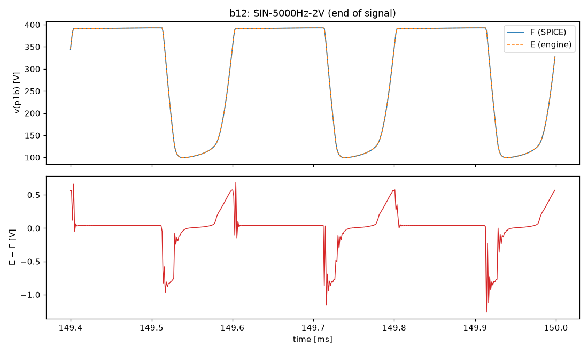
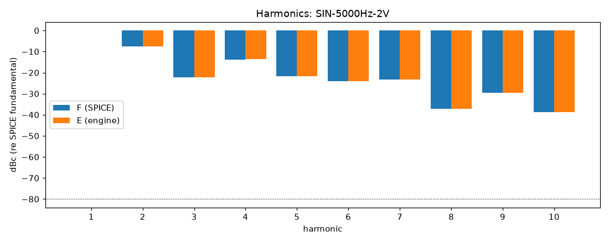
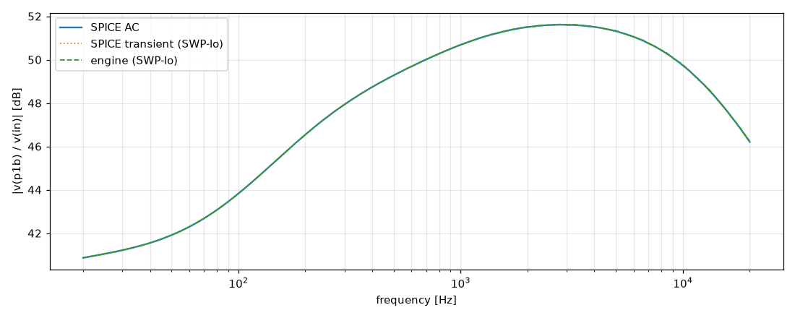
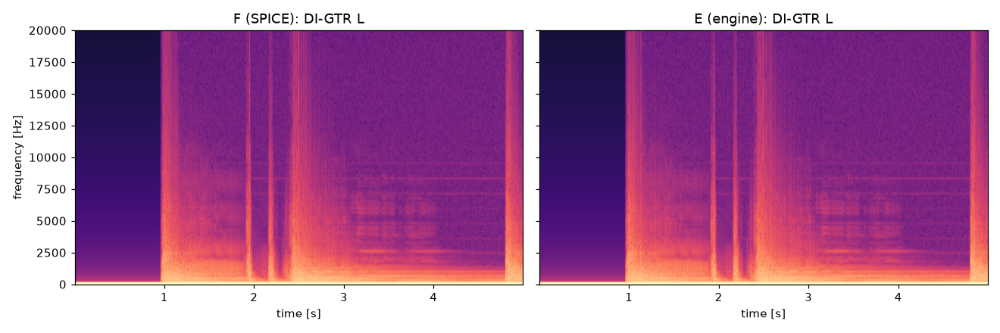

# M2 report: b12 / VOL1.0

- Block: B12 StageV1aV1b (V1a + V1b, joint root)
- Preset: VOL1.0 — Preamp Volume 1.0; standard signal set (M2)
- Knobs: preampVolume=1, treble=0.5, middle=0.5, bass=0.5, master=0.3, presence=0.5
- Date: 2026-10-18
- Engine commit: `d37baf0 (dirty)`
- Testbench: `harness/testbenches/b12.cir` sha256 `ddc48819203d327c`; netlist sha256 `ffd9b2812204248f`; tubes.lib sha256 `c9c9c88346c69010`
- ngspice 47, fs = 768000 Hz, SPICE reltol 1e-08

## Summary

PASS 106 · FAIL 0 · INFO 15 (INFO = measured, not scored in M2)

| Check | Item | Measured | Tolerance | Status |
|---|---|---|---|---|
| dc_rel_error | v(bpa) | 1.45e-16 | ≤ 0.005 | PASS |
| dc_rel_error | v(g1a) | 0.0001717 | ≤ 0.005 | PASS |
| dc_rel_error | v(in) | 0 | ≤ 0.005 | PASS |
| dc_rel_error | v(k1a) | 4.576e-05 | ≤ 0.005 | PASS |
| dc_rel_error | v(k1b) | 0.0001076 | ≤ 0.005 | PASS |
| dc_rel_error | v(na) | 0.003703 | ≤ 0.005 | PASS |
| dc_rel_error | v(p1a) | 1.436e-05 | ≤ 0.005 | PASS |
| dc_rel_error | v(p1b) | 1.128e-05 | ≤ 0.005 | PASS |
| dc_rel_error | v(vtop) | 0.003703 | ≤ 0.005 | PASS |
| dc_rel_error | v(w1) | 0.003703 | ≤ 0.005 | PASS |
| nonlinear_esr_db | SIN-100Hz-0.01V | -75.65 dB | ≤ -20 | PASS |
| harmonics_2_5_db | SIN-100Hz-0.01V | 0.01302 dB | ≤ 0.5 | PASS |
| thd_pp | SIN-100Hz-0.01V | 0.0001619 pp | — | INFO |
| newton_failures | SIN-100Hz-0.01V | 0 | ≤ 0 | PASS |
| newton_median_iterations | SIN-100Hz-0.01V | 1 | ≤ 3 | PASS |
| newton_max_iterations | SIN-100Hz-0.01V | 1 | ≤ 12 | PASS |
| nonlinear_esr_db | SIN-1000Hz-0.01V | -66.56 dB | ≤ -20 | PASS |
| harmonics_2_5_db | SIN-1000Hz-0.01V | 0.01679 dB | ≤ 0.5 | PASS |
| thd_pp | SIN-1000Hz-0.01V | 0.0004362 pp | — | INFO |
| newton_failures | SIN-1000Hz-0.01V | 0 | ≤ 0 | PASS |
| newton_median_iterations | SIN-1000Hz-0.01V | 1 | ≤ 3 | PASS |
| newton_max_iterations | SIN-1000Hz-0.01V | 2 | ≤ 12 | PASS |
| nonlinear_esr_db | SIN-5000Hz-0.01V | -57.21 dB | ≤ -20 | PASS |
| harmonics_2_5_db | SIN-5000Hz-0.01V | 0.01187 dB | ≤ 0.5 | PASS |
| thd_pp | SIN-5000Hz-0.01V | 0.0004926 pp | — | INFO |
| newton_failures | SIN-5000Hz-0.01V | 0 | ≤ 0 | PASS |
| newton_median_iterations | SIN-5000Hz-0.01V | 2 | ≤ 3 | PASS |
| newton_max_iterations | SIN-5000Hz-0.01V | 2 | ≤ 12 | PASS |
| nonlinear_esr_db | SIN-100Hz-0.1V | -75.15 dB | ≤ -20 | PASS |
| harmonics_2_5_db | SIN-100Hz-0.1V | 0.0242 dB | ≤ 0.5 | PASS |
| thd_pp | SIN-100Hz-0.1V | 0.001852 pp | — | INFO |
| newton_failures | SIN-100Hz-0.1V | 0 | ≤ 0 | PASS |
| newton_median_iterations | SIN-100Hz-0.1V | 1 | ≤ 3 | PASS |
| newton_max_iterations | SIN-100Hz-0.1V | 2 | ≤ 12 | PASS |
| nonlinear_esr_db | SIN-1000Hz-0.1V | -65.65 dB | ≤ -20 | PASS |
| harmonics_2_5_db | SIN-1000Hz-0.1V | 0.02272 dB | ≤ 0.5 | PASS |
| thd_pp | SIN-1000Hz-0.1V | 0.007833 pp | — | INFO |
| newton_failures | SIN-1000Hz-0.1V | 0 | ≤ 0 | PASS |
| newton_median_iterations | SIN-1000Hz-0.1V | 2 | ≤ 3 | PASS |
| newton_max_iterations | SIN-1000Hz-0.1V | 2 | ≤ 12 | PASS |
| nonlinear_esr_db | SIN-5000Hz-0.1V | -57.01 dB | ≤ -20 | PASS |
| harmonics_2_5_db | SIN-5000Hz-0.1V | 0.00886 dB | ≤ 0.5 | PASS |
| thd_pp | SIN-5000Hz-0.1V | 0.006626 pp | — | INFO |
| newton_failures | SIN-5000Hz-0.1V | 0 | ≤ 0 | PASS |
| newton_median_iterations | SIN-5000Hz-0.1V | 2 | ≤ 3 | PASS |
| newton_max_iterations | SIN-5000Hz-0.1V | 2 | ≤ 12 | PASS |
| nonlinear_esr_db | SIN-100Hz-0.5V | -67.4 dB | ≤ -20 | PASS |
| harmonics_2_5_db | SIN-100Hz-0.5V | 0.04441 dB | ≤ 0.5 | PASS |
| thd_pp | SIN-100Hz-0.5V | 0.0174 pp | — | INFO |
| newton_failures | SIN-100Hz-0.5V | 0 | ≤ 0 | PASS |
| newton_median_iterations | SIN-100Hz-0.5V | 1 | ≤ 3 | PASS |
| newton_max_iterations | SIN-100Hz-0.5V | 2 | ≤ 12 | PASS |
| nonlinear_esr_db | SIN-1000Hz-0.5V | -65.17 dB | ≤ -20 | PASS |
| harmonics_2_5_db | SIN-1000Hz-0.5V | 0.01001 dB | ≤ 0.5 | PASS |
| thd_pp | SIN-1000Hz-0.5V | 0.01103 pp | — | INFO |
| newton_failures | SIN-1000Hz-0.5V | 0 | ≤ 0 | PASS |
| newton_median_iterations | SIN-1000Hz-0.5V | 2 | ≤ 3 | PASS |
| newton_max_iterations | SIN-1000Hz-0.5V | 3 | ≤ 12 | PASS |
| nonlinear_esr_db | SIN-5000Hz-0.5V | -56.6 dB | ≤ -20 | PASS |
| harmonics_2_5_db | SIN-5000Hz-0.5V | 0.0126 dB | ≤ 0.5 | PASS |
| thd_pp | SIN-5000Hz-0.5V | 0.01142 pp | — | INFO |
| newton_failures | SIN-5000Hz-0.5V | 0 | ≤ 0 | PASS |
| newton_median_iterations | SIN-5000Hz-0.5V | 2 | ≤ 3 | PASS |
| newton_max_iterations | SIN-5000Hz-0.5V | 4 | ≤ 12 | PASS |
| nonlinear_esr_db_overdrive | SIN-100Hz-2V | -74.08 dB | ≤ -20 | PASS |
| harmonics_2_5_db | SIN-100Hz-2V | 0.0105 dB | ≤ 0.5 | PASS |
| thd_pp | SIN-100Hz-2V | 0.003024 pp | — | INFO |
| newton_failures | SIN-100Hz-2V | 0 | ≤ 0 | PASS |
| newton_median_iterations | SIN-100Hz-2V | 1 | ≤ 3 | PASS |
| newton_max_iterations | SIN-100Hz-2V | 2 | ≤ 12 | PASS |
| nonlinear_esr_db_overdrive | SIN-1000Hz-2V | -64.32 dB | ≤ -20 | PASS |
| harmonics_2_5_db | SIN-1000Hz-2V | 0.001354 dB | ≤ 0.5 | PASS |
| thd_pp | SIN-1000Hz-2V | 0.0006628 pp | — | INFO |
| newton_failures | SIN-1000Hz-2V | 0 | ≤ 0 | PASS |
| newton_median_iterations | SIN-1000Hz-2V | 2 | ≤ 3 | PASS |
| newton_max_iterations | SIN-1000Hz-2V | 4 | ≤ 12 | PASS |
| nonlinear_esr_db_overdrive | SIN-5000Hz-2V | -54.32 dB | ≤ -20 | PASS |
| harmonics_2_5_db | SIN-5000Hz-2V | 0.01782 dB | ≤ 0.5 | PASS |
| thd_pp | SIN-5000Hz-2V | 0.009844 pp | — | INFO |
| newton_failures | SIN-5000Hz-2V | 0 | ≤ 0 | PASS |
| newton_median_iterations | SIN-5000Hz-2V | 2 | ≤ 3 | PASS |
| newton_max_iterations | SIN-5000Hz-2V | 7 | ≤ 12 | PASS |
| nonlinear_esr_db | SWP-lo-0.01V | -58.57 dB | ≤ -20 | PASS |
| linear_mag_db_20_10k | SWP-lo-0.01V | 0.02988 dB | ≤ 0.1 | INFO |
| linear_mag_db_10k_20k | SWP-lo-0.01V | 0.0343 dB | ≤ 0.3 | INFO |
| method_mag_db_spice_tran_vs_ac | SWP-lo-0.01V | 0.03277 dB | — | INFO |
| newton_failures | SWP-lo-0.01V | 0 | ≤ 0 | PASS |
| newton_median_iterations | SWP-lo-0.01V | 1 | ≤ 3 | PASS |
| newton_max_iterations | SWP-lo-0.01V | 3 | ≤ 12 | PASS |
| nonlinear_esr_db | SWP-hi-0.1V | -58.41 dB | ≤ -20 | PASS |
| newton_failures | SWP-hi-0.1V | 0 | ≤ 0 | PASS |
| newton_median_iterations | SWP-hi-0.1V | 2 | ≤ 3 | PASS |
| newton_max_iterations | SWP-hi-0.1V | 3 | ≤ 12 | PASS |
| nonlinear_esr_db | TT-0.05V | -71.86 dB | ≤ -20 | PASS |
| newton_failures | TT-0.05V | 0 | ≤ 0 | PASS |
| newton_median_iterations | TT-0.05V | 1 | ≤ 3 | PASS |
| newton_max_iterations | TT-0.05V | 2 | ≤ 12 | PASS |
| nonlinear_esr_db | BURST-0.5V | -65.18 dB | ≤ -20 | PASS |
| newton_failures | BURST-0.5V | 0 | ≤ 0 | PASS |
| newton_median_iterations | BURST-0.5V | 2 | ≤ 3 | PASS |
| newton_max_iterations | BURST-0.5V | 3 | ≤ 12 | PASS |
| nonlinear_esr_db | STEP-0.1V | -68.47 dB | ≤ -20 | PASS |
| newton_failures | STEP-0.1V | 0 | ≤ 0 | PASS |
| newton_median_iterations | STEP-0.1V | 1 | ≤ 3 | PASS |
| newton_max_iterations | STEP-0.1V | 3 | ≤ 12 | PASS |
| nonlinear_esr_db | DI-GTR L | -68.01 dB | ≤ -20 | PASS |
| newton_failures | DI-GTR L | 0 | ≤ 0 | PASS |
| newton_median_iterations | DI-GTR L | 1 | ≤ 3 | PASS |
| newton_max_iterations | DI-GTR L | 3 | ≤ 12 | PASS |
| nonlinear_esr_db | DI-GTR LL | -68.29 dB | ≤ -20 | PASS |
| newton_failures | DI-GTR LL | 0 | ≤ 0 | PASS |
| newton_median_iterations | DI-GTR LL | 1 | ≤ 3 | PASS |
| newton_max_iterations | DI-GTR LL | 3 | ≤ 12 | PASS |
| nonlinear_esr_db | DI-GTR R | -68.31 dB | ≤ -20 | PASS |
| newton_failures | DI-GTR R | 0 | ≤ 0 | PASS |
| newton_median_iterations | DI-GTR R | 1 | ≤ 3 | PASS |
| newton_max_iterations | DI-GTR R | 3 | ≤ 12 | PASS |
| nonlinear_esr_db | DI-GTR RR | -67.83 dB | ≤ -20 | PASS |
| newton_failures | DI-GTR RR | 0 | ≤ 0 | PASS |
| newton_median_iterations | DI-GTR RR | 1 | ≤ 3 | PASS |
| newton_max_iterations | DI-GTR RR | 4 | ≤ 12 | PASS |

## Signals

| Signal | Peak F [V] | ESR [dB] | Best lag | ESR at lag [dB] | THD F / E [%] | Power F / E [W] | ns/sample | Newton fail / median / max it |
|---|---|---|---|---|---|---|---|---|
| SIN-100Hz-0.01V | 1.598 | -75.65 | 0 | -75.65 | 0.0981 / 0.0979 | — | 291.0 | 0 / 1 / 1 |
| SIN-1000Hz-0.01V | 3.577 | -66.56 | 0 | -66.56 | 0.195 / 0.195 | — | 292.6 | 0 / 1 / 2 |
| SIN-5000Hz-0.01V | 3.859 | -57.21 | 0 | -57.21 | 0.225 / 0.225 | — | 438.5 | 0 / 2 / 2 |
| SIN-100Hz-0.1V | 16.22 | -75.15 | 0 | -75.15 | 1.06 / 1.06 | — | 293.0 | 0 / 1 / 2 |
| SIN-1000Hz-0.1V | 36.57 | -65.65 | 0 | -65.65 | 3.14 / 3.13 | — | 430.3 | 0 / 2 / 2 |
| SIN-5000Hz-0.1V | 39.52 | -57.01 | 0 | -57.01 | 3.78 / 3.78 | — | 440.0 | 0 / 2 / 2 |
| SIN-100Hz-0.5V | 83.21 | -67.40 | 0 | -67.40 | 19.4 / 19.4 | — | 294.2 | 0 / 1 / 2 |
| SIN-1000Hz-0.5V | 183.1 | -65.17 | 0 | -65.17 | 30.2 / 30.1 | — | 404.0 | 0 / 2 / 3 |
| SIN-5000Hz-0.5V | 199.1 | -56.60 | 0 | -56.60 | 31.2 / 31.2 | — | 493.5 | 0 / 2 / 4 |
| SIN-100Hz-2V | 230.6 | -74.08 | 0 | -74.08 | 35 / 35 | — | 329.2 | 0 / 1 / 2 |
| SIN-1000Hz-2V | 250.7 | -64.32 | 0 | -64.32 | 40 / 40 | — | 467.1 | 0 / 2 / 4 |
| SIN-5000Hz-2V | 274.5 | -54.32 | 0 | -54.32 | 49 / 49 | — | 504.2 | 0 / 2 / 7 |
| SWP-lo-0.01V | 3.826 | -58.57 | 0 | -58.57 | — | — | 344.4 | 0 / 1 / 3 |
| SWP-hi-0.1V | 39.33 | -58.41 | 0 | -58.41 | — | — | 377.6 | 0 / 2 / 3 |
| TT-0.05V | 22.4 | -71.86 | 0 | -71.86 | — | — | 288.0 | 0 / 1 / 2 |
| BURST-0.5V | 182.9 | -65.18 | 0 | -65.18 | — | — | 365.7 | 0 / 2 / 3 |
| STEP-0.1V | 37.88 | -68.47 | 0 | -68.47 | — | — | 297.0 | 0 / 1 / 3 |
| DI-GTR L | 237.4 | -68.01 | 0 | -68.01 | — | — | 314.2 | 0 / 1 / 3 |
| DI-GTR LL | 236.9 | -68.29 | 0 | -68.29 | — | — | 306.5 | 0 / 1 / 3 |
| DI-GTR R | 238.4 | -68.31 | 0 | -68.31 | — | — | 310.8 | 0 / 1 / 3 |
| DI-GTR RR | 238.1 | -67.83 | 0 | -67.83 | — | — | 312.9 | 0 / 1 / 4 |

## DC operating point

| Node | SPICE [V] | Engine [V] | Rel. error |
|---|---|---|---|
| bpa | 391.9215 | 391.9215 | 1.45e-16 |
| g1a | 0.0001 | 0.0001 | 0.0001717 |
| in | 0.0000 | 0.0000 | 0 |
| k1a | 2.5271 | 2.5270 | 4.576e-05 |
| k1b | 3.7178 | 3.7174 | 0.0001076 |
| na | 0.0010 | 0.0010 | 0.003703 |
| p1a | 298.3260 | 298.3303 | 1.436e-05 |
| p1b | 354.7437 | 354.7477 | 1.128e-05 |
| vtop | 0.0010 | 0.0010 | 0.003703 |
| w1 | 0.0010 | 0.0010 | 0.003703 |

Engine values are the probe values after the first sample (zero input) following `reset()`. Nodes the engine does not probe yet show —.

## Figures

### Waveform overlay and error (most demanding signal)

### Harmonics

### Magnitude response

### Spectrogram (DI)

