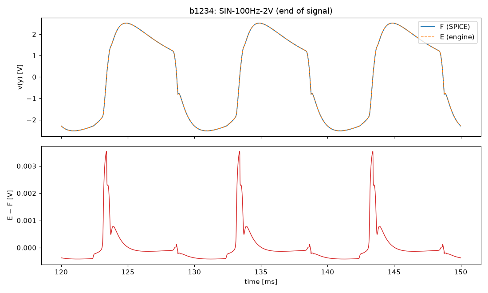
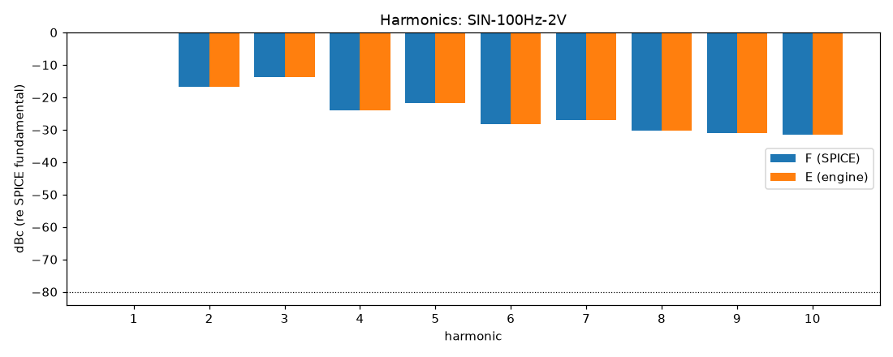
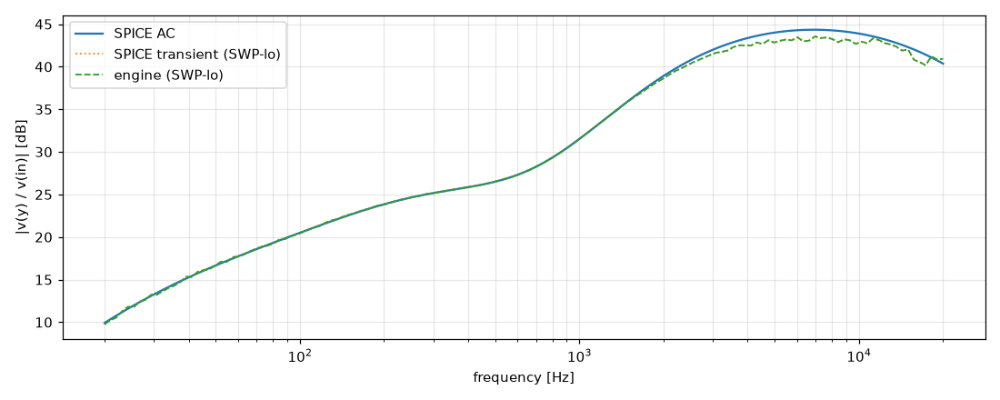

# M3 report: b1234 / DEFAULT

- Block: B1234 Preamp (B12 + B3 + B4 in one tree, 8-port root, D-038)
- Preset: DEFAULT — Default knobs; standard signal set at the block levels
- Knobs: preampVolume=0.6, treble=0.5, middle=0.5, bass=0.5, master=0.3, presence=0.5
- Date: 2026-10-13
- Engine commit: `ba83617 (dirty)`
- Testbench: `harness/testbenches/b1234.cir` sha256 `8bf0b9a644c680b3`; netlist sha256 `7bea8385e4adb04e`; tubes.lib sha256 `9ec33154be8127d7`
- ngspice 47, fs = 768000 Hz, SPICE reltol 1e-08

## Summary

PASS 102 · FAIL 1 · INFO 15 (INFO = measured, not scored in M3)

| Check | Item | Measured | Tolerance | Status |
|---|---|---|---|---|
| dc_rel_error | v(bpa) | 0 | ≤ 0.005 | PASS |
| dc_rel_error | v(bpx) | 1.413e-16 | ≤ 0.005 | PASS |
| dc_rel_error | v(g1a) | 0.0001705 | ≤ 0.005 | PASS |
| dc_rel_error | v(g2a) | 0.0006557 | ≤ 0.005 | PASS |
| dc_rel_error | v(in) | 0 | ≤ 0.005 | PASS |
| dc_rel_error | v(k1a) | 4.583e-05 | ≤ 0.005 | PASS |
| dc_rel_error | v(k1b) | 0.0001071 | ≤ 0.005 | PASS |
| dc_rel_error | v(k2a) | 2.501e-05 | ≤ 0.005 | PASS |
| dc_rel_error | v(k2b) | 1.797e-05 | ≤ 0.005 | PASS |
| dc_rel_error | v(mw) | 5.667e-12 | ≤ 0.005 | PASS |
| dc_rel_error | v(na) | 0.0005983 | ≤ 0.005 | PASS |
| dc_rel_error | v(nb) | 0.0006557 | ≤ 0.005 | PASS |
| dc_rel_error | v(nbb) | 3.156e-12 | ≤ 0.005 | PASS |
| dc_rel_error | v(nd) | 1.797e-05 | ≤ 0.005 | PASS |
| dc_rel_error | v(ne) | 2.763e-11 | ≤ 0.005 | PASS |
| dc_rel_error | v(p1a) | 1.437e-05 | ≤ 0.005 | PASS |
| dc_rel_error | v(p1b) | 1.122e-05 | ≤ 0.005 | PASS |
| dc_rel_error | v(p2a) | 1.853e-05 | ≤ 0.005 | PASS |
| dc_rel_error | v(tt) | 8.386e-12 | ≤ 0.005 | PASS |
| dc_rel_error | v(tw) | 2.252e-11 | ≤ 0.005 | PASS |
| dc_rel_error | v(vtop) | 0.0005983 | ≤ 0.005 | PASS |
| dc_rel_error | v(w1) | 0.0005983 | ≤ 0.005 | PASS |
| dc_rel_error | v(y) | 7.361e-13 | ≤ 0.005 | PASS |
| nonlinear_esr_db | SIN-100Hz-0.01V | -73.07 dB | ≤ -40 | PASS |
| harmonics_2_5_db | SIN-100Hz-0.01V | 0.002595 dB | ≤ 0.5 | PASS |
| thd_pp | SIN-100Hz-0.01V | 1.439e-05 pp | — | INFO |
| newton_failures | SIN-100Hz-0.01V | 0 | ≤ 0 | PASS |
| newton_median_iterations | SIN-100Hz-0.01V | 1 | ≤ 3 | PASS |
| newton_max_iterations | SIN-100Hz-0.01V | 2 | ≤ 12 | PASS |
| nonlinear_esr_db | SIN-1000Hz-0.01V | -60.63 dB | ≤ -40 | PASS |
| harmonics_2_5_db | SIN-1000Hz-0.01V | 0.01805 dB | ≤ 0.5 | PASS |
| thd_pp | SIN-1000Hz-0.01V | 0.001324 pp | — | INFO |
| newton_failures | SIN-1000Hz-0.01V | 0 | ≤ 0 | PASS |
| newton_median_iterations | SIN-1000Hz-0.01V | 2 | ≤ 3 | PASS |
| newton_max_iterations | SIN-1000Hz-0.01V | 2 | ≤ 12 | PASS |
| nonlinear_esr_db | SIN-5000Hz-0.01V | -52.98 dB | ≤ -40 | PASS |
| harmonics_2_5_db | SIN-5000Hz-0.01V | 0.07611 dB | ≤ 0.5 | PASS |
| thd_pp | SIN-5000Hz-0.01V | 0.03492 pp | — | INFO |
| newton_failures | SIN-5000Hz-0.01V | 0 | ≤ 0 | PASS |
| newton_median_iterations | SIN-5000Hz-0.01V | 2 | ≤ 3 | PASS |
| newton_max_iterations | SIN-5000Hz-0.01V | 7 | ≤ 12 | PASS |
| nonlinear_esr_db | SIN-100Hz-0.1V | -73.54 dB | ≤ -40 | PASS |
| harmonics_2_5_db | SIN-100Hz-0.1V | 0.02619 dB | ≤ 0.5 | PASS |
| thd_pp | SIN-100Hz-0.1V | 0.001494 pp | — | INFO |
| newton_failures | SIN-100Hz-0.1V | 0 | ≤ 0 | PASS |
| newton_median_iterations | SIN-100Hz-0.1V | 1 | ≤ 3 | PASS |
| newton_max_iterations | SIN-100Hz-0.1V | 2 | ≤ 12 | PASS |
| nonlinear_esr_db | SIN-1000Hz-0.1V | -57.73 dB | ≤ -40 | PASS |
| harmonics_2_5_db | SIN-1000Hz-0.1V | 0.02819 dB | ≤ 0.5 | PASS |
| thd_pp | SIN-1000Hz-0.1V | 0.007147 pp | — | INFO |
| newton_failures | SIN-1000Hz-0.1V | 0 | ≤ 0 | PASS |
| newton_median_iterations | SIN-1000Hz-0.1V | 2 | ≤ 3 | PASS |
| newton_max_iterations | SIN-1000Hz-0.1V | 6 | ≤ 12 | PASS |
| nonlinear_esr_db | SIN-5000Hz-0.1V | -46.98 dB | ≤ -40 | PASS |
| harmonics_2_5_db | SIN-5000Hz-0.1V | 0.04223 dB | ≤ 0.5 | PASS |
| thd_pp | SIN-5000Hz-0.1V | 0.008509 pp | — | INFO |
| newton_failures | SIN-5000Hz-0.1V | 0 | ≤ 0 | PASS |
| newton_median_iterations | SIN-5000Hz-0.1V | 3 | ≤ 3 | PASS |
| newton_max_iterations | SIN-5000Hz-0.1V | 7 | ≤ 12 | PASS |
| nonlinear_esr_db | SIN-100Hz-0.5V | -75.28 dB | ≤ -40 | PASS |
| harmonics_2_5_db | SIN-100Hz-0.5V | 0.002403 dB | ≤ 0.5 | PASS |
| thd_pp | SIN-100Hz-0.5V | 5.711e-05 pp | — | INFO |
| newton_failures | SIN-100Hz-0.5V | 0 | ≤ 0 | PASS |
| newton_median_iterations | SIN-100Hz-0.5V | 1 | ≤ 3 | PASS |
| newton_max_iterations | SIN-100Hz-0.5V | 4 | ≤ 12 | PASS |
| nonlinear_esr_db | SIN-1000Hz-0.5V | -50.57 dB | ≤ -40 | PASS |
| harmonics_2_5_db | SIN-1000Hz-0.5V | 0.02129 dB | ≤ 0.5 | PASS |
| thd_pp | SIN-1000Hz-0.5V | 0.006111 pp | — | INFO |
| newton_failures | SIN-1000Hz-0.5V | 0 | ≤ 0 | PASS |
| newton_median_iterations | SIN-1000Hz-0.5V | 2 | ≤ 3 | PASS |
| newton_max_iterations | SIN-1000Hz-0.5V | 7 | ≤ 12 | PASS |
| nonlinear_esr_db | SIN-5000Hz-0.5V | -39.41 dB | ≤ -40 | FAIL |
| harmonics_2_5_db | SIN-5000Hz-0.5V | 0.009045 dB | ≤ 0.5 | PASS |
| thd_pp | SIN-5000Hz-0.5V | 0.01533 pp | — | INFO |
| newton_failures | SIN-5000Hz-0.5V | 0 | ≤ 0 | PASS |
| newton_median_iterations | SIN-5000Hz-0.5V | 3 | ≤ 3 | PASS |
| newton_max_iterations | SIN-5000Hz-0.5V | 9 | ≤ 12 | PASS |
| nonlinear_esr_db_overdrive | SIN-100Hz-2V | -70.12 dB | ≤ -30 | PASS |
| harmonics_2_5_db | SIN-100Hz-2V | 0.009549 dB | ≤ 0.5 | PASS |
| thd_pp | SIN-100Hz-2V | 0.004204 pp | — | INFO |
| newton_failures | SIN-100Hz-2V | 0 | ≤ 0 | PASS |
| newton_median_iterations | SIN-100Hz-2V | 1 | ≤ 3 | PASS |
| newton_max_iterations | SIN-100Hz-2V | 5 | ≤ 12 | PASS |
| nonlinear_esr_db_overdrive | SIN-1000Hz-2V | -47.44 dB | ≤ -30 | PASS |
| harmonics_2_5_db | SIN-1000Hz-2V | 0.001411 dB | ≤ 0.5 | PASS |
| thd_pp | SIN-1000Hz-2V | 0.0008733 pp | — | INFO |
| newton_failures | SIN-1000Hz-2V | 0 | ≤ 0 | PASS |
| newton_median_iterations | SIN-1000Hz-2V | 3 | ≤ 3 | PASS |
| newton_max_iterations | SIN-1000Hz-2V | 7 | ≤ 12 | PASS |
| nonlinear_esr_db_overdrive | SIN-5000Hz-2V | -32.95 dB | ≤ -30 | PASS |
| harmonics_2_5_db | SIN-5000Hz-2V | 0.2152 dB | ≤ 0.5 | PASS |
| thd_pp | SIN-5000Hz-2V | 0.006374 pp | — | INFO |
| newton_failures | SIN-5000Hz-2V | 0 | ≤ 0 | PASS |
| newton_median_iterations | SIN-5000Hz-2V | 3 | ≤ 3 | PASS |
| newton_max_iterations | SIN-5000Hz-2V | 10 | ≤ 12 | PASS |
| nonlinear_esr_db | SWP-lo-0.01V | -50.68 dB | ≤ -40 | PASS |
| linear_mag_db_20_10k | SWP-lo-0.01V | 1.34 dB | ≤ 0.1 | INFO |
| linear_mag_db_10k_20k | SWP-lo-0.01V | 1.233 dB | ≤ 0.3 | INFO |
| method_mag_db_spice_tran_vs_ac | SWP-lo-0.01V | 1.349 dB | — | INFO |
| newton_failures | SWP-lo-0.01V | 0 | ≤ 0 | PASS |
| newton_median_iterations | SWP-lo-0.01V | 1 | ≤ 3 | PASS |
| newton_max_iterations | SWP-lo-0.01V | 7 | ≤ 12 | PASS |
| nonlinear_esr_db | SWP-hi-0.1V | -45.61 dB | ≤ -40 | PASS |
| newton_failures | SWP-hi-0.1V | 0 | ≤ 0 | PASS |
| newton_median_iterations | SWP-hi-0.1V | 2 | ≤ 3 | PASS |
| newton_max_iterations | SWP-hi-0.1V | 10 | ≤ 12 | PASS |
| nonlinear_esr_db | TT-0.05V | -69.18 dB | ≤ -40 | PASS |
| newton_failures | TT-0.05V | 0 | ≤ 0 | PASS |
| newton_median_iterations | TT-0.05V | 1 | ≤ 3 | PASS |
| newton_max_iterations | TT-0.05V | 3 | ≤ 12 | PASS |
| nonlinear_esr_db | BURST-0.5V | -51.15 dB | ≤ -40 | PASS |
| newton_failures | BURST-0.5V | 0 | ≤ 0 | PASS |
| newton_median_iterations | BURST-0.5V | 2 | ≤ 3 | PASS |
| newton_max_iterations | BURST-0.5V | 7 | ≤ 12 | PASS |
| nonlinear_esr_db | STEP-0.1V | -56.93 dB | ≤ -40 | PASS |
| newton_failures | STEP-0.1V | 0 | ≤ 0 | PASS |
| newton_median_iterations | STEP-0.1V | 1 | ≤ 3 | PASS |
| newton_max_iterations | STEP-0.1V | 7 | ≤ 12 | PASS |

## Signals

| Signal | Peak F [V] | ESR [dB] | Best lag | ESR at lag [dB] | THD F / E [%] | Power F / E [W] | ns/sample | Newton fail / median / max it |
|---|---|---|---|---|---|---|---|---|
| SIN-100Hz-0.01V | 0.1087 | -73.07 | 0 | -73.07 | 0.13 / 0.13 | — | 822.7 | 0 / 1 / 2 |
| SIN-1000Hz-0.01V | 0.4191 | -60.63 | 0 | -60.63 | 0.864 / 0.866 | — | 1254.2 | 0 / 2 / 2 |
| SIN-5000Hz-0.01V | 1.389 | -52.98 | 0 | -52.98 | 7.22 / 7.26 | — | 1489.8 | 0 / 2 / 7 |
| SIN-100Hz-0.1V | 1.07 | -73.54 | 0 | -73.54 | 1.69 / 1.69 | — | 844.4 | 0 / 1 / 2 |
| SIN-1000Hz-0.1V | 1.761 | -57.73 | 0 | -57.73 | 42.7 / 42.7 | — | 1360.0 | 0 / 2 / 6 |
| SIN-5000Hz-0.1V | 2.459 | -46.98 | 0 | -46.98 | 48.2 / 48.2 | — | 1761.1 | 0 / 3 / 7 |
| SIN-100Hz-0.5V | 2.705 | -75.28 | 0 | -75.28 | 16 / 16 | — | 892.3 | 0 / 1 / 4 |
| SIN-1000Hz-0.5V | 2.525 | -50.57 | 0 | -50.57 | 63.6 / 63.6 | — | 1331.9 | 0 / 2 / 7 |
| SIN-5000Hz-0.5V | 2.528 | -39.41 | 0 | -39.41 | 44.5 / 44.5 | — | 1785.2 | 0 / 3 / 9 |
| SIN-100Hz-2V | 2.86 | -70.12 | 0 | -70.12 | 28.2 / 28.2 | — | 927.1 | 0 / 1 / 5 |
| SIN-1000Hz-2V | 2.775 | -47.44 | 0 | -47.44 | 63.6 / 63.6 | — | 1555.1 | 0 / 3 / 7 |
| SIN-5000Hz-2V | 2.512 | -32.95 | 0 | -32.95 | 44.3 / 44.4 | — | 1873.7 | 0 / 3 / 10 |
| SWP-lo-0.01V | 1.413 | -50.68 | 0 | -50.68 | — | — | 1156.0 | 0 / 1 / 7 |
| SWP-hi-0.1V | 1.916 | -45.61 | 0 | -45.61 | — | — | 1306.0 | 0 / 2 / 10 |
| TT-0.05V | 1.619 | -69.18 | 0 | -69.18 | — | — | 913.6 | 0 / 1 / 3 |
| BURST-0.5V | 2.53 | -51.15 | 0 | -51.15 | — | — | 1379.4 | 0 / 2 / 7 |
| STEP-0.1V | 2.387 | -56.93 | 0 | -56.93 | — | — | 1049.5 | 0 / 1 / 7 |

## DC operating point

| Node | SPICE [V] | Engine [V] | Rel. error |
|---|---|---|---|
| bpa | 389.3496 | 389.3496 | 0 |
| bpx | 402.3360 | 402.3360 | 1.413e-16 |
| g1a | 0.0001 | 0.0001 | 0.0001705 |
| g2a | 0.0005 | 0.0005 | 0.0006557 |
| in | 0.0000 | 0.0000 | 0 |
| k1a | 2.5096 | 2.5095 | 4.583e-05 |
| k1b | 3.6917 | 3.6913 | 0.0001071 |
| k2a | 1.4039 | 1.4039 | 2.501e-05 |
| k2b | 231.6858 | 231.6900 | 1.797e-05 |
| mw | 0.0000 | 0.0000 | 5.667e-12 |
| na | 0.0002 | 0.0002 | 0.0005983 |
| nb | 0.0005 | 0.0005 | 0.0006557 |
| nbb | 0.0000 | 0.0000 | 3.156e-12 |
| nd | 231.6858 | 231.6900 | 1.797e-05 |
| ne | 0.0000 | 0.0000 | 2.763e-11 |
| p1a | 296.4025 | 296.4067 | 1.437e-05 |
| p1b | 352.4328 | 352.4367 | 1.122e-05 |
| p2a | 231.1295 | 231.1338 | 1.853e-05 |
| tt | 0.0000 | 0.0000 | 8.386e-12 |
| tw | 0.0000 | 0.0000 | 2.252e-11 |
| vtop | 0.0002 | 0.0002 | 0.0005983 |
| w1 | 0.0002 | 0.0002 | 0.0005983 |
| y | 0.0000 | 0.0000 | 7.361e-13 |

Engine values are the probe values after the first sample (zero input) following `reset()`. Nodes the engine does not probe yet show —.

## Figures

### Waveform overlay and error (most demanding signal)

### Harmonics

### Magnitude response

