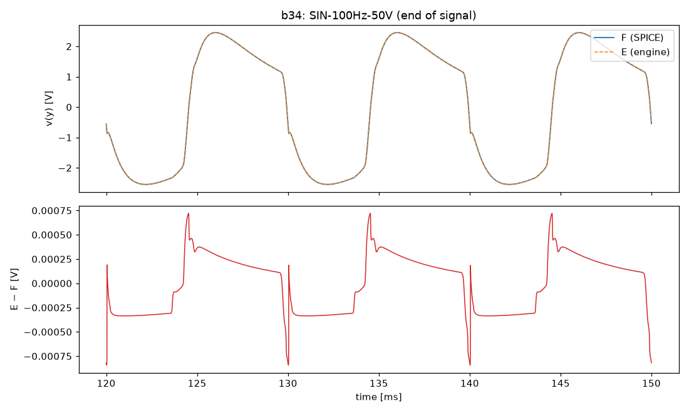
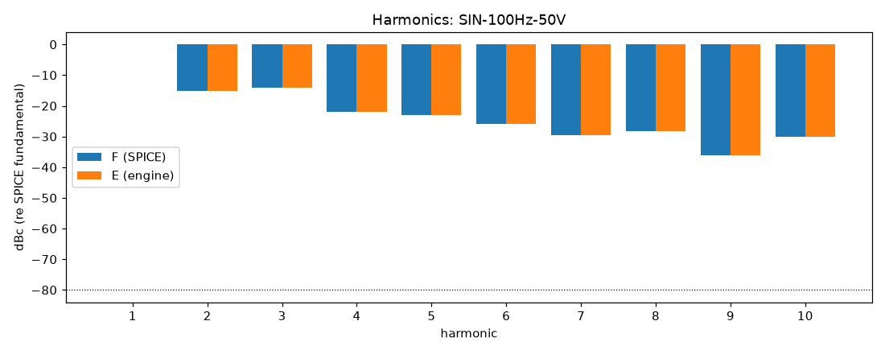
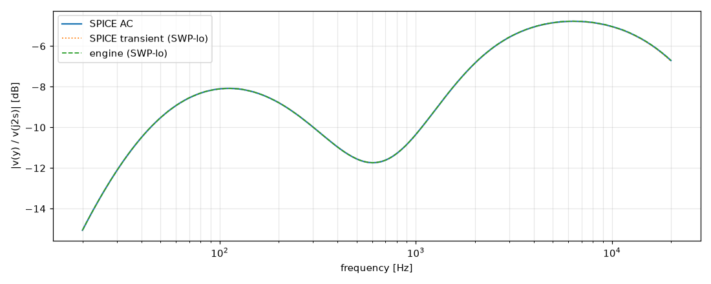

# M3 report: b34 / DEFAULT

- Block: B34 StageV2aV2bToneStack (B3 + B4 in one tree, D-033)
- Preset: DEFAULT — Default knobs; standard signal set at the block levels
- Knobs: preampVolume=0.6, treble=0.5, middle=0.5, bass=0.5, master=0.3, presence=0.5
- Date: 2026-10-13
- Engine commit: `9c92e73 (dirty)`
- Testbench: `harness/testbenches/b34.cir` sha256 `40594dc894ed44d5`; netlist sha256 `7bea8385e4adb04e`; tubes.lib sha256 `9ec33154be8127d7`
- ngspice 47, fs = 768000 Hz, SPICE reltol 1e-08

## Summary

PASS 94 · FAIL 0 · INFO 15 (INFO = measured, not scored in M3)

| Check | Item | Measured | Tolerance | Status |
|---|---|---|---|---|
| dc_rel_error | v(bpx) | 1.413e-16 | ≤ 0.005 | PASS |
| dc_rel_error | v(g2a) | 0.0006557 | ≤ 0.005 | PASS |
| dc_rel_error | v(k2a) | 2.501e-05 | ≤ 0.005 | PASS |
| dc_rel_error | v(k2b) | 1.797e-05 | ≤ 0.005 | PASS |
| dc_rel_error | v(mw) | 2.87e-12 | ≤ 0.005 | PASS |
| dc_rel_error | v(nb) | 0.0006557 | ≤ 0.005 | PASS |
| dc_rel_error | v(nbb) | 6.309e-13 | ≤ 0.005 | PASS |
| dc_rel_error | v(nd) | 1.797e-05 | ≤ 0.005 | PASS |
| dc_rel_error | v(ne) | 6.919e-12 | ≤ 0.005 | PASS |
| dc_rel_error | v(p1b) | 3.226e-16 | ≤ 0.005 | PASS |
| dc_rel_error | v(p2a) | 1.853e-05 | ≤ 0.005 | PASS |
| dc_rel_error | v(tt) | 2.524e-12 | ≤ 0.005 | PASS |
| dc_rel_error | v(tw) | 2.261e-11 | ≤ 0.005 | PASS |
| dc_rel_error | v(y) | 7.838e-13 | ≤ 0.005 | PASS |
| nonlinear_esr_db | SIN-100Hz-0.1V | -82.11 dB | ≤ -40 | PASS |
| harmonics_2_5_db | SIN-100Hz-0.1V | 0.001177 dB | ≤ 0.5 | PASS |
| thd_pp | SIN-100Hz-0.1V | 8.049e-06 pp | — | INFO |
| newton_failures | SIN-100Hz-0.1V | 0 | ≤ 0 | PASS |
| newton_median_iterations | SIN-100Hz-0.1V | 1 | ≤ 3 | PASS |
| newton_max_iterations | SIN-100Hz-0.1V | 1 | ≤ 12 | PASS |
| nonlinear_esr_db | SIN-1000Hz-0.1V | -65.31 dB | ≤ -40 | PASS |
| harmonics_2_5_db | SIN-1000Hz-0.1V | 0.01302 dB | ≤ 0.5 | PASS |
| thd_pp | SIN-1000Hz-0.1V | 8.747e-05 pp | — | INFO |
| newton_failures | SIN-1000Hz-0.1V | 0 | ≤ 0 | PASS |
| newton_median_iterations | SIN-1000Hz-0.1V | 1 | ≤ 3 | PASS |
| newton_max_iterations | SIN-1000Hz-0.1V | 2 | ≤ 12 | PASS |
| nonlinear_esr_db | SIN-5000Hz-0.1V | -58.52 dB | ≤ -40 | PASS |
| harmonics_2_5_db | SIN-5000Hz-0.1V | 0.0309 dB | ≤ 0.5 | PASS |
| thd_pp | SIN-5000Hz-0.1V | 0.0001555 pp | — | INFO |
| newton_failures | SIN-5000Hz-0.1V | 0 | ≤ 0 | PASS |
| newton_median_iterations | SIN-5000Hz-0.1V | 2 | ≤ 3 | PASS |
| newton_max_iterations | SIN-5000Hz-0.1V | 2 | ≤ 12 | PASS |
| nonlinear_esr_db | SIN-100Hz-1V | -82.09 dB | ≤ -40 | PASS |
| harmonics_2_5_db | SIN-100Hz-1V | 0.003699 dB | ≤ 0.5 | PASS |
| thd_pp | SIN-100Hz-1V | 8.183e-05 pp | — | INFO |
| newton_failures | SIN-100Hz-1V | 0 | ≤ 0 | PASS |
| newton_median_iterations | SIN-100Hz-1V | 1 | ≤ 3 | PASS |
| newton_max_iterations | SIN-100Hz-1V | 2 | ≤ 12 | PASS |
| nonlinear_esr_db | SIN-1000Hz-1V | -65.29 dB | ≤ -40 | PASS |
| harmonics_2_5_db | SIN-1000Hz-1V | 0.01308 dB | ≤ 0.5 | PASS |
| thd_pp | SIN-1000Hz-1V | 0.0008711 pp | — | INFO |
| newton_failures | SIN-1000Hz-1V | 0 | ≤ 0 | PASS |
| newton_median_iterations | SIN-1000Hz-1V | 2 | ≤ 3 | PASS |
| newton_max_iterations | SIN-1000Hz-1V | 2 | ≤ 12 | PASS |
| nonlinear_esr_db | SIN-5000Hz-1V | -58.48 dB | ≤ -40 | PASS |
| harmonics_2_5_db | SIN-5000Hz-1V | 0.03113 dB | ≤ 0.5 | PASS |
| thd_pp | SIN-5000Hz-1V | 0.001555 pp | — | INFO |
| newton_failures | SIN-5000Hz-1V | 0 | ≤ 0 | PASS |
| newton_median_iterations | SIN-5000Hz-1V | 2 | ≤ 3 | PASS |
| newton_max_iterations | SIN-5000Hz-1V | 2 | ≤ 12 | PASS |
| nonlinear_esr_db | SIN-100Hz-10V | -78.47 dB | ≤ -40 | PASS |
| harmonics_2_5_db | SIN-100Hz-10V | 0.00531 dB | ≤ 0.5 | PASS |
| thd_pp | SIN-100Hz-10V | 0.002701 pp | — | INFO |
| newton_failures | SIN-100Hz-10V | 0 | ≤ 0 | PASS |
| newton_median_iterations | SIN-100Hz-10V | 1 | ≤ 3 | PASS |
| newton_max_iterations | SIN-100Hz-10V | 2 | ≤ 12 | PASS |
| nonlinear_esr_db | SIN-1000Hz-10V | -63.49 dB | ≤ -40 | PASS |
| harmonics_2_5_db | SIN-1000Hz-10V | 0.007107 dB | ≤ 0.5 | PASS |
| thd_pp | SIN-1000Hz-10V | 0.00182 pp | — | INFO |
| newton_failures | SIN-1000Hz-10V | 0 | ≤ 0 | PASS |
| newton_median_iterations | SIN-1000Hz-10V | 2 | ≤ 3 | PASS |
| newton_max_iterations | SIN-1000Hz-10V | 6 | ≤ 12 | PASS |
| nonlinear_esr_db | SIN-5000Hz-10V | -57.69 dB | ≤ -40 | PASS |
| harmonics_2_5_db | SIN-5000Hz-10V | 0.02511 dB | ≤ 0.5 | PASS |
| thd_pp | SIN-5000Hz-10V | 0.01119 pp | — | INFO |
| newton_failures | SIN-5000Hz-10V | 0 | ≤ 0 | PASS |
| newton_median_iterations | SIN-5000Hz-10V | 3 | ≤ 3 | PASS |
| newton_max_iterations | SIN-5000Hz-10V | 7 | ≤ 12 | PASS |
| nonlinear_esr_db_overdrive | SIN-100Hz-50V | -76.51 dB | ≤ -30 | PASS |
| harmonics_2_5_db | SIN-100Hz-50V | 0.00116 dB | ≤ 0.5 | PASS |
| thd_pp | SIN-100Hz-50V | 0.0009026 pp | — | INFO |
| newton_failures | SIN-100Hz-50V | 0 | ≤ 0 | PASS |
| newton_median_iterations | SIN-100Hz-50V | 1 | ≤ 3 | PASS |
| newton_max_iterations | SIN-100Hz-50V | 4 | ≤ 12 | PASS |
| nonlinear_esr_db_overdrive | SIN-1000Hz-50V | -59.4 dB | ≤ -30 | PASS |
| harmonics_2_5_db | SIN-1000Hz-50V | 0.003856 dB | ≤ 0.5 | PASS |
| thd_pp | SIN-1000Hz-50V | 3.718e-06 pp | — | INFO |
| newton_failures | SIN-1000Hz-50V | 0 | ≤ 0 | PASS |
| newton_median_iterations | SIN-1000Hz-50V | 2 | ≤ 3 | PASS |
| newton_max_iterations | SIN-1000Hz-50V | 7 | ≤ 12 | PASS |
| nonlinear_esr_db_overdrive | SIN-5000Hz-50V | -48.1 dB | ≤ -30 | PASS |
| harmonics_2_5_db | SIN-5000Hz-50V | 0.01654 dB | ≤ 0.5 | PASS |
| thd_pp | SIN-5000Hz-50V | 0.01468 pp | — | INFO |
| newton_failures | SIN-5000Hz-50V | 0 | ≤ 0 | PASS |
| newton_median_iterations | SIN-5000Hz-50V | 3 | ≤ 3 | PASS |
| newton_max_iterations | SIN-5000Hz-50V | 7 | ≤ 12 | PASS |
| nonlinear_esr_db | SWP-lo-0.1V | -57.58 dB | ≤ -40 | PASS |
| linear_mag_db_20_10k | SWP-lo-0.1V | 0.01352 dB | ≤ 0.1 | INFO |
| linear_mag_db_10k_20k | SWP-lo-0.1V | 0.01502 dB | ≤ 0.3 | INFO |
| method_mag_db_spice_tran_vs_ac | SWP-lo-0.1V | 0.02769 dB | — | INFO |
| newton_failures | SWP-lo-0.1V | 0 | ≤ 0 | PASS |
| newton_median_iterations | SWP-lo-0.1V | 1 | ≤ 3 | PASS |
| newton_max_iterations | SWP-lo-0.1V | 2 | ≤ 12 | PASS |
| nonlinear_esr_db | SWP-hi-1V | -57.55 dB | ≤ -40 | PASS |
| newton_failures | SWP-hi-1V | 0 | ≤ 0 | PASS |
| newton_median_iterations | SWP-hi-1V | 1 | ≤ 3 | PASS |
| newton_max_iterations | SWP-hi-1V | 3 | ≤ 12 | PASS |
| nonlinear_esr_db | TT-0.5V | -74.58 dB | ≤ -40 | PASS |
| newton_failures | TT-0.5V | 0 | ≤ 0 | PASS |
| newton_median_iterations | TT-0.5V | 1 | ≤ 3 | PASS |
| newton_max_iterations | TT-0.5V | 2 | ≤ 12 | PASS |
| nonlinear_esr_db | BURST-10V | -63.48 dB | ≤ -40 | PASS |
| newton_failures | BURST-10V | 0 | ≤ 0 | PASS |
| newton_median_iterations | BURST-10V | 1 | ≤ 3 | PASS |
| newton_max_iterations | BURST-10V | 6 | ≤ 12 | PASS |
| nonlinear_esr_db | STEP-1V | -72.84 dB | ≤ -40 | PASS |
| newton_failures | STEP-1V | 0 | ≤ 0 | PASS |
| newton_median_iterations | STEP-1V | 1 | ≤ 3 | PASS |
| newton_max_iterations | STEP-1V | 2 | ≤ 12 | PASS |

## Signals

| Signal | Peak F [V] | ESR [dB] | Best lag | ESR at lag [dB] | THD F / E [%] | Power F / E [W] | ns/sample | Newton fail / median / max it |
|---|---|---|---|---|---|---|---|---|
| SIN-100Hz-0.1V | 0.04205 | -82.11 | 0 | -82.11 | 0.0459 / 0.0459 | — | 336.4 | 0 / 1 / 1 |
| SIN-1000Hz-0.1V | 0.03282 | -65.31 | 0 | -65.31 | 0.0734 / 0.0735 | — | 330.5 | 0 / 1 / 2 |
| SIN-5000Hz-0.1V | 0.05906 | -58.52 | 0 | -58.52 | 0.0586 / 0.0588 | — | 499.0 | 0 / 2 / 2 |
| SIN-100Hz-1V | 0.4182 | -82.09 | 0 | -82.09 | 0.46 / 0.46 | — | 328.9 | 0 / 1 / 2 |
| SIN-1000Hz-1V | 0.3311 | -65.29 | 0 | -65.29 | 0.734 / 0.735 | — | 476.2 | 0 / 2 / 2 |
| SIN-5000Hz-1V | 0.5846 | -58.48 | 0 | -58.48 | 0.585 / 0.586 | — | 527.1 | 0 / 2 / 2 |
| SIN-100Hz-10V | 2.733 | -78.47 | 0 | -78.47 | 10.9 / 10.9 | — | 376.0 | 0 / 1 / 2 |
| SIN-1000Hz-10V | 1.634 | -63.49 | 0 | -63.49 | 36.9 / 36.9 | — | 521.2 | 0 / 2 / 6 |
| SIN-5000Hz-10V | 2.364 | -57.69 | 0 | -57.69 | 32.5 / 32.5 | — | 648.7 | 0 / 3 / 7 |
| SIN-100Hz-50V | 3.128 | -76.51 | 0 | -76.51 | 29.4 / 29.4 | — | 354.0 | 0 / 1 / 4 |
| SIN-1000Hz-50V | 2.403 | -59.40 | 0 | -59.40 | 67.2 / 67.2 | — | 493.0 | 0 / 2 / 7 |
| SIN-5000Hz-50V | 2.509 | -48.10 | 0 | -48.10 | 55.6 / 55.6 | — | 621.3 | 0 / 3 / 7 |
| SWP-lo-0.1V | 0.0577 | -57.58 | 0 | -57.58 | — | — | 385.3 | 0 / 1 / 2 |
| SWP-hi-1V | 0.5783 | -57.55 | 0 | -57.55 | — | — | 416.8 | 0 / 1 / 3 |
| TT-0.5V | 0.3178 | -74.58 | 0 | -74.58 | — | — | 331.2 | 0 / 1 / 2 |
| BURST-10V | 1.631 | -63.48 | 0 | -63.48 | — | — | 419.3 | 0 / 1 / 6 |
| STEP-1V | 0.6208 | -72.84 | 0 | -72.84 | — | — | 333.3 | 0 / 1 / 2 |

## DC operating point

| Node | SPICE [V] | Engine [V] | Rel. error |
|---|---|---|---|
| bpx | 402.3360 | 402.3360 | 1.413e-16 |
| g2a | 0.0005 | 0.0005 | 0.0006557 |
| k2a | 1.4039 | 1.4039 | 2.501e-05 |
| k2b | 231.6858 | 231.6900 | 1.797e-05 |
| mw | 0.0000 | 0.0000 | 2.87e-12 |
| nb | 0.0005 | 0.0005 | 0.0006557 |
| nbb | 0.0000 | -0.0000 | 6.309e-13 |
| nd | 231.6858 | 231.6900 | 1.797e-05 |
| ne | 0.0000 | 0.0000 | 6.919e-12 |
| p1b | 352.4328 | 352.4328 | 3.226e-16 |
| p2a | 231.1295 | 231.1338 | 1.853e-05 |
| tt | 0.0000 | -0.0000 | 2.524e-12 |
| tw | 0.0000 | -0.0000 | 2.261e-11 |
| y | 0.0000 | 0.0000 | 7.838e-13 |

Engine values are the probe values after the first sample (zero input) following `reset()`. Nodes the engine does not probe yet show —.

## Figures

### Waveform overlay and error (most demanding signal)

### Harmonics

### Magnitude response

