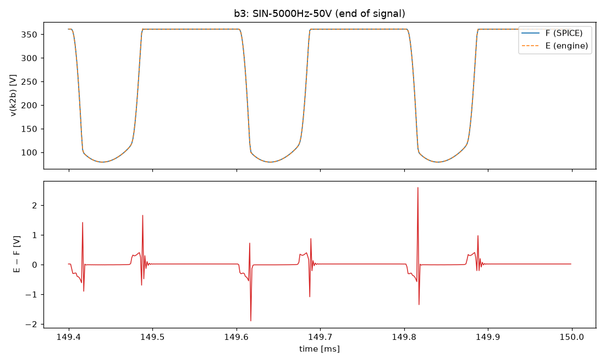
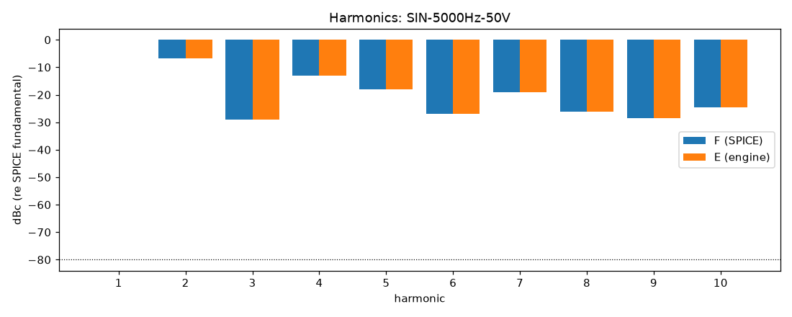
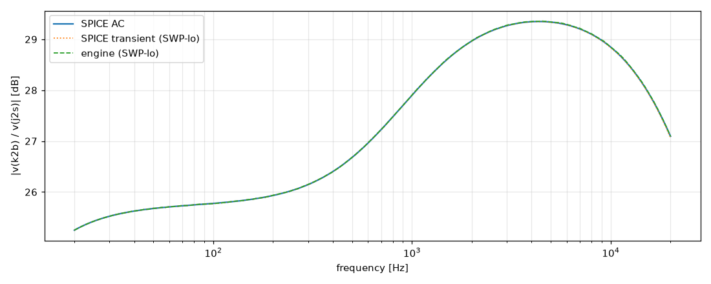

# M3 report: b3 / DEFAULT

- Block: B3 StageV2aV2b
- Preset: DEFAULT — Default knobs; standard signal set at the block levels
- Knobs: preampVolume=0.6, treble=0.5, middle=0.5, bass=0.5, master=0.3, presence=0.5
- Date: 2026-10-13
- Engine commit: `9c92e73 (dirty)`
- Testbench: `harness/testbenches/b3.cir` sha256 `b193a7cd7eafe7b8`; netlist sha256 `7bea8385e4adb04e`; tubes.lib sha256 `9ec33154be8127d7`
- ngspice 47, fs = 768000 Hz, SPICE reltol 1e-08

## Summary

PASS 87 · FAIL 0 · INFO 15 (INFO = measured, not scored in M3)

| Check | Item | Measured | Tolerance | Status |
|---|---|---|---|---|
| dc_rel_error | v(bpx) | 1.413e-16 | ≤ 0.005 | PASS |
| dc_rel_error | v(g2a) | 0.0006557 | ≤ 0.005 | PASS |
| dc_rel_error | v(k2a) | 2.501e-05 | ≤ 0.005 | PASS |
| dc_rel_error | v(k2b) | 1.797e-05 | ≤ 0.005 | PASS |
| dc_rel_error | v(nb) | 0.0006557 | ≤ 0.005 | PASS |
| dc_rel_error | v(p1b) | 6.452e-16 | ≤ 0.005 | PASS |
| dc_rel_error | v(p2a) | 1.853e-05 | ≤ 0.005 | PASS |
| nonlinear_esr_db | SIN-100Hz-0.1V | -82.2 dB | ≤ -40 | PASS |
| harmonics_2_5_db | SIN-100Hz-0.1V | 0.001143 dB | ≤ 0.5 | PASS |
| thd_pp | SIN-100Hz-0.1V | 8.754e-06 pp | — | INFO |
| newton_failures | SIN-100Hz-0.1V | 0 | ≤ 0 | PASS |
| newton_median_iterations | SIN-100Hz-0.1V | 1 | ≤ 3 | PASS |
| newton_max_iterations | SIN-100Hz-0.1V | 1 | ≤ 12 | PASS |
| nonlinear_esr_db | SIN-1000Hz-0.1V | -65.38 dB | ≤ -40 | PASS |
| harmonics_2_5_db | SIN-1000Hz-0.1V | 0.01271 dB | ≤ 0.5 | PASS |
| thd_pp | SIN-1000Hz-0.1V | 6.76e-05 pp | — | INFO |
| newton_failures | SIN-1000Hz-0.1V | 0 | ≤ 0 | PASS |
| newton_median_iterations | SIN-1000Hz-0.1V | 1 | ≤ 3 | PASS |
| newton_max_iterations | SIN-1000Hz-0.1V | 2 | ≤ 12 | PASS |
| nonlinear_esr_db | SIN-5000Hz-0.1V | -58.56 dB | ≤ -40 | PASS |
| harmonics_2_5_db | SIN-5000Hz-0.1V | 0.03004 dB | ≤ 0.5 | PASS |
| thd_pp | SIN-5000Hz-0.1V | 0.000156 pp | — | INFO |
| newton_failures | SIN-5000Hz-0.1V | 0 | ≤ 0 | PASS |
| newton_median_iterations | SIN-5000Hz-0.1V | 2 | ≤ 3 | PASS |
| newton_max_iterations | SIN-5000Hz-0.1V | 2 | ≤ 12 | PASS |
| nonlinear_esr_db | SIN-100Hz-1V | -82.17 dB | ≤ -40 | PASS |
| harmonics_2_5_db | SIN-100Hz-1V | 0.003419 dB | ≤ 0.5 | PASS |
| thd_pp | SIN-100Hz-1V | 8.908e-05 pp | — | INFO |
| newton_failures | SIN-100Hz-1V | 0 | ≤ 0 | PASS |
| newton_median_iterations | SIN-100Hz-1V | 1 | ≤ 3 | PASS |
| newton_max_iterations | SIN-100Hz-1V | 2 | ≤ 12 | PASS |
| nonlinear_esr_db | SIN-1000Hz-1V | -65.36 dB | ≤ -40 | PASS |
| harmonics_2_5_db | SIN-1000Hz-1V | 0.01282 dB | ≤ 0.5 | PASS |
| thd_pp | SIN-1000Hz-1V | 0.0006827 pp | — | INFO |
| newton_failures | SIN-1000Hz-1V | 0 | ≤ 0 | PASS |
| newton_median_iterations | SIN-1000Hz-1V | 2 | ≤ 3 | PASS |
| newton_max_iterations | SIN-1000Hz-1V | 2 | ≤ 12 | PASS |
| nonlinear_esr_db | SIN-5000Hz-1V | -58.52 dB | ≤ -40 | PASS |
| harmonics_2_5_db | SIN-5000Hz-1V | 0.03103 dB | ≤ 0.5 | PASS |
| thd_pp | SIN-5000Hz-1V | 0.001632 pp | — | INFO |
| newton_failures | SIN-5000Hz-1V | 0 | ≤ 0 | PASS |
| newton_median_iterations | SIN-5000Hz-1V | 2 | ≤ 3 | PASS |
| newton_max_iterations | SIN-5000Hz-1V | 2 | ≤ 12 | PASS |
| nonlinear_esr_db | SIN-100Hz-10V | -80.14 dB | ≤ -40 | PASS |
| harmonics_2_5_db | SIN-100Hz-10V | 0.01466 dB | ≤ 0.5 | PASS |
| thd_pp | SIN-100Hz-10V | 0.0009378 pp | — | INFO |
| newton_failures | SIN-100Hz-10V | 0 | ≤ 0 | PASS |
| newton_median_iterations | SIN-100Hz-10V | 1 | ≤ 3 | PASS |
| newton_max_iterations | SIN-100Hz-10V | 2 | ≤ 12 | PASS |
| nonlinear_esr_db | SIN-1000Hz-10V | -65.83 dB | ≤ -40 | PASS |
| harmonics_2_5_db | SIN-1000Hz-10V | 0.01231 dB | ≤ 0.5 | PASS |
| thd_pp | SIN-1000Hz-10V | 0.004686 pp | — | INFO |
| newton_failures | SIN-1000Hz-10V | 0 | ≤ 0 | PASS |
| newton_median_iterations | SIN-1000Hz-10V | 2 | ≤ 3 | PASS |
| newton_max_iterations | SIN-1000Hz-10V | 3 | ≤ 12 | PASS |
| nonlinear_esr_db | SIN-5000Hz-10V | -59.91 dB | ≤ -40 | PASS |
| harmonics_2_5_db | SIN-5000Hz-10V | 0.01461 dB | ≤ 0.5 | PASS |
| thd_pp | SIN-5000Hz-10V | 0.01885 pp | — | INFO |
| newton_failures | SIN-5000Hz-10V | 0 | ≤ 0 | PASS |
| newton_median_iterations | SIN-5000Hz-10V | 2 | ≤ 3 | PASS |
| newton_max_iterations | SIN-5000Hz-10V | 4 | ≤ 12 | PASS |
| nonlinear_esr_db_overdrive | SIN-100Hz-50V | -76.61 dB | ≤ -30 | PASS |
| harmonics_2_5_db | SIN-100Hz-50V | 0.001127 dB | ≤ 0.5 | PASS |
| thd_pp | SIN-100Hz-50V | 0.0002991 pp | — | INFO |
| newton_failures | SIN-100Hz-50V | 0 | ≤ 0 | PASS |
| newton_median_iterations | SIN-100Hz-50V | 1 | ≤ 3 | PASS |
| newton_max_iterations | SIN-100Hz-50V | 3 | ≤ 12 | PASS |
| nonlinear_esr_db_overdrive | SIN-1000Hz-50V | -64 dB | ≤ -30 | PASS |
| harmonics_2_5_db | SIN-1000Hz-50V | 0.00263 dB | ≤ 0.5 | PASS |
| thd_pp | SIN-1000Hz-50V | 0.001009 pp | — | INFO |
| newton_failures | SIN-1000Hz-50V | 0 | ≤ 0 | PASS |
| newton_median_iterations | SIN-1000Hz-50V | 2 | ≤ 3 | PASS |
| newton_max_iterations | SIN-1000Hz-50V | 4 | ≤ 12 | PASS |
| nonlinear_esr_db_overdrive | SIN-5000Hz-50V | -54.19 dB | ≤ -30 | PASS |
| harmonics_2_5_db | SIN-5000Hz-50V | 0.004314 dB | ≤ 0.5 | PASS |
| thd_pp | SIN-5000Hz-50V | 0.01383 pp | — | INFO |
| newton_failures | SIN-5000Hz-50V | 0 | ≤ 0 | PASS |
| newton_median_iterations | SIN-5000Hz-50V | 2 | ≤ 3 | PASS |
| newton_max_iterations | SIN-5000Hz-50V | 5 | ≤ 12 | PASS |
| nonlinear_esr_db | SWP-lo-0.1V | -58.71 dB | ≤ -40 | PASS |
| linear_mag_db_20_10k | SWP-lo-0.1V | 0.0138 dB | ≤ 0.1 | INFO |
| linear_mag_db_10k_20k | SWP-lo-0.1V | 0.01522 dB | ≤ 0.3 | INFO |
| method_mag_db_spice_tran_vs_ac | SWP-lo-0.1V | 0.02804 dB | — | INFO |
| newton_failures | SWP-lo-0.1V | 0 | ≤ 0 | PASS |
| newton_median_iterations | SWP-lo-0.1V | 1 | ≤ 3 | PASS |
| newton_max_iterations | SWP-lo-0.1V | 2 | ≤ 12 | PASS |
| nonlinear_esr_db | SWP-hi-1V | -58.68 dB | ≤ -40 | PASS |
| newton_failures | SWP-hi-1V | 0 | ≤ 0 | PASS |
| newton_median_iterations | SWP-hi-1V | 1 | ≤ 3 | PASS |
| newton_max_iterations | SWP-hi-1V | 3 | ≤ 12 | PASS |
| nonlinear_esr_db | TT-0.5V | -74.25 dB | ≤ -40 | PASS |
| newton_failures | TT-0.5V | 0 | ≤ 0 | PASS |
| newton_median_iterations | TT-0.5V | 1 | ≤ 3 | PASS |
| newton_max_iterations | TT-0.5V | 2 | ≤ 12 | PASS |
| nonlinear_esr_db | BURST-10V | -65.82 dB | ≤ -40 | PASS |
| newton_failures | BURST-10V | 0 | ≤ 0 | PASS |
| newton_median_iterations | BURST-10V | 1 | ≤ 3 | PASS |
| newton_max_iterations | BURST-10V | 3 | ≤ 12 | PASS |
| nonlinear_esr_db | STEP-1V | -73.12 dB | ≤ -40 | PASS |
| newton_failures | STEP-1V | 0 | ≤ 0 | PASS |
| newton_median_iterations | STEP-1V | 1 | ≤ 3 | PASS |
| newton_max_iterations | STEP-1V | 2 | ≤ 12 | PASS |

## Signals

| Signal | Peak F [V] | ESR [dB] | Best lag | ESR at lag [dB] | THD F / E [%] | Power F / E [W] | ns/sample | Newton fail / median / max it |
|---|---|---|---|---|---|---|---|---|
| SIN-100Hz-0.1V | 2.04 | -82.20 | 0 | -82.20 | 0.0513 / 0.0513 | — | 301.8 | 0 / 1 / 1 |
| SIN-1000Hz-0.1V | 2.497 | -65.38 | 0 | -65.38 | 0.0585 / 0.0586 | — | 300.9 | 0 / 1 / 2 |
| SIN-5000Hz-0.1V | 3.012 | -58.56 | 0 | -58.56 | 0.0607 / 0.0609 | — | 463.4 | 0 / 2 / 2 |
| SIN-100Hz-1V | 20.18 | -82.17 | 0 | -82.17 | 0.514 / 0.514 | — | 291.9 | 0 / 1 / 2 |
| SIN-1000Hz-1V | 25.12 | -65.36 | 0 | -65.36 | 0.587 / 0.588 | — | 418.4 | 0 / 2 / 2 |
| SIN-5000Hz-1V | 29.72 | -58.52 | 0 | -58.52 | 0.61 / 0.612 | — | 481.3 | 0 / 2 / 2 |
| SIN-100Hz-10V | 127 | -80.14 | 0 | -80.14 | 14.4 / 14.4 | — | 334.7 | 0 / 1 / 2 |
| SIN-1000Hz-10V | 129.3 | -65.83 | 0 | -65.83 | 19.2 / 19.2 | — | 508.9 | 0 / 2 / 3 |
| SIN-5000Hz-10V | 129.4 | -59.91 | 0 | -59.91 | 28.2 / 28.2 | — | 565.2 | 0 / 2 / 4 |
| SIN-100Hz-50V | 129.3 | -76.61 | 0 | -76.61 | 40.2 / 40.2 | — | 329.4 | 0 / 1 / 3 |
| SIN-1000Hz-50V | 138.8 | -64.00 | 0 | -64.00 | 45.6 / 45.6 | — | 402.9 | 0 / 2 / 4 |
| SIN-5000Hz-50V | 162.8 | -54.19 | 0 | -54.19 | 54.9 / 54.9 | — | 513.7 | 0 / 2 / 5 |
| SWP-lo-0.1V | 2.938 | -58.71 | 0 | -58.71 | — | — | 353.2 | 0 / 1 / 2 |
| SWP-hi-1V | 29.7 | -58.68 | 0 | -58.68 | — | — | 374.9 | 0 / 1 / 3 |
| TT-0.5V | 19.5 | -74.25 | 0 | -74.25 | — | — | 296.9 | 0 / 1 / 2 |
| BURST-10V | 129.3 | -65.82 | 0 | -65.82 | — | — | 397.8 | 0 / 1 / 3 |
| STEP-1V | 30.82 | -73.12 | 0 | -73.12 | — | — | 296.4 | 0 / 1 / 2 |

## DC operating point

| Node | SPICE [V] | Engine [V] | Rel. error |
|---|---|---|---|
| bpx | 402.3360 | 402.3360 | 1.413e-16 |
| g2a | 0.0005 | 0.0005 | 0.0006557 |
| k2a | 1.4039 | 1.4039 | 2.501e-05 |
| k2b | 231.6858 | 231.6900 | 1.797e-05 |
| nb | 0.0005 | 0.0005 | 0.0006557 |
| p1b | 352.4328 | 352.4328 | 6.452e-16 |
| p2a | 231.1295 | 231.1338 | 1.853e-05 |

Engine values are the probe values after the first sample (zero input) following `reset()`. Nodes the engine does not probe yet show —.

## Figures

### Waveform overlay and error (most demanding signal)

### Harmonics

### Magnitude response

