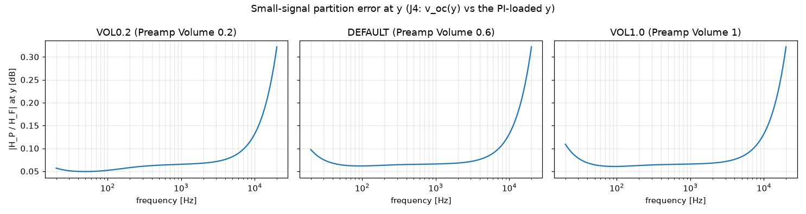
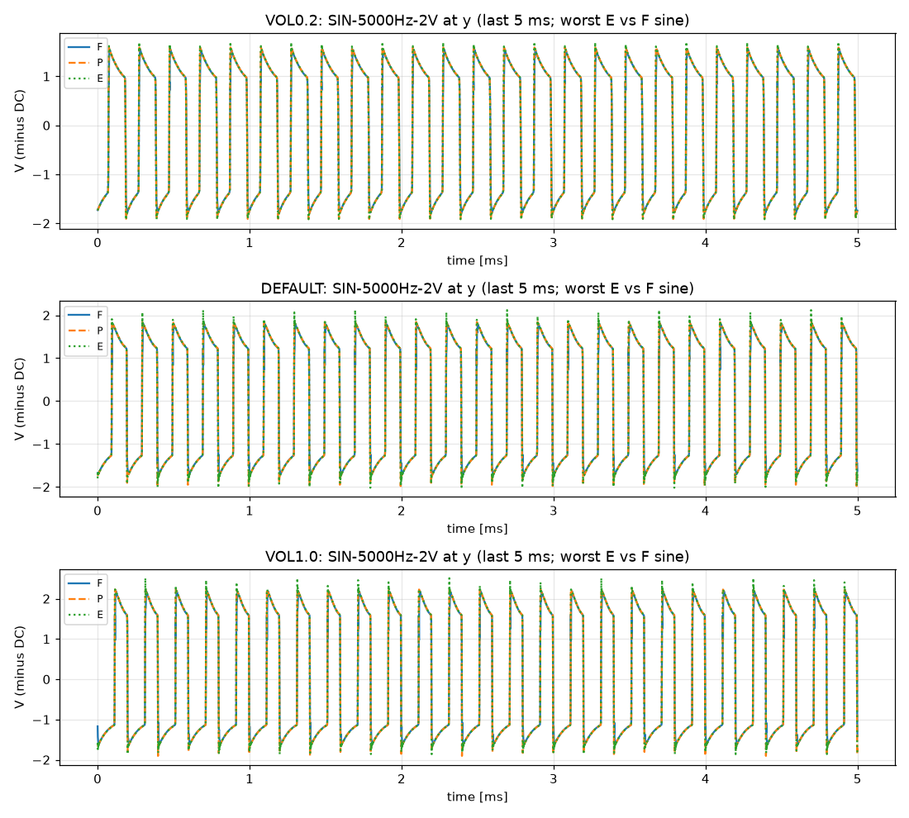

# M3 report: preamp B1234, partition and total error at y

- Date: 2026-10-13, engine commit `ba83617 (dirty)`, ngspice 47, fs = 768000 Hz, SPICE reltol 1e-08
- F: `full.cir` (sha256 `063103a6d8212d33`), P: the b1234 testbench (B12 + B3 + B4 joined, D-038), E: `ampwav --block preamp` (B1234). At y, P and E are v_oc(y) (no PI load), F has the PI load; at p1b and k2b all three are the loaded nodes. P and E run on F's recorded bpA / bpX.
- ESR on each signal minus its own DC operating point (D-018). Scored (D-036): partition error = P56 vs F at the loaded y (P's v_oc(y) through the J4 source into the b56 testbench), sines ≤ −26 dB, DI ≤ −20 dB; engine = E vs P at y with the block-exact limits by level (≤ −40 dB, 2 V sines ≤ −30 dB, harmonics 2–5 ≤ 0.5 dB) and the Newton checks. Everything else is information.

Scored checks: PASS 274 · FAIL 2

## Summary (worst over the signal set; ESR in dB)

| Preset | loaded y P56–F (sines) | out P56–F | y E–P | y P–F (open) | y E–F (open) | k2b P–F | p1b P–F |
|---|---|---|---|---|---|---|---|
| VOL0.2 | -45.9 | -47.1 | -41.3 | -21.5 | -21.1 | -99.9 | -111.3 |
| DEFAULT | -36.5 | -41.3 | -32.9 | -20.6 | -20.0 | -96.1 | -115.7 |
| VOL1.0 | -36.1 | -41.0 | -32.7 | -20.4 | -19.6 | -95.0 | -118.0 |

## Failed checks

| Check | Item | Measured | Tolerance |
|---|---|---|---|
| nonlinear_esr_db | DEFAULT SIN-5000Hz-0.5V (y, E vs P) | -39.44 | ≤ -40 |
| nonlinear_esr_db | VOL1.0 SIN-5000Hz-0.5V (y, E vs P) | -39.03 | ≤ -40 |

## Small-signal partition error at y

| Preset | max \|H_P/H_F\| 20 Hz–10 kHz | 10–20 kHz |
|---|---|---|
| VOL0.2 | 0.128 dB | 0.322 dB |
| DEFAULT | 0.128 dB | 0.322 dB |
| VOL1.0 | 0.128 dB | 0.322 dB |

## Per signal (ESR in dB)

| Preset | Signal | y P–F | y E–F | y E–P | loaded y P56–F | out P56–F | k2b P–F | k2b E–F | p1b P–F | p1b E–F | h1 E–F | h2–5 E–F | Newton fail / median / max |
|---|---|---|---|---|---|---|---|---|---|---|---|---|---|
| VOL0.2 | SIN-100Hz-0.01V | -43.1 | -42.8 | -73.2 | -95.4 | -85.1 | -136.9 | -73.2 | -141.3 | -76.3 | +0.06 dB | 0.08 dB | 0 / 1 / 2 |
| VOL0.2 | SIN-1000Hz-0.01V | -39.9 | -39.2 | -61.3 | -88.2 | -90.4 | -126.3 | -61.3 | -127.9 | -68.7 | +0.07 dB | 0.08 dB | 0 / 1 / 2 |
| VOL0.2 | SIN-5000Hz-0.01V | -29.4 | -28.8 | -52.8 | -74.5 | -72.9 | -111.4 | -52.8 | -111.3 | -55.1 | +0.09 dB | 2.99 dB | 0 / 2 / 2 |
| VOL0.2 | SIN-100Hz-0.1V | -43.1 | -42.8 | -73.2 | -95.4 | -83.5 | -144.7 | -73.2 | -150.7 | -76.3 | +0.06 dB | 0.08 dB | 0 / 1 / 2 |
| VOL0.2 | SIN-1000Hz-0.1V | -39.9 | -39.2 | -61.3 | -88.2 | -85.1 | -124.6 | -61.4 | -126.5 | -68.7 | +0.07 dB | 0.15 dB | 0 / 2 / 2 |
| VOL0.2 | SIN-5000Hz-0.1V | -28.0 | -27.5 | -52.3 | -67.0 | -64.2 | -113.4 | -52.1 | -118.6 | -54.4 | +0.08 dB | 0.42 dB | 0 / 2 / 7 |
| VOL0.2 | SIN-100Hz-0.5V | -43.1 | -42.9 | -73.2 | -95.3 | -74.5 | -136.8 | -73.2 | -138.8 | -76.2 | +0.06 dB | 0.10 dB | 0 / 1 / 2 |
| VOL0.2 | SIN-1000Hz-0.5V | -38.4 | -37.8 | -59.8 | -83.7 | -77.0 | -118.2 | -61.5 | -126.9 | -69.1 | +0.07 dB | 0.08 dB | 0 / 2 / 6 |
| VOL0.2 | SIN-5000Hz-0.5V | -23.4 | -23.0 | -47.8 | -54.9 | -52.8 | -105.0 | -50.5 | -122.9 | -52.5 | +0.09 dB | 0.38 dB | 0 / 3 / 7 |
| VOL0.2 | SIN-100Hz-2V | -43.2 | -43.0 | -74.6 | -93.4 | -67.0 | -115.7 | -74.4 | -143.2 | -75.6 | +0.06 dB | 0.09 dB | 0 / 1 / 4 |
| VOL0.2 | SIN-1000Hz-2V | -34.2 | -33.4 | -53.5 | -73.4 | -69.8 | -119.2 | -58.4 | -134.8 | -66.5 | +0.07 dB | 0.09 dB | 0 / 2 / 7 |
| VOL0.2 | SIN-5000Hz-2V | -21.5 | -21.1 | -41.3 | -45.9 | -47.1 | -99.9 | -43.4 | -120.5 | -50.0 | +0.09 dB | 0.43 dB | 0 / 3 / 10 |
| VOL0.2 | SWP-lo-0.01V | -22.9 | -22.6 | -48.9 | -63.5 | -60.1 | -116.9 | -49.1 | -117.1 | -50.9 | — | — | 0 / 1 / 3 |
| VOL0.2 | SWP-hi-0.1V | -22.5 | -22.2 | -48.3 | -55.2 | -53.0 | -103.1 | -48.8 | -114.0 | -45.9 | — | — | 0 / 1 / 8 |
| VOL0.2 | TT-0.05V | -42.4 | -42.0 | -68.7 | -93.3 | -85.2 | -120.7 | -68.6 | -122.9 | -74.2 | — | — | 0 / 1 / 2 |
| VOL0.2 | BURST-0.5V | -38.4 | -37.8 | -59.8 | -83.3 | -76.9 | -118.2 | -61.5 | -127.2 | -69.2 | — | — | 0 / 1 / 7 |
| VOL0.2 | STEP-0.1V | -26.6 | -26.3 | -51.0 | -63.3 | -60.2 | -107.3 | -51.1 | -116.8 | -54.3 | — | — | 0 / 1 / 7 |
| DEFAULT | SIN-100Hz-0.01V | -43.1 | -42.9 | -73.1 | -95.5 | -83.8 | -144.7 | -73.1 | -150.5 | -76.1 | +0.06 dB | 0.11 dB | 0 / 1 / 2 |
| DEFAULT | SIN-1000Hz-0.01V | -39.9 | -39.2 | -60.6 | -88.3 | -86.9 | -130.1 | -60.7 | -131.8 | -67.2 | +0.07 dB | 0.11 dB | 0 / 2 / 2 |
| DEFAULT | SIN-5000Hz-0.01V | -29.2 | -28.7 | -53.0 | -72.7 | -68.8 | -118.4 | -53.0 | -120.5 | -54.1 | +0.09 dB | 0.46 dB | 0 / 2 / 7 |
| DEFAULT | SIN-100Hz-0.1V | -43.1 | -42.9 | -73.5 | -95.3 | -70.5 | -135.7 | -73.5 | -162.8 | -76.1 | +0.06 dB | 0.11 dB | 0 / 1 / 2 |
| DEFAULT | SIN-1000Hz-0.1V | -37.3 | -36.6 | -57.7 | -81.0 | -75.9 | -119.7 | -60.4 | -132.0 | -67.6 | +0.07 dB | 0.10 dB | 0 / 2 / 6 |
| DEFAULT | SIN-5000Hz-0.1V | -23.5 | -23.1 | -47.0 | -55.3 | -53.1 | -104.8 | -49.6 | -123.8 | -53.1 | +0.09 dB | 0.31 dB | 0 / 3 / 7 |
| DEFAULT | SIN-100Hz-0.5V | -43.2 | -43.0 | -75.3 | -91.5 | -67.0 | -112.0 | -74.7 | -139.8 | -75.8 | +0.06 dB | 0.12 dB | 0 / 1 / 4 |
| DEFAULT | SIN-1000Hz-0.5V | -31.9 | -31.1 | -50.5 | -70.1 | -67.0 | -117.6 | -54.6 | -140.9 | -64.5 | +0.07 dB | 0.09 dB | 0 / 2 / 7 |
| DEFAULT | SIN-5000Hz-0.5V | -21.3 | -20.8 | -39.4 | -44.9 | -46.7 | -98.4 | -40.8 | -123.8 | -51.9 | +0.09 dB | 0.44 dB | 0 / 3 / 9 |
| DEFAULT | SIN-100Hz-2V | -43.0 | -42.9 | -70.1 | -91.9 | -67.8 | -110.7 | -67.5 | -140.6 | -66.6 | +0.06 dB | 0.08 dB | 0 / 1 / 5 |
| DEFAULT | SIN-1000Hz-2V | -27.6 | -26.9 | -47.4 | -58.7 | -55.6 | -112.3 | -51.3 | -138.5 | -66.8 | +0.07 dB | 0.08 dB | 0 / 2 / 7 |
| DEFAULT | SIN-5000Hz-2V | -20.6 | -20.0 | -32.9 | -36.5 | -41.3 | -96.1 | -34.0 | -131.0 | -51.2 | +0.09 dB | 0.45 dB | 0 / 3 / 10 |
| DEFAULT | SWP-lo-0.01V | -24.8 | -24.4 | -50.7 | -65.3 | -61.7 | -116.2 | -51.1 | -121.6 | -54.0 | — | — | 0 / 1 / 7 |
| DEFAULT | SWP-hi-0.1V | -22.9 | -22.6 | -45.5 | -50.2 | -49.4 | -102.4 | -48.3 | -115.7 | -45.9 | — | — | 0 / 2 / 10 |
| DEFAULT | TT-0.05V | -42.5 | -42.2 | -69.2 | -91.6 | -73.1 | -117.6 | -68.9 | -124.7 | -73.6 | — | — | 0 / 1 / 3 |
| DEFAULT | BURST-0.5V | -32.5 | -31.6 | -51.1 | -72.0 | -68.1 | -118.6 | -55.0 | -139.8 | -64.5 | — | — | 0 / 2 / 7 |
| DEFAULT | STEP-0.1V | -33.7 | -33.4 | -56.9 | -65.1 | -62.4 | -114.2 | -57.4 | -123.6 | -57.1 | — | — | 0 / 1 / 7 |
| VOL1.0 | SIN-100Hz-0.01V | -43.1 | -42.9 | -72.7 | -95.4 | -74.3 | -143.6 | -72.7 | -145.2 | -75.7 | +0.06 dB | 0.12 dB | 0 / 1 / 2 |
| VOL1.0 | SIN-1000Hz-0.01V | -39.8 | -39.1 | -60.4 | -86.9 | -77.3 | -125.3 | -60.9 | -137.6 | -65.9 | +0.07 dB | 0.12 dB | 0 / 2 / 3 |
| VOL1.0 | SIN-5000Hz-0.01V | -28.7 | -28.1 | -52.5 | -69.8 | -67.0 | -116.8 | -51.5 | -122.4 | -54.0 | +0.09 dB | 0.47 dB | 0 / 2 / 7 |
| VOL1.0 | SIN-100Hz-0.1V | -43.2 | -43.0 | -74.6 | -91.6 | -67.1 | -111.8 | -73.9 | -144.5 | -75.2 | +0.06 dB | 0.13 dB | 0 / 1 / 3 |
| VOL1.0 | SIN-1000Hz-0.1V | -34.2 | -33.4 | -53.4 | -73.2 | -70.2 | -119.6 | -57.4 | -143.6 | -65.5 | +0.07 dB | 0.08 dB | 0 / 2 / 7 |
| VOL1.0 | SIN-5000Hz-0.1V | -22.9 | -22.5 | -46.6 | -53.3 | -51.6 | -103.2 | -49.3 | -124.5 | -53.6 | +0.09 dB | 0.31 dB | 0 / 3 / 7 |
| VOL1.0 | SIN-100Hz-0.5V | -43.0 | -42.8 | -68.7 | -93.2 | -68.1 | -111.1 | -66.0 | -152.0 | -67.5 | +0.06 dB | 0.07 dB | 0 / 1 / 4 |
| VOL1.0 | SIN-1000Hz-0.5V | -28.4 | -27.6 | -47.6 | -60.6 | -58.4 | -111.3 | -51.2 | -142.9 | -65.2 | +0.07 dB | 0.08 dB | 0 / 2 / 7 |
| VOL1.0 | SIN-5000Hz-0.5V | -21.0 | -20.5 | -39.0 | -42.8 | -45.6 | -97.5 | -40.2 | -125.3 | -53.2 | +0.09 dB | 0.44 dB | 0 / 3 / 10 |
| VOL1.0 | SIN-100Hz-2V | -42.7 | -42.4 | -67.6 | -91.2 | -68.7 | -110.8 | -66.6 | -155.7 | -74.7 | +0.06 dB | 0.07 dB | 0 / 1 / 6 |
| VOL1.0 | SIN-1000Hz-2V | -26.1 | -25.5 | -44.3 | -53.2 | -52.5 | -106.5 | -47.8 | -138.5 | -63.8 | +0.07 dB | 0.08 dB | 0 / 3 / 9 |
| VOL1.0 | SIN-5000Hz-2V | -20.4 | -19.6 | -32.7 | -36.1 | -41.0 | -95.0 | -33.1 | -129.7 | -50.2 | +0.09 dB | 0.43 dB | 0 / 3 / 10 |
| VOL1.0 | SWP-lo-0.01V | -26.2 | -25.9 | -52.4 | -65.6 | -61.9 | -113.7 | -53.1 | -118.0 | -56.9 | — | — | 0 / 2 / 7 |
| VOL1.0 | SWP-hi-0.1V | -25.3 | -25.0 | -47.0 | -51.9 | -51.0 | -103.9 | -49.4 | -120.2 | -49.4 | — | — | 0 / 2 / 11 |
| VOL1.0 | TT-0.05V | -42.3 | -42.0 | -67.5 | -90.1 | -72.0 | -115.8 | -66.7 | -130.7 | -71.8 | — | — | 0 / 1 / 5 |
| VOL1.0 | BURST-0.5V | -30.3 | -29.5 | -49.4 | -64.4 | -61.3 | -113.6 | -53.1 | -143.1 | -65.2 | — | — | 0 / 2 / 7 |
| VOL1.0 | STEP-0.1V | -40.2 | -40.1 | -69.5 | -76.9 | -65.9 | -116.8 | -70.3 | -134.8 | -64.6 | — | — | 0 / 1 / 7 |

## Notes

- VOL0.2 SWP-lo-0.01V: P56 rendered at RELTOL 1e-07 (ngspice: timestep too small at 1e-08)

