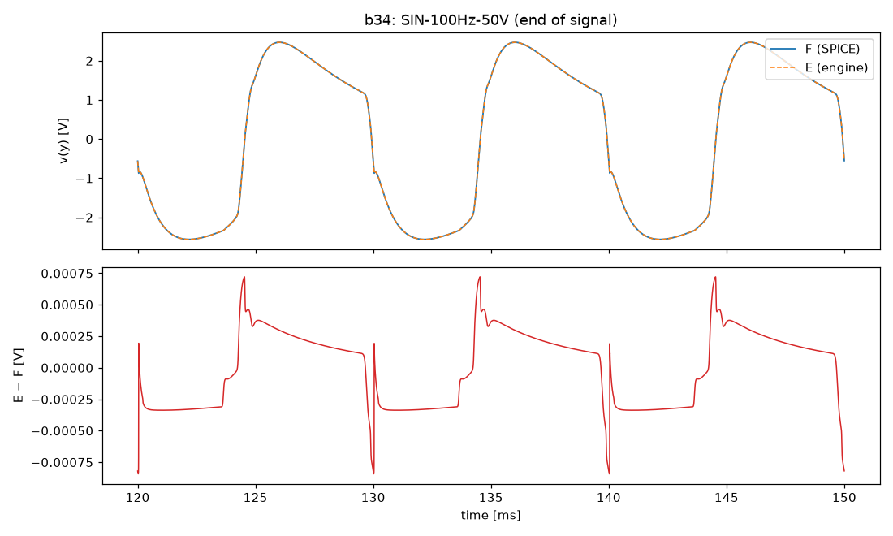
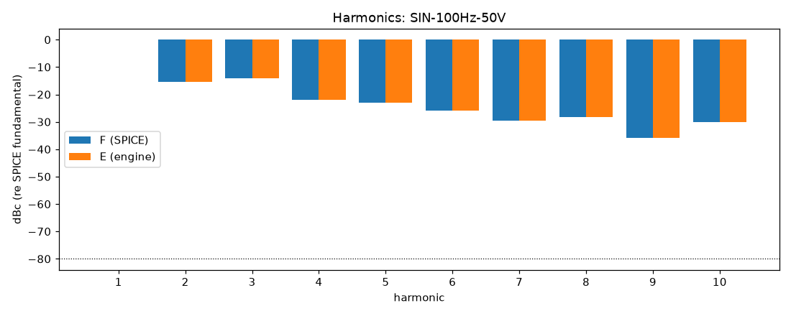
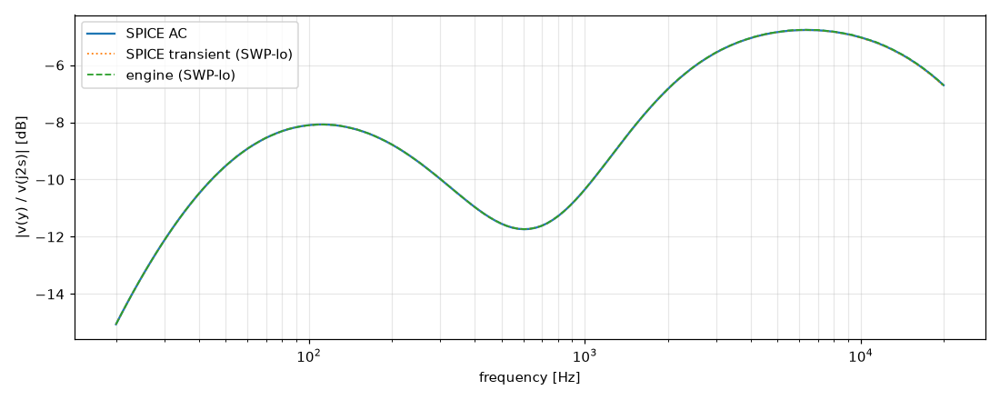

# M3 report: b34 / DEFAULT

- Block: B34 StageV2aV2bToneStack (B3 + B4 in one tree, D-033)
- Preset: DEFAULT — Default knobs; standard signal set at the block levels
- Knobs: preampVolume=0.6, treble=0.5, middle=0.5, bass=0.5, master=0.3, presence=0.5
- Date: 2026-10-18
- Engine commit: `d37baf0 (dirty)`
- Testbench: `harness/testbenches/b34.cir` sha256 `07117b5737acfc59`; netlist sha256 `ffd9b2812204248f`; tubes.lib sha256 `c9c9c88346c69010`
- ngspice 47, fs = 768000 Hz, SPICE reltol 1e-08

## Summary

PASS 94 · FAIL 0 · INFO 15 (INFO = measured, not scored in M3)

| Check | Item | Measured | Tolerance | Status |
|---|---|---|---|---|
| dc_rel_error | v(bpx) | 0 | ≤ 0.005 | PASS |
| dc_rel_error | v(g2a) | 0.0006604 | ≤ 0.005 | PASS |
| dc_rel_error | v(k2a) | 2.495e-05 | ≤ 0.005 | PASS |
| dc_rel_error | v(k2b) | 1.794e-05 | ≤ 0.005 | PASS |
| dc_rel_error | v(mw) | 1.776e-12 | ≤ 0.005 | PASS |
| dc_rel_error | v(nb) | 0.0006604 | ≤ 0.005 | PASS |
| dc_rel_error | v(nbb) | 0 | ≤ 0.005 | PASS |
| dc_rel_error | v(nd) | 1.794e-05 | ≤ 0.005 | PASS |
| dc_rel_error | v(ne) | 4.086e-11 | ≤ 0.005 | PASS |
| dc_rel_error | v(p1b) | 1.602e-16 | ≤ 0.005 | PASS |
| dc_rel_error | v(p2a) | 1.85e-05 | ≤ 0.005 | PASS |
| dc_rel_error | v(tt) | 2.132e-11 | ≤ 0.005 | PASS |
| dc_rel_error | v(tw) | 3.553e-12 | ≤ 0.005 | PASS |
| dc_rel_error | v(y) | 6.661e-13 | ≤ 0.005 | PASS |
| nonlinear_esr_db | SIN-100Hz-0.1V | -82.13 dB | ≤ -20 | PASS |
| harmonics_2_5_db | SIN-100Hz-0.1V | 0.001176 dB | ≤ 0.5 | PASS |
| thd_pp | SIN-100Hz-0.1V | 7.992e-06 pp | — | INFO |
| newton_failures | SIN-100Hz-0.1V | 0 | ≤ 0 | PASS |
| newton_median_iterations | SIN-100Hz-0.1V | 1 | ≤ 3 | PASS |
| newton_max_iterations | SIN-100Hz-0.1V | 1 | ≤ 12 | PASS |
| nonlinear_esr_db | SIN-1000Hz-0.1V | -65.33 dB | ≤ -20 | PASS |
| harmonics_2_5_db | SIN-1000Hz-0.1V | 0.01302 dB | ≤ 0.5 | PASS |
| thd_pp | SIN-1000Hz-0.1V | 8.693e-05 pp | — | INFO |
| newton_failures | SIN-1000Hz-0.1V | 0 | ≤ 0 | PASS |
| newton_median_iterations | SIN-1000Hz-0.1V | 1 | ≤ 3 | PASS |
| newton_max_iterations | SIN-1000Hz-0.1V | 2 | ≤ 12 | PASS |
| nonlinear_esr_db | SIN-5000Hz-0.1V | -58.54 dB | ≤ -20 | PASS |
| harmonics_2_5_db | SIN-5000Hz-0.1V | 0.03089 dB | ≤ 0.5 | PASS |
| thd_pp | SIN-5000Hz-0.1V | 0.0001545 pp | — | INFO |
| newton_failures | SIN-5000Hz-0.1V | 0 | ≤ 0 | PASS |
| newton_median_iterations | SIN-5000Hz-0.1V | 2 | ≤ 3 | PASS |
| newton_max_iterations | SIN-5000Hz-0.1V | 2 | ≤ 12 | PASS |
| nonlinear_esr_db | SIN-100Hz-1V | -82.11 dB | ≤ -20 | PASS |
| harmonics_2_5_db | SIN-100Hz-1V | 0.003703 dB | ≤ 0.5 | PASS |
| thd_pp | SIN-100Hz-1V | 8.123e-05 pp | — | INFO |
| newton_failures | SIN-100Hz-1V | 0 | ≤ 0 | PASS |
| newton_median_iterations | SIN-100Hz-1V | 1 | ≤ 3 | PASS |
| newton_max_iterations | SIN-100Hz-1V | 2 | ≤ 12 | PASS |
| nonlinear_esr_db | SIN-1000Hz-1V | -65.3 dB | ≤ -20 | PASS |
| harmonics_2_5_db | SIN-1000Hz-1V | 0.01307 dB | ≤ 0.5 | PASS |
| thd_pp | SIN-1000Hz-1V | 0.0008653 pp | — | INFO |
| newton_failures | SIN-1000Hz-1V | 0 | ≤ 0 | PASS |
| newton_median_iterations | SIN-1000Hz-1V | 2 | ≤ 3 | PASS |
| newton_max_iterations | SIN-1000Hz-1V | 2 | ≤ 12 | PASS |
| nonlinear_esr_db | SIN-5000Hz-1V | -58.5 dB | ≤ -20 | PASS |
| harmonics_2_5_db | SIN-5000Hz-1V | 0.03105 dB | ≤ 0.5 | PASS |
| thd_pp | SIN-5000Hz-1V | 0.00154 pp | — | INFO |
| newton_failures | SIN-5000Hz-1V | 0 | ≤ 0 | PASS |
| newton_median_iterations | SIN-5000Hz-1V | 2 | ≤ 3 | PASS |
| newton_max_iterations | SIN-5000Hz-1V | 2 | ≤ 12 | PASS |
| nonlinear_esr_db | SIN-100Hz-10V | -78.5 dB | ≤ -20 | PASS |
| harmonics_2_5_db | SIN-100Hz-10V | 0.005395 dB | ≤ 0.5 | PASS |
| thd_pp | SIN-100Hz-10V | 0.002693 pp | — | INFO |
| newton_failures | SIN-100Hz-10V | 0 | ≤ 0 | PASS |
| newton_median_iterations | SIN-100Hz-10V | 1 | ≤ 3 | PASS |
| newton_max_iterations | SIN-100Hz-10V | 2 | ≤ 12 | PASS |
| nonlinear_esr_db | SIN-1000Hz-10V | -63.53 dB | ≤ -20 | PASS |
| harmonics_2_5_db | SIN-1000Hz-10V | 0.01261 dB | ≤ 0.5 | PASS |
| thd_pp | SIN-1000Hz-10V | 0.001774 pp | — | INFO |
| newton_failures | SIN-1000Hz-10V | 0 | ≤ 0 | PASS |
| newton_median_iterations | SIN-1000Hz-10V | 2 | ≤ 3 | PASS |
| newton_max_iterations | SIN-1000Hz-10V | 6 | ≤ 12 | PASS |
| nonlinear_esr_db | SIN-5000Hz-10V | -57.72 dB | ≤ -20 | PASS |
| harmonics_2_5_db | SIN-5000Hz-10V | 0.02582 dB | ≤ 0.5 | PASS |
| thd_pp | SIN-5000Hz-10V | 0.01119 pp | — | INFO |
| newton_failures | SIN-5000Hz-10V | 0 | ≤ 0 | PASS |
| newton_median_iterations | SIN-5000Hz-10V | 3 | ≤ 3 | PASS |
| newton_max_iterations | SIN-5000Hz-10V | 7 | ≤ 12 | PASS |
| nonlinear_esr_db_overdrive | SIN-100Hz-50V | -76.52 dB | ≤ -20 | PASS |
| harmonics_2_5_db | SIN-100Hz-50V | 0.00116 dB | ≤ 0.5 | PASS |
| thd_pp | SIN-100Hz-50V | 0.0009068 pp | — | INFO |
| newton_failures | SIN-100Hz-50V | 0 | ≤ 0 | PASS |
| newton_median_iterations | SIN-100Hz-50V | 1 | ≤ 3 | PASS |
| newton_max_iterations | SIN-100Hz-50V | 4 | ≤ 12 | PASS |
| nonlinear_esr_db_overdrive | SIN-1000Hz-50V | -59.44 dB | ≤ -20 | PASS |
| harmonics_2_5_db | SIN-1000Hz-50V | 0.003692 dB | ≤ 0.5 | PASS |
| thd_pp | SIN-1000Hz-50V | 4.422e-05 pp | — | INFO |
| newton_failures | SIN-1000Hz-50V | 0 | ≤ 0 | PASS |
| newton_median_iterations | SIN-1000Hz-50V | 2 | ≤ 3 | PASS |
| newton_max_iterations | SIN-1000Hz-50V | 7 | ≤ 12 | PASS |
| nonlinear_esr_db_overdrive | SIN-5000Hz-50V | -48.13 dB | ≤ -20 | PASS |
| harmonics_2_5_db | SIN-5000Hz-50V | 0.01608 dB | ≤ 0.5 | PASS |
| thd_pp | SIN-5000Hz-50V | 0.01416 pp | — | INFO |
| newton_failures | SIN-5000Hz-50V | 0 | ≤ 0 | PASS |
| newton_median_iterations | SIN-5000Hz-50V | 3 | ≤ 3 | PASS |
| newton_max_iterations | SIN-5000Hz-50V | 7 | ≤ 12 | PASS |
| nonlinear_esr_db | SWP-lo-0.1V | -57.59 dB | ≤ -20 | PASS |
| linear_mag_db_20_10k | SWP-lo-0.1V | 0.01347 dB | ≤ 0.1 | INFO |
| linear_mag_db_10k_20k | SWP-lo-0.1V | 0.01496 dB | ≤ 0.3 | INFO |
| method_mag_db_spice_tran_vs_ac | SWP-lo-0.1V | 0.02764 dB | — | INFO |
| newton_failures | SWP-lo-0.1V | 0 | ≤ 0 | PASS |
| newton_median_iterations | SWP-lo-0.1V | 1 | ≤ 3 | PASS |
| newton_max_iterations | SWP-lo-0.1V | 2 | ≤ 12 | PASS |
| nonlinear_esr_db | SWP-hi-1V | -57.57 dB | ≤ -20 | PASS |
| newton_failures | SWP-hi-1V | 0 | ≤ 0 | PASS |
| newton_median_iterations | SWP-hi-1V | 1 | ≤ 3 | PASS |
| newton_max_iterations | SWP-hi-1V | 3 | ≤ 12 | PASS |
| nonlinear_esr_db | TT-0.5V | -74.6 dB | ≤ -20 | PASS |
| newton_failures | TT-0.5V | 0 | ≤ 0 | PASS |
| newton_median_iterations | TT-0.5V | 1 | ≤ 3 | PASS |
| newton_max_iterations | TT-0.5V | 2 | ≤ 12 | PASS |
| nonlinear_esr_db | BURST-10V | -63.52 dB | ≤ -20 | PASS |
| newton_failures | BURST-10V | 0 | ≤ 0 | PASS |
| newton_median_iterations | BURST-10V | 1 | ≤ 3 | PASS |
| newton_max_iterations | BURST-10V | 6 | ≤ 12 | PASS |
| nonlinear_esr_db | STEP-1V | -72.86 dB | ≤ -20 | PASS |
| newton_failures | STEP-1V | 0 | ≤ 0 | PASS |
| newton_median_iterations | STEP-1V | 1 | ≤ 3 | PASS |
| newton_max_iterations | STEP-1V | 2 | ≤ 12 | PASS |

## Signals

| Signal | Peak F [V] | ESR [dB] | Best lag | ESR at lag [dB] | THD F / E [%] | Power F / E [W] | ns/sample | Newton fail / median / max it |
|---|---|---|---|---|---|---|---|---|
| SIN-100Hz-0.1V | 0.04206 | -82.13 | 0 | -82.13 | 0.0456 / 0.0456 | — | 328.2 | 0 / 1 / 1 |
| SIN-1000Hz-0.1V | 0.03283 | -65.33 | 0 | -65.33 | 0.073 / 0.0731 | — | 330.0 | 0 / 1 / 2 |
| SIN-5000Hz-0.1V | 0.05907 | -58.54 | 0 | -58.54 | 0.0582 / 0.0584 | — | 479.9 | 0 / 2 / 2 |
| SIN-100Hz-1V | 0.4183 | -82.11 | 0 | -82.11 | 0.458 / 0.458 | — | 323.5 | 0 / 1 / 2 |
| SIN-1000Hz-1V | 0.3312 | -65.30 | 0 | -65.30 | 0.73 / 0.731 | — | 462.7 | 0 / 2 / 2 |
| SIN-5000Hz-1V | 0.5848 | -58.50 | 0 | -58.50 | 0.581 / 0.583 | — | 506.8 | 0 / 2 / 2 |
| SIN-100Hz-10V | 2.747 | -78.50 | 0 | -78.50 | 10.8 / 10.8 | — | 368.8 | 0 / 1 / 2 |
| SIN-1000Hz-10V | 1.642 | -63.53 | 0 | -63.53 | 36.8 / 36.8 | — | 507.0 | 0 / 2 / 6 |
| SIN-5000Hz-10V | 2.381 | -57.72 | 0 | -57.72 | 32.4 / 32.4 | — | 628.1 | 0 / 3 / 7 |
| SIN-100Hz-50V | 3.15 | -76.52 | 0 | -76.52 | 29.4 / 29.4 | — | 350.8 | 0 / 1 / 4 |
| SIN-1000Hz-50V | 2.419 | -59.44 | 0 | -59.44 | 67.2 / 67.2 | — | 484.0 | 0 / 2 / 7 |
| SIN-5000Hz-50V | 2.527 | -48.13 | 0 | -48.13 | 55.6 / 55.6 | — | 611.2 | 0 / 3 / 7 |
| SWP-lo-0.1V | 0.05772 | -57.59 | 0 | -57.59 | — | — | 378.9 | 0 / 1 / 2 |
| SWP-hi-1V | 0.5784 | -57.57 | 0 | -57.57 | — | — | 408.8 | 0 / 1 / 3 |
| TT-0.5V | 0.318 | -74.60 | 0 | -74.60 | — | — | 324.9 | 0 / 1 / 2 |
| BURST-10V | 1.64 | -63.52 | 0 | -63.52 | — | — | 424.5 | 0 / 1 / 6 |
| STEP-1V | 0.621 | -72.86 | 0 | -72.86 | — | — | 332.6 | 0 / 1 / 2 |

## DC operating point

| Node | SPICE [V] | Engine [V] | Rel. error |
|---|---|---|---|
| bpx | 404.9982 | 404.9982 | 0 |
| g2a | 0.0005 | 0.0005 | 0.0006604 |
| k2a | 1.4139 | 1.4138 | 2.495e-05 |
| k2b | 233.1404 | 233.1446 | 1.794e-05 |
| mw | 0.0000 | 0.0000 | 1.776e-12 |
| nb | 0.0005 | 0.0005 | 0.0006604 |
| nbb | 0.0000 | 0.0000 | 0 |
| nd | 233.1404 | 233.1446 | 1.794e-05 |
| ne | 0.0000 | -0.0000 | 4.086e-11 |
| p1b | 354.7502 | 354.7502 | 1.602e-16 |
| p2a | 232.5771 | 232.5814 | 1.85e-05 |
| tt | 0.0000 | 0.0000 | 2.132e-11 |
| tw | 0.0000 | -0.0000 | 3.553e-12 |
| y | 0.0000 | 0.0000 | 6.661e-13 |

Engine values are the probe values after the first sample (zero input) following `reset()`. Nodes the engine does not probe yet show —.

## Figures

### Waveform overlay and error (most demanding signal)

### Harmonics

### Magnitude response

