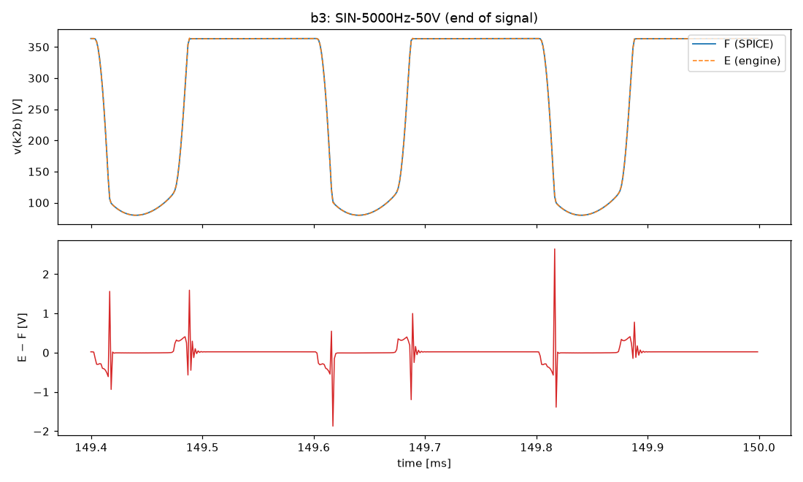
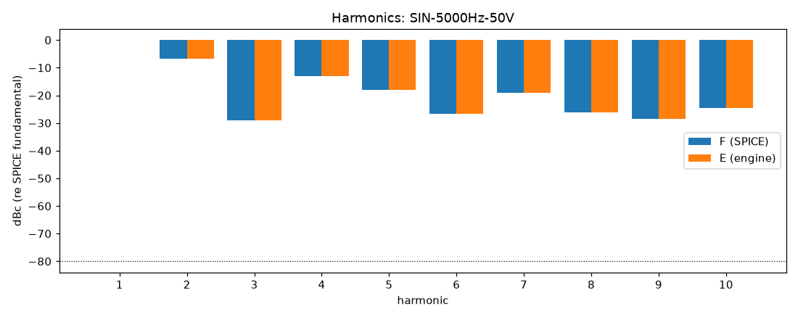
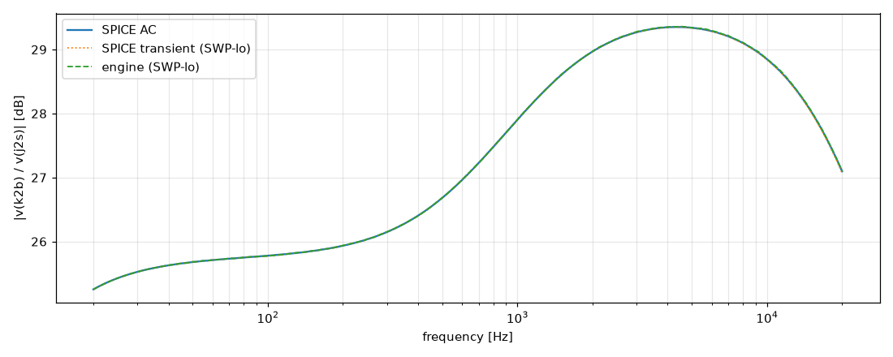

# M3 report: b3 / DEFAULT

- Block: B3 StageV2aV2b
- Preset: DEFAULT — Default knobs; standard signal set at the block levels
- Knobs: preampVolume=0.6, treble=0.5, middle=0.5, bass=0.5, master=0.3, presence=0.5
- Date: 2026-10-18
- Engine commit: `d37baf0 (dirty)`
- Testbench: `harness/testbenches/b3.cir` sha256 `7e2f0a59288617d9`; netlist sha256 `ffd9b2812204248f`; tubes.lib sha256 `c9c9c88346c69010`
- ngspice 47, fs = 768000 Hz, SPICE reltol 1e-08

## Summary

PASS 87 · FAIL 0 · INFO 15 (INFO = measured, not scored in M3)

| Check | Item | Measured | Tolerance | Status |
|---|---|---|---|---|
| dc_rel_error | v(bpx) | 0 | ≤ 0.005 | PASS |
| dc_rel_error | v(g2a) | 0.0006604 | ≤ 0.005 | PASS |
| dc_rel_error | v(k2a) | 2.495e-05 | ≤ 0.005 | PASS |
| dc_rel_error | v(k2b) | 1.794e-05 | ≤ 0.005 | PASS |
| dc_rel_error | v(nb) | 0.0006604 | ≤ 0.005 | PASS |
| dc_rel_error | v(p1b) | 1.602e-16 | ≤ 0.005 | PASS |
| dc_rel_error | v(p2a) | 1.85e-05 | ≤ 0.005 | PASS |
| nonlinear_esr_db | SIN-100Hz-0.1V | -82.22 dB | ≤ -20 | PASS |
| harmonics_2_5_db | SIN-100Hz-0.1V | 0.001141 dB | ≤ 0.5 | PASS |
| thd_pp | SIN-100Hz-0.1V | 8.687e-06 pp | — | INFO |
| newton_failures | SIN-100Hz-0.1V | 0 | ≤ 0 | PASS |
| newton_median_iterations | SIN-100Hz-0.1V | 1 | ≤ 3 | PASS |
| newton_max_iterations | SIN-100Hz-0.1V | 1 | ≤ 12 | PASS |
| nonlinear_esr_db | SIN-1000Hz-0.1V | -65.4 dB | ≤ -20 | PASS |
| harmonics_2_5_db | SIN-1000Hz-0.1V | 0.01272 dB | ≤ 0.5 | PASS |
| thd_pp | SIN-1000Hz-0.1V | 6.728e-05 pp | — | INFO |
| newton_failures | SIN-1000Hz-0.1V | 0 | ≤ 0 | PASS |
| newton_median_iterations | SIN-1000Hz-0.1V | 1 | ≤ 3 | PASS |
| newton_max_iterations | SIN-1000Hz-0.1V | 2 | ≤ 12 | PASS |
| nonlinear_esr_db | SIN-5000Hz-0.1V | -58.58 dB | ≤ -20 | PASS |
| harmonics_2_5_db | SIN-5000Hz-0.1V | 0.03003 dB | ≤ 0.5 | PASS |
| thd_pp | SIN-5000Hz-0.1V | 0.0001551 pp | — | INFO |
| newton_failures | SIN-5000Hz-0.1V | 0 | ≤ 0 | PASS |
| newton_median_iterations | SIN-5000Hz-0.1V | 2 | ≤ 3 | PASS |
| newton_max_iterations | SIN-5000Hz-0.1V | 2 | ≤ 12 | PASS |
| nonlinear_esr_db | SIN-100Hz-1V | -82.19 dB | ≤ -20 | PASS |
| harmonics_2_5_db | SIN-100Hz-1V | 0.003423 dB | ≤ 0.5 | PASS |
| thd_pp | SIN-100Hz-1V | 8.843e-05 pp | — | INFO |
| newton_failures | SIN-100Hz-1V | 0 | ≤ 0 | PASS |
| newton_median_iterations | SIN-100Hz-1V | 1 | ≤ 3 | PASS |
| newton_max_iterations | SIN-100Hz-1V | 2 | ≤ 12 | PASS |
| nonlinear_esr_db | SIN-1000Hz-1V | -65.38 dB | ≤ -20 | PASS |
| harmonics_2_5_db | SIN-1000Hz-1V | 0.01281 dB | ≤ 0.5 | PASS |
| thd_pp | SIN-1000Hz-1V | 0.0006782 pp | — | INFO |
| newton_failures | SIN-1000Hz-1V | 0 | ≤ 0 | PASS |
| newton_median_iterations | SIN-1000Hz-1V | 2 | ≤ 3 | PASS |
| newton_max_iterations | SIN-1000Hz-1V | 2 | ≤ 12 | PASS |
| nonlinear_esr_db | SIN-5000Hz-1V | -58.54 dB | ≤ -20 | PASS |
| harmonics_2_5_db | SIN-5000Hz-1V | 0.031 dB | ≤ 0.5 | PASS |
| thd_pp | SIN-5000Hz-1V | 0.00162 pp | — | INFO |
| newton_failures | SIN-5000Hz-1V | 0 | ≤ 0 | PASS |
| newton_median_iterations | SIN-5000Hz-1V | 2 | ≤ 3 | PASS |
| newton_max_iterations | SIN-5000Hz-1V | 2 | ≤ 12 | PASS |
| nonlinear_esr_db | SIN-100Hz-10V | -80.18 dB | ≤ -20 | PASS |
| harmonics_2_5_db | SIN-100Hz-10V | 0.01487 dB | ≤ 0.5 | PASS |
| thd_pp | SIN-100Hz-10V | 0.0009158 pp | — | INFO |
| newton_failures | SIN-100Hz-10V | 0 | ≤ 0 | PASS |
| newton_median_iterations | SIN-100Hz-10V | 1 | ≤ 3 | PASS |
| newton_max_iterations | SIN-100Hz-10V | 2 | ≤ 12 | PASS |
| nonlinear_esr_db | SIN-1000Hz-10V | -65.85 dB | ≤ -20 | PASS |
| harmonics_2_5_db | SIN-1000Hz-10V | 0.01237 dB | ≤ 0.5 | PASS |
| thd_pp | SIN-1000Hz-10V | 0.004707 pp | — | INFO |
| newton_failures | SIN-1000Hz-10V | 0 | ≤ 0 | PASS |
| newton_median_iterations | SIN-1000Hz-10V | 2 | ≤ 3 | PASS |
| newton_max_iterations | SIN-1000Hz-10V | 3 | ≤ 12 | PASS |
| nonlinear_esr_db | SIN-5000Hz-10V | -59.93 dB | ≤ -20 | PASS |
| harmonics_2_5_db | SIN-5000Hz-10V | 0.01483 dB | ≤ 0.5 | PASS |
| thd_pp | SIN-5000Hz-10V | 0.01898 pp | — | INFO |
| newton_failures | SIN-5000Hz-10V | 0 | ≤ 0 | PASS |
| newton_median_iterations | SIN-5000Hz-10V | 2 | ≤ 3 | PASS |
| newton_max_iterations | SIN-5000Hz-10V | 4 | ≤ 12 | PASS |
| nonlinear_esr_db_overdrive | SIN-100Hz-50V | -76.63 dB | ≤ -20 | PASS |
| harmonics_2_5_db | SIN-100Hz-50V | 0.001125 dB | ≤ 0.5 | PASS |
| thd_pp | SIN-100Hz-50V | 0.0003032 pp | — | INFO |
| newton_failures | SIN-100Hz-50V | 0 | ≤ 0 | PASS |
| newton_median_iterations | SIN-100Hz-50V | 1 | ≤ 3 | PASS |
| newton_max_iterations | SIN-100Hz-50V | 3 | ≤ 12 | PASS |
| nonlinear_esr_db_overdrive | SIN-1000Hz-50V | -64.03 dB | ≤ -20 | PASS |
| harmonics_2_5_db | SIN-1000Hz-50V | 0.00263 dB | ≤ 0.5 | PASS |
| thd_pp | SIN-1000Hz-50V | 0.0009813 pp | — | INFO |
| newton_failures | SIN-1000Hz-50V | 0 | ≤ 0 | PASS |
| newton_median_iterations | SIN-1000Hz-50V | 2 | ≤ 3 | PASS |
| newton_max_iterations | SIN-1000Hz-50V | 4 | ≤ 12 | PASS |
| nonlinear_esr_db_overdrive | SIN-5000Hz-50V | -54.24 dB | ≤ -20 | PASS |
| harmonics_2_5_db | SIN-5000Hz-50V | 0.004271 dB | ≤ 0.5 | PASS |
| thd_pp | SIN-5000Hz-50V | 0.0137 pp | — | INFO |
| newton_failures | SIN-5000Hz-50V | 0 | ≤ 0 | PASS |
| newton_median_iterations | SIN-5000Hz-50V | 2 | ≤ 3 | PASS |
| newton_max_iterations | SIN-5000Hz-50V | 5 | ≤ 12 | PASS |
| nonlinear_esr_db | SWP-lo-0.1V | -58.73 dB | ≤ -20 | PASS |
| linear_mag_db_20_10k | SWP-lo-0.1V | 0.01374 dB | ≤ 0.1 | INFO |
| linear_mag_db_10k_20k | SWP-lo-0.1V | 0.01517 dB | ≤ 0.3 | INFO |
| method_mag_db_spice_tran_vs_ac | SWP-lo-0.1V | 0.02799 dB | — | INFO |
| newton_failures | SWP-lo-0.1V | 0 | ≤ 0 | PASS |
| newton_median_iterations | SWP-lo-0.1V | 1 | ≤ 3 | PASS |
| newton_max_iterations | SWP-lo-0.1V | 2 | ≤ 12 | PASS |
| nonlinear_esr_db | SWP-hi-1V | -58.7 dB | ≤ -20 | PASS |
| newton_failures | SWP-hi-1V | 0 | ≤ 0 | PASS |
| newton_median_iterations | SWP-hi-1V | 1 | ≤ 3 | PASS |
| newton_max_iterations | SWP-hi-1V | 3 | ≤ 12 | PASS |
| nonlinear_esr_db | TT-0.5V | -74.27 dB | ≤ -20 | PASS |
| newton_failures | TT-0.5V | 0 | ≤ 0 | PASS |
| newton_median_iterations | TT-0.5V | 1 | ≤ 3 | PASS |
| newton_max_iterations | TT-0.5V | 2 | ≤ 12 | PASS |
| nonlinear_esr_db | BURST-10V | -65.85 dB | ≤ -20 | PASS |
| newton_failures | BURST-10V | 0 | ≤ 0 | PASS |
| newton_median_iterations | BURST-10V | 1 | ≤ 3 | PASS |
| newton_max_iterations | BURST-10V | 3 | ≤ 12 | PASS |
| nonlinear_esr_db | STEP-1V | -73.14 dB | ≤ -20 | PASS |
| newton_failures | STEP-1V | 0 | ≤ 0 | PASS |
| newton_median_iterations | STEP-1V | 1 | ≤ 3 | PASS |
| newton_max_iterations | STEP-1V | 2 | ≤ 12 | PASS |

## Signals

| Signal | Peak F [V] | ESR [dB] | Best lag | ESR at lag [dB] | THD F / E [%] | Power F / E [W] | ns/sample | Newton fail / median / max it |
|---|---|---|---|---|---|---|---|---|
| SIN-100Hz-0.1V | 2.04 | -82.22 | 0 | -82.22 | 0.051 / 0.051 | — | 305.3 | 0 / 1 / 1 |
| SIN-1000Hz-0.1V | 2.497 | -65.40 | 0 | -65.40 | 0.0581 / 0.0582 | — | 300.9 | 0 / 1 / 2 |
| SIN-5000Hz-0.1V | 3.013 | -58.58 | 0 | -58.58 | 0.0603 / 0.0605 | — | 450.1 | 0 / 2 / 2 |
| SIN-100Hz-1V | 20.19 | -82.19 | 0 | -82.19 | 0.511 / 0.511 | — | 293.5 | 0 / 1 / 2 |
| SIN-1000Hz-1V | 25.12 | -65.38 | 0 | -65.38 | 0.583 / 0.584 | — | 403.5 | 0 / 2 / 2 |
| SIN-5000Hz-1V | 29.73 | -58.54 | 0 | -58.54 | 0.606 / 0.608 | — | 460.7 | 0 / 2 / 2 |
| SIN-100Hz-10V | 127.9 | -80.18 | 0 | -80.18 | 14.3 / 14.3 | — | 334.1 | 0 / 1 / 2 |
| SIN-1000Hz-10V | 130.3 | -65.85 | 0 | -65.85 | 19 / 19 | — | 492.5 | 0 / 2 / 3 |
| SIN-5000Hz-10V | 130.4 | -59.93 | 0 | -59.93 | 28 / 28 | — | 545.9 | 0 / 2 / 4 |
| SIN-100Hz-50V | 130.3 | -76.63 | 0 | -76.63 | 40.1 / 40.1 | — | 329.8 | 0 / 1 / 3 |
| SIN-1000Hz-50V | 139.5 | -64.03 | 0 | -64.03 | 45.5 / 45.5 | — | 397.7 | 0 / 2 / 4 |
| SIN-5000Hz-50V | 163.6 | -54.24 | 0 | -54.24 | 54.9 / 54.9 | — | 492.0 | 0 / 2 / 5 |
| SWP-lo-0.1V | 2.938 | -58.73 | 0 | -58.73 | — | — | 344.6 | 0 / 1 / 2 |
| SWP-hi-1V | 29.71 | -58.70 | 0 | -58.70 | — | — | 362.6 | 0 / 1 / 3 |
| TT-0.5V | 19.5 | -74.27 | 0 | -74.27 | — | — | 292.9 | 0 / 1 / 2 |
| BURST-10V | 130.3 | -65.85 | 0 | -65.85 | — | — | 378.9 | 0 / 1 / 3 |
| STEP-1V | 30.83 | -73.14 | 0 | -73.14 | — | — | 294.0 | 0 / 1 / 2 |

## DC operating point

| Node | SPICE [V] | Engine [V] | Rel. error |
|---|---|---|---|
| bpx | 404.9982 | 404.9982 | 0 |
| g2a | 0.0005 | 0.0005 | 0.0006604 |
| k2a | 1.4139 | 1.4138 | 2.495e-05 |
| k2b | 233.1404 | 233.1446 | 1.794e-05 |
| nb | 0.0005 | 0.0005 | 0.0006604 |
| p1b | 354.7502 | 354.7502 | 1.602e-16 |
| p2a | 232.5771 | 232.5814 | 1.85e-05 |

Engine values are the probe values after the first sample (zero input) following `reset()`. Nodes the engine does not probe yet show —.

## Figures

### Waveform overlay and error (most demanding signal)

### Harmonics

### Magnitude response

