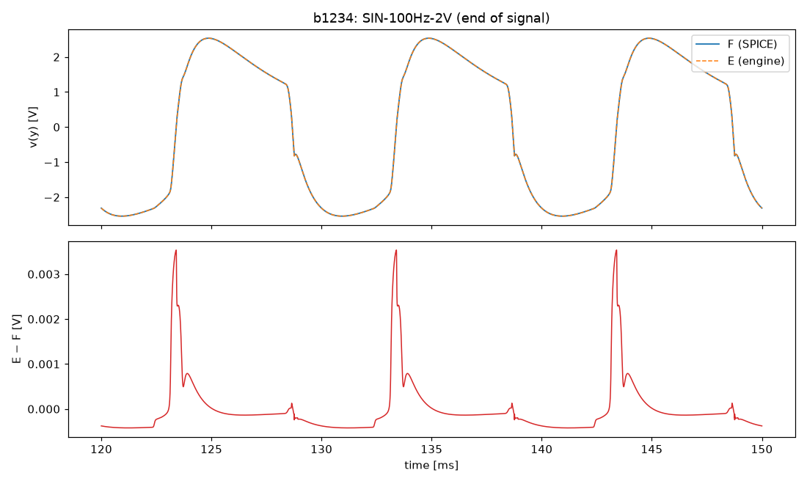
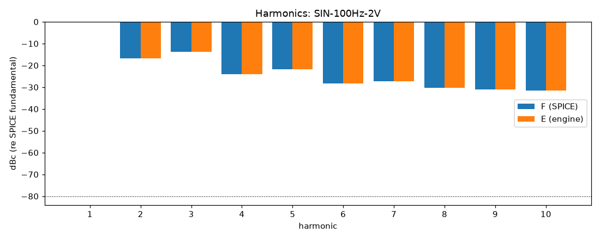
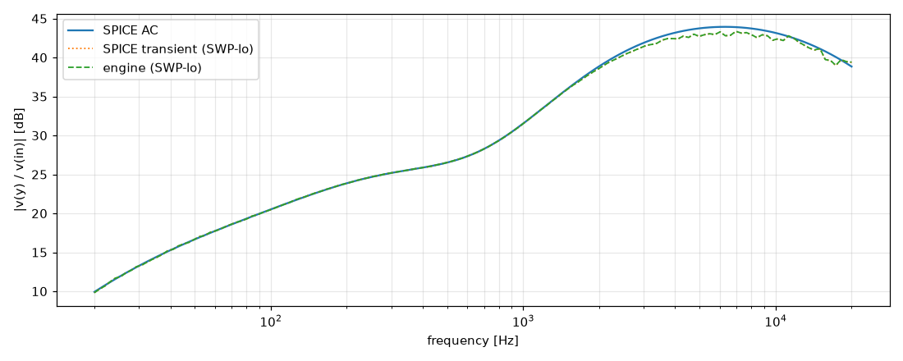
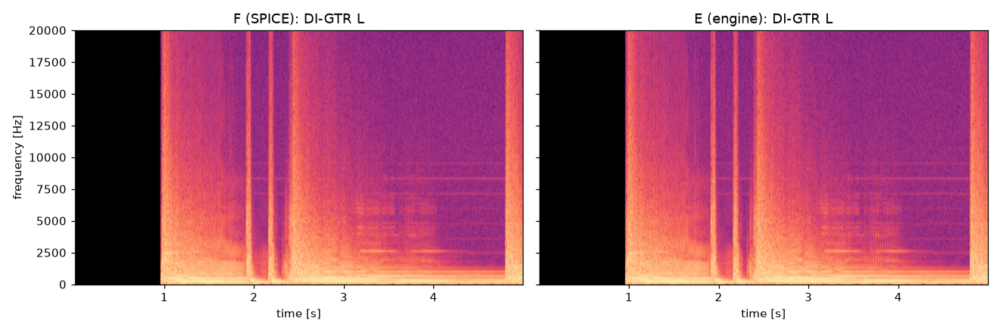

# M3 report: b1234 / DEFAULT

- Block: B1234 Preamp (B12 + B3 + B4 in one tree, 8-port root, D-038)
- Preset: DEFAULT — Default knobs; standard signal set at the block levels
- Knobs: preampVolume=0.6, treble=0.5, middle=0.5, bass=0.5, master=0.3, presence=0.5
- Date: 2026-10-19
- Engine commit: `ecf9042 (dirty)`
- Testbench: `harness/testbenches/b1234.cir` sha256 `a99cb5b98a48184b`; netlist sha256 `ffd9b2812204248f`; tubes.lib sha256 `c9c9c88346c69010`
- ngspice 47, fs = 768000 Hz, SPICE reltol 1e-08

## Summary

PASS 119 · FAIL 0 · INFO 15 (INFO = measured, not scored in M3)

| Check | Item | Measured | Tolerance | Status |
|---|---|---|---|---|
| dc_rel_error | v(bpa) | 1.45e-16 | ≤ 0.005 | PASS |
| dc_rel_error | v(bpx) | 0 | ≤ 0.005 | PASS |
| dc_rel_error | v(g1a) | 0.0001717 | ≤ 0.005 | PASS |
| dc_rel_error | v(g2a) | 0.0006604 | ≤ 0.005 | PASS |
| dc_rel_error | v(in) | 0 | ≤ 0.005 | PASS |
| dc_rel_error | v(k1a) | 4.576e-05 | ≤ 0.005 | PASS |
| dc_rel_error | v(k1b) | 0.000107 | ≤ 0.005 | PASS |
| dc_rel_error | v(k2a) | 2.495e-05 | ≤ 0.005 | PASS |
| dc_rel_error | v(k2b) | 1.794e-05 | ≤ 0.005 | PASS |
| dc_rel_error | v(mw) | 1.175e-08 | ≤ 0.005 | PASS |
| dc_rel_error | v(na) | 0.0006024 | ≤ 0.005 | PASS |
| dc_rel_error | v(nb) | 0.0006604 | ≤ 0.005 | PASS |
| dc_rel_error | v(nbb) | 1.175e-08 | ≤ 0.005 | PASS |
| dc_rel_error | v(nd) | 1.794e-05 | ≤ 0.005 | PASS |
| dc_rel_error | v(ne) | 1.179e-08 | ≤ 0.005 | PASS |
| dc_rel_error | v(p1a) | 1.436e-05 | ≤ 0.005 | PASS |
| dc_rel_error | v(p1b) | 1.121e-05 | ≤ 0.005 | PASS |
| dc_rel_error | v(p2a) | 1.85e-05 | ≤ 0.005 | PASS |
| dc_rel_error | v(tt) | 8.356e-09 | ≤ 0.005 | PASS |
| dc_rel_error | v(tw) | 9.614e-09 | ≤ 0.005 | PASS |
| dc_rel_error | v(vtop) | 0.0006024 | ≤ 0.005 | PASS |
| dc_rel_error | v(w1) | 0.0006024 | ≤ 0.005 | PASS |
| dc_rel_error | v(y) | 3.257e-10 | ≤ 0.005 | PASS |
| nonlinear_esr_db | SIN-100Hz-0.01V | -73.08 dB | ≤ -20 | PASS |
| harmonics_2_5_db | SIN-100Hz-0.01V | 0.002595 dB | ≤ 0.5 | PASS |
| thd_pp | SIN-100Hz-0.01V | 1.433e-05 pp | — | INFO |
| newton_failures | SIN-100Hz-0.01V | 0 | ≤ 0 | PASS |
| newton_median_iterations | SIN-100Hz-0.01V | 1 | ≤ 3 | PASS |
| newton_max_iterations | SIN-100Hz-0.01V | 1 | ≤ 64 | PASS |
| nonlinear_esr_db | SIN-1000Hz-0.01V | -60.63 dB | ≤ -20 | PASS |
| harmonics_2_5_db | SIN-1000Hz-0.01V | 0.01803 dB | ≤ 0.5 | PASS |
| thd_pp | SIN-1000Hz-0.01V | 0.001323 pp | — | INFO |
| newton_failures | SIN-1000Hz-0.01V | 0 | ≤ 0 | PASS |
| newton_median_iterations | SIN-1000Hz-0.01V | 1 | ≤ 3 | PASS |
| newton_max_iterations | SIN-1000Hz-0.01V | 2 | ≤ 64 | PASS |
| nonlinear_esr_db | SIN-5000Hz-0.01V | -53.07 dB | ≤ -20 | PASS |
| harmonics_2_5_db | SIN-5000Hz-0.01V | 0.1088 dB | ≤ 0.5 | PASS |
| thd_pp | SIN-5000Hz-0.01V | 0.03125 pp | — | INFO |
| newton_failures | SIN-5000Hz-0.01V | 0 | ≤ 0 | PASS |
| newton_median_iterations | SIN-5000Hz-0.01V | 2 | ≤ 3 | PASS |
| newton_max_iterations | SIN-5000Hz-0.01V | 6 | ≤ 64 | PASS |
| nonlinear_esr_db | SIN-100Hz-0.1V | -73.53 dB | ≤ -20 | PASS |
| harmonics_2_5_db | SIN-100Hz-0.1V | 0.02799 dB | ≤ 0.5 | PASS |
| thd_pp | SIN-100Hz-0.1V | 0.001435 pp | — | INFO |
| newton_failures | SIN-100Hz-0.1V | 0 | ≤ 0 | PASS |
| newton_median_iterations | SIN-100Hz-0.1V | 1 | ≤ 3 | PASS |
| newton_max_iterations | SIN-100Hz-0.1V | 2 | ≤ 64 | PASS |
| nonlinear_esr_db | SIN-1000Hz-0.1V | -57.75 dB | ≤ -20 | PASS |
| harmonics_2_5_db | SIN-1000Hz-0.1V | 0.02889 dB | ≤ 0.5 | PASS |
| thd_pp | SIN-1000Hz-0.1V | 0.007326 pp | — | INFO |
| newton_failures | SIN-1000Hz-0.1V | 0 | ≤ 0 | PASS |
| newton_median_iterations | SIN-1000Hz-0.1V | 2 | ≤ 3 | PASS |
| newton_max_iterations | SIN-1000Hz-0.1V | 6 | ≤ 64 | PASS |
| nonlinear_esr_db | SIN-5000Hz-0.1V | -47.24 dB | ≤ -20 | PASS |
| harmonics_2_5_db | SIN-5000Hz-0.1V | 0.03821 dB | ≤ 0.5 | PASS |
| thd_pp | SIN-5000Hz-0.1V | 0.008787 pp | — | INFO |
| newton_failures | SIN-5000Hz-0.1V | 0 | ≤ 0 | PASS |
| newton_median_iterations | SIN-5000Hz-0.1V | 2 | ≤ 3 | PASS |
| newton_max_iterations | SIN-5000Hz-0.1V | 7 | ≤ 64 | PASS |
| nonlinear_esr_db | SIN-100Hz-0.5V | -75.29 dB | ≤ -20 | PASS |
| harmonics_2_5_db | SIN-100Hz-0.5V | 0.002416 dB | ≤ 0.5 | PASS |
| thd_pp | SIN-100Hz-0.5V | 6.976e-05 pp | — | INFO |
| newton_failures | SIN-100Hz-0.5V | 0 | ≤ 0 | PASS |
| newton_median_iterations | SIN-100Hz-0.5V | 1 | ≤ 3 | PASS |
| newton_max_iterations | SIN-100Hz-0.5V | 4 | ≤ 64 | PASS |
| nonlinear_esr_db | SIN-1000Hz-0.5V | -50.57 dB | ≤ -20 | PASS |
| harmonics_2_5_db | SIN-1000Hz-0.5V | 0.02096 dB | ≤ 0.5 | PASS |
| thd_pp | SIN-1000Hz-0.5V | 0.005945 pp | — | INFO |
| newton_failures | SIN-1000Hz-0.5V | 0 | ≤ 0 | PASS |
| newton_median_iterations | SIN-1000Hz-0.5V | 2 | ≤ 3 | PASS |
| newton_max_iterations | SIN-1000Hz-0.5V | 7 | ≤ 64 | PASS |
| nonlinear_esr_db | SIN-5000Hz-0.5V | -39.33 dB | ≤ -20 | PASS |
| harmonics_2_5_db | SIN-5000Hz-0.5V | 0.0322 dB | ≤ 0.5 | PASS |
| thd_pp | SIN-5000Hz-0.5V | 0.00618 pp | — | INFO |
| newton_failures | SIN-5000Hz-0.5V | 0 | ≤ 0 | PASS |
| newton_median_iterations | SIN-5000Hz-0.5V | 2 | ≤ 3 | PASS |
| newton_max_iterations | SIN-5000Hz-0.5V | 9 | ≤ 64 | PASS |
| nonlinear_esr_db_overdrive | SIN-100Hz-2V | -70.14 dB | ≤ -20 | PASS |
| harmonics_2_5_db | SIN-100Hz-2V | 0.00951 dB | ≤ 0.5 | PASS |
| thd_pp | SIN-100Hz-2V | 0.004205 pp | — | INFO |
| newton_failures | SIN-100Hz-2V | 0 | ≤ 0 | PASS |
| newton_median_iterations | SIN-100Hz-2V | 1 | ≤ 3 | PASS |
| newton_max_iterations | SIN-100Hz-2V | 5 | ≤ 64 | PASS |
| nonlinear_esr_db_overdrive | SIN-1000Hz-2V | -47.39 dB | ≤ -20 | PASS |
| harmonics_2_5_db | SIN-1000Hz-2V | 0.00316 dB | ≤ 0.5 | PASS |
| thd_pp | SIN-1000Hz-2V | 0.0003278 pp | — | INFO |
| newton_failures | SIN-1000Hz-2V | 0 | ≤ 0 | PASS |
| newton_median_iterations | SIN-1000Hz-2V | 2 | ≤ 3 | PASS |
| newton_max_iterations | SIN-1000Hz-2V | 7 | ≤ 64 | PASS |
| nonlinear_esr_db_overdrive | SIN-5000Hz-2V | -34.32 dB | ≤ -20 | PASS |
| harmonics_2_5_db | SIN-5000Hz-2V | 0.1697 dB | ≤ 0.5 | PASS |
| thd_pp | SIN-5000Hz-2V | 0.007558 pp | — | INFO |
| newton_failures | SIN-5000Hz-2V | 0 | ≤ 0 | PASS |
| newton_median_iterations | SIN-5000Hz-2V | 2 | ≤ 3 | PASS |
| newton_max_iterations | SIN-5000Hz-2V | 9 | ≤ 64 | PASS |
| nonlinear_esr_db | SWP-lo-0.01V | -51.28 dB | ≤ -20 | PASS |
| linear_mag_db_20_10k | SWP-lo-0.01V | 1.146 dB | ≤ 0.1 | INFO |
| linear_mag_db_10k_20k | SWP-lo-0.01V | 1.073 dB | ≤ 0.3 | INFO |
| method_mag_db_spice_tran_vs_ac | SWP-lo-0.01V | 1.155 dB | — | INFO |
| newton_failures | SWP-lo-0.01V | 0 | ≤ 0 | PASS |
| newton_median_iterations | SWP-lo-0.01V | 1 | ≤ 3 | PASS |
| newton_max_iterations | SWP-lo-0.01V | 7 | ≤ 64 | PASS |
| nonlinear_esr_db | SWP-hi-0.1V | -46.6 dB | ≤ -20 | PASS |
| newton_failures | SWP-hi-0.1V | 0 | ≤ 0 | PASS |
| newton_median_iterations | SWP-hi-0.1V | 1 | ≤ 3 | PASS |
| newton_max_iterations | SWP-hi-0.1V | 9 | ≤ 64 | PASS |
| nonlinear_esr_db | TT-0.05V | -69.19 dB | ≤ -20 | PASS |
| newton_failures | TT-0.05V | 0 | ≤ 0 | PASS |
| newton_median_iterations | TT-0.05V | 1 | ≤ 3 | PASS |
| newton_max_iterations | TT-0.05V | 3 | ≤ 64 | PASS |
| nonlinear_esr_db | BURST-0.5V | -51.14 dB | ≤ -20 | PASS |
| newton_failures | BURST-0.5V | 0 | ≤ 0 | PASS |
| newton_median_iterations | BURST-0.5V | 1 | ≤ 3 | PASS |
| newton_max_iterations | BURST-0.5V | 7 | ≤ 64 | PASS |
| nonlinear_esr_db | STEP-0.1V | -56.98 dB | ≤ -20 | PASS |
| newton_failures | STEP-0.1V | 0 | ≤ 0 | PASS |
| newton_median_iterations | STEP-0.1V | 1 | ≤ 3 | PASS |
| newton_max_iterations | STEP-0.1V | 7 | ≤ 64 | PASS |
| nonlinear_esr_db | DI-GTR L | -62.5 dB | ≤ -20 | PASS |
| newton_failures | DI-GTR L | 0 | ≤ 0 | PASS |
| newton_median_iterations | DI-GTR L | 1 | ≤ 3 | PASS |
| newton_max_iterations | DI-GTR L | 7 | ≤ 64 | PASS |
| nonlinear_esr_db | DI-GTR LL | -62.95 dB | ≤ -20 | PASS |
| newton_failures | DI-GTR LL | 0 | ≤ 0 | PASS |
| newton_median_iterations | DI-GTR LL | 1 | ≤ 3 | PASS |
| newton_max_iterations | DI-GTR LL | 7 | ≤ 64 | PASS |
| nonlinear_esr_db | DI-GTR R | -63.68 dB | ≤ -20 | PASS |
| newton_failures | DI-GTR R | 0 | ≤ 0 | PASS |
| newton_median_iterations | DI-GTR R | 1 | ≤ 3 | PASS |
| newton_max_iterations | DI-GTR R | 7 | ≤ 64 | PASS |
| nonlinear_esr_db | DI-GTR RR | -62.6 dB | ≤ -20 | PASS |
| newton_failures | DI-GTR RR | 0 | ≤ 0 | PASS |
| newton_median_iterations | DI-GTR RR | 1 | ≤ 3 | PASS |
| newton_max_iterations | DI-GTR RR | 7 | ≤ 64 | PASS |

## Signals

| Signal | Peak F [V] | ESR [dB] | Best lag | ESR at lag [dB] | THD F / E [%] | Power F / E [W] | ns/sample | Newton fail / median / max it |
|---|---|---|---|---|---|---|---|---|
| SIN-100Hz-0.01V | 0.1088 | -73.08 | 0 | -73.08 | 0.129 / 0.129 | — | 786.4 | 0 / 1 / 1 |
| SIN-1000Hz-0.01V | 0.4171 | -60.63 | 0 | -60.63 | 0.864 / 0.866 | — | 788.7 | 0 / 1 / 2 |
| SIN-5000Hz-0.01V | 1.39 | -53.07 | 0 | -53.07 | 6.4 / 6.43 | — | 1157.7 | 0 / 2 / 6 |
| SIN-100Hz-0.1V | 1.071 | -73.53 | 0 | -73.53 | 1.65 / 1.65 | — | 790.9 | 0 / 1 / 2 |
| SIN-1000Hz-0.1V | 1.771 | -57.75 | 0 | -57.75 | 42.6 / 42.6 | — | 972.1 | 0 / 2 / 6 |
| SIN-5000Hz-0.1V | 2.482 | -47.24 | 0 | -47.24 | 48 / 48 | — | 1214.2 | 0 / 2 / 7 |
| SIN-100Hz-0.5V | 2.723 | -75.29 | 0 | -75.29 | 15.9 / 15.9 | — | 799.8 | 0 / 1 / 4 |
| SIN-1000Hz-0.5V | 2.543 | -50.57 | 0 | -50.57 | 63.6 / 63.6 | — | 997.7 | 0 / 2 / 7 |
| SIN-5000Hz-0.5V | 2.549 | -39.33 | 0 | -39.33 | 44.7 / 44.7 | — | 1169.0 | 0 / 2 / 9 |
| SIN-100Hz-2V | 2.881 | -70.14 | 0 | -70.14 | 28.2 / 28.3 | — | 812.9 | 0 / 1 / 5 |
| SIN-1000Hz-2V | 2.798 | -47.39 | 0 | -47.39 | 63.6 / 63.6 | — | 983.8 | 0 / 2 / 7 |
| SIN-5000Hz-2V | 2.542 | -34.32 | 0 | -34.32 | 44.4 / 44.5 | — | 1157.4 | 0 / 2 / 9 |
| SWP-lo-0.01V | 1.367 | -51.28 | 0 | -51.28 | — | — | 896.5 | 0 / 1 / 7 |
| SWP-hi-0.1V | 1.928 | -46.60 | 0 | -46.60 | — | — | 960.5 | 0 / 1 / 9 |
| TT-0.05V | 1.627 | -69.19 | 0 | -69.19 | — | — | 800.9 | 0 / 1 / 3 |
| BURST-0.5V | 2.548 | -51.14 | 0 | -51.14 | — | — | 949.1 | 0 / 1 / 7 |
| STEP-0.1V | 2.403 | -56.98 | 0 | -56.98 | — | — | 784.7 | 0 / 1 / 7 |
| DI-GTR L | 2.564 | -62.50 | 0 | -62.50 | — | — | 762.3 | 0 / 1 / 7 |
| DI-GTR LL | 2.571 | -62.95 | 0 | -62.95 | — | — | 735.8 | 0 / 1 / 7 |
| DI-GTR R | 2.628 | -63.68 | 0 | -63.68 | — | — | 754.0 | 0 / 1 / 7 |
| DI-GTR RR | 2.679 | -62.60 | 0 | -62.60 | — | — | 760.0 | 0 / 1 / 7 |

## DC operating point

| Node | SPICE [V] | Engine [V] | Rel. error |
|---|---|---|---|
| bpa | 391.9215 | 391.9215 | 1.45e-16 |
| bpx | 404.9982 | 404.9982 | 0 |
| g1a | 0.0001 | 0.0001 | 0.0001717 |
| g2a | 0.0005 | 0.0005 | 0.0006604 |
| in | 0.0000 | 0.0000 | 0 |
| k1a | 2.5271 | 2.5270 | 4.576e-05 |
| k1b | 3.7171 | 3.7167 | 0.000107 |
| k2a | 1.4139 | 1.4138 | 2.495e-05 |
| k2b | 233.1404 | 233.1446 | 1.794e-05 |
| mw | 0.0000 | -0.0000 | 1.175e-08 |
| na | 0.0002 | 0.0002 | 0.0006024 |
| nb | 0.0005 | 0.0005 | 0.0006604 |
| nbb | 0.0000 | -0.0000 | 1.175e-08 |
| nd | 233.1404 | 233.1446 | 1.794e-05 |
| ne | 0.0000 | -0.0000 | 1.179e-08 |
| p1a | 298.3260 | 298.3303 | 1.436e-05 |
| p1b | 354.7502 | 354.7542 | 1.121e-05 |
| p2a | 232.5771 | 232.5814 | 1.85e-05 |
| tt | 0.0000 | -0.0000 | 8.356e-09 |
| tw | 0.0000 | -0.0000 | 9.614e-09 |
| vtop | 0.0002 | 0.0002 | 0.0006024 |
| w1 | 0.0002 | 0.0002 | 0.0006024 |
| y | 0.0000 | -0.0000 | 3.257e-10 |

Engine values are the probe values after the first sample (zero input) following `reset()`. Nodes the engine does not probe yet show —.

## Figures

### Waveform overlay and error (most demanding signal)

### Harmonics

### Magnitude response

### Spectrogram (DI)

