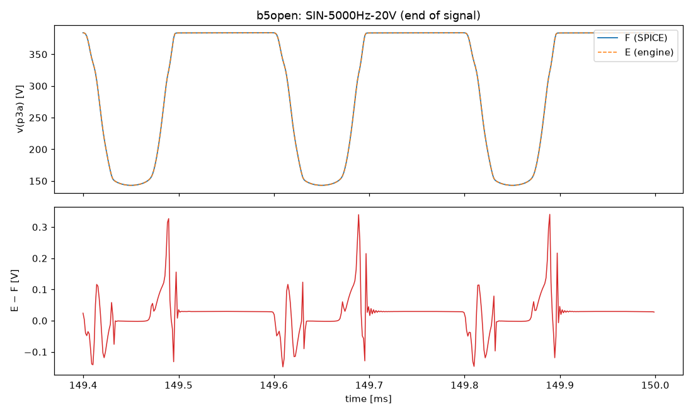
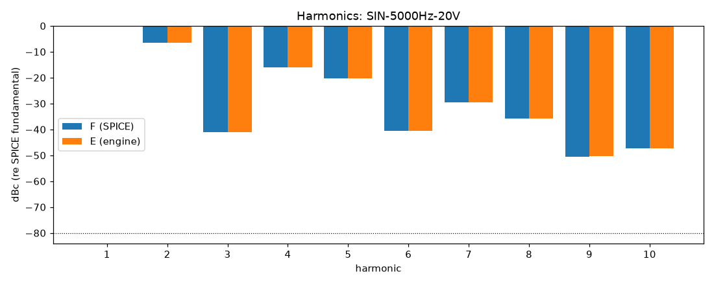

# M4 report: b5open / DEFAULT

- Block: B5-open phase inverter, R22 driven by recorded speaker voltage
- Preset: DEFAULT — Default knobs; standard signal set at the block levels
- Knobs: preampVolume=0.6, treble=0.5, middle=0.5, bass=0.5, master=0.3, presence=0.5
- Date: 2026-10-13
- Engine commit: `e1baabd (dirty)`
- Testbench: `harness/testbenches/b5open.cir` sha256 `bc67b1de3fba5131`; netlist sha256 `7bea8385e4adb04e`; tubes.lib sha256 `9ec33154be8127d7`
- ngspice 47, fs = 768000 Hz, SPICE reltol 1e-08

## Summary

PASS 88 · FAIL 0 · INFO 12 (INFO = measured, not scored in M4)

| Check | Item | Measured | Tolerance | Status |
|---|---|---|---|---|
| dc_rel_error | v(g3a) | 2.534e-05 | ≤ 0.005 | PASS |
| dc_rel_error | v(g3b) | 2.534e-05 | ≤ 0.005 | PASS |
| dc_rel_error | v(k3) | 2.531e-05 | ≤ 0.005 | PASS |
| dc_rel_error | v(nf) | 2.531e-05 | ≤ 0.005 | PASS |
| dc_rel_error | v(ng) | 2.531e-05 | ≤ 0.005 | PASS |
| dc_rel_error | v(p3a) | 1.226e-05 | ≤ 0.005 | PASS |
| dc_rel_error | v(p3b) | 1.356e-05 | ≤ 0.005 | PASS |
| dc_rel_error | v(y) | 2.344e-12 | ≤ 0.005 | PASS |
| nonlinear_esr_db | SIN-100Hz-0.1V | -84.12 dB | ≤ -40 | PASS |
| harmonics_2_5_db | SIN-100Hz-0.1V | 0.0003647 dB | ≤ 0.5 | PASS |
| thd_pp | SIN-100Hz-0.1V | 9.136e-07 pp | — | INFO |
| newton_failures | SIN-100Hz-0.1V | 0 | ≤ 0 | PASS |
| newton_median_iterations | SIN-100Hz-0.1V | 1 | ≤ 3 | PASS |
| newton_max_iterations | SIN-100Hz-0.1V | 2 | ≤ 12 | PASS |
| nonlinear_esr_db | SIN-1000Hz-0.1V | -80.53 dB | ≤ -40 | PASS |
| harmonics_2_5_db | SIN-1000Hz-0.1V | 0.0009576 dB | ≤ 0.5 | PASS |
| thd_pp | SIN-1000Hz-0.1V | 2.771e-07 pp | — | INFO |
| newton_failures | SIN-1000Hz-0.1V | 0 | ≤ 0 | PASS |
| newton_median_iterations | SIN-1000Hz-0.1V | 1 | ≤ 3 | PASS |
| newton_max_iterations | SIN-1000Hz-0.1V | 2 | ≤ 12 | PASS |
| nonlinear_esr_db | SIN-5000Hz-0.1V | -68.45 dB | ≤ -40 | PASS |
| harmonics_2_5_db | SIN-5000Hz-0.1V | 0.06278 dB | ≤ 0.5 | PASS |
| thd_pp | SIN-5000Hz-0.1V | 4.508e-05 pp | — | INFO |
| newton_failures | SIN-5000Hz-0.1V | 0 | ≤ 0 | PASS |
| newton_median_iterations | SIN-5000Hz-0.1V | 2 | ≤ 3 | PASS |
| newton_max_iterations | SIN-5000Hz-0.1V | 2 | ≤ 12 | PASS |
| nonlinear_esr_db | SIN-100Hz-1V | -84.1 dB | ≤ -40 | PASS |
| harmonics_2_5_db | SIN-100Hz-1V | 0.0005251 dB | ≤ 0.5 | PASS |
| thd_pp | SIN-100Hz-1V | 7.227e-06 pp | — | INFO |
| newton_failures | SIN-100Hz-1V | 0 | ≤ 0 | PASS |
| newton_median_iterations | SIN-100Hz-1V | 1 | ≤ 3 | PASS |
| newton_max_iterations | SIN-100Hz-1V | 2 | ≤ 12 | PASS |
| nonlinear_esr_db | SIN-1000Hz-1V | -80.53 dB | ≤ -40 | PASS |
| harmonics_2_5_db | SIN-1000Hz-1V | 0.001841 dB | ≤ 0.5 | PASS |
| thd_pp | SIN-1000Hz-1V | 3.737e-05 pp | — | INFO |
| newton_failures | SIN-1000Hz-1V | 0 | ≤ 0 | PASS |
| newton_median_iterations | SIN-1000Hz-1V | 2 | ≤ 3 | PASS |
| newton_max_iterations | SIN-1000Hz-1V | 2 | ≤ 12 | PASS |
| nonlinear_esr_db | SIN-5000Hz-1V | -68.48 dB | ≤ -40 | PASS |
| harmonics_2_5_db | SIN-5000Hz-1V | 0.02534 dB | ≤ 0.5 | PASS |
| thd_pp | SIN-5000Hz-1V | 0.001179 pp | — | INFO |
| newton_failures | SIN-5000Hz-1V | 0 | ≤ 0 | PASS |
| newton_median_iterations | SIN-5000Hz-1V | 2 | ≤ 3 | PASS |
| newton_max_iterations | SIN-5000Hz-1V | 2 | ≤ 12 | PASS |
| nonlinear_esr_db | SIN-100Hz-5V | -83.6 dB | ≤ -40 | PASS |
| harmonics_2_5_db | SIN-100Hz-5V | 0.001753 dB | ≤ 0.5 | PASS |
| thd_pp | SIN-100Hz-5V | 1.053e-05 pp | — | INFO |
| newton_failures | SIN-100Hz-5V | 0 | ≤ 0 | PASS |
| newton_median_iterations | SIN-100Hz-5V | 1 | ≤ 3 | PASS |
| newton_max_iterations | SIN-100Hz-5V | 2 | ≤ 12 | PASS |
| nonlinear_esr_db | SIN-1000Hz-5V | -79.97 dB | ≤ -40 | PASS |
| harmonics_2_5_db | SIN-1000Hz-5V | 0.03036 dB | ≤ 0.5 | PASS |
| thd_pp | SIN-1000Hz-5V | 0.0008823 pp | — | INFO |
| newton_failures | SIN-1000Hz-5V | 0 | ≤ 0 | PASS |
| newton_median_iterations | SIN-1000Hz-5V | 2 | ≤ 3 | PASS |
| newton_max_iterations | SIN-1000Hz-5V | 2 | ≤ 12 | PASS |
| nonlinear_esr_db | SIN-5000Hz-5V | -67.07 dB | ≤ -40 | PASS |
| harmonics_2_5_db | SIN-5000Hz-5V | 0.04367 dB | ≤ 0.5 | PASS |
| thd_pp | SIN-5000Hz-5V | 0.01936 pp | — | INFO |
| newton_failures | SIN-5000Hz-5V | 0 | ≤ 0 | PASS |
| newton_median_iterations | SIN-5000Hz-5V | 2 | ≤ 3 | PASS |
| newton_max_iterations | SIN-5000Hz-5V | 3 | ≤ 12 | PASS |
| nonlinear_esr_db_overdrive | SIN-100Hz-20V | -75.05 dB | ≤ -30 | PASS |
| harmonics_2_5_db | SIN-100Hz-20V | 0.003567 dB | ≤ 0.5 | PASS |
| thd_pp | SIN-100Hz-20V | 0.002643 pp | — | INFO |
| newton_failures | SIN-100Hz-20V | 0 | ≤ 0 | PASS |
| newton_median_iterations | SIN-100Hz-20V | 1 | ≤ 3 | PASS |
| newton_max_iterations | SIN-100Hz-20V | 2 | ≤ 12 | PASS |
| nonlinear_esr_db_overdrive | SIN-1000Hz-20V | -74.11 dB | ≤ -30 | PASS |
| harmonics_2_5_db | SIN-1000Hz-20V | 0.005546 dB | ≤ 0.5 | PASS |
| thd_pp | SIN-1000Hz-20V | 0.002188 pp | — | INFO |
| newton_failures | SIN-1000Hz-20V | 0 | ≤ 0 | PASS |
| newton_median_iterations | SIN-1000Hz-20V | 2 | ≤ 3 | PASS |
| newton_max_iterations | SIN-1000Hz-20V | 3 | ≤ 12 | PASS |
| nonlinear_esr_db_overdrive | SIN-5000Hz-20V | -64.71 dB | ≤ -30 | PASS |
| harmonics_2_5_db | SIN-5000Hz-20V | 0.07242 dB | ≤ 0.5 | PASS |
| thd_pp | SIN-5000Hz-20V | 0.000555 pp | — | INFO |
| newton_failures | SIN-5000Hz-20V | 0 | ≤ 0 | PASS |
| newton_median_iterations | SIN-5000Hz-20V | 2 | ≤ 3 | PASS |
| newton_max_iterations | SIN-5000Hz-20V | 4 | ≤ 12 | PASS |
| nonlinear_esr_db | SWP-lo-0.1V | -64.91 dB | ≤ -40 | PASS |
| newton_failures | SWP-lo-0.1V | 0 | ≤ 0 | PASS |
| newton_median_iterations | SWP-lo-0.1V | 1 | ≤ 3 | PASS |
| newton_max_iterations | SWP-lo-0.1V | 3 | ≤ 12 | PASS |
| nonlinear_esr_db | SWP-hi-1V | -64.93 dB | ≤ -40 | PASS |
| newton_failures | SWP-hi-1V | 0 | ≤ 0 | PASS |
| newton_median_iterations | SWP-hi-1V | 1 | ≤ 3 | PASS |
| newton_max_iterations | SWP-hi-1V | 3 | ≤ 12 | PASS |
| nonlinear_esr_db | TT-0.5V | -83.65 dB | ≤ -40 | PASS |
| newton_failures | TT-0.5V | 0 | ≤ 0 | PASS |
| newton_median_iterations | TT-0.5V | 1 | ≤ 3 | PASS |
| newton_max_iterations | TT-0.5V | 2 | ≤ 12 | PASS |
| nonlinear_esr_db | BURST-5V | -80.24 dB | ≤ -40 | PASS |
| newton_failures | BURST-5V | 0 | ≤ 0 | PASS |
| newton_median_iterations | BURST-5V | 1 | ≤ 3 | PASS |
| newton_max_iterations | BURST-5V | 2 | ≤ 12 | PASS |
| nonlinear_esr_db | STEP-1V | -79.94 dB | ≤ -40 | PASS |
| newton_failures | STEP-1V | 0 | ≤ 0 | PASS |
| newton_median_iterations | STEP-1V | 1 | ≤ 3 | PASS |
| newton_max_iterations | STEP-1V | 2 | ≤ 12 | PASS |

## Signals

| Signal | Peak F [V] | ESR [dB] | Best lag | ESR at lag [dB] | THD F / E [%] | Power F / E [W] | ns/sample | Newton fail / median / max it |
|---|---|---|---|---|---|---|---|---|
| SIN-100Hz-0.1V | 1.344 | -84.12 | 0 | -84.12 | 0.0474 / 0.0474 | — | 278.0 | 0 / 1 / 2 |
| SIN-1000Hz-0.1V | 1.305 | -80.53 | 0 | -80.53 | 0.0506 / 0.0506 | — | 276.7 | 0 / 1 / 2 |
| SIN-5000Hz-0.1V | 1.315 | -68.45 | 0 | -68.45 | 0.0546 / 0.0547 | — | 412.4 | 0 / 2 / 2 |
| SIN-100Hz-1V | 13.12 | -84.10 | 0 | -84.10 | 0.866 / 0.866 | — | 276.7 | 0 / 1 / 2 |
| SIN-1000Hz-1V | 13.57 | -80.53 | 0 | -80.53 | 1.06 / 1.06 | — | 374.7 | 0 / 2 / 2 |
| SIN-5000Hz-1V | 13.71 | -68.48 | 0 | -68.48 | 1.15 / 1.15 | — | 431.5 | 0 / 2 / 2 |
| SIN-100Hz-5V | 74.31 | -83.60 | 0 | -83.60 | 3.98 / 3.98 | — | 292.9 | 0 / 1 / 2 |
| SIN-1000Hz-5V | 88.9 | -79.97 | 0 | -79.97 | 5.14 / 5.14 | — | 472.3 | 0 / 2 / 2 |
| SIN-5000Hz-5V | 89.03 | -67.07 | 0 | -67.07 | 5.41 / 5.43 | — | 483.8 | 0 / 2 / 3 |
| SIN-100Hz-20V | 131.3 | -75.05 | 0 | -75.05 | 47.2 / 47.2 | — | 394.6 | 0 / 1 / 2 |
| SIN-1000Hz-20V | 139.5 | -74.11 | 0 | -74.11 | 50.6 / 50.6 | — | 458.9 | 0 / 2 / 3 |
| SIN-5000Hz-20V | 141.5 | -64.71 | 0 | -64.71 | 50.4 / 50.4 | — | 621.8 | 0 / 2 / 4 |
| SWP-lo-0.1V | 2.324 | -64.91 | 0 | -64.91 | — | — | 313.8 | 0 / 1 / 3 |
| SWP-hi-1V | 23.16 | -64.93 | 0 | -64.93 | — | — | 345.0 | 0 / 1 / 3 |
| TT-0.5V | 12.24 | -83.65 | 0 | -83.65 | — | — | 278.4 | 0 / 1 / 2 |
| BURST-5V | 94.29 | -80.24 | 0 | -80.24 | — | — | 406.6 | 0 / 1 / 2 |
| STEP-1V | 16.01 | -79.94 | 0 | -79.94 | — | — | 281.1 | 0 / 1 / 2 |

## DC operating point

| Node | SPICE [V] | Engine [V] | Rel. error |
|---|---|---|---|
| g3a | 43.5226 | 43.5215 | 2.534e-05 |
| g3b | 43.5226 | 43.5215 | 2.534e-05 |
| k3 | 44.9334 | 44.9322 | 2.531e-05 |
| nf | 43.5216 | 43.5205 | 2.531e-05 |
| ng | 13.4840 | 13.4836 | 2.531e-05 |
| npr | 0.0000 | — | — |
| p3a | 270.8809 | 270.8842 | 1.226e-05 |
| p3b | 262.2706 | 262.2741 | 1.356e-05 |
| y | 0.0000 | -0.0000 | 2.344e-12 |

Engine values are the probe values after the first sample (zero input) following `reset()`. Nodes the engine does not probe yet show —.

## Figures

### Waveform overlay and error (most demanding signal)

### Harmonics

