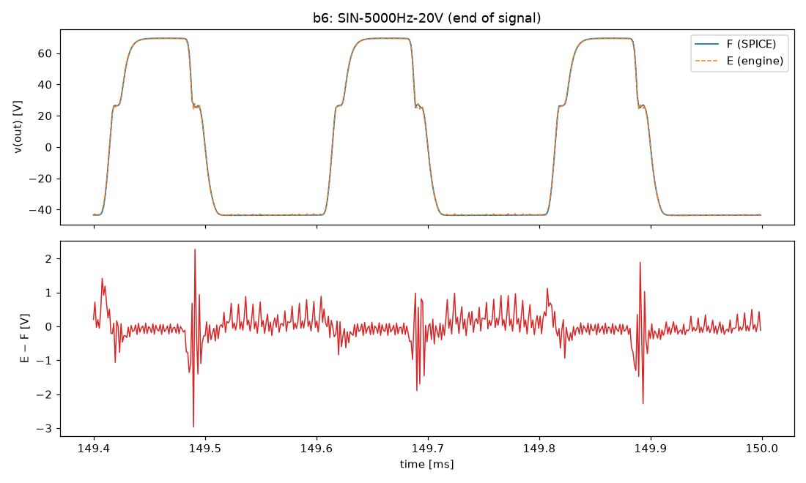
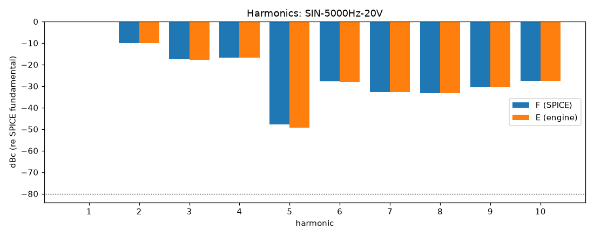

# M4 report: b6 / DEFAULT

- Block: B6 PowerStage, driven by recorded PI outputs
- Preset: DEFAULT — Default knobs; standard signal set at the block levels
- Knobs: preampVolume=0.6, treble=0.5, middle=0.5, bass=0.5, master=0.3, presence=0.5
- Date: 2026-10-13
- Engine commit: `e1baabd (dirty)`
- Testbench: `harness/testbenches/b6.cir` sha256 `a6749a2bf5edeed8`; netlist sha256 `7bea8385e4adb04e`; tubes.lib sha256 `9ec33154be8127d7`
- ngspice 47, fs = 768000 Hz, SPICE reltol 1e-08

## Summary

PASS 94 · FAIL 3 · INFO 24 (INFO = measured, not scored in M4)

| Check | Item | Measured | Tolerance | Status |
|---|---|---|---|---|
| dc_rel_error | v(g4) | 4.919e-07 | ≤ 0.005 | PASS |
| dc_rel_error | v(g5) | 4.919e-07 | ≤ 0.005 | PASS |
| dc_rel_error | v(g6) | 4.919e-07 | ≤ 0.005 | PASS |
| dc_rel_error | v(g7) | 4.919e-07 | ≤ 0.005 | PASS |
| dc_rel_error | v(nbias) | 4.636e-08 | ≤ 0.005 | PASS |
| dc_rel_error | v(ngn) | 4.863e-07 | ≤ 0.005 | PASS |
| dc_rel_error | v(nor) | 4.863e-07 | ≤ 0.005 | PASS |
| dc_rel_error | v(out) | 1.298e-09 | ≤ 0.005 | PASS |
| dc_rel_error | v(p3a) | 3.511e-10 | ≤ 0.005 | PASS |
| dc_rel_error | v(p3b) | 8.605e-10 | ≤ 0.005 | PASS |
| dc_rel_error | v(pa) | 3.585e-08 | ≤ 0.005 | PASS |
| dc_rel_error | v(pa1) | 8.147e-10 | ≤ 0.005 | PASS |
| dc_rel_error | v(pb) | 3.871e-08 | ≤ 0.005 | PASS |
| dc_rel_error | v(pb1) | 8.147e-10 | ≤ 0.005 | PASS |
| dc_rel_error | v(s4) | 2.621e-08 | ≤ 0.005 | PASS |
| dc_rel_error | v(s6) | 2.622e-08 | ≤ 0.005 | PASS |
| dc_rel_error | v(sl) | 2.598e-11 | ≤ 0.005 | PASS |
| nonlinear_esr_db | SIN-100Hz-0.1V | -97.3 dB | ≤ -40 | PASS |
| harmonics_2_5_db | SIN-100Hz-0.1V | 0.0002134 dB | ≤ 0.5 | PASS |
| thd_pp | SIN-100Hz-0.1V | 1.784e-06 pp | — | INFO |
| total_power_rel | SIN-100Hz-0.1V | 1.618e-05 | ≤ 0.05 | INFO |
| newton_failures | SIN-100Hz-0.1V | 0 | ≤ 0 | PASS |
| newton_median_iterations | SIN-100Hz-0.1V | 1 | ≤ 3 | PASS |
| newton_max_iterations | SIN-100Hz-0.1V | 2 | ≤ 12 | PASS |
| nonlinear_esr_db | SIN-1000Hz-0.1V | -81.01 dB | ≤ -40 | PASS |
| harmonics_2_5_db | SIN-1000Hz-0.1V | 0.000283 dB | ≤ 0.5 | PASS |
| thd_pp | SIN-1000Hz-0.1V | 1.997e-06 pp | — | INFO |
| total_power_rel | SIN-1000Hz-0.1V | 3.361e-05 | ≤ 0.05 | INFO |
| newton_failures | SIN-1000Hz-0.1V | 0 | ≤ 0 | PASS |
| newton_median_iterations | SIN-1000Hz-0.1V | 2 | ≤ 3 | PASS |
| newton_max_iterations | SIN-1000Hz-0.1V | 2 | ≤ 12 | PASS |
| nonlinear_esr_db | SIN-5000Hz-0.1V | -66.85 dB | ≤ -40 | PASS |
| harmonics_2_5_db | SIN-5000Hz-0.1V | 0.004279 dB | ≤ 0.5 | PASS |
| thd_pp | SIN-5000Hz-0.1V | 3.819e-05 pp | — | INFO |
| total_power_rel | SIN-5000Hz-0.1V | 0.0004511 | ≤ 0.05 | INFO |
| newton_failures | SIN-5000Hz-0.1V | 0 | ≤ 0 | PASS |
| newton_median_iterations | SIN-5000Hz-0.1V | 2 | ≤ 3 | PASS |
| newton_max_iterations | SIN-5000Hz-0.1V | 2 | ≤ 12 | PASS |
| nonlinear_esr_db | SIN-100Hz-1V | -96.85 dB | ≤ -40 | PASS |
| harmonics_2_5_db | SIN-100Hz-1V | 0.0008476 dB | ≤ 0.5 | PASS |
| thd_pp | SIN-100Hz-1V | 2.596e-05 pp | — | INFO |
| total_power_rel | SIN-100Hz-1V | 1.797e-05 | ≤ 0.05 | INFO |
| newton_failures | SIN-100Hz-1V | 0 | ≤ 0 | PASS |
| newton_median_iterations | SIN-100Hz-1V | 1 | ≤ 3 | PASS |
| newton_max_iterations | SIN-100Hz-1V | 2 | ≤ 12 | PASS |
| nonlinear_esr_db | SIN-1000Hz-1V | -80.72 dB | ≤ -40 | PASS |
| harmonics_2_5_db | SIN-1000Hz-1V | 0.0005123 dB | ≤ 0.5 | PASS |
| thd_pp | SIN-1000Hz-1V | 1.929e-05 pp | — | INFO |
| total_power_rel | SIN-1000Hz-1V | 3.75e-05 | ≤ 0.05 | INFO |
| newton_failures | SIN-1000Hz-1V | 0 | ≤ 0 | PASS |
| newton_median_iterations | SIN-1000Hz-1V | 2 | ≤ 3 | PASS |
| newton_max_iterations | SIN-1000Hz-1V | 2 | ≤ 12 | PASS |
| nonlinear_esr_db | SIN-5000Hz-1V | -66.41 dB | ≤ -40 | PASS |
| harmonics_2_5_db | SIN-5000Hz-1V | 0.02682 dB | ≤ 0.5 | PASS |
| thd_pp | SIN-5000Hz-1V | 0.0003324 pp | — | INFO |
| total_power_rel | SIN-5000Hz-1V | 0.0004973 | ≤ 0.05 | INFO |
| newton_failures | SIN-5000Hz-1V | 0 | ≤ 0 | PASS |
| newton_median_iterations | SIN-5000Hz-1V | 2 | ≤ 3 | PASS |
| newton_max_iterations | SIN-5000Hz-1V | 3 | ≤ 12 | PASS |
| nonlinear_esr_db | SIN-100Hz-5V | -93.73 dB | ≤ -40 | PASS |
| harmonics_2_5_db | SIN-100Hz-5V | 0.0008309 dB | ≤ 0.5 | PASS |
| thd_pp | SIN-100Hz-5V | 0.0001377 pp | — | INFO |
| total_power_rel | SIN-100Hz-5V | 7.764e-06 | ≤ 0.05 | INFO |
| newton_failures | SIN-100Hz-5V | 0 | ≤ 0 | PASS |
| newton_median_iterations | SIN-100Hz-5V | 2 | ≤ 3 | PASS |
| newton_max_iterations | SIN-100Hz-5V | 3 | ≤ 12 | PASS |
| nonlinear_esr_db | SIN-1000Hz-5V | -75.79 dB | ≤ -40 | PASS |
| harmonics_2_5_db | SIN-1000Hz-5V | 0.002388 dB | ≤ 0.5 | PASS |
| thd_pp | SIN-1000Hz-5V | 0.0006185 pp | — | INFO |
| total_power_rel | SIN-1000Hz-5V | 8.746e-06 | ≤ 0.05 | INFO |
| newton_failures | SIN-1000Hz-5V | 0 | ≤ 0 | PASS |
| newton_median_iterations | SIN-1000Hz-5V | 2 | ≤ 3 | PASS |
| newton_max_iterations | SIN-1000Hz-5V | 5 | ≤ 12 | PASS |
| nonlinear_esr_db | SIN-5000Hz-5V | -61.65 dB | ≤ -40 | PASS |
| harmonics_2_5_db | SIN-5000Hz-5V | 0.03583 dB | ≤ 0.5 | PASS |
| thd_pp | SIN-5000Hz-5V | 0.0009414 pp | — | INFO |
| total_power_rel | SIN-5000Hz-5V | 3.917e-05 | ≤ 0.05 | INFO |
| newton_failures | SIN-5000Hz-5V | 0 | ≤ 0 | PASS |
| newton_median_iterations | SIN-5000Hz-5V | 3 | ≤ 3 | PASS |
| newton_max_iterations | SIN-5000Hz-5V | 6 | ≤ 12 | PASS |
| nonlinear_esr_db_overdrive | SIN-100Hz-20V | -90 dB | ≤ -30 | PASS |
| harmonics_2_5_db | SIN-100Hz-20V | 0.00018 dB | ≤ 0.5 | PASS |
| thd_pp | SIN-100Hz-20V | 0.0002554 pp | — | INFO |
| total_power_rel | SIN-100Hz-20V | 3.165e-07 | ≤ 0.05 | INFO |
| newton_failures | SIN-100Hz-20V | 0 | ≤ 0 | PASS |
| newton_median_iterations | SIN-100Hz-20V | 1 | ≤ 3 | PASS |
| newton_max_iterations | SIN-100Hz-20V | 5 | ≤ 12 | PASS |
| nonlinear_esr_db_overdrive | SIN-1000Hz-20V | -70.9 dB | ≤ -30 | PASS |
| harmonics_2_5_db | SIN-1000Hz-20V | 0.003947 dB | ≤ 0.5 | PASS |
| thd_pp | SIN-1000Hz-20V | 0.001548 pp | — | INFO |
| total_power_rel | SIN-1000Hz-20V | 1.313e-05 | ≤ 0.05 | INFO |
| newton_failures | SIN-1000Hz-20V | 0 | ≤ 0 | PASS |
| newton_median_iterations | SIN-1000Hz-20V | 2 | ≤ 3 | PASS |
| newton_max_iterations | SIN-1000Hz-20V | 6 | ≤ 12 | PASS |
| nonlinear_esr_db_overdrive | SIN-5000Hz-20V | -39.7 dB | ≤ -30 | PASS |
| harmonics_2_5_db | SIN-5000Hz-20V | 1.481 dB | ≤ 0.5 | FAIL |
| thd_pp | SIN-5000Hz-20V | 0.02066 pp | — | INFO |
| total_power_rel | SIN-5000Hz-20V | 0.005644 | ≤ 0.05 | INFO |
| newton_failures | SIN-5000Hz-20V | 1 | ≤ 0 | FAIL |
| newton_median_iterations | SIN-5000Hz-20V | 4 | ≤ 3 | FAIL |
| newton_max_iterations | SIN-5000Hz-20V | 12 | ≤ 12 | PASS |
| nonlinear_esr_db | SWP-lo-0.1V | -65.08 dB | ≤ -40 | PASS |
| newton_failures | SWP-lo-0.1V | 0 | ≤ 0 | PASS |
| newton_median_iterations | SWP-lo-0.1V | 1 | ≤ 3 | PASS |
| newton_max_iterations | SWP-lo-0.1V | 3 | ≤ 12 | PASS |
| nonlinear_esr_db | SWP-hi-1V | -64.24 dB | ≤ -40 | PASS |
| newton_failures | SWP-hi-1V | 0 | ≤ 0 | PASS |
| newton_median_iterations | SWP-hi-1V | 2 | ≤ 3 | PASS |
| newton_max_iterations | SWP-hi-1V | 3 | ≤ 12 | PASS |
| nonlinear_esr_db | TT-0.5V | -91.09 dB | ≤ -40 | PASS |
| newton_failures | TT-0.5V | 0 | ≤ 0 | PASS |
| newton_median_iterations | TT-0.5V | 1 | ≤ 3 | PASS |
| newton_max_iterations | TT-0.5V | 2 | ≤ 12 | PASS |
| nonlinear_esr_db | BURST-5V | -75.78 dB | ≤ -40 | PASS |
| newton_failures | BURST-5V | 0 | ≤ 0 | PASS |
| newton_median_iterations | BURST-5V | 2 | ≤ 3 | PASS |
| newton_max_iterations | BURST-5V | 5 | ≤ 12 | PASS |
| nonlinear_esr_db | STEP-1V | -82.03 dB | ≤ -40 | PASS |
| newton_failures | STEP-1V | 0 | ≤ 0 | PASS |
| newton_median_iterations | STEP-1V | 1 | ≤ 3 | PASS |
| newton_max_iterations | STEP-1V | 3 | ≤ 12 | PASS |

## Signals

| Signal | Peak F [V] | ESR [dB] | Best lag | ESR at lag [dB] | THD F / E [%] | Power F / E [W] | ns/sample | Newton fail / median / max it |
|---|---|---|---|---|---|---|---|---|
| SIN-100Hz-0.1V | 1.401 | -97.30 | 0 | -97.30 | 0.107 / 0.107 | 0.0502 / 0.0502 | 422.0 | 0 / 1 / 2 |
| SIN-1000Hz-0.1V | 1.469 | -81.01 | 0 | -81.01 | 0.124 / 0.124 | 0.06401 / 0.06402 | 594.7 | 0 / 2 / 2 |
| SIN-5000Hz-0.1V | 1.431 | -66.85 | 0 | -66.85 | 0.142 / 0.142 | 0.06331 / 0.06334 | 673.9 | 0 / 2 / 2 |
| SIN-100Hz-1V | 13.99 | -96.85 | 0 | -96.85 | 1.09 / 1.09 | 4.974 / 4.974 | 423.0 | 0 / 1 / 2 |
| SIN-1000Hz-1V | 14.73 | -80.72 | 0 | -80.72 | 1.25 / 1.25 | 6.327 / 6.327 | 672.5 | 0 / 2 / 2 |
| SIN-5000Hz-1V | 14.77 | -66.41 | 0 | -66.41 | 1.45 / 1.45 | 6.253 / 6.256 | 664.4 | 0 / 2 / 3 |
| SIN-100Hz-5V | 70.25 | -93.73 | 0 | -93.73 | 4.44 / 4.44 | 125.3 / 125.3 | 547.2 | 0 / 2 / 3 |
| SIN-1000Hz-5V | 72.17 | -75.79 | 0 | -75.79 | 6 / 6 | 135.1 / 135.1 | 686.2 | 0 / 2 / 5 |
| SIN-5000Hz-5V | 72.45 | -61.65 | 0 | -61.65 | 7.29 / 7.29 | 134.7 / 134.7 | 921.2 | 0 / 3 / 6 |
| SIN-100Hz-20V | 71.82 | -90.00 | 0 | -90.00 | 36.9 / 36.9 | 140.3 / 140.3 | 533.2 | 0 / 1 / 5 |
| SIN-1000Hz-20V | 72.78 | -70.90 | 0 | -70.90 | 42.8 / 42.8 | 153.7 / 153.7 | 868.4 | 0 / 2 / 6 |
| SIN-5000Hz-20V | 72.91 | -39.70 | 0 | -39.70 | 37.8 / 37.8 | 151.8 / 151 | 1428.7 | 1 / 4 / 12 |
| SWP-lo-0.1V | 1.435 | -65.08 | 0 | -65.08 | — | — | 530.1 | 0 / 1 / 3 |
| SWP-hi-1V | 14.5 | -64.24 | 0 | -64.24 | — | — | 600.4 | 0 / 2 / 3 |
| TT-0.5V | 13.74 | -91.09 | 0 | -91.09 | — | — | 535.0 | 0 / 1 / 2 |
| BURST-5V | 72.14 | -75.78 | 0 | -75.78 | — | — | 653.4 | 0 / 2 / 5 |
| STEP-1V | 18.44 | -82.03 | 0 | -82.03 | — | — | 428.7 | 0 / 1 / 3 |

## DC operating point

| Node | SPICE [V] | Engine [V] | Rel. error |
|---|---|---|---|
| c20 | -60.0000 | — | — |
| g4 | -46.3631 | -46.3631 | 4.919e-07 |
| g5 | -46.3631 | -46.3631 | 4.919e-07 |
| g6 | -46.3631 | -46.3631 | 4.919e-07 |
| g7 | -46.3631 | -46.3631 | 4.919e-07 |
| nbias | -46.3636 | -46.3636 | 4.636e-08 |
| ngn | -46.3631 | -46.3631 | 4.863e-07 |
| nor | -46.3631 | -46.3631 | 4.863e-07 |
| nrv | -3.6364 | — | — |
| out | 0.0000 | -0.0000 | 1.298e-09 |
| p3a | 270.8809 | 270.8809 | 3.511e-10 |
| p3b | 262.2706 | 262.2706 | 8.605e-10 |
| pa | 487.6615 | 487.6615 | 3.585e-08 |
| pa1 | 488.7084 | 488.7084 | 8.147e-10 |
| pb | 487.5797 | 487.5798 | 3.871e-08 |
| pb1 | 488.7084 | 488.7084 | 8.147e-10 |
| s4 | 481.0819 | 481.0819 | 2.621e-08 |
| s5 | 481.0819 | — | — |
| s6 | 481.0817 | 481.0818 | 2.622e-08 |
| s7 | 481.0817 | — | — |
| sl | 0.0000 | 0.0000 | 2.598e-11 |

Engine values are the probe values after the first sample (zero input) following `reset()`. Nodes the engine does not probe yet show —.

## Figures

### Waveform overlay and error (most demanding signal)

### Harmonics

