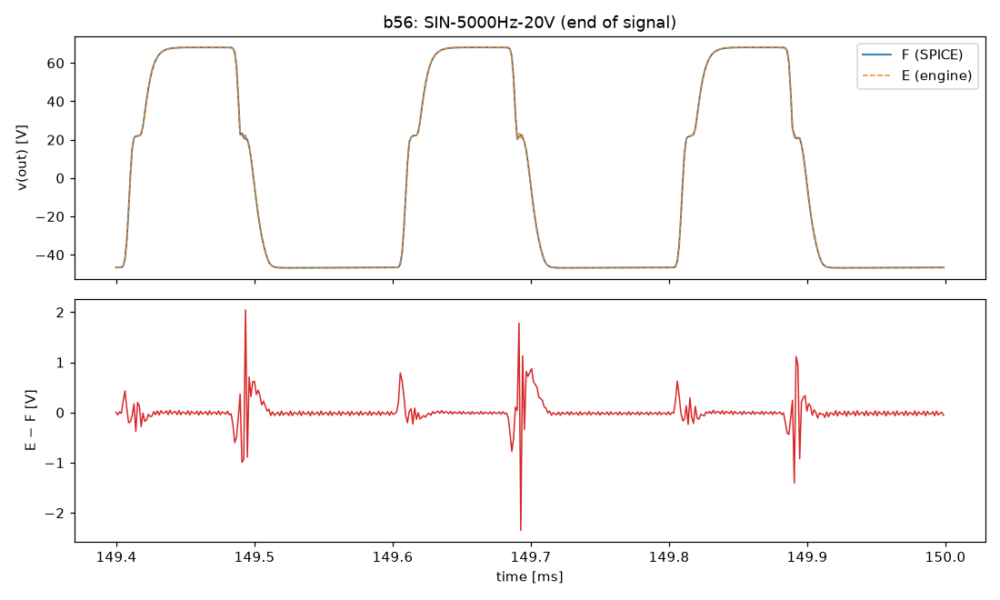
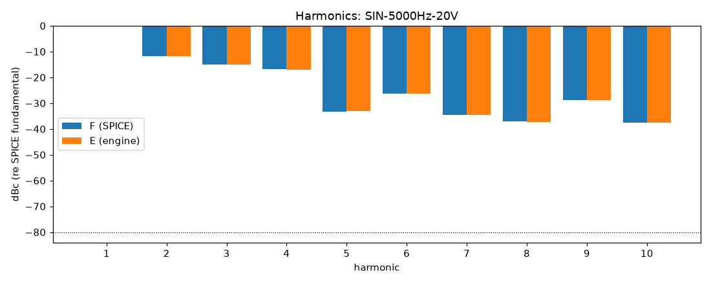
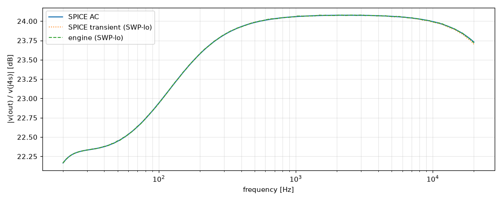

# M4 report: b56 / DEFAULT

- Block: B56 PowerAmp (phase inverter + power stage + OT in one tree, D-041); SPICE with B7
- Preset: DEFAULT — Default knobs; standard signal set at the block levels
- Knobs: preampVolume=0.6, treble=0.5, middle=0.5, bass=0.5, master=0.3, presence=0.5
- Date: 2026-10-14
- Engine commit: `18c866c (dirty)`
- Testbench: `harness/testbenches/b56.cir` sha256 `33f55c7ac8ebb82b`; netlist sha256 `7bea8385e4adb04e`; tubes.lib sha256 `9ec33154be8127d7`
- ngspice 47, fs = 768000 Hz, SPICE reltol 1e-08

## Summary

PASS 106 · FAIL 0 · INFO 27 (INFO = measured, not scored in M4)

| Check | Item | Measured | Tolerance | Status |
|---|---|---|---|---|
| dc_rel_error | v(bpx) | 9.563e-13 | ≤ 0.005 | PASS |
| dc_rel_error | v(ct) | 4.071e-15 | ≤ 0.005 | PASS |
| dc_rel_error | v(g3a) | 2.535e-05 | ≤ 0.005 | PASS |
| dc_rel_error | v(g3b) | 2.535e-05 | ≤ 0.005 | PASS |
| dc_rel_error | v(g4) | 4.919e-07 | ≤ 0.005 | PASS |
| dc_rel_error | v(g5) | 4.919e-07 | ≤ 0.005 | PASS |
| dc_rel_error | v(g6) | 4.919e-07 | ≤ 0.005 | PASS |
| dc_rel_error | v(g7) | 4.919e-07 | ≤ 0.005 | PASS |
| dc_rel_error | v(k3) | 2.531e-05 | ≤ 0.005 | PASS |
| dc_rel_error | v(nbias) | 4.636e-08 | ≤ 0.005 | PASS |
| dc_rel_error | v(nf) | 2.531e-05 | ≤ 0.005 | PASS |
| dc_rel_error | v(ng) | 2.531e-05 | ≤ 0.005 | PASS |
| dc_rel_error | v(ngn) | 4.863e-07 | ≤ 0.005 | PASS |
| dc_rel_error | v(nor) | 4.863e-07 | ≤ 0.005 | PASS |
| dc_rel_error | v(nscr) | 1.252e-14 | ≤ 0.005 | PASS |
| dc_rel_error | v(out) | 5.755e-07 | ≤ 0.005 | PASS |
| dc_rel_error | v(p3a) | 1.226e-05 | ≤ 0.005 | PASS |
| dc_rel_error | v(p3b) | 1.356e-05 | ≤ 0.005 | PASS |
| dc_rel_error | v(pa) | 3.669e-08 | ≤ 0.005 | PASS |
| dc_rel_error | v(pa1) | 2.592e-11 | ≤ 0.005 | PASS |
| dc_rel_error | v(pb) | 3.947e-08 | ≤ 0.005 | PASS |
| dc_rel_error | v(pb1) | 5.604e-11 | ≤ 0.005 | PASS |
| dc_rel_error | v(s4) | 2.637e-08 | ≤ 0.005 | PASS |
| dc_rel_error | v(s6) | 2.638e-08 | ≤ 0.005 | PASS |
| dc_rel_error | v(sl) | 1.081e-06 | ≤ 0.005 | PASS |
| dc_rel_error | v(y) | 1.434e-07 | ≤ 0.005 | PASS |
| nonlinear_esr_db | SIN-100Hz-0.1V | -88.9 dB | ≤ -40 | PASS |
| harmonics_2_5_db | SIN-100Hz-0.1V | 0.001937 dB | ≤ 0.5 | PASS |
| thd_pp | SIN-100Hz-0.1V | 7.613e-06 pp | — | INFO |
| total_power_rel | SIN-100Hz-0.1V | 7.14e-05 | ≤ 0.05 | INFO |
| newton_failures | SIN-100Hz-0.1V | 0 | ≤ 0 | PASS |
| newton_median_iterations | SIN-100Hz-0.1V | 1 | ≤ 3 | PASS |
| newton_max_iterations | SIN-100Hz-0.1V | 2 | ≤ 16 | PASS |
| nonlinear_esr_db | SIN-1000Hz-0.1V | -82.93 dB | ≤ -40 | PASS |
| harmonics_2_5_db | SIN-1000Hz-0.1V | 0.00184 dB | ≤ 0.5 | PASS |
| thd_pp | SIN-1000Hz-0.1V | 7.694e-06 pp | — | INFO |
| total_power_rel | SIN-1000Hz-0.1V | 8.623e-05 | ≤ 0.05 | INFO |
| newton_failures | SIN-1000Hz-0.1V | 0 | ≤ 0 | PASS |
| newton_median_iterations | SIN-1000Hz-0.1V | 2 | ≤ 3 | PASS |
| newton_max_iterations | SIN-1000Hz-0.1V | 2 | ≤ 16 | PASS |
| nonlinear_esr_db | SIN-5000Hz-0.1V | -69.73 dB | ≤ -40 | PASS |
| harmonics_2_5_db | SIN-5000Hz-0.1V | 0.003813 dB | ≤ 0.5 | PASS |
| thd_pp | SIN-5000Hz-0.1V | 1.922e-05 pp | — | INFO |
| total_power_rel | SIN-5000Hz-0.1V | 0.0003599 | ≤ 0.05 | INFO |
| newton_failures | SIN-5000Hz-0.1V | 0 | ≤ 0 | PASS |
| newton_median_iterations | SIN-5000Hz-0.1V | 2 | ≤ 3 | PASS |
| newton_max_iterations | SIN-5000Hz-0.1V | 2 | ≤ 16 | PASS |
| nonlinear_esr_db | SIN-100Hz-1V | -88.56 dB | ≤ -40 | PASS |
| harmonics_2_5_db | SIN-100Hz-1V | 0.002006 dB | ≤ 0.5 | PASS |
| thd_pp | SIN-100Hz-1V | 4.801e-05 pp | — | INFO |
| total_power_rel | SIN-100Hz-1V | 7.436e-05 | ≤ 0.05 | INFO |
| newton_failures | SIN-100Hz-1V | 0 | ≤ 0 | PASS |
| newton_median_iterations | SIN-100Hz-1V | 1 | ≤ 3 | PASS |
| newton_max_iterations | SIN-100Hz-1V | 2 | ≤ 16 | PASS |
| nonlinear_esr_db | SIN-1000Hz-1V | -82.62 dB | ≤ -40 | PASS |
| harmonics_2_5_db | SIN-1000Hz-1V | 0.001854 dB | ≤ 0.5 | PASS |
| thd_pp | SIN-1000Hz-1V | 4.187e-05 pp | — | INFO |
| total_power_rel | SIN-1000Hz-1V | 9.078e-05 | ≤ 0.05 | INFO |
| newton_failures | SIN-1000Hz-1V | 0 | ≤ 0 | PASS |
| newton_median_iterations | SIN-1000Hz-1V | 2 | ≤ 3 | PASS |
| newton_max_iterations | SIN-1000Hz-1V | 2 | ≤ 16 | PASS |
| nonlinear_esr_db | SIN-5000Hz-1V | -69.4 dB | ≤ -40 | PASS |
| harmonics_2_5_db | SIN-5000Hz-1V | 0.01378 dB | ≤ 0.5 | PASS |
| thd_pp | SIN-5000Hz-1V | 3.543e-05 pp | — | INFO |
| total_power_rel | SIN-5000Hz-1V | 0.0003792 | ≤ 0.05 | INFO |
| newton_failures | SIN-5000Hz-1V | 0 | ≤ 0 | PASS |
| newton_median_iterations | SIN-5000Hz-1V | 2 | ≤ 3 | PASS |
| newton_max_iterations | SIN-5000Hz-1V | 3 | ≤ 16 | PASS |
| nonlinear_esr_db | SIN-100Hz-5V | -91.67 dB | ≤ -40 | PASS |
| harmonics_2_5_db | SIN-100Hz-5V | 0.03405 dB | ≤ 0.5 | PASS |
| thd_pp | SIN-100Hz-5V | 0.0008111 pp | — | INFO |
| total_power_rel | SIN-100Hz-5V | 2.791e-05 | ≤ 0.05 | INFO |
| newton_failures | SIN-100Hz-5V | 0 | ≤ 0 | PASS |
| newton_median_iterations | SIN-100Hz-5V | 2 | ≤ 3 | PASS |
| newton_max_iterations | SIN-100Hz-5V | 3 | ≤ 16 | PASS |
| nonlinear_esr_db | SIN-1000Hz-5V | -79.82 dB | ≤ -40 | PASS |
| harmonics_2_5_db | SIN-1000Hz-5V | 0.007639 dB | ≤ 0.5 | PASS |
| thd_pp | SIN-1000Hz-5V | 0.0006432 pp | — | INFO |
| total_power_rel | SIN-1000Hz-5V | 1.712e-05 | ≤ 0.05 | INFO |
| newton_failures | SIN-1000Hz-5V | 0 | ≤ 0 | PASS |
| newton_median_iterations | SIN-1000Hz-5V | 2 | ≤ 3 | PASS |
| newton_max_iterations | SIN-1000Hz-5V | 5 | ≤ 16 | PASS |
| nonlinear_esr_db | SIN-5000Hz-5V | -66.3 dB | ≤ -40 | PASS |
| harmonics_2_5_db | SIN-5000Hz-5V | 0.03613 dB | ≤ 0.5 | PASS |
| thd_pp | SIN-5000Hz-5V | 0.001096 pp | — | INFO |
| total_power_rel | SIN-5000Hz-5V | 3.099e-05 | ≤ 0.05 | INFO |
| newton_failures | SIN-5000Hz-5V | 0 | ≤ 0 | PASS |
| newton_median_iterations | SIN-5000Hz-5V | 3 | ≤ 3 | PASS |
| newton_max_iterations | SIN-5000Hz-5V | 6 | ≤ 16 | PASS |
| nonlinear_esr_db_overdrive | SIN-100Hz-20V | -81.81 dB | ≤ -30 | PASS |
| harmonics_2_5_db | SIN-100Hz-20V | 0.01357 dB | ≤ 0.5 | PASS |
| thd_pp | SIN-100Hz-20V | 0.001584 pp | — | INFO |
| total_power_rel | SIN-100Hz-20V | 4.584e-05 | ≤ 0.05 | INFO |
| newton_failures | SIN-100Hz-20V | 0 | ≤ 0 | PASS |
| newton_median_iterations | SIN-100Hz-20V | 1 | ≤ 3 | PASS |
| newton_max_iterations | SIN-100Hz-20V | 6 | ≤ 16 | PASS |
| nonlinear_esr_db_overdrive | SIN-1000Hz-20V | -73.09 dB | ≤ -30 | PASS |
| harmonics_2_5_db | SIN-1000Hz-20V | 0.03684 dB | ≤ 0.5 | PASS |
| thd_pp | SIN-1000Hz-20V | 0.001528 pp | — | INFO |
| total_power_rel | SIN-1000Hz-20V | 3.173e-05 | ≤ 0.05 | INFO |
| newton_failures | SIN-1000Hz-20V | 0 | ≤ 0 | PASS |
| newton_median_iterations | SIN-1000Hz-20V | 2 | ≤ 3 | PASS |
| newton_max_iterations | SIN-1000Hz-20V | 5 | ≤ 16 | PASS |
| nonlinear_esr_db_overdrive | SIN-5000Hz-20V | -45.64 dB | ≤ -30 | PASS |
| harmonics_2_5_db | SIN-5000Hz-20V | 0.1072 dB | ≤ 0.5 | PASS |
| thd_pp | SIN-5000Hz-20V | 0.08729 pp | — | INFO |
| total_power_rel | SIN-5000Hz-20V | 0.0006607 | ≤ 0.05 | INFO |
| newton_failures | SIN-5000Hz-20V | 0 | ≤ 0 | PASS |
| newton_median_iterations | SIN-5000Hz-20V | 3 | ≤ 3 | PASS |
| newton_max_iterations | SIN-5000Hz-20V | 10 | ≤ 16 | PASS |
| nonlinear_esr_db | SWP-lo-0.1V | -66.01 dB | ≤ -40 | PASS |
| linear_mag_db_20_10k | SWP-lo-0.1V | 0.006037 dB | ≤ 0.1 | INFO |
| linear_mag_db_10k_20k | SWP-lo-0.1V | 0.009946 dB | ≤ 0.3 | INFO |
| method_mag_db_spice_tran_vs_ac | SWP-lo-0.1V | 0.02879 dB | — | INFO |
| newton_failures | SWP-lo-0.1V | 0 | ≤ 0 | PASS |
| newton_median_iterations | SWP-lo-0.1V | 1 | ≤ 3 | PASS |
| newton_max_iterations | SWP-lo-0.1V | 3 | ≤ 16 | PASS |
| nonlinear_esr_db | SWP-hi-1V | -65.32 dB | ≤ -40 | PASS |
| newton_failures | SWP-hi-1V | 0 | ≤ 0 | PASS |
| newton_median_iterations | SWP-hi-1V | 2 | ≤ 3 | PASS |
| newton_max_iterations | SWP-hi-1V | 4 | ≤ 16 | PASS |
| nonlinear_esr_db | TT-0.5V | -87.53 dB | ≤ -40 | PASS |
| newton_failures | TT-0.5V | 0 | ≤ 0 | PASS |
| newton_median_iterations | TT-0.5V | 1 | ≤ 3 | PASS |
| newton_max_iterations | TT-0.5V | 2 | ≤ 16 | PASS |
| nonlinear_esr_db | BURST-5V | -79.77 dB | ≤ -40 | PASS |
| newton_failures | BURST-5V | 0 | ≤ 0 | PASS |
| newton_median_iterations | BURST-5V | 2 | ≤ 3 | PASS |
| newton_max_iterations | BURST-5V | 5 | ≤ 16 | PASS |
| nonlinear_esr_db | STEP-1V | -81.58 dB | ≤ -40 | PASS |
| newton_failures | STEP-1V | 0 | ≤ 0 | PASS |
| newton_median_iterations | STEP-1V | 1 | ≤ 3 | PASS |
| newton_max_iterations | STEP-1V | 3 | ≤ 16 | PASS |

## Signals

| Signal | Peak F [V] | ESR [dB] | Best lag | ESR at lag [dB] | THD F / E [%] | Power F / E [W] | ns/sample | Newton fail / median / max it |
|---|---|---|---|---|---|---|---|---|
| SIN-100Hz-0.1V | 1.549 | -88.90 | 0 | -88.90 | 0.0418 / 0.0418 | 0.06147 / 0.06147 | 872.2 | 0 / 1 / 2 |
| SIN-1000Hz-0.1V | 1.644 | -82.93 | 0 | -82.93 | 0.0462 / 0.0462 | 0.07957 / 0.07958 | 1186.2 | 0 / 2 / 2 |
| SIN-5000Hz-0.1V | 1.609 | -69.73 | 0 | -69.73 | 0.0516 / 0.0516 | 0.07962 / 0.07965 | 1283.2 | 0 / 2 / 2 |
| SIN-100Hz-1V | 15.77 | -88.56 | 0 | -88.56 | 0.803 / 0.803 | 6.188 / 6.188 | 872.4 | 0 / 1 / 2 |
| SIN-1000Hz-1V | 16.88 | -82.62 | 0 | -82.62 | 0.984 / 0.984 | 8.03 / 8.031 | 1296.1 | 0 / 2 / 2 |
| SIN-5000Hz-1V | 16.55 | -69.40 | 0 | -69.40 | 1.11 / 1.11 | 8.041 / 8.044 | 1312.8 | 0 / 2 / 3 |
| SIN-100Hz-5V | 70.93 | -91.67 | 0 | -91.67 | 4.52 / 4.52 | 135.6 / 135.6 | 1212.7 | 0 / 2 / 3 |
| SIN-1000Hz-5V | 72.27 | -79.82 | 0 | -79.82 | 7.22 / 7.22 | 143.9 / 143.9 | 1445.7 | 0 / 2 / 5 |
| SIN-5000Hz-5V | 72.55 | -66.30 | 0 | -66.30 | 8.14 / 8.14 | 142.8 / 142.8 | 2476.0 | 0 / 3 / 6 |
| SIN-100Hz-20V | 72.38 | -81.81 | 0 | -81.81 | 35.7 / 35.7 | 161.7 / 161.7 | 1108.2 | 0 / 1 / 6 |
| SIN-1000Hz-20V | 72.71 | -73.09 | 0 | -73.09 | 42.4 / 42.4 | 167.2 / 167.2 | 1736.6 | 0 / 2 / 5 |
| SIN-5000Hz-20V | 72.76 | -45.64 | 0 | -45.64 | 35.3 / 35.2 | 163 / 162.9 | 2622.2 | 0 / 3 / 10 |
| SWP-lo-0.1V | 1.6 | -66.01 | 0 | -66.01 | — | — | 1056.6 | 0 / 1 / 3 |
| SWP-hi-1V | 16.27 | -65.32 | 0 | -65.32 | — | — | 1187.4 | 0 / 2 / 4 |
| TT-0.5V | 15.33 | -87.53 | 0 | -87.53 | — | — | 1082.4 | 0 / 1 / 2 |
| BURST-5V | 72.24 | -79.77 | 0 | -79.77 | — | — | 1319.5 | 0 / 2 / 5 |
| STEP-1V | 21.16 | -81.58 | 0 | -81.58 | — | — | 885.9 | 0 / 1 / 3 |

## DC operating point

| Node | SPICE [V] | Engine [V] | Rel. error |
|---|---|---|---|
| bpa | 389.3496 | — | — |
| bpx | 402.3360 | 402.3360 | 9.563e-13 |
| c20 | -60.0000 | — | — |
| ct | 488.7084 | 488.7084 | 4.071e-15 |
| g3a | 43.5226 | 43.5215 | 2.535e-05 |
| g3b | 43.5226 | 43.5215 | 2.535e-05 |
| g4 | -46.3631 | -46.3631 | 4.919e-07 |
| g5 | -46.3631 | -46.3631 | 4.919e-07 |
| g6 | -46.3631 | -46.3631 | 4.919e-07 |
| g7 | -46.3631 | -46.3631 | 4.919e-07 |
| k3 | 44.9334 | 44.9322 | 2.531e-05 |
| nbias | -46.3636 | -46.3636 | 4.636e-08 |
| nch | 488.7084 | — | — |
| nf | 43.5216 | 43.5205 | 2.531e-05 |
| ng | 13.4840 | 13.4836 | 2.531e-05 |
| ngn | -46.3631 | -46.3631 | 4.863e-07 |
| nor | -46.3631 | -46.3631 | 4.863e-07 |
| npr | 0.0000 | — | — |
| nrv | -3.6364 | — | — |
| nscr | 485.6493 | 485.6493 | 1.252e-14 |
| out | 0.0000 | 0.0000 | 5.755e-07 |
| p3a | 270.8809 | 270.8842 | 1.226e-05 |
| p3b | 262.2706 | 262.2741 | 1.356e-05 |
| pa | 487.6615 | 487.6615 | 3.669e-08 |
| pa1 | 488.7084 | 488.7084 | 2.592e-11 |
| pb | 487.5797 | 487.5798 | 3.947e-08 |
| pb1 | 488.7084 | 488.7084 | 5.604e-11 |
| raw | 505.0000 | — | — |
| s4 | 481.0819 | 481.0819 | 2.637e-08 |
| s5 | 481.0819 | — | — |
| s6 | 481.0817 | 481.0818 | 2.638e-08 |
| s7 | 481.0817 | — | — |
| sl | 0.0000 | 0.0000 | 1.081e-06 |
| y | 0.0000 | 0.0000 | 1.434e-07 |

Engine values are the probe values after the first sample (zero input) following `reset()`. Nodes the engine does not probe yet show —.

## Figures

### Waveform overlay and error (most demanding signal)

### Harmonics

### Magnitude response

