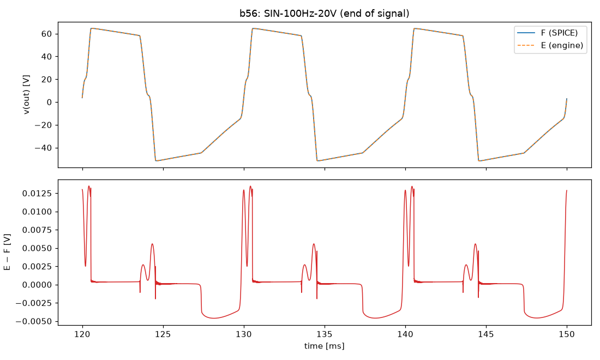
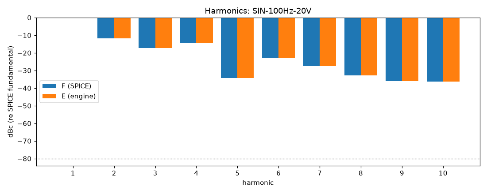
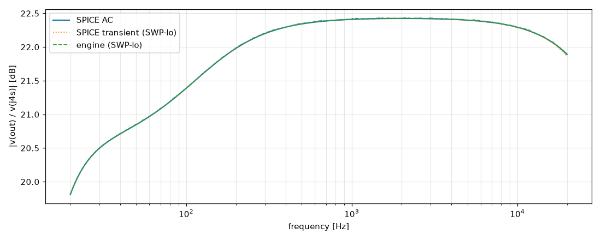

# M4 report: b56 / DEFAULT

- Block: B56 PowerAmp (phase inverter + power stage + OT in one tree, D-041); SPICE with B7
- Preset: DEFAULT — Default knobs; standard signal set at the block levels
- Knobs: preampVolume=0.6, treble=0.5, middle=0.5, bass=0.5, master=0.3, presence=0.5
- Date: 2026-10-15
- Engine commit: `476d21f (dirty)`
- Testbench: `harness/testbenches/b56.cir` sha256 `33af0649f0b082da`; netlist sha256 `7bea8385e4adb04e`; tubes.lib sha256 `5767afe208240bfa`
- ngspice 47, fs = 768000 Hz, SPICE reltol 1e-08

## Summary

PASS 106 · FAIL 0 · INFO 27 (INFO = measured, not scored in M4)

| Check | Item | Measured | Tolerance | Status |
|---|---|---|---|---|
| dc_rel_error | v(bpx) | 6.639e-13 | ≤ 0.005 | PASS |
| dc_rel_error | v(ct) | 3.933e-15 | ≤ 0.005 | PASS |
| dc_rel_error | v(g3a) | 2.529e-05 | ≤ 0.005 | PASS |
| dc_rel_error | v(g3b) | 2.529e-05 | ≤ 0.005 | PASS |
| dc_rel_error | v(g4) | 4.919e-07 | ≤ 0.005 | PASS |
| dc_rel_error | v(g5) | 4.919e-07 | ≤ 0.005 | PASS |
| dc_rel_error | v(g6) | 4.919e-07 | ≤ 0.005 | PASS |
| dc_rel_error | v(g7) | 4.919e-07 | ≤ 0.005 | PASS |
| dc_rel_error | v(k3) | 2.526e-05 | ≤ 0.005 | PASS |
| dc_rel_error | v(nbias) | 4.636e-08 | ≤ 0.005 | PASS |
| dc_rel_error | v(nf) | 2.526e-05 | ≤ 0.005 | PASS |
| dc_rel_error | v(ng) | 2.526e-05 | ≤ 0.005 | PASS |
| dc_rel_error | v(ngn) | 4.863e-07 | ≤ 0.005 | PASS |
| dc_rel_error | v(nor) | 4.863e-07 | ≤ 0.005 | PASS |
| dc_rel_error | v(nscr) | 1.07e-14 | ≤ 0.005 | PASS |
| dc_rel_error | v(out) | 6.591e-07 | ≤ 0.005 | PASS |
| dc_rel_error | v(p3a) | 1.223e-05 | ≤ 0.005 | PASS |
| dc_rel_error | v(p3b) | 1.353e-05 | ≤ 0.005 | PASS |
| dc_rel_error | v(pa) | 3.49e-08 | ≤ 0.005 | PASS |
| dc_rel_error | v(pa1) | 3.469e-11 | ≤ 0.005 | PASS |
| dc_rel_error | v(pb) | 3.756e-08 | ≤ 0.005 | PASS |
| dc_rel_error | v(pb1) | 2.844e-11 | ≤ 0.005 | PASS |
| dc_rel_error | v(s4) | 1.558e-08 | ≤ 0.005 | PASS |
| dc_rel_error | v(s6) | 1.559e-08 | ≤ 0.005 | PASS |
| dc_rel_error | v(sl) | 1.084e-06 | ≤ 0.005 | PASS |
| dc_rel_error | v(y) | 1.221e-07 | ≤ 0.005 | PASS |
| nonlinear_esr_db | SIN-100Hz-0.1V | -87.37 dB | ≤ -20 | PASS |
| harmonics_2_5_db | SIN-100Hz-0.1V | 0.002212 dB | ≤ 0.5 | PASS |
| thd_pp | SIN-100Hz-0.1V | 1.094e-05 pp | — | INFO |
| total_power_rel | SIN-100Hz-0.1V | 8.518e-05 | ≤ 0.05 | INFO |
| newton_failures | SIN-100Hz-0.1V | 0 | ≤ 0 | PASS |
| newton_median_iterations | SIN-100Hz-0.1V | 1 | ≤ 3 | PASS |
| newton_max_iterations | SIN-100Hz-0.1V | 2 | ≤ 32 | PASS |
| nonlinear_esr_db | SIN-1000Hz-0.1V | -81.58 dB | ≤ -20 | PASS |
| harmonics_2_5_db | SIN-1000Hz-0.1V | 0.002075 dB | ≤ 0.5 | PASS |
| thd_pp | SIN-1000Hz-0.1V | 1.08e-05 pp | — | INFO |
| total_power_rel | SIN-1000Hz-0.1V | 0.0001002 | ≤ 0.05 | INFO |
| newton_failures | SIN-1000Hz-0.1V | 0 | ≤ 0 | PASS |
| newton_median_iterations | SIN-1000Hz-0.1V | 2 | ≤ 3 | PASS |
| newton_max_iterations | SIN-1000Hz-0.1V | 2 | ≤ 32 | PASS |
| nonlinear_esr_db | SIN-5000Hz-0.1V | -68.59 dB | ≤ -20 | PASS |
| harmonics_2_5_db | SIN-5000Hz-0.1V | 0.00327 dB | ≤ 0.5 | PASS |
| thd_pp | SIN-5000Hz-0.1V | 2.189e-05 pp | — | INFO |
| total_power_rel | SIN-5000Hz-0.1V | 0.0003846 | ≤ 0.05 | INFO |
| newton_failures | SIN-5000Hz-0.1V | 0 | ≤ 0 | PASS |
| newton_median_iterations | SIN-5000Hz-0.1V | 2 | ≤ 3 | PASS |
| newton_max_iterations | SIN-5000Hz-0.1V | 2 | ≤ 32 | PASS |
| nonlinear_esr_db | SIN-100Hz-1V | -86.86 dB | ≤ -20 | PASS |
| harmonics_2_5_db | SIN-100Hz-1V | 0.002249 dB | ≤ 0.5 | PASS |
| thd_pp | SIN-100Hz-1V | 7.58e-05 pp | — | INFO |
| total_power_rel | SIN-100Hz-1V | 9.044e-05 | ≤ 0.05 | INFO |
| newton_failures | SIN-100Hz-1V | 0 | ≤ 0 | PASS |
| newton_median_iterations | SIN-100Hz-1V | 1 | ≤ 3 | PASS |
| newton_max_iterations | SIN-100Hz-1V | 2 | ≤ 32 | PASS |
| nonlinear_esr_db | SIN-1000Hz-1V | -81.27 dB | ≤ -20 | PASS |
| harmonics_2_5_db | SIN-1000Hz-1V | 0.002148 dB | ≤ 0.5 | PASS |
| thd_pp | SIN-1000Hz-1V | 6.705e-05 pp | — | INFO |
| total_power_rel | SIN-1000Hz-1V | 0.0001081 | ≤ 0.05 | INFO |
| newton_failures | SIN-1000Hz-1V | 0 | ≤ 0 | PASS |
| newton_median_iterations | SIN-1000Hz-1V | 2 | ≤ 3 | PASS |
| newton_max_iterations | SIN-1000Hz-1V | 2 | ≤ 32 | PASS |
| nonlinear_esr_db | SIN-5000Hz-1V | -68.25 dB | ≤ -20 | PASS |
| harmonics_2_5_db | SIN-5000Hz-1V | 0.01228 dB | ≤ 0.5 | PASS |
| thd_pp | SIN-5000Hz-1V | 0.0001581 pp | — | INFO |
| total_power_rel | SIN-5000Hz-1V | 0.00042 | ≤ 0.05 | INFO |
| newton_failures | SIN-5000Hz-1V | 0 | ≤ 0 | PASS |
| newton_median_iterations | SIN-5000Hz-1V | 2 | ≤ 3 | PASS |
| newton_max_iterations | SIN-5000Hz-1V | 3 | ≤ 32 | PASS |
| nonlinear_esr_db | SIN-100Hz-5V | -90.98 dB | ≤ -20 | PASS |
| harmonics_2_5_db | SIN-100Hz-5V | 0.00839 dB | ≤ 0.5 | PASS |
| thd_pp | SIN-100Hz-5V | 0.000788 pp | — | INFO |
| total_power_rel | SIN-100Hz-5V | 2.589e-05 | ≤ 0.05 | INFO |
| newton_failures | SIN-100Hz-5V | 0 | ≤ 0 | PASS |
| newton_median_iterations | SIN-100Hz-5V | 2 | ≤ 3 | PASS |
| newton_max_iterations | SIN-100Hz-5V | 3 | ≤ 32 | PASS |
| nonlinear_esr_db | SIN-1000Hz-5V | -78.94 dB | ≤ -20 | PASS |
| harmonics_2_5_db | SIN-1000Hz-5V | 0.00431 dB | ≤ 0.5 | PASS |
| thd_pp | SIN-1000Hz-5V | 0.0006853 pp | — | INFO |
| total_power_rel | SIN-1000Hz-5V | 1.741e-05 | ≤ 0.05 | INFO |
| newton_failures | SIN-1000Hz-5V | 0 | ≤ 0 | PASS |
| newton_median_iterations | SIN-1000Hz-5V | 2 | ≤ 3 | PASS |
| newton_max_iterations | SIN-1000Hz-5V | 5 | ≤ 32 | PASS |
| nonlinear_esr_db | SIN-5000Hz-5V | -65.3 dB | ≤ -20 | PASS |
| harmonics_2_5_db | SIN-5000Hz-5V | 0.04574 dB | ≤ 0.5 | PASS |
| thd_pp | SIN-5000Hz-5V | 0.0005468 pp | — | INFO |
| total_power_rel | SIN-5000Hz-5V | 3.519e-05 | ≤ 0.05 | INFO |
| newton_failures | SIN-5000Hz-5V | 0 | ≤ 0 | PASS |
| newton_median_iterations | SIN-5000Hz-5V | 3 | ≤ 3 | PASS |
| newton_max_iterations | SIN-5000Hz-5V | 6 | ≤ 32 | PASS |
| nonlinear_esr_db_overdrive | SIN-100Hz-20V | -81.58 dB | ≤ -20 | PASS |
| harmonics_2_5_db | SIN-100Hz-20V | 0.009901 dB | ≤ 0.5 | PASS |
| thd_pp | SIN-100Hz-20V | 0.001575 pp | — | INFO |
| total_power_rel | SIN-100Hz-20V | 4.799e-05 | ≤ 0.05 | INFO |
| newton_failures | SIN-100Hz-20V | 0 | ≤ 0 | PASS |
| newton_median_iterations | SIN-100Hz-20V | 1 | ≤ 3 | PASS |
| newton_max_iterations | SIN-100Hz-20V | 5 | ≤ 32 | PASS |
| nonlinear_esr_db_overdrive | SIN-1000Hz-20V | -72.55 dB | ≤ -20 | PASS |
| harmonics_2_5_db | SIN-1000Hz-20V | 0.01873 dB | ≤ 0.5 | PASS |
| thd_pp | SIN-1000Hz-20V | 0.001125 pp | — | INFO |
| total_power_rel | SIN-1000Hz-20V | 3.314e-05 | ≤ 0.05 | INFO |
| newton_failures | SIN-1000Hz-20V | 0 | ≤ 0 | PASS |
| newton_median_iterations | SIN-1000Hz-20V | 2 | ≤ 3 | PASS |
| newton_max_iterations | SIN-1000Hz-20V | 5 | ≤ 32 | PASS |
| nonlinear_esr_db_overdrive | SIN-5000Hz-20V | -48.4 dB | ≤ -20 | PASS |
| harmonics_2_5_db | SIN-5000Hz-20V | 0.06446 dB | ≤ 0.5 | PASS |
| thd_pp | SIN-5000Hz-20V | 0.03904 pp | — | INFO |
| total_power_rel | SIN-5000Hz-20V | 0.000511 | ≤ 0.05 | INFO |
| newton_failures | SIN-5000Hz-20V | 0 | ≤ 0 | PASS |
| newton_median_iterations | SIN-5000Hz-20V | 3 | ≤ 3 | PASS |
| newton_max_iterations | SIN-5000Hz-20V | 9 | ≤ 32 | PASS |
| nonlinear_esr_db | SWP-lo-0.1V | -65.7 dB | ≤ -20 | PASS |
| linear_mag_db_20_10k | SWP-lo-0.1V | 0.01172 dB | ≤ 0.1 | INFO |
| linear_mag_db_10k_20k | SWP-lo-0.1V | 0.01193 dB | ≤ 0.3 | INFO |
| method_mag_db_spice_tran_vs_ac | SWP-lo-0.1V | 0.03085 dB | — | INFO |
| newton_failures | SWP-lo-0.1V | 0 | ≤ 0 | PASS |
| newton_median_iterations | SWP-lo-0.1V | 1 | ≤ 3 | PASS |
| newton_max_iterations | SWP-lo-0.1V | 3 | ≤ 32 | PASS |
| nonlinear_esr_db | SWP-hi-1V | -64.68 dB | ≤ -20 | PASS |
| newton_failures | SWP-hi-1V | 0 | ≤ 0 | PASS |
| newton_median_iterations | SWP-hi-1V | 2 | ≤ 3 | PASS |
| newton_max_iterations | SWP-hi-1V | 4 | ≤ 32 | PASS |
| nonlinear_esr_db | TT-0.5V | -85.94 dB | ≤ -20 | PASS |
| newton_failures | TT-0.5V | 0 | ≤ 0 | PASS |
| newton_median_iterations | TT-0.5V | 2 | ≤ 3 | PASS |
| newton_max_iterations | TT-0.5V | 2 | ≤ 32 | PASS |
| nonlinear_esr_db | BURST-5V | -78.9 dB | ≤ -20 | PASS |
| newton_failures | BURST-5V | 0 | ≤ 0 | PASS |
| newton_median_iterations | BURST-5V | 2 | ≤ 3 | PASS |
| newton_max_iterations | BURST-5V | 5 | ≤ 32 | PASS |
| nonlinear_esr_db | STEP-1V | -80.95 dB | ≤ -20 | PASS |
| newton_failures | STEP-1V | 0 | ≤ 0 | PASS |
| newton_median_iterations | STEP-1V | 1 | ≤ 3 | PASS |
| newton_max_iterations | STEP-1V | 3 | ≤ 32 | PASS |

## Signals

| Signal | Peak F [V] | ESR [dB] | Best lag | ESR at lag [dB] | THD F / E [%] | Power F / E [W] | ns/sample | Newton fail / median / max it |
|---|---|---|---|---|---|---|---|---|
| SIN-100Hz-0.1V | 1.298 | -87.37 | 0 | -87.37 | 0.0564 / 0.0564 | 0.04303 / 0.04303 | 790.4 | 0 / 1 / 2 |
| SIN-1000Hz-0.1V | 1.362 | -81.58 | 0 | -81.58 | 0.0624 / 0.0625 | 0.05449 / 0.05449 | 1086.9 | 0 / 2 / 2 |
| SIN-5000Hz-0.1V | 1.329 | -68.59 | 0 | -68.59 | 0.069 / 0.069 | 0.05433 / 0.05435 | 1205.9 | 0 / 2 / 2 |
| SIN-100Hz-1V | 13.71 | -86.86 | 0 | -86.86 | 1.58 / 1.58 | 4.566 / 4.567 | 775.5 | 0 / 1 / 2 |
| SIN-1000Hz-1V | 14.56 | -81.27 | 0 | -81.27 | 1.89 / 1.89 | 5.876 / 5.877 | 1194.9 | 0 / 2 / 2 |
| SIN-5000Hz-1V | 14.25 | -68.25 | 0 | -68.25 | 2.08 / 2.08 | 5.866 / 5.868 | 1196.2 | 0 / 2 / 3 |
| SIN-100Hz-5V | 65.1 | -90.98 | 0 | -90.98 | 5.85 / 5.85 | 113.5 / 113.5 | 1053.3 | 0 / 2 / 3 |
| SIN-1000Hz-5V | 65.17 | -78.94 | 0 | -78.94 | 8.18 / 8.18 | 120 / 120 | 1329.4 | 0 / 2 / 5 |
| SIN-5000Hz-5V | 65.28 | -65.30 | 0 | -65.30 | 9.16 / 9.16 | 119.1 / 119.1 | 2237.6 | 0 / 3 / 6 |
| SIN-100Hz-20V | 67.03 | -81.58 | 0 | -81.58 | 35.9 / 35.9 | 136.9 / 136.9 | 997.3 | 0 / 1 / 5 |
| SIN-1000Hz-20V | 65.75 | -72.55 | 0 | -72.55 | 42.6 / 42.6 | 144 / 144 | 1577.0 | 0 / 2 / 5 |
| SIN-5000Hz-20V | 65.53 | -48.40 | 0 | -48.40 | 35.5 / 35.5 | 139.6 / 139.5 | 2359.4 | 0 / 3 / 9 |
| SWP-lo-0.1V | 1.324 | -65.70 | 0 | -65.70 | — | — | 978.5 | 0 / 1 / 3 |
| SWP-hi-1V | 14.04 | -64.68 | 0 | -64.68 | — | — | 1121.5 | 0 / 2 / 4 |
| TT-0.5V | 13.23 | -85.94 | 0 | -85.94 | — | — | 994.8 | 0 / 2 / 2 |
| BURST-5V | 65.14 | -78.90 | 0 | -78.90 | — | — | 1229.9 | 0 / 2 / 5 |
| STEP-1V | 18.54 | -80.95 | 0 | -80.95 | — | — | 784.7 | 0 / 1 / 3 |

## DC operating point

| Node | SPICE [V] | Engine [V] | Rel. error |
|---|---|---|---|
| bpa | 391.9215 | — | — |
| bpx | 404.9982 | 404.9982 | 6.639e-13 |
| c20 | -60.0000 | — | — |
| ct | 491.3466 | 491.3466 | 3.933e-15 |
| g3a | 43.8295 | 43.8284 | 2.529e-05 |
| g3b | 43.8295 | 43.8284 | 2.529e-05 |
| g4 | -46.3631 | -46.3631 | 4.919e-07 |
| g5 | -46.3631 | -46.3631 | 4.919e-07 |
| g6 | -46.3631 | -46.3631 | 4.919e-07 |
| g7 | -46.3631 | -46.3631 | 4.919e-07 |
| k3 | 45.2502 | 45.2491 | 2.526e-05 |
| nbias | -46.3636 | -46.3636 | 4.636e-08 |
| nch | 491.3466 | — | — |
| nf | 43.8285 | 43.8274 | 2.526e-05 |
| ng | 13.5790 | 13.5787 | 2.526e-05 |
| ngn | -46.3631 | -46.3631 | 4.863e-07 |
| nor | -46.3631 | -46.3631 | 4.863e-07 |
| npr | 0.0000 | — | — |
| nrv | -3.6364 | — | — |
| nscr | 488.8805 | 488.8805 | 1.07e-14 |
| out | 0.0000 | 0.0000 | 6.591e-07 |
| p3a | 272.6113 | 272.6146 | 1.223e-05 |
| p3b | 263.9512 | 263.9548 | 1.353e-05 |
| pa | 490.4628 | 490.4628 | 3.49e-08 |
| pa1 | 491.3466 | 491.3466 | 3.469e-11 |
| pb | 490.3937 | 490.3937 | 3.756e-08 |
| pb1 | 491.3466 | 491.3466 | 2.844e-11 |
| raw | 505.0000 | — | — |
| s4 | 485.6164 | 485.6164 | 1.558e-08 |
| s5 | 485.6164 | — | — |
| s6 | 485.6162 | 485.6162 | 1.559e-08 |
| s7 | 485.6162 | — | — |
| sl | 0.0000 | 0.0000 | 1.084e-06 |
| y | 0.0000 | 0.0000 | 1.221e-07 |

Engine values are the probe values after the first sample (zero input) following `reset()`. Nodes the engine does not probe yet show —.

## Figures

### Waveform overlay and error (most demanding signal)

### Harmonics

### Magnitude response

