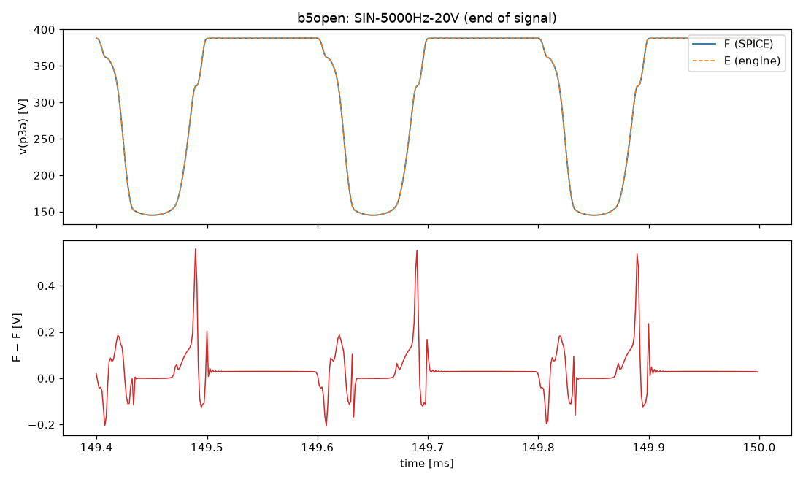
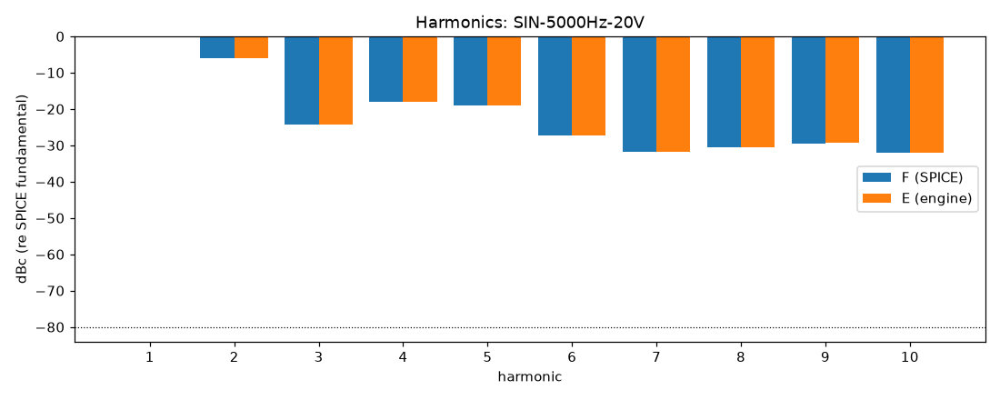

# M4 report: b5open / DEFAULT

- Block: B5-open phase inverter, R22 driven by recorded speaker voltage
- Preset: DEFAULT — Default knobs; standard signal set at the block levels
- Knobs: preampVolume=0.6, treble=0.5, middle=0.5, bass=0.5, master=0.3, presence=0.5
- Date: 2026-10-15
- Engine commit: `3cb4124 (dirty)`
- Testbench: `harness/testbenches/b5open.cir` sha256 `44543f92cde2a435`; netlist sha256 `83f01b6fd8b64a06`; tubes.lib sha256 `5767afe208240bfa`
- ngspice 47, fs = 768000 Hz, SPICE reltol 1e-08

> SWP-lo-0.1V b56: source run rendered at RELTOL 1e-07 (timestep too small at 1e-08)

## Summary

PASS 88 · FAIL 0 · INFO 12 (INFO = measured, not scored in M4)

| Check | Item | Measured | Tolerance | Status |
|---|---|---|---|---|
| dc_rel_error | v(g3a) | 2.529e-05 | ≤ 0.005 | PASS |
| dc_rel_error | v(g3b) | 2.529e-05 | ≤ 0.005 | PASS |
| dc_rel_error | v(k3) | 2.526e-05 | ≤ 0.005 | PASS |
| dc_rel_error | v(nf) | 2.526e-05 | ≤ 0.005 | PASS |
| dc_rel_error | v(ng) | 2.526e-05 | ≤ 0.005 | PASS |
| dc_rel_error | v(p3a) | 1.223e-05 | ≤ 0.005 | PASS |
| dc_rel_error | v(p3b) | 1.353e-05 | ≤ 0.005 | PASS |
| dc_rel_error | v(y) | 3.553e-12 | ≤ 0.005 | PASS |
| nonlinear_esr_db | SIN-100Hz-0.1V | -84.14 dB | ≤ -20 | PASS |
| harmonics_2_5_db | SIN-100Hz-0.1V | 0.0004405 dB | ≤ 0.5 | PASS |
| thd_pp | SIN-100Hz-0.1V | 3.15e-07 pp | — | INFO |
| newton_failures | SIN-100Hz-0.1V | 0 | ≤ 0 | PASS |
| newton_median_iterations | SIN-100Hz-0.1V | 1 | ≤ 3 | PASS |
| newton_max_iterations | SIN-100Hz-0.1V | 1 | ≤ 12 | PASS |
| nonlinear_esr_db | SIN-1000Hz-0.1V | -80.61 dB | ≤ -20 | PASS |
| harmonics_2_5_db | SIN-1000Hz-0.1V | 0.0009776 dB | ≤ 0.5 | PASS |
| thd_pp | SIN-1000Hz-0.1V | 7.277e-07 pp | — | INFO |
| newton_failures | SIN-1000Hz-0.1V | 0 | ≤ 0 | PASS |
| newton_median_iterations | SIN-1000Hz-0.1V | 1 | ≤ 3 | PASS |
| newton_max_iterations | SIN-1000Hz-0.1V | 2 | ≤ 12 | PASS |
| nonlinear_esr_db | SIN-5000Hz-0.1V | -68.37 dB | ≤ -20 | PASS |
| harmonics_2_5_db | SIN-5000Hz-0.1V | 0.01189 dB | ≤ 0.5 | PASS |
| thd_pp | SIN-5000Hz-0.1V | 3.277e-05 pp | — | INFO |
| newton_failures | SIN-5000Hz-0.1V | 0 | ≤ 0 | PASS |
| newton_median_iterations | SIN-5000Hz-0.1V | 2 | ≤ 3 | PASS |
| newton_max_iterations | SIN-5000Hz-0.1V | 2 | ≤ 12 | PASS |
| nonlinear_esr_db | SIN-100Hz-1V | -84.13 dB | ≤ -20 | PASS |
| harmonics_2_5_db | SIN-100Hz-1V | 0.0004838 dB | ≤ 0.5 | PASS |
| thd_pp | SIN-100Hz-1V | 3.29e-06 pp | — | INFO |
| newton_failures | SIN-100Hz-1V | 0 | ≤ 0 | PASS |
| newton_median_iterations | SIN-100Hz-1V | 1 | ≤ 3 | PASS |
| newton_max_iterations | SIN-100Hz-1V | 2 | ≤ 12 | PASS |
| nonlinear_esr_db | SIN-1000Hz-1V | -80.59 dB | ≤ -20 | PASS |
| harmonics_2_5_db | SIN-1000Hz-1V | 0.001843 dB | ≤ 0.5 | PASS |
| thd_pp | SIN-1000Hz-1V | 8.536e-05 pp | — | INFO |
| newton_failures | SIN-1000Hz-1V | 0 | ≤ 0 | PASS |
| newton_median_iterations | SIN-1000Hz-1V | 2 | ≤ 3 | PASS |
| newton_max_iterations | SIN-1000Hz-1V | 2 | ≤ 12 | PASS |
| nonlinear_esr_db | SIN-5000Hz-1V | -68.4 dB | ≤ -20 | PASS |
| harmonics_2_5_db | SIN-5000Hz-1V | 0.03292 dB | ≤ 0.5 | PASS |
| thd_pp | SIN-5000Hz-1V | 0.001451 pp | — | INFO |
| newton_failures | SIN-5000Hz-1V | 0 | ≤ 0 | PASS |
| newton_median_iterations | SIN-5000Hz-1V | 2 | ≤ 3 | PASS |
| newton_max_iterations | SIN-5000Hz-1V | 2 | ≤ 12 | PASS |
| nonlinear_esr_db | SIN-100Hz-5V | -83.88 dB | ≤ -20 | PASS |
| harmonics_2_5_db | SIN-100Hz-5V | 0.000628 dB | ≤ 0.5 | PASS |
| thd_pp | SIN-100Hz-5V | 3.143e-05 pp | — | INFO |
| newton_failures | SIN-100Hz-5V | 0 | ≤ 0 | PASS |
| newton_median_iterations | SIN-100Hz-5V | 1 | ≤ 3 | PASS |
| newton_max_iterations | SIN-100Hz-5V | 2 | ≤ 12 | PASS |
| nonlinear_esr_db | SIN-1000Hz-5V | -79.54 dB | ≤ -20 | PASS |
| harmonics_2_5_db | SIN-1000Hz-5V | 0.01625 dB | ≤ 0.5 | PASS |
| thd_pp | SIN-1000Hz-5V | 0.001227 pp | — | INFO |
| newton_failures | SIN-1000Hz-5V | 0 | ≤ 0 | PASS |
| newton_median_iterations | SIN-1000Hz-5V | 2 | ≤ 3 | PASS |
| newton_max_iterations | SIN-1000Hz-5V | 2 | ≤ 12 | PASS |
| nonlinear_esr_db | SIN-5000Hz-5V | -66.53 dB | ≤ -20 | PASS |
| harmonics_2_5_db | SIN-5000Hz-5V | 0.02992 dB | ≤ 0.5 | PASS |
| thd_pp | SIN-5000Hz-5V | 0.02042 pp | — | INFO |
| newton_failures | SIN-5000Hz-5V | 0 | ≤ 0 | PASS |
| newton_median_iterations | SIN-5000Hz-5V | 2 | ≤ 3 | PASS |
| newton_max_iterations | SIN-5000Hz-5V | 3 | ≤ 12 | PASS |
| nonlinear_esr_db_overdrive | SIN-100Hz-20V | -75.04 dB | ≤ -20 | PASS |
| harmonics_2_5_db | SIN-100Hz-20V | 0.003219 dB | ≤ 0.5 | PASS |
| thd_pp | SIN-100Hz-20V | 0.002833 pp | — | INFO |
| newton_failures | SIN-100Hz-20V | 0 | ≤ 0 | PASS |
| newton_median_iterations | SIN-100Hz-20V | 1 | ≤ 3 | PASS |
| newton_max_iterations | SIN-100Hz-20V | 2 | ≤ 12 | PASS |
| nonlinear_esr_db_overdrive | SIN-1000Hz-20V | -73.74 dB | ≤ -20 | PASS |
| harmonics_2_5_db | SIN-1000Hz-20V | 0.002388 dB | ≤ 0.5 | PASS |
| thd_pp | SIN-1000Hz-20V | 0.002133 pp | — | INFO |
| newton_failures | SIN-1000Hz-20V | 0 | ≤ 0 | PASS |
| newton_median_iterations | SIN-1000Hz-20V | 2 | ≤ 3 | PASS |
| newton_max_iterations | SIN-1000Hz-20V | 3 | ≤ 12 | PASS |
| nonlinear_esr_db_overdrive | SIN-5000Hz-20V | -61.74 dB | ≤ -20 | PASS |
| harmonics_2_5_db | SIN-5000Hz-20V | 0.03478 dB | ≤ 0.5 | PASS |
| thd_pp | SIN-5000Hz-20V | 0.01646 pp | — | INFO |
| newton_failures | SIN-5000Hz-20V | 0 | ≤ 0 | PASS |
| newton_median_iterations | SIN-5000Hz-20V | 2 | ≤ 3 | PASS |
| newton_max_iterations | SIN-5000Hz-20V | 4 | ≤ 12 | PASS |
| nonlinear_esr_db | SWP-lo-0.1V | -69.19 dB | ≤ -20 | PASS |
| newton_failures | SWP-lo-0.1V | 0 | ≤ 0 | PASS |
| newton_median_iterations | SWP-lo-0.1V | 1 | ≤ 3 | PASS |
| newton_max_iterations | SWP-lo-0.1V | 3 | ≤ 12 | PASS |
| nonlinear_esr_db | SWP-hi-1V | -69.04 dB | ≤ -20 | PASS |
| newton_failures | SWP-hi-1V | 0 | ≤ 0 | PASS |
| newton_median_iterations | SWP-hi-1V | 1 | ≤ 3 | PASS |
| newton_max_iterations | SWP-hi-1V | 3 | ≤ 12 | PASS |
| nonlinear_esr_db | TT-0.5V | -83.65 dB | ≤ -20 | PASS |
| newton_failures | TT-0.5V | 0 | ≤ 0 | PASS |
| newton_median_iterations | TT-0.5V | 1 | ≤ 3 | PASS |
| newton_max_iterations | TT-0.5V | 2 | ≤ 12 | PASS |
| nonlinear_esr_db | BURST-5V | -79.75 dB | ≤ -20 | PASS |
| newton_failures | BURST-5V | 0 | ≤ 0 | PASS |
| newton_median_iterations | BURST-5V | 1 | ≤ 3 | PASS |
| newton_max_iterations | BURST-5V | 2 | ≤ 12 | PASS |
| nonlinear_esr_db | STEP-1V | -82.54 dB | ≤ -20 | PASS |
| newton_failures | STEP-1V | 0 | ≤ 0 | PASS |
| newton_median_iterations | STEP-1V | 1 | ≤ 3 | PASS |
| newton_max_iterations | STEP-1V | 2 | ≤ 12 | PASS |

## Signals

| Signal | Peak F [V] | ESR [dB] | Best lag | ESR at lag [dB] | THD F / E [%] | Power F / E [W] | ns/sample | Newton fail / median / max it |
|---|---|---|---|---|---|---|---|---|
| SIN-100Hz-0.1V | 1.309 | -84.14 | 0 | -84.14 | 0.0292 / 0.0292 | — | 278.1 | 0 / 1 / 1 |
| SIN-1000Hz-0.1V | 1.642 | -80.61 | 0 | -80.61 | 0.0599 / 0.0599 | — | 277.5 | 0 / 1 / 2 |
| SIN-5000Hz-0.1V | 1.172 | -68.37 | 0 | -68.37 | 0.0573 / 0.0573 | — | 393.4 | 0 / 2 / 2 |
| SIN-100Hz-1V | 12.67 | -84.13 | 0 | -84.13 | 0.428 / 0.428 | — | 281.7 | 0 / 1 / 2 |
| SIN-1000Hz-1V | 16.11 | -80.59 | 0 | -80.59 | 2.09 / 2.09 | — | 398.4 | 0 / 2 / 2 |
| SIN-5000Hz-1V | 11.1 | -68.40 | 0 | -68.40 | 1.4 / 1.4 | — | 424.0 | 0 / 2 / 2 |
| SIN-100Hz-5V | 56.7 | -83.88 | 0 | -83.88 | 6.05 / 6.05 | — | 280.1 | 0 / 1 / 2 |
| SIN-1000Hz-5V | 97.08 | -79.54 | 0 | -79.54 | 7.71 / 7.71 | — | 471.1 | 0 / 2 / 2 |
| SIN-5000Hz-5V | 77.43 | -66.53 | 0 | -66.53 | 13.6 / 13.6 | — | 450.7 | 0 / 2 / 3 |
| SIN-100Hz-20V | 132.2 | -75.04 | 0 | -75.04 | 47.4 / 47.4 | — | 388.9 | 0 / 1 / 2 |
| SIN-1000Hz-20V | 140.8 | -73.74 | 0 | -73.74 | 50.7 / 50.7 | — | 452.9 | 0 / 2 / 3 |
| SIN-5000Hz-20V | 142 | -61.74 | 0 | -61.74 | 53.6 / 53.6 | — | 610.7 | 0 / 2 / 4 |
| SWP-lo-0.1V | 2.693 | -69.19 | 0 | -69.19 | — | — | 312.5 | 0 / 1 / 3 |
| SWP-hi-1V | 26.97 | -69.04 | 0 | -69.04 | — | — | 345.6 | 0 / 1 / 3 |
| TT-0.5V | 14.38 | -83.65 | 0 | -83.65 | — | — | 280.8 | 0 / 1 / 2 |
| BURST-5V | 102.3 | -79.75 | 0 | -79.75 | — | — | 366.1 | 0 / 1 / 2 |
| STEP-1V | 19.85 | -82.54 | 0 | -82.54 | — | — | 284.8 | 0 / 1 / 2 |

## DC operating point

| Node | SPICE [V] | Engine [V] | Rel. error |
|---|---|---|---|
| g3a | 43.8295 | 43.8284 | 2.529e-05 |
| g3b | 43.8295 | 43.8284 | 2.529e-05 |
| k3 | 45.2502 | 45.2491 | 2.526e-05 |
| nf | 43.8285 | 43.8274 | 2.526e-05 |
| ng | 13.5790 | 13.5787 | 2.526e-05 |
| npr | 0.0000 | — | — |
| p3a | 272.6113 | 272.6146 | 1.223e-05 |
| p3b | 263.9512 | 263.9548 | 1.353e-05 |
| y | 0.0000 | -0.0000 | 3.553e-12 |

Engine values are the probe values after the first sample (zero input) following `reset()`. Nodes the engine does not probe yet show —.

## Figures

### Waveform overlay and error (most demanding signal)

### Harmonics

