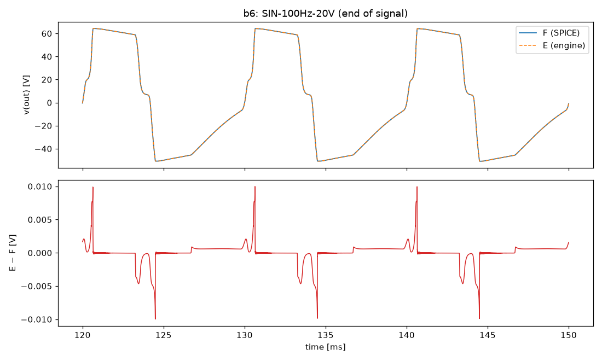
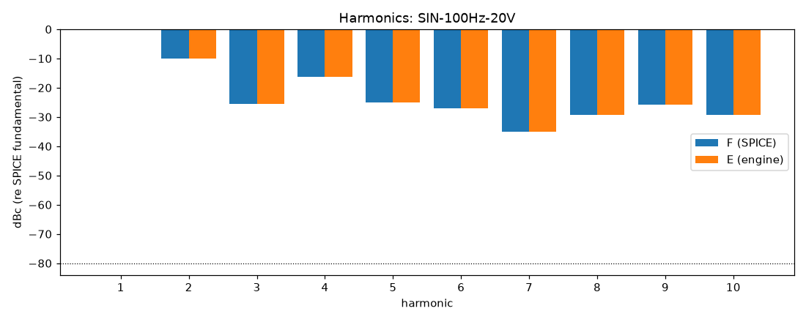

# M4 report: b6 / DEFAULT

- Block: B6 PowerStage, driven by recorded PI outputs
- Preset: DEFAULT — Default knobs; standard signal set at the block levels
- Knobs: preampVolume=0.6, treble=0.5, middle=0.5, bass=0.5, master=0.3, presence=0.5
- Date: 2026-10-15
- Engine commit: `476d21f (dirty)`
- Testbench: `harness/testbenches/b6.cir` sha256 `124605426f35e6fd`; netlist sha256 `7bea8385e4adb04e`; tubes.lib sha256 `5767afe208240bfa`
- ngspice 47, fs = 768000 Hz, SPICE reltol 1e-08

## Summary

PASS 95 · FAIL 2 · INFO 24 (INFO = measured, not scored in M4)

| Check | Item | Measured | Tolerance | Status |
|---|---|---|---|---|
| dc_rel_error | v(g4) | 4.919e-07 | ≤ 0.005 | PASS |
| dc_rel_error | v(g5) | 4.919e-07 | ≤ 0.005 | PASS |
| dc_rel_error | v(g6) | 4.919e-07 | ≤ 0.005 | PASS |
| dc_rel_error | v(g7) | 4.919e-07 | ≤ 0.005 | PASS |
| dc_rel_error | v(nbias) | 4.636e-08 | ≤ 0.005 | PASS |
| dc_rel_error | v(ngn) | 4.863e-07 | ≤ 0.005 | PASS |
| dc_rel_error | v(nor) | 4.863e-07 | ≤ 0.005 | PASS |
| dc_rel_error | v(out) | 9.519e-10 | ≤ 0.005 | PASS |
| dc_rel_error | v(p3a) | 1.332e-09 | ≤ 0.005 | PASS |
| dc_rel_error | v(p3b) | 7.708e-10 | ≤ 0.005 | PASS |
| dc_rel_error | v(pa) | 3.492e-08 | ≤ 0.005 | PASS |
| dc_rel_error | v(pa1) | 4.64e-11 | ≤ 0.005 | PASS |
| dc_rel_error | v(pb) | 3.764e-08 | ≤ 0.005 | PASS |
| dc_rel_error | v(pb1) | 4.642e-11 | ≤ 0.005 | PASS |
| dc_rel_error | v(s4) | 1.509e-08 | ≤ 0.005 | PASS |
| dc_rel_error | v(s6) | 1.51e-08 | ≤ 0.005 | PASS |
| dc_rel_error | v(sl) | 1.905e-11 | ≤ 0.005 | PASS |
| nonlinear_esr_db | SIN-100Hz-0.1V | -97.25 dB | ≤ -20 | PASS |
| harmonics_2_5_db | SIN-100Hz-0.1V | 0.0004626 dB | ≤ 0.5 | PASS |
| thd_pp | SIN-100Hz-0.1V | 1.925e-06 pp | — | INFO |
| total_power_rel | SIN-100Hz-0.1V | 1.643e-05 | ≤ 0.05 | INFO |
| newton_failures | SIN-100Hz-0.1V | 0 | ≤ 0 | PASS |
| newton_median_iterations | SIN-100Hz-0.1V | 1 | ≤ 3 | PASS |
| newton_max_iterations | SIN-100Hz-0.1V | 2 | ≤ 12 | PASS |
| nonlinear_esr_db | SIN-1000Hz-0.1V | -81.01 dB | ≤ -20 | PASS |
| harmonics_2_5_db | SIN-1000Hz-0.1V | 0.0007302 dB | ≤ 0.5 | PASS |
| thd_pp | SIN-1000Hz-0.1V | 2.326e-06 pp | — | INFO |
| total_power_rel | SIN-1000Hz-0.1V | 3.365e-05 | ≤ 0.05 | INFO |
| newton_failures | SIN-1000Hz-0.1V | 0 | ≤ 0 | PASS |
| newton_median_iterations | SIN-1000Hz-0.1V | 2 | ≤ 3 | PASS |
| newton_max_iterations | SIN-1000Hz-0.1V | 2 | ≤ 12 | PASS |
| nonlinear_esr_db | SIN-5000Hz-0.1V | -66.84 dB | ≤ -20 | PASS |
| harmonics_2_5_db | SIN-5000Hz-0.1V | 0.005712 dB | ≤ 0.5 | PASS |
| thd_pp | SIN-5000Hz-0.1V | 3.845e-05 pp | — | INFO |
| total_power_rel | SIN-5000Hz-0.1V | 0.0004467 | ≤ 0.05 | INFO |
| newton_failures | SIN-5000Hz-0.1V | 0 | ≤ 0 | PASS |
| newton_median_iterations | SIN-5000Hz-0.1V | 2 | ≤ 3 | PASS |
| newton_max_iterations | SIN-5000Hz-0.1V | 2 | ≤ 12 | PASS |
| nonlinear_esr_db | SIN-100Hz-1V | -96.55 dB | ≤ -20 | PASS |
| harmonics_2_5_db | SIN-100Hz-1V | 0.0005171 dB | ≤ 0.5 | PASS |
| thd_pp | SIN-100Hz-1V | 4.251e-05 pp | — | INFO |
| total_power_rel | SIN-100Hz-1V | 1.93e-05 | ≤ 0.05 | INFO |
| newton_failures | SIN-100Hz-1V | 0 | ≤ 0 | PASS |
| newton_median_iterations | SIN-100Hz-1V | 1 | ≤ 3 | PASS |
| newton_max_iterations | SIN-100Hz-1V | 2 | ≤ 12 | PASS |
| nonlinear_esr_db | SIN-1000Hz-1V | -80.61 dB | ≤ -20 | PASS |
| harmonics_2_5_db | SIN-1000Hz-1V | 0.0003471 dB | ≤ 0.5 | PASS |
| thd_pp | SIN-1000Hz-1V | 2.724e-05 pp | — | INFO |
| total_power_rel | SIN-1000Hz-1V | 3.995e-05 | ≤ 0.05 | INFO |
| newton_failures | SIN-1000Hz-1V | 0 | ≤ 0 | PASS |
| newton_median_iterations | SIN-1000Hz-1V | 2 | ≤ 3 | PASS |
| newton_max_iterations | SIN-1000Hz-1V | 2 | ≤ 12 | PASS |
| nonlinear_esr_db | SIN-5000Hz-1V | -66.18 dB | ≤ -20 | PASS |
| harmonics_2_5_db | SIN-5000Hz-1V | 0.01894 dB | ≤ 0.5 | PASS |
| thd_pp | SIN-5000Hz-1V | 0.00049 pp | — | INFO |
| total_power_rel | SIN-5000Hz-1V | 0.000524 | ≤ 0.05 | INFO |
| newton_failures | SIN-5000Hz-1V | 0 | ≤ 0 | PASS |
| newton_median_iterations | SIN-5000Hz-1V | 2 | ≤ 3 | PASS |
| newton_max_iterations | SIN-5000Hz-1V | 3 | ≤ 12 | PASS |
| nonlinear_esr_db | SIN-100Hz-5V | -92.83 dB | ≤ -20 | PASS |
| harmonics_2_5_db | SIN-100Hz-5V | 0.0005535 dB | ≤ 0.5 | PASS |
| thd_pp | SIN-100Hz-5V | 0.0001694 pp | — | INFO |
| total_power_rel | SIN-100Hz-5V | 6.42e-06 | ≤ 0.05 | INFO |
| newton_failures | SIN-100Hz-5V | 0 | ≤ 0 | PASS |
| newton_median_iterations | SIN-100Hz-5V | 2 | ≤ 3 | PASS |
| newton_max_iterations | SIN-100Hz-5V | 3 | ≤ 12 | PASS |
| nonlinear_esr_db | SIN-1000Hz-5V | -75.08 dB | ≤ -20 | PASS |
| harmonics_2_5_db | SIN-1000Hz-5V | 0.001867 dB | ≤ 0.5 | PASS |
| thd_pp | SIN-1000Hz-5V | 0.0005724 pp | — | INFO |
| total_power_rel | SIN-1000Hz-5V | 9.42e-06 | ≤ 0.05 | INFO |
| newton_failures | SIN-1000Hz-5V | 0 | ≤ 0 | PASS |
| newton_median_iterations | SIN-1000Hz-5V | 2 | ≤ 3 | PASS |
| newton_max_iterations | SIN-1000Hz-5V | 5 | ≤ 12 | PASS |
| nonlinear_esr_db | SIN-5000Hz-5V | -61.11 dB | ≤ -20 | PASS |
| harmonics_2_5_db | SIN-5000Hz-5V | 0.01248 dB | ≤ 0.5 | PASS |
| thd_pp | SIN-5000Hz-5V | 0.002327 pp | — | INFO |
| total_power_rel | SIN-5000Hz-5V | 3.77e-05 | ≤ 0.05 | INFO |
| newton_failures | SIN-5000Hz-5V | 0 | ≤ 0 | PASS |
| newton_median_iterations | SIN-5000Hz-5V | 3 | ≤ 3 | PASS |
| newton_max_iterations | SIN-5000Hz-5V | 5 | ≤ 12 | PASS |
| nonlinear_esr_db_overdrive | SIN-100Hz-20V | -89.38 dB | ≤ -20 | PASS |
| harmonics_2_5_db | SIN-100Hz-20V | 0.0001692 dB | ≤ 0.5 | PASS |
| thd_pp | SIN-100Hz-20V | 0.0002596 pp | — | INFO |
| total_power_rel | SIN-100Hz-20V | 9.19e-08 | ≤ 0.05 | INFO |
| newton_failures | SIN-100Hz-20V | 0 | ≤ 0 | PASS |
| newton_median_iterations | SIN-100Hz-20V | 1 | ≤ 3 | PASS |
| newton_max_iterations | SIN-100Hz-20V | 5 | ≤ 12 | PASS |
| nonlinear_esr_db_overdrive | SIN-1000Hz-20V | -70.68 dB | ≤ -20 | PASS |
| harmonics_2_5_db | SIN-1000Hz-20V | 0.003575 dB | ≤ 0.5 | PASS |
| thd_pp | SIN-1000Hz-20V | 0.001789 pp | — | INFO |
| total_power_rel | SIN-1000Hz-20V | 2.615e-07 | ≤ 0.05 | INFO |
| newton_failures | SIN-1000Hz-20V | 0 | ≤ 0 | PASS |
| newton_median_iterations | SIN-1000Hz-20V | 3 | ≤ 3 | PASS |
| newton_max_iterations | SIN-1000Hz-20V | 6 | ≤ 12 | PASS |
| nonlinear_esr_db_overdrive | SIN-5000Hz-20V | -40.9 dB | ≤ -20 | PASS |
| harmonics_2_5_db | SIN-5000Hz-20V | 0.8185 dB | ≤ 0.5 | FAIL |
| thd_pp | SIN-5000Hz-20V | 0.03399 pp | — | INFO |
| total_power_rel | SIN-5000Hz-20V | 0.005427 | ≤ 0.05 | INFO |
| newton_failures | SIN-5000Hz-20V | 0 | ≤ 0 | PASS |
| newton_median_iterations | SIN-5000Hz-20V | 4 | ≤ 3 | FAIL |
| newton_max_iterations | SIN-5000Hz-20V | 10 | ≤ 12 | PASS |
| nonlinear_esr_db | SWP-lo-0.1V | -65.2 dB | ≤ -20 | PASS |
| newton_failures | SWP-lo-0.1V | 0 | ≤ 0 | PASS |
| newton_median_iterations | SWP-lo-0.1V | 1 | ≤ 3 | PASS |
| newton_max_iterations | SWP-lo-0.1V | 3 | ≤ 12 | PASS |
| nonlinear_esr_db | SWP-hi-1V | -63.92 dB | ≤ -20 | PASS |
| newton_failures | SWP-hi-1V | 0 | ≤ 0 | PASS |
| newton_median_iterations | SWP-hi-1V | 2 | ≤ 3 | PASS |
| newton_max_iterations | SWP-hi-1V | 3 | ≤ 12 | PASS |
| nonlinear_esr_db | TT-0.5V | -90.96 dB | ≤ -20 | PASS |
| newton_failures | TT-0.5V | 0 | ≤ 0 | PASS |
| newton_median_iterations | TT-0.5V | 1 | ≤ 3 | PASS |
| newton_max_iterations | TT-0.5V | 2 | ≤ 12 | PASS |
| nonlinear_esr_db | BURST-5V | -75.06 dB | ≤ -20 | PASS |
| newton_failures | BURST-5V | 0 | ≤ 0 | PASS |
| newton_median_iterations | BURST-5V | 2 | ≤ 3 | PASS |
| newton_max_iterations | BURST-5V | 5 | ≤ 12 | PASS |
| nonlinear_esr_db | STEP-1V | -81.81 dB | ≤ -20 | PASS |
| newton_failures | STEP-1V | 0 | ≤ 0 | PASS |
| newton_median_iterations | STEP-1V | 1 | ≤ 3 | PASS |
| newton_max_iterations | STEP-1V | 3 | ≤ 12 | PASS |

## Signals

| Signal | Peak F [V] | ESR [dB] | Best lag | ESR at lag [dB] | THD F / E [%] | Power F / E [W] | ns/sample | Newton fail / median / max it |
|---|---|---|---|---|---|---|---|---|
| SIN-100Hz-0.1V | 1.175 | -97.25 | 0 | -97.25 | 0.128 / 0.128 | 0.03513 / 0.03513 | 405.5 | 0 / 1 / 2 |
| SIN-1000Hz-0.1V | 1.217 | -81.01 | 0 | -81.01 | 0.145 / 0.145 | 0.04381 / 0.04381 | 538.5 | 0 / 2 / 2 |
| SIN-5000Hz-0.1V | 1.182 | -66.84 | 0 | -66.84 | 0.163 / 0.163 | 0.04319 / 0.04321 | 599.7 | 0 / 2 / 2 |
| SIN-100Hz-1V | 12.04 | -96.55 | 0 | -96.55 | 1.59 / 1.59 | 3.62 / 3.62 | 396.9 | 0 / 1 / 2 |
| SIN-1000Hz-1V | 12.55 | -80.61 | 0 | -80.61 | 1.83 / 1.83 | 4.552 / 4.552 | 598.5 | 0 / 2 / 2 |
| SIN-5000Hz-1V | 12.6 | -66.18 | 0 | -66.18 | 2.06 / 2.06 | 4.484 / 4.486 | 593.9 | 0 / 2 / 3 |
| SIN-100Hz-5V | 64.51 | -92.83 | 0 | -92.83 | 5.86 / 5.86 | 105.6 / 105.6 | 504.1 | 0 / 2 / 3 |
| SIN-1000Hz-5V | 65.07 | -75.08 | 0 | -75.08 | 7.28 / 7.28 | 112.3 / 112.3 | 631.1 | 0 / 2 / 5 |
| SIN-5000Hz-5V | 65.19 | -61.11 | 0 | -61.11 | 8.59 / 8.59 | 112 / 112 | 807.6 | 0 / 3 / 5 |
| SIN-100Hz-20V | 66.34 | -89.38 | 0 | -89.38 | 37.2 / 37.2 | 118.6 / 118.6 | 492.2 | 0 / 1 / 5 |
| SIN-1000Hz-20V | 65.86 | -70.68 | 0 | -70.68 | 43.1 / 43.1 | 132.9 / 132.9 | 751.5 | 0 / 3 / 6 |
| SIN-5000Hz-20V | 65.72 | -40.90 | 0 | -40.90 | 38 / 38 | 130.8 / 130.1 | 1181.5 | 0 / 4 / 10 |
| SWP-lo-0.1V | 1.187 | -65.20 | 0 | -65.20 | — | — | 484.1 | 0 / 1 / 3 |
| SWP-hi-1V | 12.39 | -63.92 | 0 | -63.92 | — | — | 541.2 | 0 / 2 / 3 |
| TT-0.5V | 11.76 | -90.96 | 0 | -90.96 | — | — | 490.3 | 0 / 1 / 2 |
| BURST-5V | 65.05 | -75.06 | 0 | -75.06 | — | — | 589.8 | 0 / 2 / 5 |
| STEP-1V | 15.96 | -81.81 | 0 | -81.81 | — | — | 400.6 | 0 / 1 / 3 |

## DC operating point

| Node | SPICE [V] | Engine [V] | Rel. error |
|---|---|---|---|
| c20 | -60.0000 | — | — |
| g4 | -46.3631 | -46.3631 | 4.919e-07 |
| g5 | -46.3631 | -46.3631 | 4.919e-07 |
| g6 | -46.3631 | -46.3631 | 4.919e-07 |
| g7 | -46.3631 | -46.3631 | 4.919e-07 |
| nbias | -46.3636 | -46.3636 | 4.636e-08 |
| ngn | -46.3631 | -46.3631 | 4.863e-07 |
| nor | -46.3631 | -46.3631 | 4.863e-07 |
| nrv | -3.6364 | — | — |
| out | 0.0000 | -0.0000 | 9.519e-10 |
| p3a | 272.6113 | 272.6113 | 1.332e-09 |
| p3b | 263.9512 | 263.9512 | 7.708e-10 |
| pa | 490.4628 | 490.4628 | 3.492e-08 |
| pa1 | 491.3466 | 491.3466 | 4.64e-11 |
| pb | 490.3937 | 490.3937 | 3.764e-08 |
| pb1 | 491.3466 | 491.3466 | 4.642e-11 |
| s4 | 485.6164 | 485.6164 | 1.509e-08 |
| s5 | 485.6164 | — | — |
| s6 | 485.6162 | 485.6162 | 1.51e-08 |
| s7 | 485.6162 | — | — |
| sl | 0.0000 | 0.0000 | 1.905e-11 |

Engine values are the probe values after the first sample (zero input) following `reset()`. Nodes the engine does not probe yet show —.

## Figures

### Waveform overlay and error (most demanding signal)

### Harmonics

> Note (2026-10-15, after D-058): the SPICE reference for SWP-lo-0.1V stopped with "timestep too small" at RELTOL 1e-8 (t = 1.507 s, recorded nScr source) and was rendered at RELTOL 1e-7, as the M3 cascade does for P56. The two FAILs (5 kHz 20 V) are the known B6 discretisation FAILs (D-043; three before D-058).
