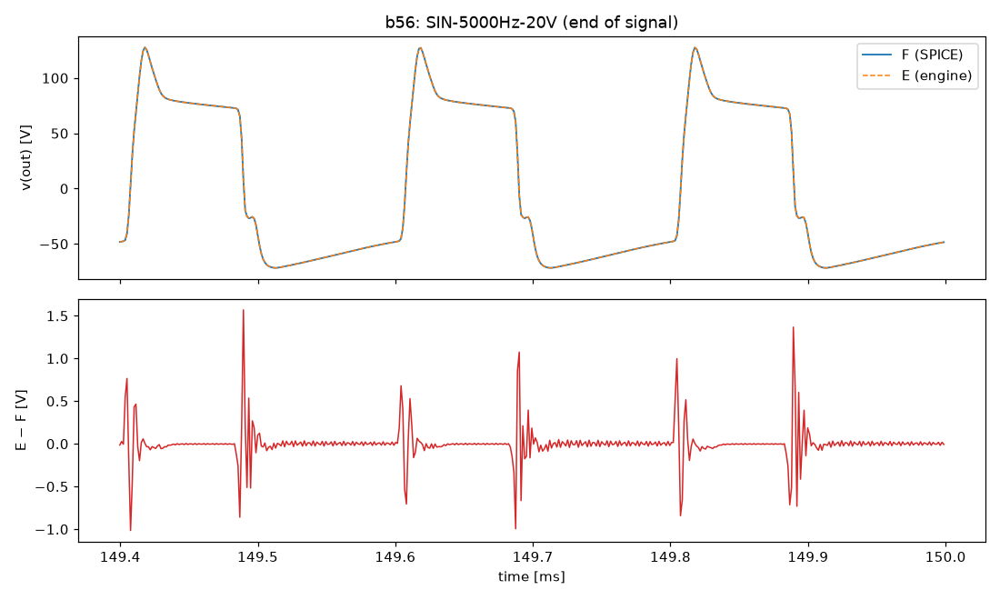
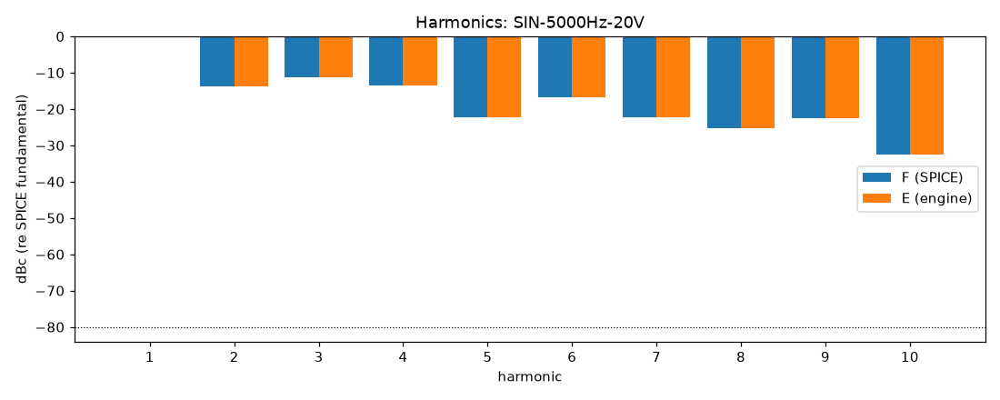
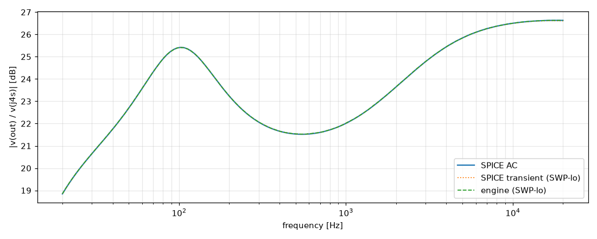

# M4 report: b56 / DEFAULT

- Block: B56 PowerAmp (phase inverter + power stage + OT in one tree, D-041); SPICE with B7
- Preset: DEFAULT — Default knobs; standard signal set at the block levels
- Knobs: preampVolume=0.6, treble=0.5, middle=0.5, bass=0.5, master=0.3, presence=0.5
- Date: 2026-10-19
- Engine commit: `ecf9042 (dirty)`
- Testbench: `harness/testbenches/b56.cir` sha256 `cf8c8de755f4bb9a`; netlist sha256 `ffd9b2812204248f`; tubes.lib sha256 `c9c9c88346c69010`
- ngspice 47, fs = 768000 Hz, SPICE reltol 1e-08

> SWP-lo-0.1V rendered at RELTOL 1e-07 (ngspice: timestep too small at 1e-08)

## Summary

PASS 106 · FAIL 0 · INFO 27 (INFO = measured, not scored in M4)

| Check | Item | Measured | Tolerance | Status |
|---|---|---|---|---|
| dc_rel_error | v(bpx) | 6.632e-13 | ≤ 0.005 | PASS |
| dc_rel_error | v(ct) | 3.008e-15 | ≤ 0.005 | PASS |
| dc_rel_error | v(g3a) | 2.529e-05 | ≤ 0.005 | PASS |
| dc_rel_error | v(g3b) | 2.529e-05 | ≤ 0.005 | PASS |
| dc_rel_error | v(g4) | 4.919e-07 | ≤ 0.005 | PASS |
| dc_rel_error | v(g5) | 4.919e-07 | ≤ 0.005 | PASS |
| dc_rel_error | v(g6) | 4.919e-07 | ≤ 0.005 | PASS |
| dc_rel_error | v(g7) | 4.919e-07 | ≤ 0.005 | PASS |
| dc_rel_error | v(k3) | 2.526e-05 | ≤ 0.005 | PASS |
| dc_rel_error | v(nbias) | 4.636e-08 | ≤ 0.005 | PASS |
| dc_rel_error | v(nf) | 2.526e-05 | ≤ 0.005 | PASS |
| dc_rel_error | v(ng) | 2.526e-05 | ≤ 0.005 | PASS |
| dc_rel_error | v(ngn) | 4.863e-07 | ≤ 0.005 | PASS |
| dc_rel_error | v(nor) | 4.863e-07 | ≤ 0.005 | PASS |
| dc_rel_error | v(nscr) | 9.186e-15 | ≤ 0.005 | PASS |
| dc_rel_error | v(out) | 7.715e-08 | ≤ 0.005 | PASS |
| dc_rel_error | v(p3a) | 1.223e-05 | ≤ 0.005 | PASS |
| dc_rel_error | v(p3b) | 1.353e-05 | ≤ 0.005 | PASS |
| dc_rel_error | v(pa) | 3.49e-08 | ≤ 0.005 | PASS |
| dc_rel_error | v(pa1) | 3.618e-11 | ≤ 0.005 | PASS |
| dc_rel_error | v(pb) | 3.756e-08 | ≤ 0.005 | PASS |
| dc_rel_error | v(pb1) | 2.991e-11 | ≤ 0.005 | PASS |
| dc_rel_error | v(s4) | 1.558e-08 | ≤ 0.005 | PASS |
| dc_rel_error | v(s6) | 1.559e-08 | ≤ 0.005 | PASS |
| dc_rel_error | v(sl) | 1.079e-06 | ≤ 0.005 | PASS |
| dc_rel_error | v(y) | 1.287e-07 | ≤ 0.005 | PASS |
| nonlinear_esr_db | SIN-100Hz-0.1V | -91.75 dB | ≤ -20 | PASS |
| harmonics_2_5_db | SIN-100Hz-0.1V | 0.001428 dB | ≤ 0.5 | PASS |
| thd_pp | SIN-100Hz-0.1V | 1.72e-06 pp | — | INFO |
| total_power_rel | SIN-100Hz-0.1V | 5.011e-05 | ≤ 0.05 | INFO |
| newton_failures | SIN-100Hz-0.1V | 0 | ≤ 0 | PASS |
| newton_median_iterations | SIN-100Hz-0.1V | 1 | ≤ 3 | PASS |
| newton_max_iterations | SIN-100Hz-0.1V | 2 | ≤ 48 | PASS |
| nonlinear_esr_db | SIN-1000Hz-0.1V | -80.96 dB | ≤ -20 | PASS |
| harmonics_2_5_db | SIN-1000Hz-0.1V | 0.002869 dB | ≤ 0.5 | PASS |
| thd_pp | SIN-1000Hz-0.1V | 2.06e-05 pp | — | INFO |
| total_power_rel | SIN-1000Hz-0.1V | 0.0001214 | ≤ 0.05 | INFO |
| newton_failures | SIN-1000Hz-0.1V | 0 | ≤ 0 | PASS |
| newton_median_iterations | SIN-1000Hz-0.1V | 1 | ≤ 3 | PASS |
| newton_max_iterations | SIN-1000Hz-0.1V | 2 | ≤ 48 | PASS |
| nonlinear_esr_db | SIN-5000Hz-0.1V | -69.65 dB | ≤ -20 | PASS |
| harmonics_2_5_db | SIN-5000Hz-0.1V | 0.003285 dB | ≤ 0.5 | PASS |
| thd_pp | SIN-5000Hz-0.1V | 1.375e-05 pp | — | INFO |
| total_power_rel | SIN-5000Hz-0.1V | 0.0005555 | ≤ 0.05 | INFO |
| newton_failures | SIN-5000Hz-0.1V | 0 | ≤ 0 | PASS |
| newton_median_iterations | SIN-5000Hz-0.1V | 1 | ≤ 3 | PASS |
| newton_max_iterations | SIN-5000Hz-0.1V | 2 | ≤ 48 | PASS |
| nonlinear_esr_db | SIN-100Hz-1V | -91.73 dB | ≤ -20 | PASS |
| harmonics_2_5_db | SIN-100Hz-1V | 0.001392 dB | ≤ 0.5 | PASS |
| thd_pp | SIN-100Hz-1V | 1.04e-05 pp | — | INFO |
| total_power_rel | SIN-100Hz-1V | 5.01e-05 | ≤ 0.05 | INFO |
| newton_failures | SIN-100Hz-1V | 0 | ≤ 0 | PASS |
| newton_median_iterations | SIN-100Hz-1V | 1 | ≤ 3 | PASS |
| newton_max_iterations | SIN-100Hz-1V | 2 | ≤ 48 | PASS |
| nonlinear_esr_db | SIN-1000Hz-1V | -80.58 dB | ≤ -20 | PASS |
| harmonics_2_5_db | SIN-1000Hz-1V | 0.002813 dB | ≤ 0.5 | PASS |
| thd_pp | SIN-1000Hz-1V | 0.000276 pp | — | INFO |
| total_power_rel | SIN-1000Hz-1V | 0.0001334 | ≤ 0.05 | INFO |
| newton_failures | SIN-1000Hz-1V | 0 | ≤ 0 | PASS |
| newton_median_iterations | SIN-1000Hz-1V | 2 | ≤ 3 | PASS |
| newton_max_iterations | SIN-1000Hz-1V | 2 | ≤ 48 | PASS |
| nonlinear_esr_db | SIN-5000Hz-1V | -69.55 dB | ≤ -20 | PASS |
| harmonics_2_5_db | SIN-5000Hz-1V | 0.01431 dB | ≤ 0.5 | PASS |
| thd_pp | SIN-5000Hz-1V | 9.148e-06 pp | — | INFO |
| total_power_rel | SIN-5000Hz-1V | 0.0005667 | ≤ 0.05 | INFO |
| newton_failures | SIN-5000Hz-1V | 0 | ≤ 0 | PASS |
| newton_median_iterations | SIN-5000Hz-1V | 2 | ≤ 3 | PASS |
| newton_max_iterations | SIN-5000Hz-1V | 3 | ≤ 48 | PASS |
| nonlinear_esr_db | SIN-100Hz-5V | -94.19 dB | ≤ -20 | PASS |
| harmonics_2_5_db | SIN-100Hz-5V | 0.001922 dB | ≤ 0.5 | PASS |
| thd_pp | SIN-100Hz-5V | 0.0003959 pp | — | INFO |
| total_power_rel | SIN-100Hz-5V | 3.615e-05 | ≤ 0.05 | INFO |
| newton_failures | SIN-100Hz-5V | 0 | ≤ 0 | PASS |
| newton_median_iterations | SIN-100Hz-5V | 1 | ≤ 3 | PASS |
| newton_max_iterations | SIN-100Hz-5V | 2 | ≤ 48 | PASS |
| nonlinear_esr_db | SIN-1000Hz-5V | -78.07 dB | ≤ -20 | PASS |
| harmonics_2_5_db | SIN-1000Hz-5V | 0.003837 dB | ≤ 0.5 | PASS |
| thd_pp | SIN-1000Hz-5V | 0.001507 pp | — | INFO |
| total_power_rel | SIN-1000Hz-5V | 2.732e-05 | ≤ 0.05 | INFO |
| newton_failures | SIN-1000Hz-5V | 0 | ≤ 0 | PASS |
| newton_median_iterations | SIN-1000Hz-5V | 2 | ≤ 3 | PASS |
| newton_max_iterations | SIN-1000Hz-5V | 5 | ≤ 48 | PASS |
| nonlinear_esr_db | SIN-5000Hz-5V | -68.63 dB | ≤ -20 | PASS |
| harmonics_2_5_db | SIN-5000Hz-5V | 0.02699 dB | ≤ 0.5 | PASS |
| thd_pp | SIN-5000Hz-5V | 0.002248 pp | — | INFO |
| total_power_rel | SIN-5000Hz-5V | 0.0001378 | ≤ 0.05 | INFO |
| newton_failures | SIN-5000Hz-5V | 0 | ≤ 0 | PASS |
| newton_median_iterations | SIN-5000Hz-5V | 3 | ≤ 3 | PASS |
| newton_max_iterations | SIN-5000Hz-5V | 6 | ≤ 48 | PASS |
| nonlinear_esr_db_overdrive | SIN-100Hz-20V | -84.66 dB | ≤ -20 | PASS |
| harmonics_2_5_db | SIN-100Hz-20V | 0.004908 dB | ≤ 0.5 | PASS |
| thd_pp | SIN-100Hz-20V | 1.303e-05 pp | — | INFO |
| total_power_rel | SIN-100Hz-20V | 3.482e-05 | ≤ 0.05 | INFO |
| newton_failures | SIN-100Hz-20V | 0 | ≤ 0 | PASS |
| newton_median_iterations | SIN-100Hz-20V | 1 | ≤ 3 | PASS |
| newton_max_iterations | SIN-100Hz-20V | 6 | ≤ 48 | PASS |
| nonlinear_esr_db_overdrive | SIN-1000Hz-20V | -70.1 dB | ≤ -20 | PASS |
| harmonics_2_5_db | SIN-1000Hz-20V | 0.03295 dB | ≤ 0.5 | PASS |
| thd_pp | SIN-1000Hz-20V | 0.0004306 pp | — | INFO |
| total_power_rel | SIN-1000Hz-20V | 4.339e-05 | ≤ 0.05 | INFO |
| newton_failures | SIN-1000Hz-20V | 0 | ≤ 0 | PASS |
| newton_median_iterations | SIN-1000Hz-20V | 2 | ≤ 3 | PASS |
| newton_max_iterations | SIN-1000Hz-20V | 6 | ≤ 48 | PASS |
| nonlinear_esr_db_overdrive | SIN-5000Hz-20V | -50.21 dB | ≤ -20 | PASS |
| harmonics_2_5_db | SIN-5000Hz-20V | 0.01262 dB | ≤ 0.5 | PASS |
| thd_pp | SIN-5000Hz-20V | 0.02265 pp | — | INFO |
| total_power_rel | SIN-5000Hz-20V | 0.000384 | ≤ 0.05 | INFO |
| newton_failures | SIN-5000Hz-20V | 0 | ≤ 0 | PASS |
| newton_median_iterations | SIN-5000Hz-20V | 2 | ≤ 3 | PASS |
| newton_max_iterations | SIN-5000Hz-20V | 7 | ≤ 48 | PASS |
| nonlinear_esr_db | SWP-lo-0.1V | -63.49 dB | ≤ -20 | PASS |
| linear_mag_db_20_10k | SWP-lo-0.1V | 0.01309 dB | ≤ 0.1 | INFO |
| linear_mag_db_10k_20k | SWP-lo-0.1V | 0.004612 dB | ≤ 0.3 | INFO |
| method_mag_db_spice_tran_vs_ac | SWP-lo-0.1V | 0.02452 dB | — | INFO |
| newton_failures | SWP-lo-0.1V | 0 | ≤ 0 | PASS |
| newton_median_iterations | SWP-lo-0.1V | 1 | ≤ 3 | PASS |
| newton_max_iterations | SWP-lo-0.1V | 2 | ≤ 48 | PASS |
| nonlinear_esr_db | SWP-hi-1V | -63.43 dB | ≤ -20 | PASS |
| newton_failures | SWP-hi-1V | 0 | ≤ 0 | PASS |
| newton_median_iterations | SWP-hi-1V | 1 | ≤ 3 | PASS |
| newton_max_iterations | SWP-hi-1V | 3 | ≤ 48 | PASS |
| nonlinear_esr_db | TT-0.5V | -86.26 dB | ≤ -20 | PASS |
| newton_failures | TT-0.5V | 0 | ≤ 0 | PASS |
| newton_median_iterations | TT-0.5V | 1 | ≤ 3 | PASS |
| newton_max_iterations | TT-0.5V | 2 | ≤ 48 | PASS |
| nonlinear_esr_db | BURST-5V | -78.02 dB | ≤ -20 | PASS |
| newton_failures | BURST-5V | 0 | ≤ 0 | PASS |
| newton_median_iterations | BURST-5V | 1 | ≤ 3 | PASS |
| newton_max_iterations | BURST-5V | 5 | ≤ 48 | PASS |
| nonlinear_esr_db | STEP-1V | -79.13 dB | ≤ -20 | PASS |
| newton_failures | STEP-1V | 0 | ≤ 0 | PASS |
| newton_median_iterations | STEP-1V | 1 | ≤ 3 | PASS |
| newton_max_iterations | STEP-1V | 2 | ≤ 48 | PASS |

## Signals

| Signal | Peak F [V] | ESR [dB] | Best lag | ESR at lag [dB] | THD F / E [%] | Power F / E [W] | ns/sample | Newton fail / median / max it |
|---|---|---|---|---|---|---|---|---|
| SIN-100Hz-0.1V | 1.9 | -91.75 | 0 | -91.75 | 0.0126 / 0.0126 | 0.1087 / 0.1087 | 952.7 | 0 / 1 / 2 |
| SIN-1000Hz-0.1V | 1.309 | -80.96 | 0 | -80.96 | 0.0852 / 0.0852 | 0.04968 / 0.04969 | 951.7 | 0 / 1 / 2 |
| SIN-5000Hz-0.1V | 1.982 | -69.65 | 0 | -69.65 | 0.0359 / 0.0359 | 0.12 / 0.1201 | 957.5 | 0 / 1 / 2 |
| SIN-100Hz-1V | 19.26 | -91.73 | 0 | -91.73 | 0.19 / 0.19 | 10.94 / 10.94 | 950.4 | 0 / 1 / 2 |
| SIN-1000Hz-1V | 14.04 | -80.58 | 0 | -80.58 | 2.88 / 2.88 | 5.416 / 5.417 | 1308.6 | 0 / 2 / 2 |
| SIN-5000Hz-1V | 20.15 | -69.55 | 0 | -69.55 | 0.881 / 0.881 | 12.28 / 12.28 | 1408.4 | 0 / 2 / 3 |
| SIN-100Hz-5V | 84.02 | -94.19 | 0 | -94.19 | 3.68 / 3.69 | 229.8 / 229.8 | 1080.0 | 0 / 1 / 2 |
| SIN-1000Hz-5V | 69.71 | -78.07 | 0 | -78.07 | 13.3 / 13.3 | 109.3 / 109.3 | 1420.6 | 0 / 2 / 5 |
| SIN-5000Hz-5V | 81.96 | -68.63 | 0 | -68.63 | 12.8 / 12.8 | 222.1 / 222.1 | 1758.5 | 0 / 3 / 6 |
| SIN-100Hz-20V | 86.97 | -84.66 | 0 | -84.66 | 23 / 23 | 273.2 / 273.2 | 1042.9 | 0 / 1 / 6 |
| SIN-1000Hz-20V | 79.87 | -70.10 | 0 | -70.10 | 57.5 / 57.5 | 146.2 / 146.2 | 1243.0 | 0 / 2 / 6 |
| SIN-5000Hz-20V | 127.7 | -50.21 | 0 | -50.21 | 45.1 / 45 | 298 / 297.9 | 1850.7 | 0 / 2 / 7 |
| SWP-lo-0.1V | 2.143 | -63.49 | 0 | -63.49 | — | — | 982.0 | 0 / 1 / 2 |
| SWP-hi-1V | 21.65 | -63.43 | 0 | -63.43 | — | — | 1172.8 | 0 / 1 / 3 |
| TT-0.5V | 13.52 | -86.26 | 0 | -86.26 | — | — | 969.6 | 0 / 1 / 2 |
| BURST-5V | 69.64 | -78.02 | 0 | -78.02 | — | — | 1169.0 | 0 / 1 / 5 |
| STEP-1V | 23.89 | -79.13 | 0 | -79.13 | — | — | 963.2 | 0 / 1 / 2 |

## DC operating point

| Node | SPICE [V] | Engine [V] | Rel. error |
|---|---|---|---|
| bpa | 391.9215 | — | — |
| bpx | 404.9982 | 404.9982 | 6.632e-13 |
| c20 | -60.0000 | — | — |
| ct | 491.3466 | 491.3466 | 3.008e-15 |
| g3a | 43.8295 | 43.8284 | 2.529e-05 |
| g3b | 43.8295 | 43.8284 | 2.529e-05 |
| g4 | -46.3631 | -46.3631 | 4.919e-07 |
| g5 | -46.3631 | -46.3631 | 4.919e-07 |
| g6 | -46.3631 | -46.3631 | 4.919e-07 |
| g7 | -46.3631 | -46.3631 | 4.919e-07 |
| k3 | 45.2502 | 45.2491 | 2.526e-05 |
| nbias | -46.3636 | -46.3636 | 4.636e-08 |
| nch | 491.3466 | — | — |
| nf | 43.8285 | 43.8274 | 2.526e-05 |
| ng | 13.5790 | 13.5787 | 2.526e-05 |
| ngn | -46.3631 | -46.3631 | 4.863e-07 |
| nor | -46.3631 | -46.3631 | 4.863e-07 |
| npr | 0.0000 | — | — |
| nrv | -3.6364 | — | — |
| nscr | 488.8805 | 488.8805 | 9.186e-15 |
| out | 0.0000 | 0.0000 | 7.715e-08 |
| p3a | 272.6113 | 272.6146 | 1.223e-05 |
| p3b | 263.9512 | 263.9548 | 1.353e-05 |
| pa | 490.4628 | 490.4628 | 3.49e-08 |
| pa1 | 491.3466 | 491.3466 | 3.618e-11 |
| pb | 490.3937 | 490.3937 | 3.756e-08 |
| pb1 | 491.3466 | 491.3466 | 2.991e-11 |
| raw | 505.0000 | — | — |
| s4 | 485.6164 | 485.6164 | 1.558e-08 |
| s5 | 485.6164 | — | — |
| s6 | 485.6162 | 485.6162 | 1.559e-08 |
| s7 | 485.6162 | — | — |
| sl | 0.0000 | 0.0000 | 1.079e-06 |
| spk1 | -0.0000 | — | — |
| spk2 | -0.0000 | — | — |
| y | 0.0000 | 0.0000 | 1.287e-07 |

Engine values are the probe values after the first sample (zero input) following `reset()`. Nodes the engine does not probe yet show —.

## Figures

### Waveform overlay and error (most demanding signal)

### Harmonics

### Magnitude response

