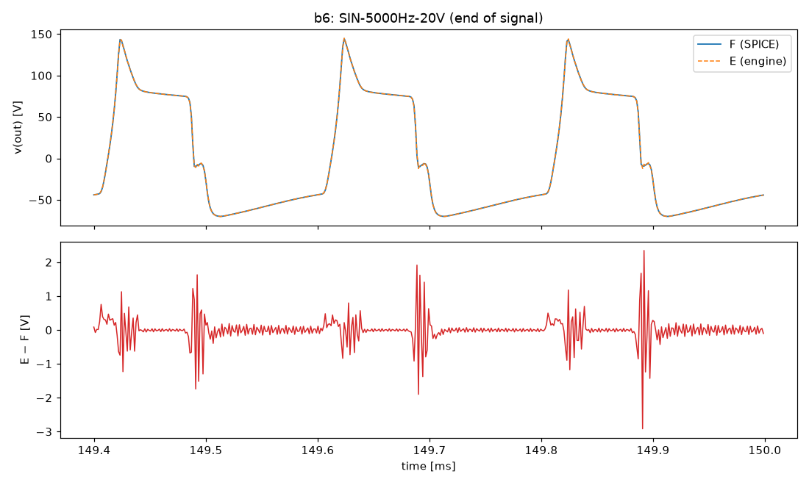
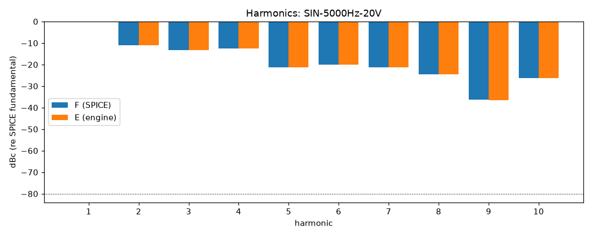

# M4 report: b6 / DEFAULT

- Block: B6 PowerStage, driven by recorded PI outputs
- Preset: DEFAULT — Default knobs; standard signal set at the block levels
- Knobs: preampVolume=0.6, treble=0.5, middle=0.5, bass=0.5, master=0.3, presence=0.5
- Date: 2026-10-19
- Engine commit: `ecf9042 (dirty)`
- Testbench: `harness/testbenches/b6.cir` sha256 `65ebb460f9cac218`; netlist sha256 `ffd9b2812204248f`; tubes.lib sha256 `c9c9c88346c69010`
- ngspice 47, fs = 768000 Hz, SPICE reltol 1e-08

> SWP-lo-0.1V b56: source run rendered at RELTOL 1e-07 (timestep too small at 1e-08)
> SWP-lo-0.1V rendered at RELTOL 1e-07 (ngspice: timestep too small at 1e-08)

## Summary

PASS 97 · FAIL 0 · INFO 24 (INFO = measured, not scored in M4)

| Check | Item | Measured | Tolerance | Status |
|---|---|---|---|---|
| dc_rel_error | v(g4) | 4.919e-07 | ≤ 0.005 | PASS |
| dc_rel_error | v(g5) | 4.919e-07 | ≤ 0.005 | PASS |
| dc_rel_error | v(g6) | 4.919e-07 | ≤ 0.005 | PASS |
| dc_rel_error | v(g7) | 4.919e-07 | ≤ 0.005 | PASS |
| dc_rel_error | v(nbias) | 4.636e-08 | ≤ 0.005 | PASS |
| dc_rel_error | v(ngn) | 4.863e-07 | ≤ 0.005 | PASS |
| dc_rel_error | v(nor) | 4.863e-07 | ≤ 0.005 | PASS |
| dc_rel_error | v(out) | 3.067e-09 | ≤ 0.005 | PASS |
| dc_rel_error | v(p3a) | 1.345e-09 | ≤ 0.005 | PASS |
| dc_rel_error | v(p3b) | 7.844e-10 | ≤ 0.005 | PASS |
| dc_rel_error | v(pa) | 3.492e-08 | ≤ 0.005 | PASS |
| dc_rel_error | v(pa1) | 4.634e-11 | ≤ 0.005 | PASS |
| dc_rel_error | v(pb) | 3.764e-08 | ≤ 0.005 | PASS |
| dc_rel_error | v(pb1) | 4.633e-11 | ≤ 0.005 | PASS |
| dc_rel_error | v(s4) | 1.509e-08 | ≤ 0.005 | PASS |
| dc_rel_error | v(s6) | 1.51e-08 | ≤ 0.005 | PASS |
| dc_rel_error | v(sl) | 1.729e-11 | ≤ 0.005 | PASS |
| nonlinear_esr_db | SIN-100Hz-0.1V | -93.97 dB | ≤ -20 | PASS |
| harmonics_2_5_db | SIN-100Hz-0.1V | 0.0001923 dB | ≤ 0.5 | PASS |
| thd_pp | SIN-100Hz-0.1V | 2.066e-07 pp | — | INFO |
| total_power_rel | SIN-100Hz-0.1V | 3.047e-05 | ≤ 0.05 | INFO |
| newton_failures | SIN-100Hz-0.1V | 0 | ≤ 0 | PASS |
| newton_median_iterations | SIN-100Hz-0.1V | 1 | ≤ 3 | PASS |
| newton_max_iterations | SIN-100Hz-0.1V | 1 | ≤ 12 | PASS |
| nonlinear_esr_db | SIN-1000Hz-0.1V | -80.69 dB | ≤ -20 | PASS |
| harmonics_2_5_db | SIN-1000Hz-0.1V | 0.0005399 dB | ≤ 0.5 | PASS |
| thd_pp | SIN-1000Hz-0.1V | 8.409e-06 pp | — | INFO |
| total_power_rel | SIN-1000Hz-0.1V | 3.543e-05 | ≤ 0.05 | INFO |
| newton_failures | SIN-1000Hz-0.1V | 0 | ≤ 0 | PASS |
| newton_median_iterations | SIN-1000Hz-0.1V | 1 | ≤ 3 | PASS |
| newton_max_iterations | SIN-1000Hz-0.1V | 1 | ≤ 12 | PASS |
| nonlinear_esr_db | SIN-5000Hz-0.1V | -66.19 dB | ≤ -20 | PASS |
| harmonics_2_5_db | SIN-5000Hz-0.1V | 0.004325 dB | ≤ 0.5 | PASS |
| thd_pp | SIN-5000Hz-0.1V | 2.394e-05 pp | — | INFO |
| total_power_rel | SIN-5000Hz-0.1V | 0.0006316 | ≤ 0.05 | INFO |
| newton_failures | SIN-5000Hz-0.1V | 0 | ≤ 0 | PASS |
| newton_median_iterations | SIN-5000Hz-0.1V | 1 | ≤ 3 | PASS |
| newton_max_iterations | SIN-5000Hz-0.1V | 1 | ≤ 12 | PASS |
| nonlinear_esr_db | SIN-100Hz-1V | -93.84 dB | ≤ -20 | PASS |
| harmonics_2_5_db | SIN-100Hz-1V | 0.0004289 dB | ≤ 0.5 | PASS |
| thd_pp | SIN-100Hz-1V | 2.908e-06 pp | — | INFO |
| total_power_rel | SIN-100Hz-1V | 3.114e-05 | ≤ 0.05 | INFO |
| newton_failures | SIN-100Hz-1V | 0 | ≤ 0 | PASS |
| newton_median_iterations | SIN-100Hz-1V | 1 | ≤ 3 | PASS |
| newton_max_iterations | SIN-100Hz-1V | 1 | ≤ 12 | PASS |
| nonlinear_esr_db | SIN-1000Hz-1V | -80.25 dB | ≤ -20 | PASS |
| harmonics_2_5_db | SIN-1000Hz-1V | 0.004216 dB | ≤ 0.5 | PASS |
| thd_pp | SIN-1000Hz-1V | 0.0001549 pp | — | INFO |
| total_power_rel | SIN-1000Hz-1V | 4.199e-05 | ≤ 0.05 | INFO |
| newton_failures | SIN-1000Hz-1V | 0 | ≤ 0 | PASS |
| newton_median_iterations | SIN-1000Hz-1V | 2 | ≤ 3 | PASS |
| newton_max_iterations | SIN-1000Hz-1V | 2 | ≤ 12 | PASS |
| nonlinear_esr_db | SIN-5000Hz-1V | -65.87 dB | ≤ -20 | PASS |
| harmonics_2_5_db | SIN-5000Hz-1V | 0.01796 dB | ≤ 0.5 | PASS |
| thd_pp | SIN-5000Hz-1V | 7.348e-05 pp | — | INFO |
| total_power_rel | SIN-5000Hz-1V | 0.0006695 | ≤ 0.05 | INFO |
| newton_failures | SIN-5000Hz-1V | 0 | ≤ 0 | PASS |
| newton_median_iterations | SIN-5000Hz-1V | 2 | ≤ 3 | PASS |
| newton_max_iterations | SIN-5000Hz-1V | 2 | ≤ 12 | PASS |
| nonlinear_esr_db | SIN-100Hz-5V | -96.77 dB | ≤ -20 | PASS |
| harmonics_2_5_db | SIN-100Hz-5V | 0.0004405 dB | ≤ 0.5 | PASS |
| thd_pp | SIN-100Hz-5V | 9.023e-05 pp | — | INFO |
| total_power_rel | SIN-100Hz-5V | 1.316e-05 | ≤ 0.05 | INFO |
| newton_failures | SIN-100Hz-5V | 0 | ≤ 0 | PASS |
| newton_median_iterations | SIN-100Hz-5V | 1 | ≤ 3 | PASS |
| newton_max_iterations | SIN-100Hz-5V | 2 | ≤ 12 | PASS |
| nonlinear_esr_db | SIN-1000Hz-5V | -72.5 dB | ≤ -20 | PASS |
| harmonics_2_5_db | SIN-1000Hz-5V | 0.005786 dB | ≤ 0.5 | PASS |
| thd_pp | SIN-1000Hz-5V | 0.003782 pp | — | INFO |
| total_power_rel | SIN-1000Hz-5V | 2.637e-05 | ≤ 0.05 | INFO |
| newton_failures | SIN-1000Hz-5V | 0 | ≤ 0 | PASS |
| newton_median_iterations | SIN-1000Hz-5V | 2 | ≤ 3 | PASS |
| newton_max_iterations | SIN-1000Hz-5V | 5 | ≤ 12 | PASS |
| nonlinear_esr_db | SIN-5000Hz-5V | -61.44 dB | ≤ -20 | PASS |
| harmonics_2_5_db | SIN-5000Hz-5V | 0.02523 dB | ≤ 0.5 | PASS |
| thd_pp | SIN-5000Hz-5V | 0.02407 pp | — | INFO |
| total_power_rel | SIN-5000Hz-5V | 0.0003556 | ≤ 0.05 | INFO |
| newton_failures | SIN-5000Hz-5V | 0 | ≤ 0 | PASS |
| newton_median_iterations | SIN-5000Hz-5V | 3 | ≤ 3 | PASS |
| newton_max_iterations | SIN-5000Hz-5V | 5 | ≤ 12 | PASS |
| nonlinear_esr_db_overdrive | SIN-100Hz-20V | -92.04 dB | ≤ -20 | PASS |
| harmonics_2_5_db | SIN-100Hz-20V | 0.0007905 dB | ≤ 0.5 | PASS |
| thd_pp | SIN-100Hz-20V | 5.421e-05 pp | — | INFO |
| total_power_rel | SIN-100Hz-20V | 9.873e-07 | ≤ 0.05 | INFO |
| newton_failures | SIN-100Hz-20V | 0 | ≤ 0 | PASS |
| newton_median_iterations | SIN-100Hz-20V | 1 | ≤ 3 | PASS |
| newton_max_iterations | SIN-100Hz-20V | 5 | ≤ 12 | PASS |
| nonlinear_esr_db_overdrive | SIN-1000Hz-20V | -66.93 dB | ≤ -20 | PASS |
| harmonics_2_5_db | SIN-1000Hz-20V | 0.002626 dB | ≤ 0.5 | PASS |
| thd_pp | SIN-1000Hz-20V | 0.001563 pp | — | INFO |
| total_power_rel | SIN-1000Hz-20V | 2.063e-05 | ≤ 0.05 | INFO |
| newton_failures | SIN-1000Hz-20V | 0 | ≤ 0 | PASS |
| newton_median_iterations | SIN-1000Hz-20V | 2 | ≤ 3 | PASS |
| newton_max_iterations | SIN-1000Hz-20V | 5 | ≤ 12 | PASS |
| nonlinear_esr_db_overdrive | SIN-5000Hz-20V | -44.21 dB | ≤ -20 | PASS |
| harmonics_2_5_db | SIN-5000Hz-20V | 0.05041 dB | ≤ 0.5 | PASS |
| thd_pp | SIN-5000Hz-20V | 0.06374 pp | — | INFO |
| total_power_rel | SIN-5000Hz-20V | 0.0004657 | ≤ 0.05 | INFO |
| newton_failures | SIN-5000Hz-20V | 0 | ≤ 0 | PASS |
| newton_median_iterations | SIN-5000Hz-20V | 3 | ≤ 3 | PASS |
| newton_max_iterations | SIN-5000Hz-20V | 7 | ≤ 12 | PASS |
| nonlinear_esr_db | SWP-lo-0.1V | -62.33 dB | ≤ -20 | PASS |
| newton_failures | SWP-lo-0.1V | 0 | ≤ 0 | PASS |
| newton_median_iterations | SWP-lo-0.1V | 1 | ≤ 3 | PASS |
| newton_max_iterations | SWP-lo-0.1V | 2 | ≤ 12 | PASS |
| nonlinear_esr_db | SWP-hi-1V | -62.11 dB | ≤ -20 | PASS |
| newton_failures | SWP-hi-1V | 0 | ≤ 0 | PASS |
| newton_median_iterations | SWP-hi-1V | 1 | ≤ 3 | PASS |
| newton_max_iterations | SWP-hi-1V | 2 | ≤ 12 | PASS |
| nonlinear_esr_db | TT-0.5V | -91.95 dB | ≤ -20 | PASS |
| newton_failures | TT-0.5V | 0 | ≤ 0 | PASS |
| newton_median_iterations | TT-0.5V | 1 | ≤ 3 | PASS |
| newton_max_iterations | TT-0.5V | 1 | ≤ 12 | PASS |
| nonlinear_esr_db | BURST-5V | -72.49 dB | ≤ -20 | PASS |
| newton_failures | BURST-5V | 0 | ≤ 0 | PASS |
| newton_median_iterations | BURST-5V | 1 | ≤ 3 | PASS |
| newton_max_iterations | BURST-5V | 5 | ≤ 12 | PASS |
| nonlinear_esr_db | STEP-1V | -79.95 dB | ≤ -20 | PASS |
| newton_failures | STEP-1V | 0 | ≤ 0 | PASS |
| newton_median_iterations | STEP-1V | 1 | ≤ 3 | PASS |
| newton_max_iterations | STEP-1V | 2 | ≤ 12 | PASS |

## Signals

| Signal | Peak F [V] | ESR [dB] | Best lag | ESR at lag [dB] | THD F / E [%] | Power F / E [W] | ns/sample | Newton fail / median / max it |
|---|---|---|---|---|---|---|---|---|
| SIN-100Hz-0.1V | 1.725 | -93.97 | 0 | -93.97 | 0.03 / 0.03 | 0.08881 / 0.08881 | 461.2 | 0 / 1 / 1 |
| SIN-1000Hz-0.1V | 1.171 | -80.69 | 0 | -80.69 | 0.194 / 0.194 | 0.03997 / 0.03997 | 487.7 | 0 / 1 / 1 |
| SIN-5000Hz-0.1V | 1.777 | -66.19 | 0 | -66.19 | 0.13 / 0.13 | 0.09674 / 0.0968 | 492.0 | 0 / 1 / 1 |
| SIN-100Hz-1V | 17.31 | -93.84 | 0 | -93.84 | 0.308 / 0.308 | 8.87 / 8.87 | 470.4 | 0 / 1 / 1 |
| SIN-1000Hz-1V | 12.53 | -80.25 | 0 | -80.25 | 2.58 / 2.58 | 4.184 / 4.184 | 621.8 | 0 / 2 / 2 |
| SIN-5000Hz-1V | 18.07 | -65.87 | 0 | -65.87 | 1.27 / 1.27 | 9.717 / 9.723 | 662.4 | 0 / 2 / 2 |
| SIN-100Hz-5V | 82.21 | -96.77 | 0 | -96.77 | 2.37 / 2.37 | 211.1 / 211.1 | 500.8 | 0 / 1 / 2 |
| SIN-1000Hz-5V | 69.47 | -72.50 | 0 | -72.50 | 12 / 12 | 100.7 / 100.7 | 647.7 | 0 / 2 / 5 |
| SIN-5000Hz-5V | 81 | -61.44 | 0 | -61.44 | 11.2 / 11.2 | 213.2 / 213.1 | 827.6 | 0 / 3 / 5 |
| SIN-100Hz-20V | 86.47 | -92.04 | 0 | -92.04 | 21.2 / 21.2 | 251.6 / 251.6 | 510.8 | 0 / 1 / 5 |
| SIN-1000Hz-20V | 106.1 | -66.93 | 0 | -66.93 | 58.7 / 58.7 | 137.5 / 137.5 | 597.2 | 0 / 2 / 5 |
| SIN-5000Hz-20V | 144.7 | -44.21 | 0 | -44.21 | 46.1 / 46.1 | 286.2 / 286.1 | 821.4 | 0 / 3 / 7 |
| SWP-lo-0.1V | 1.865 | -62.33 | 0 | -62.33 | — | — | 480.0 | 0 / 1 / 2 |
| SWP-hi-1V | 18.83 | -62.11 | 0 | -62.11 | — | — | 565.7 | 0 / 1 / 2 |
| TT-0.5V | 11.82 | -91.95 | 0 | -91.95 | — | — | 483.7 | 0 / 1 / 1 |
| BURST-5V | 69.4 | -72.49 | 0 | -72.49 | — | — | 560.2 | 0 / 1 / 5 |
| STEP-1V | 20.76 | -79.95 | 0 | -79.95 | — | — | 480.2 | 0 / 1 / 2 |

## DC operating point

| Node | SPICE [V] | Engine [V] | Rel. error |
|---|---|---|---|
| c20 | -60.0000 | — | — |
| g4 | -46.3631 | -46.3631 | 4.919e-07 |
| g5 | -46.3631 | -46.3631 | 4.919e-07 |
| g6 | -46.3631 | -46.3631 | 4.919e-07 |
| g7 | -46.3631 | -46.3631 | 4.919e-07 |
| nbias | -46.3636 | -46.3636 | 4.636e-08 |
| ngn | -46.3631 | -46.3631 | 4.863e-07 |
| nor | -46.3631 | -46.3631 | 4.863e-07 |
| nrv | -3.6364 | — | — |
| out | 0.0000 | -0.0000 | 3.067e-09 |
| p3a | 272.6113 | 272.6113 | 1.345e-09 |
| p3b | 263.9512 | 263.9512 | 7.844e-10 |
| pa | 490.4628 | 490.4628 | 3.492e-08 |
| pa1 | 491.3466 | 491.3466 | 4.634e-11 |
| pb | 490.3937 | 490.3937 | 3.764e-08 |
| pb1 | 491.3466 | 491.3466 | 4.633e-11 |
| s4 | 485.6164 | 485.6164 | 1.509e-08 |
| s5 | 485.6164 | — | — |
| s6 | 485.6162 | 485.6162 | 1.51e-08 |
| s7 | 485.6162 | — | — |
| sl | 0.0000 | 0.0000 | 1.729e-11 |
| spk1 | 0.0000 | — | — |
| spk2 | 0.0000 | — | — |

Engine values are the probe values after the first sample (zero input) following `reset()`. Nodes the engine does not probe yet show —.

## Figures

### Waveform overlay and error (most demanding signal)

### Harmonics

